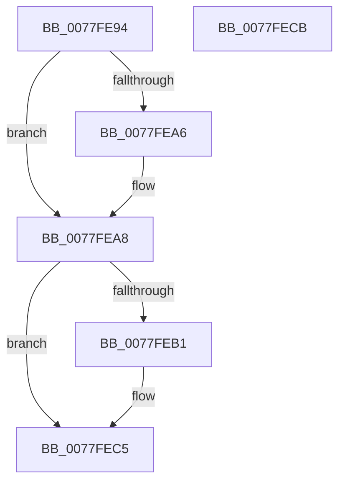

# PspDeleteSilo

- RVA: `0x0077FE94`–`0x0077FECC` (길이 `56` bytes)
- VA: `0x000000014077FE94`
- 실행 섹션: `PAGE`
- PDB 이름 있음: `예`; PDB Function 태그: `아니요`
- unwind 정보 RVA: `0x0005CF00`
- 디코드: `16`개 명령, `56/56` bytes 표시
- 미해석 바이트: `0` (있으면 어셈블리에 `.byte`로 보존)

> 이 문서는 커널 이미지의 기계어와 PDB 기호를 분석해 생성했습니다. 4번과 5번은 함수 원형과 자료형을 바이너리 사용 방식에서 추정한 C 해석이며 원본 소스 복구 결과는 아닙니다.

## 1. Dependencies

- 직접 호출 지점: **2**; 고유 호출 대상: **2**
- 직접 호출자로 확인된 함수: **1**
- RIP 상대 이미지 참조: **0**

### Outgoing calls
- `0x0077FEA8` → [PsIsServerSilo](../../text/22/PsIsServerSilo_function_00225828.md) (function, `0x00225828`)
- `0x0077FEB8` → [PspDeleteServerSiloGlobals](PspDeleteServerSiloGlobals_function_0077FC54.md) (function, `0x0077FC54`)

### Direct callers
- [PspJobDelete](../../text/4B/PspJobDelete_function_004BF8F0.md) at `0x004BFC10`

### Static image references
- 디코드된 RIP-relative 메모리 참조가 없습니다.

## 2. Other-region calls and transfers

- 다른 실행 섹션으로 향하는 call: **1**
  - `0x0077FEA8` → [PsIsServerSilo](../../text/22/PsIsServerSilo_function_00225828.md) (`PAGE` → `.text`)
- 별도 외부 분기/꼬리 이동을 확인하지 못했습니다.

## 3. Assembly (complete function range)

```asm
0077FE94  40 53                           push rbx
0077FE96  48 83 EC 20                     sub rsp, 0x20
0077FE9A  83 B9 D8 00 00 00 00            cmp dword ptr [rcx + 0xd8], 0
0077FEA1  48 8B D9                        mov rbx, rcx
0077FEA4  74 02                           je 0x14077fea8
0077FEA6  CD 2C                           int 0x2c
0077FEA8  E8 7B 59 AA FF                  call 0x140225828
0077FEAD  84 C0                           test al, al
0077FEAF  74 14                           je 0x14077fec5
0077FEB1  48 8B 89 E0 05 00 00            mov rcx, qword ptr [rcx + 0x5e0]
0077FEB8  E8 97 FD FF FF                  call 0x14077fc54
0077FEBD  48 83 A3 E0 05 00 00 00         and qword ptr [rbx + 0x5e0], 0
0077FEC5  48 83 C4 20                     add rsp, 0x20
0077FEC9  5B                              pop rbx
0077FECA  C3                              ret
0077FECB  CC                              int3
```

## 4. C-style interpretation (structured pseudocode)

```c
__int64 __fastcall PspDeleteSilo(__int64 a1)
{
    __int64 result;
    __int64 v_rsp;

    v_rsp = (v_rsp) - (32);
    if ((*(unsigned int *)(a1 + 216)) != 0) {
    }
    result = PsIsServerSilo(a1, a2, a3, a4);
    if ((unsigned __int8)(result) != 0) {
        a1 = *(unsigned __int64 *)(a1 + 1504);
        result = PspDeleteServerSiloGlobals(a1, a2, a3, a4);
    }
    v_rsp = (v_rsp) + (32);
    return result;
}
```

## 5. (Beta) C Style

```c
int64_t PspDeleteSilo(void *Arg1)
{
    uint8_t *arg1 = (uint8_t *)Arg1;

    int64_t result;
    int64_t local_rsp;

    local_rsp = (local_rsp) - (32);
    if ((*(uint32_t *)(arg1 + 0xD8)) != 0) {
    }
    result = PsIsServerSilo(Arg1, a2, a3, a4);
    if ((uint8_t)(result) != 0) {
        Arg1 = *(uint64_t *)(arg1 + 0x5E0);
        result = PspDeleteServerSiloGlobals(Arg1, a2, a3, a4);
    }
    local_rsp = (local_rsp) + (32);
    return result;
}
```

### 관측된 메모리 오프셋

구조체 형식이 확인되지 않은 접근은 인자 기준의 오프셋으로만 기록했습니다.

| 기준 인자 | 오프셋 표현 | 폭 (bit) | 접근 |
|---|---:|---:|---|
| `Arg1` | `+ 0xD8` | `32` | `R` |
| `Arg1` | `+ 0x5E0` | `64` | `R/W` |

## 6. Execution-region graph

[열기: 2D/3D 그래프와 함수 탐색 컨트롤 패널](../../../control-panel.html?section=page&rva=0x0077FE94&view=graph)

- 2D 그래프는 위에서 아래로 흐르고, 3D 그래프는 빈 공간을 드래그해 회전합니다. Shift+드래그는 이동, 휠은 확대·축소, 함수 노드 선택은 대상 보고서 이동입니다.

### Static fallback


