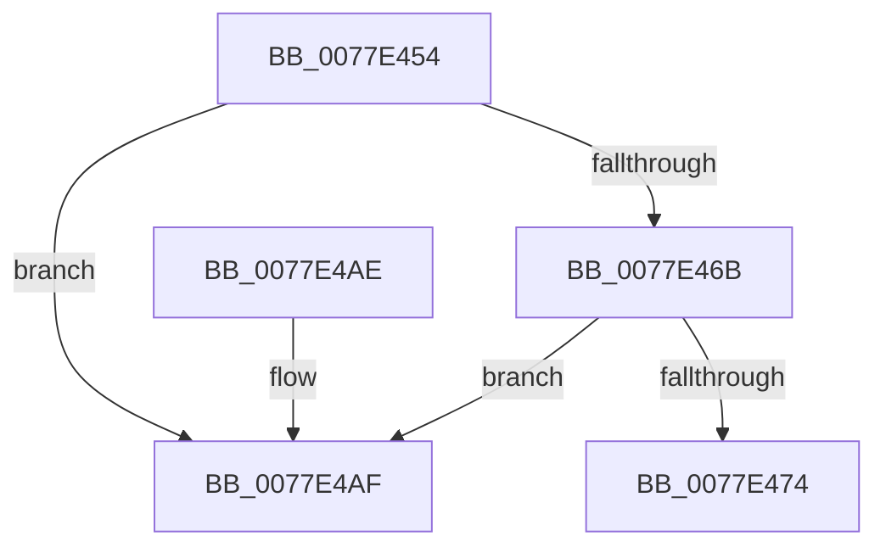

# PspDestroySyscallProvider

- RVA: `0x0077E454`–`0x0077E4B6` (길이 `98` bytes)
- VA: `0x000000014077E454`
- 실행 섹션: `PAGE`
- PDB 이름 있음: `예`; PDB Function 태그: `아니요`
- unwind 정보 RVA: `0x0005DAC8`
- 디코드: `28`개 명령, `98/98` bytes 표시
- 미해석 바이트: `0` (있으면 어셈블리에 `.byte`로 보존)

> 이 문서는 커널 이미지의 기계어와 PDB 기호를 분석해 생성했습니다. 4번과 5번은 함수 원형과 자료형을 바이너리 사용 방식에서 추정한 C 해석이며 원본 소스 복구 결과는 아닙니다.

## 1. Dependencies

- 직접 호출 지점: **5**; 고유 호출 대상: **5**
- 직접 호출자로 확인된 함수: **1**
- RIP 상대 이미지 참조: **0**

### Outgoing calls
- `0x0077E45D` → [PspAcquireSyscallProviderRegistrationLockExclusive](../../text/5E/PspAcquireSyscallProviderRegistrationLockExclusive_function_005E2284.md) (function, `0x005E2284`)
- `0x0077E47B` → [PspReleaseSyscallProviderRegistrationLockExclusive](../../text/5E/PspReleaseSyscallProviderRegistrationLockExclusive_function_005E2438.md) (function, `0x005E2438`)
- `0x0077E488` → [VslRevokeSyscallProviderServiceTables](../71/VslRevokeSyscallProviderServiceTables_function_007195B0.md) (function, `0x007195B0`)
- `0x0077E496` → [ObfDereferenceObjectWithTag](../../text/2F/ObfDereferenceObjectWithTag_function_002F78E0.md) (function, `0x002F78E0`)
- `0x0077E4A3` → [ExFreePoolWithTag](../../poolcode/B8/ExFreePoolWithTag_function_00B82870.md) (function, `0x00B82870`)

### Direct callers
- [PspDereferenceSyscallProvider](../../text/5E/PspDereferenceSyscallProvider_function_005E22E8.md) at `0x005E230A`

### Static image references
- 디코드된 RIP-relative 메모리 참조가 없습니다.

## 2. Other-region calls and transfers

- 다른 실행 섹션으로 향하는 call: **4**
  - `0x0077E45D` → [PspAcquireSyscallProviderRegistrationLockExclusive](../../text/5E/PspAcquireSyscallProviderRegistrationLockExclusive_function_005E2284.md) (`PAGE` → `.text`)
  - `0x0077E47B` → [PspReleaseSyscallProviderRegistrationLockExclusive](../../text/5E/PspReleaseSyscallProviderRegistrationLockExclusive_function_005E2438.md) (`PAGE` → `.text`)
  - `0x0077E496` → [ObfDereferenceObjectWithTag](../../text/2F/ObfDereferenceObjectWithTag_function_002F78E0.md) (`PAGE` → `.text`)
  - `0x0077E4A3` → [ExFreePoolWithTag](../../poolcode/B8/ExFreePoolWithTag_function_00B82870.md) (`PAGE` → `POOLCODE`)
- 별도 외부 분기/꼬리 이동을 확인하지 못했습니다.

## 3. Assembly (complete function range)

```asm
0077E454  40 53                           push rbx
0077E456  48 83 EC 20                     sub rsp, 0x20
0077E45A  48 8B D9                        mov rbx, rcx
0077E45D  E8 22 3E E6 FF                  call 0x1405e2284
0077E462  48 8B 0B                        mov rcx, qword ptr [rbx]
0077E465  48 39 59 08                     cmp qword ptr [rcx + 8], rbx
0077E469  75 44                           jne 0x14077e4af
0077E46B  48 8B 43 08                     mov rax, qword ptr [rbx + 8]
0077E46F  48 39 18                        cmp qword ptr [rax], rbx
0077E472  75 3B                           jne 0x14077e4af
0077E474  48 89 08                        mov qword ptr [rax], rcx
0077E477  48 89 41 08                     mov qword ptr [rcx + 8], rax
0077E47B  E8 B8 3F E6 FF                  call 0x1405e2438
0077E480  48 8B 4B 20                     mov rcx, qword ptr [rbx + 0x20]
0077E484  48 8B 49 18                     mov rcx, qword ptr [rcx + 0x18]
0077E488  E8 23 B1 F9 FF                  call 0x1407195b0
0077E48D  48 8B 4B 20                     mov rcx, qword ptr [rbx + 0x20]
0077E491  BA 50 73 53 63                  mov edx, 0x63537350
0077E496  E8 45 94 B7 FF                  call 0x1402f78e0
0077E49B  BA 50 73 53 63                  mov edx, 0x63537350
0077E4A0  48 8B CB                        mov rcx, rbx
0077E4A3  E8 C8 43 40 00                  call 0x140b82870
0077E4A8  48 83 C4 20                     add rsp, 0x20
0077E4AC  5B                              pop rbx
0077E4AD  C3                              ret
0077E4AE  CC                              int3
0077E4AF  B9 03 00 00 00                  mov ecx, 3
0077E4B4  CD 29                           int 0x29
```

## 4. C-style interpretation (structured pseudocode)

```c
__int64 __fastcall PspDestroySyscallProvider(__int64 a1)
{
    __int64 result;
    __int64 v_rsp;

    v_rsp = (v_rsp) - (32);
    result = PspAcquireSyscallProviderRegistrationLockExclusive(a1, a2, a3, a4);
    if ((*(unsigned __int64 *)(*(unsigned __int64 *)(a1) + 8)) != a1) goto loc_0077E4AF;
    if ((*(unsigned __int64 *)(*(unsigned __int64 *)(a1 + 8))) != a1) goto loc_0077E4AF;
    *(unsigned __int64 *)(*(unsigned __int64 *)(a1 + 8)) = *(unsigned __int64 *)(a1);
    *(unsigned __int64 *)(*(unsigned __int64 *)(a1) + 8) = *(unsigned __int64 *)(a1 + 8);
    result = PspReleaseSyscallProviderRegistrationLockExclusive(*(unsigned __int64 *)(a1), a2, a3, a4);
    result = VslRevokeSyscallProviderServiceTables(*(unsigned __int64 *)(*(unsigned __int64 *)(a1 + 32) + 24), a2, a3, a4);
    result = ObfDereferenceObjectWithTag(*(unsigned __int64 *)(a1 + 32), (unsigned int)(0x63537350ULL), a3, a4);
    result = ExFreePoolWithTag(a1, (unsigned int)(0x63537350ULL), a3, a4);
    v_rsp = (v_rsp) + (32);
    return result;
loc_0077E4AF:
    return result;
}
```

## 5. (Beta) C Style

```c
int64_t PspDestroySyscallProvider(void *Arg1)
{
    uint8_t *arg1 = (uint8_t *)Arg1;

    int64_t result;
    int64_t local_rsp;

    local_rsp = (local_rsp) - (32);
    result = PspAcquireSyscallProviderRegistrationLockExclusive(Arg1, a2, a3, a4);
    if ((*(uint64_t *)(*(uint64_t *)(arg1) + 0x8)) != Arg1) goto loc_0077E4AF;
    if ((*(uint64_t *)(*(uint64_t *)(arg1 + 0x8))) != Arg1) goto loc_0077E4AF;
    *(uint64_t *)(*(uint64_t *)(arg1 + 0x8)) = *(uint64_t *)(arg1);
    *(uint64_t *)(*(uint64_t *)(arg1) + 0x8) = *(uint64_t *)(arg1 + 0x8);
    result = PspReleaseSyscallProviderRegistrationLockExclusive(*(uint64_t *)(arg1), a2, a3, a4);
    result = VslRevokeSyscallProviderServiceTables(*(uint64_t *)(*(uint64_t *)(arg1 + 0x20) + 0x18), a2, a3, a4);
    result = ObfDereferenceObjectWithTag(*(uint64_t *)(arg1 + 0x20), (uint32_t)(0x63537350ULL), a3, a4);
    result = ExFreePoolWithTag(Arg1, (uint32_t)(0x63537350ULL), a3, a4);
    local_rsp = (local_rsp) + (32);
    return result;
loc_0077E4AF:
    return result;
}
```

### 관측된 메모리 오프셋

구조체 형식이 확인되지 않은 접근은 인자 기준의 오프셋으로만 기록했습니다.

| 기준 인자 | 오프셋 표현 | 폭 (bit) | 접근 |
|---|---:|---:|---|
| `Arg1` | `+ 0x0` | `64` | `R` |
| `Arg1` | `+ 0x8` | `64` | `R` |
| `Arg1` | `+ 0x20` | `64` | `R` |

## 6. Execution-region graph

[열기: 2D/3D 그래프와 함수 탐색 컨트롤 패널](../../../control-panel.html?section=page&rva=0x0077E454&view=graph)

- 2D 그래프는 위에서 아래로 흐르고, 3D 그래프는 빈 공간을 드래그해 회전합니다. Shift+드래그는 이동, 휠은 확대·축소, 함수 노드 선택은 대상 보고서 이동입니다.

### Static fallback


