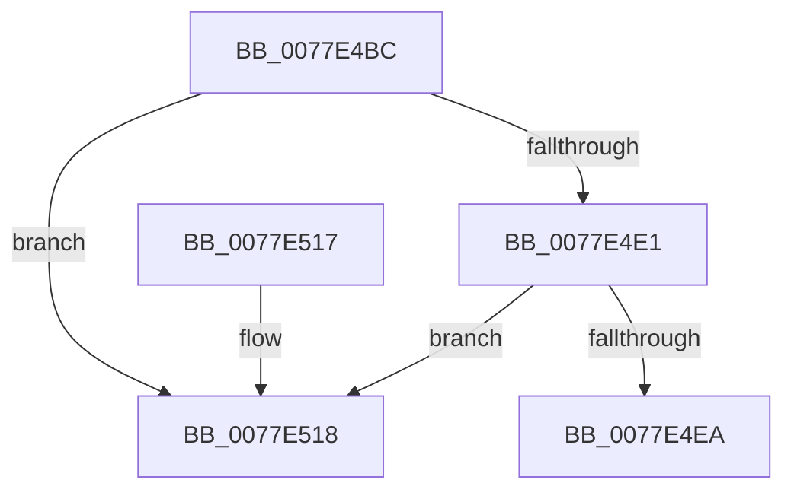

# PspDetachProcessFromSyscallProvider

- RVA: `0x0077E4BC`–`0x0077E51F` (길이 `99` bytes)
- VA: `0x000000014077E4BC`
- 실행 섹션: `PAGE`
- PDB 이름 있음: `예`; PDB Function 태그: `아니요`
- unwind 정보 RVA: `0x0005DAC8`
- 디코드: `25`개 명령, `99/99` bytes 표시
- 미해석 바이트: `0` (있으면 어셈블리에 `.byte`로 보존)

> 이 문서는 커널 이미지의 기계어와 PDB 기호를 분석해 생성했습니다. 4번과 5번은 함수 원형과 자료형을 바이너리 사용 방식에서 추정한 C 해석이며 원본 소스 복구 결과는 아닙니다.

## 1. Dependencies

- 직접 호출 지점: **3**; 고유 호출 대상: **3**
- 직접 호출자로 확인된 함수: **1**
- RIP 상대 이미지 참조: **0**

### Outgoing calls
- `0x0077E4CC` → [PspLockSyscallProviderExclusive](../../text/5E/PspLockSyscallProviderExclusive_function_005E231C.md) (function, `0x005E231C`)
- `0x0077E4F8` → [PspUnlockSyscallProviderExclusive](../../text/5E/PspUnlockSyscallProviderExclusive_function_005E2478.md) (function, `0x005E2478`)
- `0x0077E504` → [PspDereferenceSyscallProvider](../../text/5E/PspDereferenceSyscallProvider_function_005E22E8.md) (function, `0x005E22E8`)

### Direct callers
- [PspProcessDelete](../90/PspProcessDelete_function_00907B90.md) at `0x00908106`

### Static image references
- 디코드된 RIP-relative 메모리 참조가 없습니다.

## 2. Other-region calls and transfers

- 다른 실행 섹션으로 향하는 call: **3**
  - `0x0077E4CC` → [PspLockSyscallProviderExclusive](../../text/5E/PspLockSyscallProviderExclusive_function_005E231C.md) (`PAGE` → `.text`)
  - `0x0077E4F8` → [PspUnlockSyscallProviderExclusive](../../text/5E/PspUnlockSyscallProviderExclusive_function_005E2478.md) (`PAGE` → `.text`)
  - `0x0077E504` → [PspDereferenceSyscallProvider](../../text/5E/PspDereferenceSyscallProvider_function_005E22E8.md) (`PAGE` → `.text`)
- 별도 외부 분기/꼬리 이동을 확인하지 못했습니다.

## 3. Assembly (complete function range)

```asm
0077E4BC  40 53                           push rbx
0077E4BE  48 83 EC 20                     sub rsp, 0x20
0077E4C2  48 8B D9                        mov rbx, rcx
0077E4C5  48 8B 89 B8 07 00 00            mov rcx, qword ptr [rcx + 0x7b8]
0077E4CC  E8 4B 3E E6 FF                  call 0x1405e231c
0077E4D1  48 8D 8B C0 07 00 00            lea rcx, [rbx + 0x7c0]
0077E4D8  48 8B 11                        mov rdx, qword ptr [rcx]
0077E4DB  48 39 4A 08                     cmp qword ptr [rdx + 8], rcx
0077E4DF  75 37                           jne 0x14077e518
0077E4E1  48 8B 41 08                     mov rax, qword ptr [rcx + 8]
0077E4E5  48 39 08                        cmp qword ptr [rax], rcx
0077E4E8  75 2E                           jne 0x14077e518
0077E4EA  48 89 10                        mov qword ptr [rax], rdx
0077E4ED  48 89 42 08                     mov qword ptr [rdx + 8], rax
0077E4F1  48 8B 8B B8 07 00 00            mov rcx, qword ptr [rbx + 0x7b8]
0077E4F8  E8 7B 3F E6 FF                  call 0x1405e2478
0077E4FD  48 8B 8B B8 07 00 00            mov rcx, qword ptr [rbx + 0x7b8]
0077E504  E8 DF 3D E6 FF                  call 0x1405e22e8
0077E509  48 83 A3 B8 07 00 00 00         and qword ptr [rbx + 0x7b8], 0
0077E511  48 83 C4 20                     add rsp, 0x20
0077E515  5B                              pop rbx
0077E516  C3                              ret
0077E517  CC                              int3
0077E518  B9 03 00 00 00                  mov ecx, 3
0077E51D  CD 29                           int 0x29
```

## 4. C-style interpretation (structured pseudocode)

```c
__int64 __fastcall PspDetachProcessFromSyscallProvider(__int64 a1)
{
    __int64 result;
    __int64 v_rsp;

    v_rsp = (v_rsp) - (32);
    result = PspLockSyscallProviderExclusive(*(unsigned __int64 *)(a1 + 1976), a2, a3, a4);
    if ((*(unsigned __int64 *)(*(unsigned __int64 *)(a1 + 1984) + 8)) != (a1 + 1984)) goto loc_0077E518;
    if ((*(unsigned __int64 *)(*(unsigned __int64 *)(a1 + 1984 + 8))) != (a1 + 1984)) goto loc_0077E518;
    *(unsigned __int64 *)(*(unsigned __int64 *)(a1 + 1984 + 8)) = *(unsigned __int64 *)(a1 + 1984);
    *(unsigned __int64 *)(*(unsigned __int64 *)(a1 + 1984) + 8) = *(unsigned __int64 *)(a1 + 1984 + 8);
    result = PspUnlockSyscallProviderExclusive(*(unsigned __int64 *)(a1 + 1976), *(unsigned __int64 *)(a1 + 1984), a3, a4);
    result = PspDereferenceSyscallProvider(*(unsigned __int64 *)(a1 + 1976), *(unsigned __int64 *)(a1 + 1984), a3, a4);
    v_rsp = (v_rsp) + (32);
    return result;
loc_0077E518:
    return result;
}
```

## 5. (Beta) C Style

```c
int64_t PspDetachProcessFromSyscallProvider(void *Arg1)
{
    uint8_t *arg1 = (uint8_t *)Arg1;

    int64_t result;
    int64_t local_rsp;

    local_rsp = (local_rsp) - (32);
    result = PspLockSyscallProviderExclusive(*(uint64_t *)(arg1 + 0x7B8), a2, a3, a4);
    if ((*(uint64_t *)(*(uint64_t *)(arg1 + 0x7C0) + 0x8)) != (Arg1 + 1984)) goto loc_0077E518;
    if ((*(uint64_t *)(*(uint64_t *)(arg1 + 0x7C0 + 0x8))) != (Arg1 + 1984)) goto loc_0077E518;
    *(uint64_t *)(*(uint64_t *)(arg1 + 0x7C0 + 0x8)) = *(uint64_t *)(arg1 + 0x7C0);
    *(uint64_t *)(*(uint64_t *)(arg1 + 0x7C0) + 0x8) = *(uint64_t *)(arg1 + 0x7C0 + 0x8);
    result = PspUnlockSyscallProviderExclusive(*(uint64_t *)(arg1 + 0x7B8), *(uint64_t *)(arg1 + 0x7C0), a3, a4);
    result = PspDereferenceSyscallProvider(*(uint64_t *)(arg1 + 0x7B8), *(uint64_t *)(arg1 + 0x7C0), a3, a4);
    local_rsp = (local_rsp) + (32);
    return result;
loc_0077E518:
    return result;
}
```

### 관측된 메모리 오프셋

구조체 형식이 확인되지 않은 접근은 인자 기준의 오프셋으로만 기록했습니다.

| 기준 인자 | 오프셋 표현 | 폭 (bit) | 접근 |
|---|---:|---:|---|
| `Arg1` | `+ 0x0` | `64` | `R` |
| `Arg1` | `+ 0x8` | `64` | `R` |
| `Arg1` | `+ 0x7B8` | `64` | `R` |
| `Arg1` | `+ 0x7B8` | `64` | `R/W` |
| `Arg1` | `+ 0x7C0` | `64` | `R` |

## 6. Execution-region graph

[열기: 2D/3D 그래프와 함수 탐색 컨트롤 패널](../../../control-panel.html?section=page&rva=0x0077E4BC&view=graph)

- 2D 그래프는 위에서 아래로 흐르고, 3D 그래프는 빈 공간을 드래그해 회전합니다. Shift+드래그는 이동, 휠은 확대·축소, 함수 노드 선택은 대상 보고서 이동입니다.

### Static fallback


