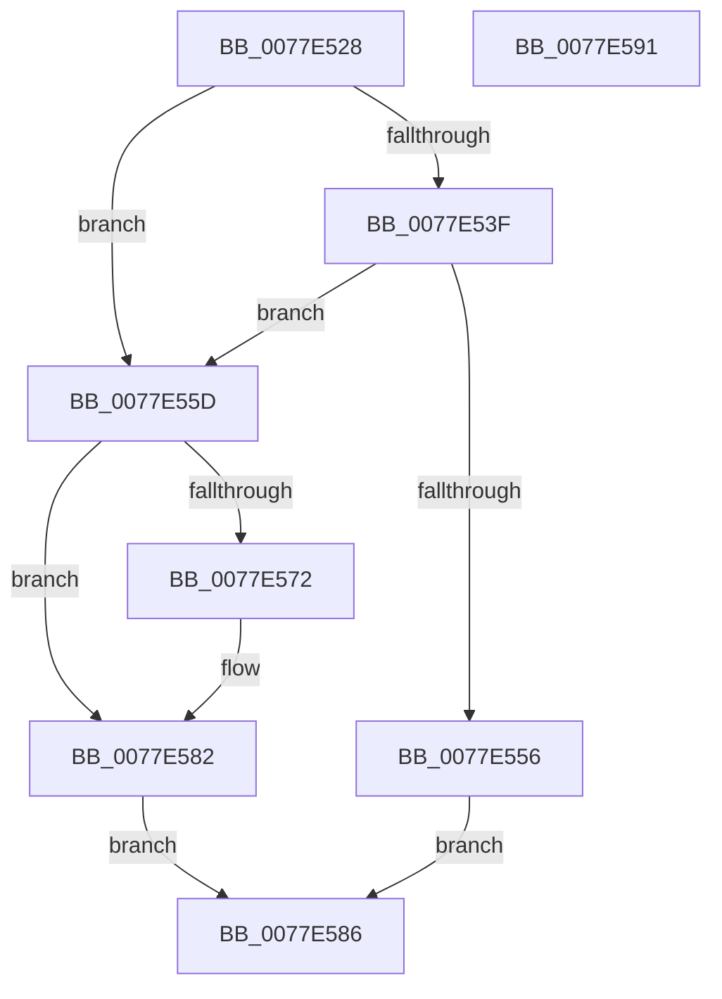

# PspEnsureGuiThreadAndBatchFlush

- RVA: `0x0077E528`–`0x0077E592` (길이 `106` bytes)
- VA: `0x000000014077E528`
- 실행 섹션: `PAGE`
- PDB 이름 있음: `예`; PDB Function 태그: `아니요`
- unwind 정보 RVA: `0x000CDF1C`
- 디코드: `31`개 명령, `106/106` bytes 표시
- 미해석 바이트: `0` (있으면 어셈블리에 `.byte`로 보존)

> 이 문서는 커널 이미지의 기계어와 PDB 기호를 분석해 생성했습니다. 4번과 5번은 함수 원형과 자료형을 바이너리 사용 방식에서 추정한 C 해석이며 원본 소스 복구 결과는 아닙니다.

## 1. Dependencies

- 직접 호출 지점: **2**; 고유 호출 대상: **2**
- 직접 호출자로 확인된 함수: **1**
- RIP 상대 이미지 참조: **0**

### Outgoing calls
- `0x0077E546` → [PsConvertToGuiThread](../A2/PsConvertToGuiThread_function_00A2F8B0.md) (function, `0x00A2F8B0`)
- `0x0077E57D` → [PsInvokeWin32Callout](../91/PsInvokeWin32Callout_function_009133C0.md) (function, `0x009133C0`)

### Direct callers
- [PsSyscallProviderDispatch](../AB/PsSyscallProviderDispatch_function_00AB3D80.md) at `0x00AB3E60`

### Static image references
- 디코드된 RIP-relative 메모리 참조가 없습니다.

## 2. Other-region calls and transfers

- 다른 실행 섹션으로 향하는 call: **0**
- 별도 외부 분기/꼬리 이동을 확인하지 못했습니다.

## 3. Assembly (complete function range)

```asm
0077E528  48 89 5C 24 08                  mov qword ptr [rsp + 8], rbx
0077E52D  57                              push rdi
0077E52E  48 83 EC 30                     sub rsp, 0x30
0077E532  48 8B F9                        mov rdi, rcx
0077E535  8B 41 78                        mov eax, dword ptr [rcx + 0x78]
0077E538  A9 80 00 20 00                  test eax, 0x200080
0077E53D  75 1E                           jne 0x14077e55d
0077E53F  48 8B 99 90 00 00 00            mov rbx, qword ptr [rcx + 0x90]
0077E546  E8 65 13 2B 00                  call 0x140a2f8b0
0077E54B  48 89 9F 90 00 00 00            mov qword ptr [rdi + 0x90], rbx
0077E552  85 C0                           test eax, eax
0077E554  79 07                           jns 0x14077e55d
0077E556  B8 01 00 00 C0                  mov eax, 0xc0000001
0077E55B  EB 29                           jmp 0x14077e586
0077E55D  48 8B 87 F0 00 00 00            mov rax, qword ptr [rdi + 0xf0]
0077E564  8B 80 40 17 00 00               mov eax, dword ptr [rax + 0x1740]
0077E56A  89 44 24 20                     mov dword ptr [rsp + 0x20], eax
0077E56E  85 C0                           test eax, eax
0077E570  74 10                           je 0x14077e582
0077E572  45 33 C9                        xor r9d, r9d
0077E575  45 33 C0                        xor r8d, r8d
0077E578  33 D2                           xor edx, edx
0077E57A  8D 4A 07                        lea ecx, [rdx + 7]
0077E57D  E8 3E 4E 19 00                  call 0x1409133c0
0077E582  33 C0                           xor eax, eax
0077E584  EB 00                           jmp 0x14077e586
0077E586  48 8B 5C 24 40                  mov rbx, qword ptr [rsp + 0x40]
0077E58B  48 83 C4 30                     add rsp, 0x30
0077E58F  5F                              pop rdi
0077E590  C3                              ret
0077E591  CC                              int3
```

## 4. C-style interpretation (structured pseudocode)

```c
__int64 __fastcall PspEnsureGuiThreadAndBatchFlush(__int64 a1, int a2, int a3, int a4)
{
    __int64 result;
    __int64 v_rsp;
    unsigned int v_stack_m18;
    unsigned __int64 v_stack_p8;

    v_stack_p8 = v_rbx;
    v_rsp = (v_rsp) - (48);
    if ((((unsigned int)((unsigned int)(*(unsigned int *)(a1 + 120)))) & (0x200080ULL)) != 0) goto loc_0077E55D;
    result = PsConvertToGuiThread(a1, a2, a3, a4);
    *(unsigned __int64 *)(a1 + 144) = *(unsigned __int64 *)(a1 + 144);
    if (!sign_flag) goto loc_0077E55D;
    goto loc_0077E586;
loc_0077E55D:
    v_stack_m18 = (unsigned int)((unsigned int)(*(unsigned int *)(*(unsigned __int64 *)(a1 + 240) + 5952)));
    result = (unsigned int)(*(unsigned int *)(*(unsigned __int64 *)(a1 + 240) + 5952));
    if ((unsigned int)((unsigned int)(*(unsigned int *)(*(unsigned __int64 *)(a1 + 240) + 5952))) != 0) {
        a4 = 0;
        a3 = 0;
        a2 = 0;
        a1 = a2 + 7;
        result = PsInvokeWin32Callout(a1, a2, a3, a4);
    }
    result = 0;
    goto loc_0077E586;
loc_0077E586:
    v_rsp = (v_rsp) + (48);
    return result;
}
```

## 5. (Beta) C Style

```c
int64_t PspEnsureGuiThreadAndBatchFlush(void *Arg1, int32_t Arg2, int32_t Arg3, int32_t Arg4)
{
    uint8_t *arg1 = (uint8_t *)Arg1;

    int64_t result;
    int64_t local_rsp;
    uint32_t v_stack_m18;
    uint64_t v_stack_p8;

    v_stack_p8 = local_rbx;
    local_rsp = (local_rsp) - (48);
    if ((((uint32_t)((uint32_t)(*(uint32_t *)(arg1 + 0x78)))) & (0x200080ULL)) != 0) goto loc_0077E55D;
    result = PsConvertToGuiThread(Arg1, Arg2, Arg3, Arg4);
    *(uint64_t *)(arg1 + 0x90) = *(uint64_t *)(arg1 + 0x90);
    if (!sign_flag) goto loc_0077E55D;
    goto loc_0077E586;
loc_0077E55D:
    v_stack_m18 = (uint32_t)((uint32_t)(*(uint32_t *)(*(uint64_t *)(arg1 + 0xF0) + 0x1740)));
    result = (uint32_t)(*(uint32_t *)(*(uint64_t *)(arg1 + 0xF0) + 0x1740));
    if ((uint32_t)((uint32_t)(*(uint32_t *)(*(uint64_t *)(arg1 + 0xF0) + 0x1740))) != 0) {
        Arg4 = 0;
        Arg3 = 0;
        Arg2 = 0;
        Arg1 = Arg2 + 7;
        result = PsInvokeWin32Callout(Arg1, Arg2, Arg3, Arg4);
    }
    result = 0;
    goto loc_0077E586;
loc_0077E586:
    local_rsp = (local_rsp) + (48);
    return result;
}
```

### 관측된 메모리 오프셋

구조체 형식이 확인되지 않은 접근은 인자 기준의 오프셋으로만 기록했습니다.

| 기준 인자 | 오프셋 표현 | 폭 (bit) | 접근 |
|---|---:|---:|---|
| `Arg1` | `+ 0x78` | `32` | `R` |
| `Arg1` | `+ 0x90` | `64` | `R` |
| `Arg1` | `+ 0x90` | `64` | `W` |
| `Arg1` | `+ 0xF0` | `64` | `R` |

## 6. Execution-region graph

[열기: 2D/3D 그래프와 함수 탐색 컨트롤 패널](../../../control-panel.html?section=page&rva=0x0077E528&view=graph)

- 2D 그래프는 위에서 아래로 흐르고, 3D 그래프는 빈 공간을 드래그해 회전합니다. Shift+드래그는 이동, 휠은 확대·축소, 함수 노드 선택은 대상 보고서 이동입니다.

### Static fallback


