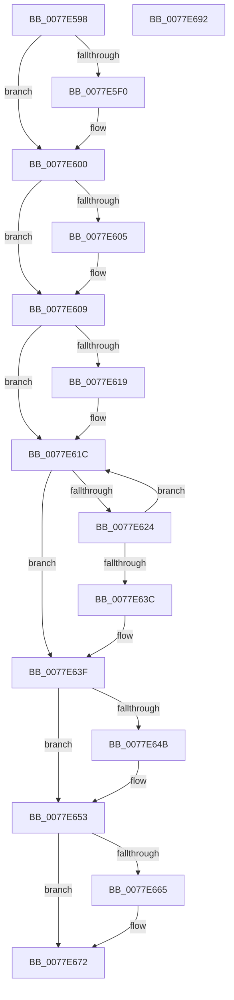

# PspGetNextSyscallProviderProcess

- RVA: `0x0077E598`–`0x0077E693` (길이 `251` bytes)
- VA: `0x000000014077E598`
- 실행 섹션: `PAGE`
- PDB 이름 있음: `예`; PDB Function 태그: `아니요`
- unwind 정보 RVA: `0x00083688`
- 디코드: `75`개 명령, `251/251` bytes 표시
- 미해석 바이트: `0` (있으면 어셈블리에 `.byte`로 보존)

> 이 문서는 커널 이미지의 기계어와 PDB 기호를 분석해 생성했습니다. 4번과 5번은 함수 원형과 자료형을 바이너리 사용 방식에서 추정한 C 해석이며 원본 소스 복구 결과는 아닙니다.

## 1. Dependencies

- 직접 호출 지점: **7**; 고유 호출 대상: **7**
- 직접 호출자로 확인된 함수: **1**
- RIP 상대 이미지 참조: **0**

### Outgoing calls
- `0x0077E5DA` → [KeAbPreAcquire](../../text/21/KeAbPreAcquire_function_00210230.md) (function, `0x00210230`)
- `0x0077E5FB` → [ExfAcquirePushLockSharedEx](../../text/21/ExfAcquirePushLockSharedEx_function_0021044C.md) (function, `0x0021044C`)
- `0x0077E633` → [ObReferenceObjectSafeWithTag](../../text/21/ObReferenceObjectSafeWithTag_function_00210EE0.md) (function, `0x00210EE0`)
- `0x0077E64E` → [ExfReleasePushLockShared](../../text/26/ExfReleasePushLockShared_function_00263440.md) (function, `0x00263440`)
- `0x0077E656` → [KeAbPostRelease](../../text/2E/KeAbPostRelease_function_002E1600.md) (function, `0x002E1600`)
- `0x0077E65B` → [KeLeaveCriticalRegion](../../text/25/KeLeaveCriticalRegion_function_0025D8B0.md) (function, `0x0025D8B0`)
- `0x0077E66D` → [ObfDereferenceObjectWithTag](../../text/2F/ObfDereferenceObjectWithTag_function_002F78E0.md) (function, `0x002F78E0`)

### Direct callers
- [PspQuerySyscallProviderProcessList](PspQuerySyscallProviderProcessList_function_0077E710.md) at `0x0077E762`

### Static image references
- 디코드된 RIP-relative 메모리 참조가 없습니다.

## 2. Other-region calls and transfers

- 다른 실행 섹션으로 향하는 call: **7**
  - `0x0077E5DA` → [KeAbPreAcquire](../../text/21/KeAbPreAcquire_function_00210230.md) (`PAGE` → `.text`)
  - `0x0077E5FB` → [ExfAcquirePushLockSharedEx](../../text/21/ExfAcquirePushLockSharedEx_function_0021044C.md) (`PAGE` → `.text`)
  - `0x0077E633` → [ObReferenceObjectSafeWithTag](../../text/21/ObReferenceObjectSafeWithTag_function_00210EE0.md) (`PAGE` → `.text`)
  - `0x0077E64E` → [ExfReleasePushLockShared](../../text/26/ExfReleasePushLockShared_function_00263440.md) (`PAGE` → `.text`)
  - `0x0077E656` → [KeAbPostRelease](../../text/2E/KeAbPostRelease_function_002E1600.md) (`PAGE` → `.text`)
  - `0x0077E65B` → [KeLeaveCriticalRegion](../../text/25/KeLeaveCriticalRegion_function_0025D8B0.md) (`PAGE` → `.text`)
  - `0x0077E66D` → [ObfDereferenceObjectWithTag](../../text/2F/ObfDereferenceObjectWithTag_function_002F78E0.md) (`PAGE` → `.text`)
- 별도 외부 분기/꼬리 이동을 확인하지 못했습니다.

## 3. Assembly (complete function range)

```asm
0077E598  48 89 5C 24 10                  mov qword ptr [rsp + 0x10], rbx
0077E59D  48 89 6C 24 18                  mov qword ptr [rsp + 0x18], rbp
0077E5A2  56                              push rsi
0077E5A3  57                              push rdi
0077E5A4  41 54                           push r12
0077E5A6  41 56                           push r14
0077E5A8  41 57                           push r15
0077E5AA  48 83 EC 20                     sub rsp, 0x20
0077E5AE  65 48 8B 04 25 88 01 00 00      mov rax, qword ptr gs:[0x188]
0077E5B7  48 8D 59 40                     lea rbx, [rcx + 0x40]
0077E5BB  48 8B F2                        mov rsi, rdx
0077E5BE  48 8B E9                        mov rbp, rcx
0077E5C1  45 33 E4                        xor r12d, r12d
0077E5C4  45 33 C0                        xor r8d, r8d
0077E5C7  33 D2                           xor edx, edx
0077E5C9  48 8B CB                        mov rcx, rbx
0077E5CC  66 FF 88 E4 01 00 00            dec word ptr [rax + 0x1e4]
0077E5D3  45 8B FC                        mov r15d, r12d
0077E5D6  90                              nop
0077E5D7  45 8A F4                        mov r14b, r12b
0077E5DA  E8 51 1C A9 FF                  call 0x140210230
0077E5DF  48 8B F8                        mov rdi, rax
0077E5E2  41 8D 4C 24 11                  lea ecx, [r12 + 0x11]
0077E5E7  33 C0                           xor eax, eax
0077E5E9  F0 48 0F B1 0B                  lock cmpxchg qword ptr [rbx], rcx
0077E5EE  74 10                           je 0x14077e600
0077E5F0  4C 8B CB                        mov r9, rbx
0077E5F3  4C 8B C7                        mov r8, rdi
0077E5F6  33 D2                           xor edx, edx
0077E5F8  48 8B CB                        mov rcx, rbx
0077E5FB  E8 4C 1E A9 FF                  call 0x14021044c
0077E600  48 85 FF                        test rdi, rdi
0077E603  74 04                           je 0x14077e609
0077E605  C6 47 0A 01                     mov byte ptr [rdi + 0xa], 1
0077E609  48 83 C5 48                     add rbp, 0x48
0077E60D  48 8D BE C0 07 00 00            lea rdi, [rsi + 0x7c0]
0077E614  48 85 F6                        test rsi, rsi
0077E617  75 03                           jne 0x14077e61c
0077E619  48 8B FD                        mov rdi, rbp
0077E61C  48 8B 3F                        mov rdi, qword ptr [rdi]
0077E61F  48 3B FD                        cmp rdi, rbp
0077E622  74 1B                           je 0x14077e63f
0077E624  4C 8D BF 40 F8 FF FF            lea r15, [rdi - 0x7c0]
0077E62B  BA 50 73 53 63                  mov edx, 0x63537350
0077E630  49 8B CF                        mov rcx, r15
0077E633  E8 A8 28 A9 FF                  call 0x140210ee0
0077E638  84 C0                           test al, al
0077E63A  74 E0                           je 0x14077e61c
0077E63C  41 B6 01                        mov r14b, 1
0077E63F  B8 11 00 00 00                  mov eax, 0x11
0077E644  F0 4C 0F B1 23                  lock cmpxchg qword ptr [rbx], r12
0077E649  74 08                           je 0x14077e653
0077E64B  48 8B CB                        mov rcx, rbx
0077E64E  E8 ED 4D AE FF                  call 0x140263440
0077E653  48 8B CB                        mov rcx, rbx
0077E656  E8 A5 2F B6 FF                  call 0x1402e1600
0077E65B  E8 50 F2 AD FF                  call 0x14025d8b0
0077E660  48 85 F6                        test rsi, rsi
0077E663  74 0D                           je 0x14077e672
0077E665  BA 50 73 53 63                  mov edx, 0x63537350
0077E66A  48 8B CE                        mov rcx, rsi
0077E66D  E8 6E 92 B7 FF                  call 0x1402f78e0
0077E672  48 8B 5C 24 58                  mov rbx, qword ptr [rsp + 0x58]
0077E677  41 F6 DE                        neg r14b
0077E67A  48 8B 6C 24 60                  mov rbp, qword ptr [rsp + 0x60]
0077E67F  48 1B C0                        sbb rax, rax
0077E682  49 23 C7                        and rax, r15
0077E685  48 83 C4 20                     add rsp, 0x20
0077E689  41 5F                           pop r15
0077E68B  41 5E                           pop r14
0077E68D  41 5C                           pop r12
0077E68F  5F                              pop rdi
0077E690  5E                              pop rsi
0077E691  C3                              ret
0077E692  CC                              int3
```

## 4. C-style interpretation (structured pseudocode)

```c
__int64 __fastcall PspGetNextSyscallProviderProcess(__int64 a1, __int64 a2, int a3)
{
    __int64 result;
    __int64 v_r12;
    __int64 v_r14;
    __int64 v_rbp;
    __int64 v_rdi;
    __int64 v_rsp;
    unsigned __int64 v_stack_p10;
    unsigned __int64 v_stack_p18;

    v_stack_p10 = v_rbx;
    v_stack_p18 = v_rbp;
    v_rsp = (v_rsp) - (32);
    v_r12 = 0;
    a3 = 0;
    a2 = 0;
    result = KeAbPreAcquire(a1 + 64, a2, a3, a4);
    result = 0;
    if (!(condition_is_equal)) {
        a4 = a1 + 64;
        a3 = 0;
        a2 = 0;
        a1 = a1 + 64;
        result = ExfAcquirePushLockSharedEx(a1, a2, a3, a4);
    }
    if (result != 0) {
        *(unsigned __int8 *)(result + 10) = 1;
    }
    v_rbp = (a1) + (72);
    v_rdi = a2 + 1984;
    if (0 == 0) {
        v_rdi = v_rbp;
    }
    if ((*(unsigned __int64 *)(v_rdi)) == v_rbp) goto loc_0077E63F;
    result = ObReferenceObjectSafeWithTag(*(unsigned __int64 *)(v_rdi) - 1984, (unsigned int)(0x63537350ULL), a3, a4);
    if ((unsigned __int8)(result) == 0) goto loc_0077E61C;
loc_0077E63F:
    result = 17;
    if ((unsigned __int8)(result) != 0) {
        a1 = a1 + 64;
        result = ExfReleasePushLockShared(a1, (unsigned int)(0x63537350ULL), a3, a4);
    }
    result = KeAbPostRelease(a1 + 64, (unsigned int)(0x63537350ULL), a3, a4);
    result = KeLeaveCriticalRegion(a1 + 64, (unsigned int)(0x63537350ULL), a3, a4);
    if (0 != 0) {
        a2 = 0x63537350ULL;
        a1 = a2;
        result = ObfDereferenceObjectWithTag(a1, a2, a3, a4);
    }
    v_r14 = (unsigned __int8)(-(1));
    result = (result) & (*(unsigned __int64 *)(v_rdi) - 1984);
    v_rsp = (v_rsp) + (32);
    return result;
}
```

## 5. (Beta) C Style

```c
int64_t PspGetNextSyscallProviderProcess(void *Arg1, void *Arg2, int32_t Arg3)
{
    uint8_t *arg1 = (uint8_t *)Arg1;
    uint8_t *arg2 = (uint8_t *)Arg2;

    int64_t result;
    int64_t local_r12;
    int64_t local_r14;
    int64_t local_rbp;
    int64_t local_rdi;
    int64_t local_rsp;
    uint64_t v_stack_p10;
    uint64_t v_stack_p18;

    v_stack_p10 = local_rbx;
    v_stack_p18 = local_rbp;
    local_rsp = (local_rsp) - (32);
    local_r12 = 0;
    Arg3 = 0;
    Arg2 = 0;
    result = KeAbPreAcquire(Arg1 + 64, Arg2, Arg3, a4);
    result = 0;
    if (!(condition_is_equal)) {
        a4 = Arg1 + 64;
        Arg3 = 0;
        Arg2 = 0;
        Arg1 = Arg1 + 64;
        result = ExfAcquirePushLockSharedEx(Arg1, Arg2, Arg3, a4);
    }
    if (result != 0) {
        *(uint8_t *)(result + 0xA) = 1;
    }
    local_rbp = (Arg1) + (72);
    local_rdi = Arg2 + 1984;
    if (0 == 0) {
        local_rdi = local_rbp;
    }
    if ((*(uint64_t *)(local_rdi)) == local_rbp) goto loc_0077E63F;
    result = ObReferenceObjectSafeWithTag(*(uint64_t *)(local_rdi) - 1984, (uint32_t)(0x63537350ULL), Arg3, a4);
    if ((uint8_t)(result) == 0) goto loc_0077E61C;
loc_0077E63F:
    result = 17;
    if ((uint8_t)(result) != 0) {
        Arg1 = Arg1 + 64;
        result = ExfReleasePushLockShared(Arg1, (uint32_t)(0x63537350ULL), Arg3, a4);
    }
    result = KeAbPostRelease(Arg1 + 64, (uint32_t)(0x63537350ULL), Arg3, a4);
    result = KeLeaveCriticalRegion(Arg1 + 64, (uint32_t)(0x63537350ULL), Arg3, a4);
    if (0 != 0) {
        Arg2 = 0x63537350ULL;
        Arg1 = Arg2;
        result = ObfDereferenceObjectWithTag(Arg1, Arg2, Arg3, a4);
    }
    local_r14 = (uint8_t)(-(1));
    result = (result) & (*(uint64_t *)(local_rdi) - 1984);
    local_rsp = (local_rsp) + (32);
    return result;
}
```

### 관측된 메모리 오프셋

구조체 형식이 확인되지 않은 접근은 인자 기준의 오프셋으로만 기록했습니다.

| 기준 인자 | 오프셋 표현 | 폭 (bit) | 접근 |
|---|---:|---:|---|
| `Arg1` | `+ 0x0` | `64` | `R` |
| `Arg1` | `+ 0x40` | `64` | `R` |
| `Arg2` | `+ 0x7C0` | `64` | `R` |

## 6. Execution-region graph

[열기: 2D/3D 그래프와 함수 탐색 컨트롤 패널](../../../control-panel.html?section=page&rva=0x0077E598&view=graph)

- 2D 그래프는 위에서 아래로 흐르고, 3D 그래프는 빈 공간을 드래그해 회전합니다. Shift+드래그는 이동, 휠은 확대·축소, 함수 노드 선택은 대상 보고서 이동입니다.

### Static fallback


