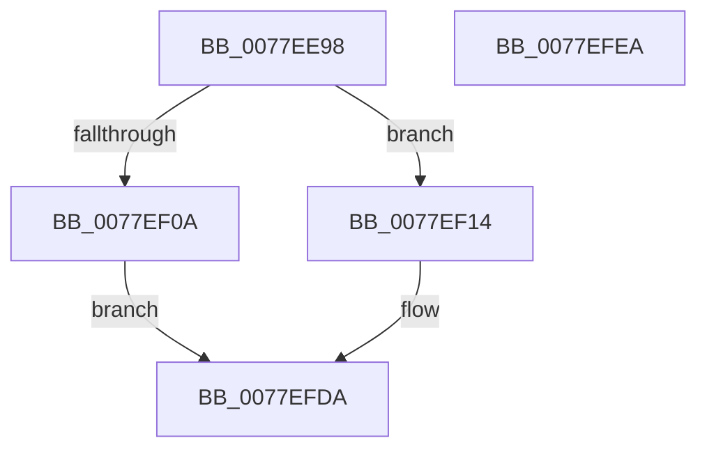

# PspInitializeProtectedProcessParameters

- RVA: `0x0077EE98`–`0x0077EFEB` (길이 `339` bytes)
- VA: `0x000000014077EE98`
- 실행 섹션: `PAGE`
- PDB 이름 있음: `예`; PDB Function 태그: `아니요`
- unwind 정보 RVA: `0x000794E0`
- 디코드: `73`개 명령, `339/339` bytes 표시
- 미해석 바이트: `0` (있으면 어셈블리에 `.byte`로 보존)

> 이 문서는 커널 이미지의 기계어와 PDB 기호를 분석해 생성했습니다. 4번과 5번은 함수 원형과 자료형을 바이너리 사용 방식에서 추정한 C 해석이며 원본 소스 복구 결과는 아닙니다.

## 1. Dependencies

- 직접 호출 지점: **3**; 고유 호출 대상: **2**
- 직접 호출자로 확인된 함수: **2**
- RIP 상대 이미지 참조: **4**

### Outgoing calls
- `0x0077EEF4` → [ExAllocatePool2](../../poolcode/B8/ExAllocatePool2_function_00B820F0.md) (function, `0x00B820F0`)
- `0x0077EF41` → [memcpy](../../text/6C/memcpy_function_006C6840.md) (function, `0x006C6840`)
- `0x0077EFC8` → [memcpy](../../text/6C/memcpy_function_006C6840.md) (function, `0x006C6840`)

### Direct callers
- [PspInitializeServerSiloDeferred](PspInitializeServerSiloDeferred_function_0077FEE0.md) at `0x0077FF3E`
- [PspInitPhase2](../../init/C4/PspInitPhase2_function_00C45460.md) at `0x00C455E1`

### Static image references
- `0x0077EF14` → RVA `0x00B4B5A8` (`PAGE`; read)
- `0x0077EF46` → RVA `0x00B4B598` (`PAGE`; read)
- `0x0077EF69` → RVA `0x00B4B5B8` (`PAGE`; read)
- `0x0077EF93` → RVA `0x00B4B588` (`PAGE`; read)

## 2. Other-region calls and transfers

- 다른 실행 섹션으로 향하는 call: **3**
  - `0x0077EEF4` → [ExAllocatePool2](../../poolcode/B8/ExAllocatePool2_function_00B820F0.md) (`PAGE` → `POOLCODE`)
  - `0x0077EF41` → [memcpy](../../text/6C/memcpy_function_006C6840.md) (`PAGE` → `.text`)
  - `0x0077EFC8` → [memcpy](../../text/6C/memcpy_function_006C6840.md) (`PAGE` → `.text`)
- 별도 외부 분기/꼬리 이동을 확인하지 못했습니다.

## 3. Assembly (complete function range)

```asm
0077EE98  48 89 5C 24 08                  mov qword ptr [rsp + 8], rbx
0077EE9D  48 89 74 24 10                  mov qword ptr [rsp + 0x10], rsi
0077EEA2  57                              push rdi
0077EEA3  48 83 EC 30                     sub rsp, 0x30
0077EEA7  0F 10 81 D0 04 00 00            movups xmm0, xmmword ptr [rcx + 0x4d0]
0077EEAE  48 8B F9                        mov rdi, rcx
0077EEB1  41 B8 50 73 53 6C               mov r8d, 0x6c537350
0077EEB7  F3 0F 7F 81 C8 03 00 00         movdqu xmmword ptr [rcx + 0x3c8], xmm0
0077EEBF  0F B7 81 D0 04 00 00            movzx eax, word ptr [rcx + 0x4d0]
0077EEC6  0F 10 89 D0 04 00 00            movups xmm1, xmmword ptr [rcx + 0x4d0]
0077EECD  66 83 C0 2A                     add ax, 0x2a
0077EED1  66 03 C0                        add ax, ax
0077EED4  66 89 81 D8 03 00 00            mov word ptr [rcx + 0x3d8], ax
0077EEDB  66 83 C0 02                     add ax, 2
0077EEDF  0F B7 D0                        movzx edx, ax
0077EEE2  66 89 91 DA 03 00 00            mov word ptr [rcx + 0x3da], dx
0077EEE9  B9 00 01 00 00                  mov ecx, 0x100
0077EEEE  F3 0F 7F 4C 24 20               movdqu xmmword ptr [rsp + 0x20], xmm1
0077EEF4  E8 F7 31 40 00                  call 0x140b820f0
0077EEF9  33 F6                           xor esi, esi
0077EEFB  48 89 87 E0 03 00 00            mov qword ptr [rdi + 0x3e0], rax
0077EF02  48 8B D8                        mov rbx, rax
0077EF05  48 85 C0                        test rax, rax
0077EF08  75 0A                           jne 0x14077ef14
0077EF0A  B8 9A 00 00 C0                  mov eax, 0xc000009a
0077EF0F  E9 C6 00 00 00                  jmp 0x14077efda
0077EF14  48 8B 05 8D C6 3C 00            mov rax, qword ptr [rip + 0x3cc68d]
0077EF1B  F2 0F 10 00                     movsd xmm0, qword ptr [rax]
0077EF1F  F2 0F 11 03                     movsd qword ptr [rbx], xmm0
0077EF23  0F B7 40 08                     movzx eax, word ptr [rax + 8]
0077EF27  66 89 43 08                     mov word ptr [rbx + 8], ax
0077EF2B  48 83 C3 0A                     add rbx, 0xa
0077EF2F  44 0F B7 87 D0 04 00 00         movzx r8d, word ptr [rdi + 0x4d0]
0077EF37  48 8B CB                        mov rcx, rbx
0077EF3A  48 8B 97 D8 04 00 00            mov rdx, qword ptr [rdi + 0x4d8]
0077EF41  E8 FA 78 F4 FF                  call 0x1406c6840
0077EF46  48 8B 05 4B C6 3C 00            mov rax, qword ptr [rip + 0x3cc64b]
0077EF4D  0F B7 97 D0 04 00 00            movzx edx, word ptr [rdi + 0x4d0]
0077EF54  0F 10 00                        movups xmm0, xmmword ptr [rax]
0077EF57  0F 11 04 1A                     movups xmmword ptr [rdx + rbx], xmm0
0077EF5B  0F B7 40 10                     movzx eax, word ptr [rax + 0x10]
0077EF5F  66 89 44 1A 10                  mov word ptr [rdx + rbx + 0x10], ax
0077EF64  66 89 74 1A 12                  mov word ptr [rdx + rbx + 0x12], si
0077EF69  48 8B 05 48 C6 3C 00            mov rax, qword ptr [rip + 0x3cc648]
0077EF70  0F 10 00                        movups xmm0, xmmword ptr [rax]
0077EF73  0F 11 44 1A 14                  movups xmmword ptr [rdx + rbx + 0x14], xmm0
0077EF78  F2 0F 10 48 10                  movsd xmm1, qword ptr [rax + 0x10]
0077EF7D  48 8B 44 24 28                  mov rax, qword ptr [rsp + 0x28]
0077EF82  F2 0F 11 4C 1A 24               movsd qword ptr [rdx + rbx + 0x24], xmm1
0077EF88  8B 08                           mov ecx, dword ptr [rax]
0077EF8A  89 4C 1A 2C                     mov dword ptr [rdx + rbx + 0x2c], ecx
0077EF8E  66 89 74 1A 30                  mov word ptr [rdx + rbx + 0x30], si
0077EF93  48 8B 0D EE C5 3C 00            mov rcx, qword ptr [rip + 0x3cc5ee]
0077EF9A  0F 10 01                        movups xmm0, xmmword ptr [rcx]
0077EF9D  0F 11 44 1A 32                  movups xmmword ptr [rdx + rbx + 0x32], xmm0
0077EFA2  8B 41 10                        mov eax, dword ptr [rcx + 0x10]
0077EFA5  89 44 1A 42                     mov dword ptr [rdx + rbx + 0x42], eax
0077EFA9  0F B7 41 14                     movzx eax, word ptr [rcx + 0x14]
0077EFAD  66 89 44 1A 46                  mov word ptr [rdx + rbx + 0x46], ax
0077EFB2  48 03 DA                        add rbx, rdx
0077EFB5  44 0F B7 87 D0 04 00 00         movzx r8d, word ptr [rdi + 0x4d0]
0077EFBD  48 8B 97 D8 04 00 00            mov rdx, qword ptr [rdi + 0x4d8]
0077EFC4  48 8D 4B 48                     lea rcx, [rbx + 0x48]
0077EFC8  E8 73 78 F4 FF                  call 0x1406c6840
0077EFCD  0F B7 87 D0 04 00 00            movzx eax, word ptr [rdi + 0x4d0]
0077EFD4  89 74 03 48                     mov dword ptr [rbx + rax + 0x48], esi
0077EFD8  33 C0                           xor eax, eax
0077EFDA  48 8B 5C 24 40                  mov rbx, qword ptr [rsp + 0x40]
0077EFDF  48 8B 74 24 48                  mov rsi, qword ptr [rsp + 0x48]
0077EFE4  48 83 C4 30                     add rsp, 0x30
0077EFE8  5F                              pop rdi
0077EFE9  C3                              ret
0077EFEA  CC                              int3
```

## 4. C-style interpretation (structured pseudocode)

```c
__int64 __fastcall PspInitializeProtectedProcessParameters(__int64 a1)
{
    __int64 result;
    __int64 v_rbx;
    __int64 v_rsi;
    __int64 v_rsp;
    unsigned __int64 v_stack_m10;
    unsigned __int64 v_stack_m18;
    unsigned __int64 v_stack_p10;
    unsigned __int64 v_stack_p8;

    v_stack_p8 = v_rbx;
    v_stack_p10 = v_rsi;
    v_rsp = (v_rsp) - (48);
    *(unsigned __int64 *)(a1 + 968) = v_xmm0;
    result = (unsigned __int16)((*(unsigned __int16 *)(a1 + 1232)) + (42));
    result = (unsigned __int16)((result) + ((unsigned __int16)(result)));
    *(unsigned __int16 *)(a1 + 984) = (unsigned __int16)(result);
    result = (unsigned __int16)((result) + (2));
    *(unsigned __int16 *)(a1 + 986) = (unsigned __int16)((unsigned __int16)(result));
    v_stack_m18 = v_xmm1;
    result = ExAllocatePool2(256, (unsigned __int16)(result), (unsigned int)(0x6C537350ULL), a4);
    v_rsi = 0;
    *(unsigned __int64 *)(a1 + 992) = result;
    if (result != 0) goto loc_0077EF14;
    goto loc_0077EFDA;
loc_0077EF14:
    *(unsigned __int64 *)(result) = v_xmm0;
    *(unsigned __int16 *)(result + 8) = (unsigned __int16)(*(unsigned __int16 *)(*(unsigned __int64 *)(v_rip + 3982989) + 8));
    v_rbx = (result) + (10);
    result = memcpy(v_rbx, *(unsigned __int64 *)(a1 + 1240), *(unsigned __int16 *)(a1 + 1232), a4);
    *(unsigned __int64 *)(*(unsigned __int16 *)(a1 + 1232) + v_rbx * 1) = v_xmm0;
    *(unsigned __int16 *)(*(unsigned __int16 *)(a1 + 1232) + v_rbx * 1 + 16) = (unsigned __int16)(*(unsigned __int16 *)(*(unsigned __int64 *)(v_rip + 3982923) + 16));
    *(unsigned __int16 *)(*(unsigned __int16 *)(a1 + 1232) + v_rbx * 1 + 18) = 0;
    *(unsigned __int64 *)(*(unsigned __int16 *)(a1 + 1232) + v_rbx * 1 + 20) = v_xmm0;
    *(unsigned __int64 *)(*(unsigned __int16 *)(a1 + 1232) + v_rbx * 1 + 36) = v_xmm1;
    *(unsigned int *)(*(unsigned __int16 *)(a1 + 1232) + v_rbx * 1 + 44) = (unsigned int)((unsigned int)(*(unsigned int *)(v_stack_m10)));
    *(unsigned __int16 *)(*(unsigned __int16 *)(a1 + 1232) + v_rbx * 1 + 48) = 0;
    *(unsigned __int64 *)(*(unsigned __int16 *)(a1 + 1232) + v_rbx * 1 + 50) = v_xmm0;
    *(unsigned int *)(*(unsigned __int16 *)(a1 + 1232) + v_rbx * 1 + 66) = (unsigned int)((unsigned int)(*(unsigned int *)(*(unsigned __int64 *)(v_rip + 3982830) + 16)));
    *(unsigned __int16 *)(*(unsigned __int16 *)(a1 + 1232) + v_rbx * 1 + 70) = (unsigned __int16)(*(unsigned __int16 *)(*(unsigned __int64 *)(v_rip + 3982830) + 20));
    v_rbx = (v_rbx) + (*(unsigned __int16 *)(a1 + 1232));
    result = memcpy(v_rbx + 72, *(unsigned __int64 *)(a1 + 1240), *(unsigned __int16 *)(a1 + 1232), a4);
    *(unsigned int *)(v_rbx + *(unsigned __int16 *)(a1 + 1232) * 1 + 72) = 0;
    result = 0;
loc_0077EFDA:
    v_rsp = (v_rsp) + (48);
    return result;
}
```

## 5. (Beta) C Style

```c
int64_t PspInitializeProtectedProcessParameters(void *Arg1)
{
    uint8_t *arg1 = (uint8_t *)Arg1;

    int64_t result;
    int64_t local_rbx;
    int64_t local_rsi;
    int64_t local_rsp;
    uint64_t v_stack_m10;
    uint64_t v_stack_m18;
    uint64_t v_stack_p10;
    uint64_t v_stack_p8;

    v_stack_p8 = local_rbx;
    v_stack_p10 = local_rsi;
    local_rsp = (local_rsp) - (48);
    *(uint64_t *)(arg1 + 0x3C8) = v_xmm0;
    result = (uint16_t)((*(uint16_t *)(arg1 + 0x4D0)) + (42));
    result = (uint16_t)((result) + ((uint16_t)(result)));
    *(uint16_t *)(arg1 + 0x3D8) = (uint16_t)(result);
    result = (uint16_t)((result) + (2));
    *(uint16_t *)(arg1 + 0x3DA) = (uint16_t)((uint16_t)(result));
    v_stack_m18 = v_xmm1;
    result = ExAllocatePool2(256, (uint16_t)(result), (uint32_t)(0x6C537350ULL), a4);
    local_rsi = 0;
    *(uint64_t *)(arg1 + 0x3E0) = result;
    if (result != 0) goto loc_0077EF14;
    goto loc_0077EFDA;
loc_0077EF14:
    *(uint64_t *)(result) = v_xmm0;
    *(uint16_t *)(result + 0x8) = (uint16_t)(*(uint16_t *)(*(uint64_t *)(v_rip + 0x3CC68D) + 0x8));
    local_rbx = (result) + (10);
    result = memcpy(local_rbx, *(uint64_t *)(arg1 + 0x4D8), *(uint16_t *)(arg1 + 0x4D0), a4);
    *(uint64_t *)(*(uint16_t *)(arg1 + 0x4D0) + local_rbx * 1) = v_xmm0;
    *(uint16_t *)(*(uint16_t *)(arg1 + 0x4D0) + local_rbx * 1 + 0x10) = (uint16_t)(*(uint16_t *)(*(uint64_t *)(v_rip + 0x3CC64B) + 0x10));
    *(uint16_t *)(*(uint16_t *)(arg1 + 0x4D0) + local_rbx * 1 + 0x12) = 0;
    *(uint64_t *)(*(uint16_t *)(arg1 + 0x4D0) + local_rbx * 1 + 0x14) = v_xmm0;
    *(uint64_t *)(*(uint16_t *)(arg1 + 0x4D0) + local_rbx * 1 + 0x24) = v_xmm1;
    *(uint32_t *)(*(uint16_t *)(arg1 + 0x4D0) + local_rbx * 1 + 0x2C) = (uint32_t)((uint32_t)(*(uint32_t *)(v_stack_m10)));
    *(uint16_t *)(*(uint16_t *)(arg1 + 0x4D0) + local_rbx * 1 + 0x30) = 0;
    *(uint64_t *)(*(uint16_t *)(arg1 + 0x4D0) + local_rbx * 1 + 0x32) = v_xmm0;
    *(uint32_t *)(*(uint16_t *)(arg1 + 0x4D0) + local_rbx * 1 + 0x42) = (uint32_t)((uint32_t)(*(uint32_t *)(*(uint64_t *)(v_rip + 0x3CC5EE) + 0x10)));
    *(uint16_t *)(*(uint16_t *)(arg1 + 0x4D0) + local_rbx * 1 + 0x46) = (uint16_t)(*(uint16_t *)(*(uint64_t *)(v_rip + 0x3CC5EE) + 0x14));
    local_rbx = (local_rbx) + (*(uint16_t *)(arg1 + 0x4D0));
    result = memcpy(local_rbx + 72, *(uint64_t *)(arg1 + 0x4D8), *(uint16_t *)(arg1 + 0x4D0), a4);
    *(uint32_t *)(local_rbx + *(uint16_t *)(arg1 + 0x4D0) * 1 + 0x48) = 0;
    result = 0;
loc_0077EFDA:
    local_rsp = (local_rsp) + (48);
    return result;
}
```

### 관측된 메모리 오프셋

구조체 형식이 확인되지 않은 접근은 인자 기준의 오프셋으로만 기록했습니다.

| 기준 인자 | 오프셋 표현 | 폭 (bit) | 접근 |
|---|---:|---:|---|
| `Arg1` | `+ 0x3C8` | `128` | `W` |
| `Arg1` | `+ 0x3D8` | `16` | `W` |
| `Arg1` | `+ 0x3DA` | `16` | `W` |
| `Arg1` | `+ 0x3E0` | `64` | `W` |
| `Arg1` | `+ 0x4D0` | `16` | `R` |
| `Arg1` | `+ 0x4D0` | `128` | `R` |
| `Arg1` | `+ 0x4D8` | `64` | `R` |

## 6. Execution-region graph

[열기: 2D/3D 그래프와 함수 탐색 컨트롤 패널](../../../control-panel.html?section=page&rva=0x0077EE98&view=graph)

- 2D 그래프는 위에서 아래로 흐르고, 3D 그래프는 빈 공간을 드래그해 회전합니다. Shift+드래그는 이동, 휠은 확대·축소, 함수 노드 선택은 대상 보고서 이동입니다.

### Static fallback


