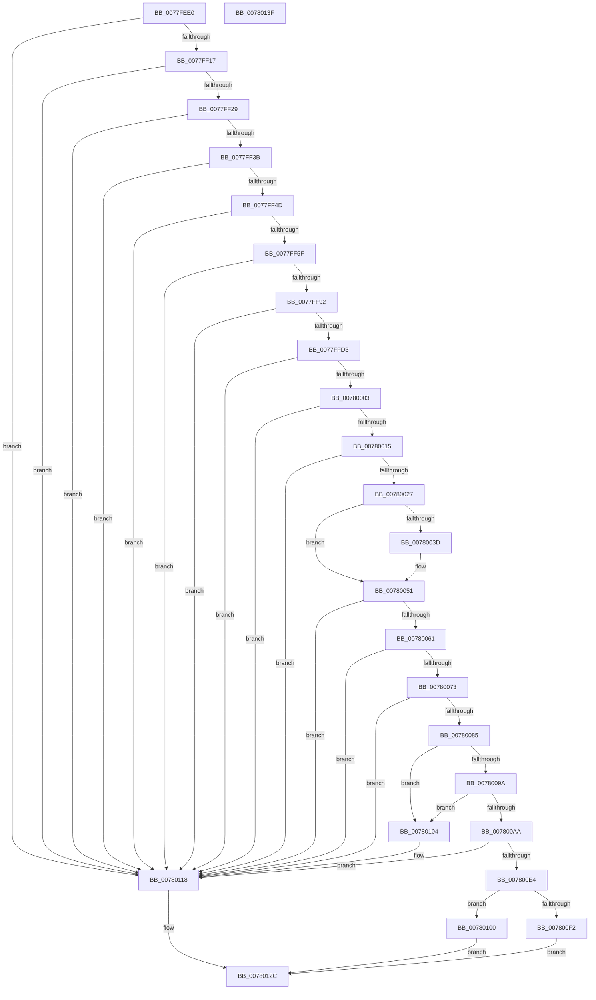

# PspInitializeServerSiloDeferred

- RVA: `0x0077FEE0`–`0x00780140` (길이 `608` bytes)
- VA: `0x000000014077FEE0`
- 실행 섹션: `PAGE`
- PDB 이름 있음: `예`; PDB Function 태그: `아니요`
- unwind 정보 RVA: `0x000A44D8`
- 디코드: `165`개 명령, `608/608` bytes 표시
- 미해석 바이트: `0` (있으면 어셈블리에 `.byte`로 보존)

> 이 문서는 커널 이미지의 기계어와 PDB 기호를 분석해 생성했습니다. 4번과 5번은 함수 원형과 자료형을 바이너리 사용 방식에서 추정한 C 해석이며 원본 소스 복구 결과는 아닙니다.

## 1. Dependencies

- 직접 호출 지점: **36**; 고유 호출 대상: **26**
- 직접 호출자로 확인된 함수: **1**
- RIP 상대 이미지 참조: **0**

### Outgoing calls
- `0x0077FEF5` → [PsGetServerSiloGlobals](../../text/22/PsGetServerSiloGlobals_function_002250A0.md) (function, `0x002250A0`)
- `0x0077FF00` → [RtlNlsInitState](../78/RtlNlsInitState_function_0078BEC4.md) (function, `0x0078BEC4`)
- `0x0077FF08` → [sub_006578CC](../../text/65/Unknown_function_006578CC.md) (function, `0x006578CC`)
- `0x0077FF1A` → [PspSiloInitializeUserSharedData](../78/PspSiloInitializeUserSharedData_function_00780684.md) (function, `0x00780684`)
- `0x0077FF2C` → [PspSiloInitializeSystemRootSymlink](../78/PspSiloInitializeSystemRootSymlink_function_00780558.md) (function, `0x00780558`)
- `0x0077FF3E` → [PspInitializeProtectedProcessParameters](PspInitializeProtectedProcessParameters_function_0077EE98.md) (function, `0x0077EE98`)
- `0x0077FF50` → [PspSiloLoadApiSets](../78/PspSiloLoadApiSets_function_00780848.md) (function, `0x00780848`)
- `0x0077FF6E` → [PsAttachSiloToCurrentThread](../../text/44/PsAttachSiloToCurrentThread_function_004428C0.md) (function, `0x004428C0`)
- `0x0077FF7B` → [ExIsMultiSessionSku](../7C/ExIsMultiSessionSku_function_007C7538.md) (function, `0x007C7538`)
- `0x0077FF85` → [PsDetachSiloFromCurrentThread](../../text/44/PsDetachSiloFromCurrentThread_function_00449AC0.md) (function, `0x00449AC0`)
- `0x0077FFAF` → [PsAttachSiloToCurrentThread](../../text/44/PsAttachSiloToCurrentThread_function_004428C0.md) (function, `0x004428C0`)
- `0x0077FFBC` → [ExIsStateSeparationEnabled](../7C/ExIsStateSeparationEnabled_function_007C75E0.md) (function, `0x007C75E0`)
- `0x0077FFC6` → [PsDetachSiloFromCurrentThread](../../text/44/PsDetachSiloFromCurrentThread_function_00449AC0.md) (function, `0x00449AC0`)
- `0x0077FFE4` → [PsAttachSiloToCurrentThread](../../text/44/PsAttachSiloToCurrentThread_function_004428C0.md) (function, `0x004428C0`)
- `0x0077FFEC` → [RtlInitFunctionalityCache](../78/RtlInitFunctionalityCache_function_0078A5F8.md) (function, `0x0078A5F8`)
- `0x0077FFF6` → [PsDetachSiloFromCurrentThread](../../text/44/PsDetachSiloFromCurrentThread_function_00449AC0.md) (function, `0x00449AC0`)
- `0x00780006` → [ObInitServerSilo](../74/ObInitServerSilo_function_0074D8FC.md) (function, `0x0074D8FC`)
- `0x00780018` → [ExpTimeZoneInitSiloState](../7C/ExpTimeZoneInitSiloState_function_007C6430.md) (function, `0x007C6430`)
- `0x0078002A` → [PsAttachSiloToCurrentThread](../../text/44/PsAttachSiloToCurrentThread_function_004428C0.md) (function, `0x004428C0`)
- `0x00780032` → [ExInitializeNls](../AD/ExInitializeNls_function_00ADB178.md) (function, `0x00ADB178`)
- `0x0078003D` → [PsGetCurrentServerSiloGlobals](../../text/2F/PsGetCurrentServerSiloGlobals_function_002FE1F0.md) (function, `0x002FE1F0`)
- `0x00780054` → [PsDetachSiloFromCurrentThread](../../text/44/PsDetachSiloFromCurrentThread_function_00449AC0.md) (function, `0x00449AC0`)
- `0x00780064` → [SeInitServerSilo](../79/SeInitServerSilo_function_0079C3EC.md) (function, `0x0079C3EC`)
- `0x00780076` → [CmInitServerSiloState](../7E/CmInitServerSiloState_function_007E5B14.md) (function, `0x007E5B14`)
- `0x00780085` → [EtwpGetCurrentSiloMaxLoggers](../../text/64/EtwpGetCurrentSiloMaxLoggers_function_0064E86C.md) (function, `0x0064E86C`)
- `0x0078008F` → [EtwpPreInitializeSiloState](../7B/EtwpPreInitializeSiloState_function_007B76BC.md) (function, `0x007B76BC`)
- `0x0078009F` → [EtwpInitializeSiloState](../7B/EtwpInitializeSiloState_function_007B6A3C.md) (function, `0x007B6A3C`)
- `0x007800AD` → [PsAttachSiloToCurrentThread](../../text/44/PsAttachSiloToCurrentThread_function_004428C0.md) (function, `0x004428C0`)
- `0x007800B8` → [PsGetServerSiloGlobals](../../text/22/PsGetServerSiloGlobals_function_002250A0.md) (function, `0x002250A0`)
- `0x007800CC` → [DbgkpInitializePhase1SiloState](../71/DbgkpInitializePhase1SiloState_function_00710774.md) (function, `0x00710774`)
- `0x007800DB` → [PsDetachSiloFromCurrentThread](../../text/44/PsDetachSiloFromCurrentThread_function_00449AC0.md) (function, `0x00449AC0`)
- `0x007800E7` → [PspNotifyServerSiloCreation](../78/PspNotifyServerSiloCreation_function_00786C58.md) (function, `0x00786C58`)
- `0x007800F7` → [PsTerminateServerSilo](PsTerminateServerSilo_function_0077F620.md) (function, `0x0077F620`)
- `0x00780107` → [PsGetServerSiloGlobals](../../text/22/PsGetServerSiloGlobals_function_002250A0.md) (function, `0x002250A0`)
- `0x00780113` → [EtwpCleanupSiloState](../7B/EtwpCleanupSiloState_function_007B59CC.md) (function, `0x007B59CC`)
- `0x00780125` → [PspDeleteExternalServerSiloState](PspDeleteExternalServerSiloState_function_0077FB88.md) (function, `0x0077FB88`)

### Direct callers
- [PspQueueDeferredWorkAndWait](../78/PspQueueDeferredWorkAndWait_function_00780148.md) at `0x00780190`

### Static image references
- 디코드된 RIP-relative 메모리 참조가 없습니다.

## 2. Other-region calls and transfers

- 다른 실행 섹션으로 향하는 call: **16**
  - `0x0077FEF5` → [PsGetServerSiloGlobals](../../text/22/PsGetServerSiloGlobals_function_002250A0.md) (`PAGE` → `.text`)
  - `0x0077FF08` → [sub_006578CC](../../text/65/Unknown_function_006578CC.md) (`PAGE` → `.text`)
  - `0x0077FF6E` → [PsAttachSiloToCurrentThread](../../text/44/PsAttachSiloToCurrentThread_function_004428C0.md) (`PAGE` → `.text`)
  - `0x0077FF85` → [PsDetachSiloFromCurrentThread](../../text/44/PsDetachSiloFromCurrentThread_function_00449AC0.md) (`PAGE` → `.text`)
  - `0x0077FFAF` → [PsAttachSiloToCurrentThread](../../text/44/PsAttachSiloToCurrentThread_function_004428C0.md) (`PAGE` → `.text`)
  - `0x0077FFC6` → [PsDetachSiloFromCurrentThread](../../text/44/PsDetachSiloFromCurrentThread_function_00449AC0.md) (`PAGE` → `.text`)
  - `0x0077FFE4` → [PsAttachSiloToCurrentThread](../../text/44/PsAttachSiloToCurrentThread_function_004428C0.md) (`PAGE` → `.text`)
  - `0x0077FFF6` → [PsDetachSiloFromCurrentThread](../../text/44/PsDetachSiloFromCurrentThread_function_00449AC0.md) (`PAGE` → `.text`)
  - `0x0078002A` → [PsAttachSiloToCurrentThread](../../text/44/PsAttachSiloToCurrentThread_function_004428C0.md) (`PAGE` → `.text`)
  - `0x0078003D` → [PsGetCurrentServerSiloGlobals](../../text/2F/PsGetCurrentServerSiloGlobals_function_002FE1F0.md) (`PAGE` → `.text`)
  - `0x00780054` → [PsDetachSiloFromCurrentThread](../../text/44/PsDetachSiloFromCurrentThread_function_00449AC0.md) (`PAGE` → `.text`)
  - `0x00780085` → [EtwpGetCurrentSiloMaxLoggers](../../text/64/EtwpGetCurrentSiloMaxLoggers_function_0064E86C.md) (`PAGE` → `.text`)
  - `0x007800AD` → [PsAttachSiloToCurrentThread](../../text/44/PsAttachSiloToCurrentThread_function_004428C0.md) (`PAGE` → `.text`)
  - `0x007800B8` → [PsGetServerSiloGlobals](../../text/22/PsGetServerSiloGlobals_function_002250A0.md) (`PAGE` → `.text`)
  - `0x007800DB` → [PsDetachSiloFromCurrentThread](../../text/44/PsDetachSiloFromCurrentThread_function_00449AC0.md) (`PAGE` → `.text`)
  - `0x00780107` → [PsGetServerSiloGlobals](../../text/22/PsGetServerSiloGlobals_function_002250A0.md) (`PAGE` → `.text`)
- 별도 외부 분기/꼬리 이동을 확인하지 못했습니다.

## 3. Assembly (complete function range)

```asm
0077FEE0  48 89 5C 24 18                  mov qword ptr [rsp + 0x18], rbx
0077FEE5  48 89 6C 24 20                  mov qword ptr [rsp + 0x20], rbp
0077FEEA  56                              push rsi
0077FEEB  57                              push rdi
0077FEEC  41 56                           push r14
0077FEEE  48 83 EC 20                     sub rsp, 0x20
0077FEF2  48 8B F1                        mov rsi, rcx
0077FEF5  E8 A6 51 AA FF                  call 0x1402250a0
0077FEFA  48 8B C8                        mov rcx, rax
0077FEFD  48 8B E8                        mov rbp, rax
0077FF00  E8 BF BF 00 00                  call 0x14078bec4
0077FF05  48 8B CE                        mov rcx, rsi
0077FF08  E8 BF 79 ED FF                  call 0x1406578cc
0077FF0D  8B F8                           mov edi, eax
0077FF0F  85 C0                           test eax, eax
0077FF11  0F 88 01 02 00 00               js 0x140780118
0077FF17  48 8B CE                        mov rcx, rsi
0077FF1A  E8 65 07 00 00                  call 0x140780684
0077FF1F  8B F8                           mov edi, eax
0077FF21  85 C0                           test eax, eax
0077FF23  0F 88 EF 01 00 00               js 0x140780118
0077FF29  48 8B CE                        mov rcx, rsi
0077FF2C  E8 27 06 00 00                  call 0x140780558
0077FF31  8B F8                           mov edi, eax
0077FF33  85 C0                           test eax, eax
0077FF35  0F 88 DD 01 00 00               js 0x140780118
0077FF3B  48 8B CD                        mov rcx, rbp
0077FF3E  E8 55 EF FF FF                  call 0x14077ee98
0077FF43  8B F8                           mov edi, eax
0077FF45  85 C0                           test eax, eax
0077FF47  0F 88 CB 01 00 00               js 0x140780118
0077FF4D  48 8B CE                        mov rcx, rsi
0077FF50  E8 F3 08 00 00                  call 0x140780848
0077FF55  8B F8                           mov edi, eax
0077FF57  85 C0                           test eax, eax
0077FF59  0F 88 B9 01 00 00               js 0x140780118
0077FF5F  4C 8B B6 E0 05 00 00            mov r14, qword ptr [rsi + 0x5e0]
0077FF66  48 8B CE                        mov rcx, rsi
0077FF69  C6 44 24 40 00                  mov byte ptr [rsp + 0x40], 0
0077FF6E  E8 4D 29 CC FF                  call 0x1404428c0
0077FF73  48 8D 4C 24 40                  lea rcx, [rsp + 0x40]
0077FF78  48 8B D8                        mov rbx, rax
0077FF7B  E8 B8 75 04 00                  call 0x1407c7538
0077FF80  48 8B CB                        mov rcx, rbx
0077FF83  8B F8                           mov edi, eax
0077FF85  E8 36 9B CC FF                  call 0x140449ac0
0077FF8A  85 FF                           test edi, edi
0077FF8C  0F 88 86 01 00 00               js 0x140780118
0077FF92  49 8B 8E 08 05 00 00            mov rcx, qword ptr [r14 + 0x508]
0077FF99  8A 44 24 40                     mov al, byte ptr [rsp + 0x40]
0077FF9D  C6 44 24 48 00                  mov byte ptr [rsp + 0x48], 0
0077FFA2  88 41 1C                        mov byte ptr [rcx + 0x1c], al
0077FFA5  48 8B CE                        mov rcx, rsi
0077FFA8  4C 8B B6 E0 05 00 00            mov r14, qword ptr [rsi + 0x5e0]
0077FFAF  E8 0C 29 CC FF                  call 0x1404428c0
0077FFB4  48 8D 4C 24 48                  lea rcx, [rsp + 0x48]
0077FFB9  48 8B D8                        mov rbx, rax
0077FFBC  E8 1F 76 04 00                  call 0x1407c75e0
0077FFC1  48 8B CB                        mov rcx, rbx
0077FFC4  8B F8                           mov edi, eax
0077FFC6  E8 F5 9A CC FF                  call 0x140449ac0
0077FFCB  85 FF                           test edi, edi
0077FFCD  0F 88 45 01 00 00               js 0x140780118
0077FFD3  49 8B 8E 08 05 00 00            mov rcx, qword ptr [r14 + 0x508]
0077FFDA  8A 44 24 48                     mov al, byte ptr [rsp + 0x48]
0077FFDE  88 41 1D                        mov byte ptr [rcx + 0x1d], al
0077FFE1  48 8B CE                        mov rcx, rsi
0077FFE4  E8 D7 28 CC FF                  call 0x1404428c0
0077FFE9  48 8B D8                        mov rbx, rax
0077FFEC  E8 07 A6 00 00                  call 0x14078a5f8
0077FFF1  48 8B CB                        mov rcx, rbx
0077FFF4  8B F8                           mov edi, eax
0077FFF6  E8 C5 9A CC FF                  call 0x140449ac0
0077FFFB  85 FF                           test edi, edi
0077FFFD  0F 88 15 01 00 00               js 0x140780118
00780003  48 8B CE                        mov rcx, rsi
00780006  E8 F1 D8 FC FF                  call 0x14074d8fc
0078000B  8B F8                           mov edi, eax
0078000D  85 C0                           test eax, eax
0078000F  0F 88 03 01 00 00               js 0x140780118
00780015  48 8B CE                        mov rcx, rsi
00780018  E8 13 64 04 00                  call 0x1407c6430
0078001D  8B F8                           mov edi, eax
0078001F  85 C0                           test eax, eax
00780021  0F 88 F1 00 00 00               js 0x140780118
00780027  48 8B CE                        mov rcx, rsi
0078002A  E8 91 28 CC FF                  call 0x1404428c0
0078002F  48 8B D8                        mov rbx, rax
00780032  E8 41 B1 35 00                  call 0x140adb178
00780037  8B F8                           mov edi, eax
00780039  85 C0                           test eax, eax
0078003B  78 14                           js 0x140780051
0078003D  E8 AE E1 B7 FF                  call 0x1402fe1f0
00780042  48 8B 88 00 04 00 00            mov rcx, qword ptr [rax + 0x400]
00780049  48 C7 41 08 01 00 00 00         mov qword ptr [rcx + 8], 1
00780051  48 8B CB                        mov rcx, rbx
00780054  E8 67 9A CC FF                  call 0x140449ac0
00780059  85 FF                           test edi, edi
0078005B  0F 88 B7 00 00 00               js 0x140780118
00780061  48 8B CE                        mov rcx, rsi
00780064  E8 83 C3 01 00                  call 0x14079c3ec
00780069  8B F8                           mov edi, eax
0078006B  85 C0                           test eax, eax
0078006D  0F 88 A5 00 00 00               js 0x140780118
00780073  48 8B CE                        mov rcx, rsi
00780076  E8 99 5A 06 00                  call 0x1407e5b14
0078007B  8B F8                           mov edi, eax
0078007D  85 C0                           test eax, eax
0078007F  0F 88 93 00 00 00               js 0x140780118
00780085  E8 E2 E7 EC FF                  call 0x14064e86c
0078008A  8B D0                           mov edx, eax
0078008C  48 8B CE                        mov rcx, rsi
0078008F  E8 28 76 03 00                  call 0x1407b76bc
00780094  8B F8                           mov edi, eax
00780096  85 C0                           test eax, eax
00780098  78 6A                           js 0x140780104
0078009A  33 D2                           xor edx, edx
0078009C  48 8B CE                        mov rcx, rsi
0078009F  E8 98 69 03 00                  call 0x1407b6a3c
007800A4  8B F8                           mov edi, eax
007800A6  85 C0                           test eax, eax
007800A8  78 5A                           js 0x140780104
007800AA  48 8B CE                        mov rcx, rsi
007800AD  E8 0E 28 CC FF                  call 0x1404428c0
007800B2  48 8B CE                        mov rcx, rsi
007800B5  48 8B D8                        mov rbx, rax
007800B8  E8 E3 4F AA FF                  call 0x1402250a0
007800BD  48 83 A0 A8 03 00 00 00         and qword ptr [rax + 0x3a8], 0
007800C5  48 8D 88 A8 03 00 00            lea rcx, [rax + 0x3a8]
007800CC  E8 A3 06 F9 FF                  call 0x140710774
007800D1  33 FF                           xor edi, edi
007800D3  48 8B CB                        mov rcx, rbx
007800D6  85 C0                           test eax, eax
007800D8  0F 48 F8                        cmovs edi, eax
007800DB  E8 E0 99 CC FF                  call 0x140449ac0
007800E0  85 FF                           test edi, edi
007800E2  78 34                           js 0x140780118
007800E4  48 8B CE                        mov rcx, rsi
007800E7  E8 6C 6B 00 00                  call 0x140786c58
007800EC  8B D8                           mov ebx, eax
007800EE  85 C0                           test eax, eax
007800F0  79 0E                           jns 0x140780100
007800F2  8B D0                           mov edx, eax
007800F4  48 8B CE                        mov rcx, rsi
007800F7  E8 24 F5 FF FF                  call 0x14077f620
007800FC  8B C3                           mov eax, ebx
007800FE  EB 2C                           jmp 0x14078012c
00780100  33 C0                           xor eax, eax
00780102  EB 28                           jmp 0x14078012c
00780104  48 8B CE                        mov rcx, rsi
00780107  E8 94 4F AA FF                  call 0x1402250a0
0078010C  48 8B 88 40 03 00 00            mov rcx, qword ptr [rax + 0x340]
00780113  E8 B4 58 03 00                  call 0x1407b59cc
00780118  48 8B CE                        mov rcx, rsi
0078011B  C7 85 F8 04 00 00 04 00 00 00   mov dword ptr [rbp + 0x4f8], 4
00780125  E8 5E FA FF FF                  call 0x14077fb88
0078012A  8B C7                           mov eax, edi
0078012C  48 8B 5C 24 50                  mov rbx, qword ptr [rsp + 0x50]
00780131  48 8B 6C 24 58                  mov rbp, qword ptr [rsp + 0x58]
00780136  48 83 C4 20                     add rsp, 0x20
0078013A  41 5E                           pop r14
0078013C  5F                              pop rdi
0078013D  5E                              pop rsi
0078013E  C3                              ret
0078013F  CC                              int3
```

## 4. C-style interpretation (structured pseudocode)

```c
__int64 __fastcall PspInitializeServerSiloDeferred(__int64 a1)
{
    __int64 result;
    __int64 v_rdi;
    __int64 v_rsp;
    unsigned __int8 v_stack_p10;
    unsigned __int64 v_stack_p18;
    unsigned __int64 v_stack_p20;
    unsigned __int8 v_stack_p8;

    v_stack_p18 = v_rbx;
    v_stack_p20 = v_rbp;
    v_rsp = (v_rsp) - (32);
    result = PsGetServerSiloGlobals(a1, a2, a3, a4);
    result = RtlNlsInitState(result, a2, a3, a4);
    result = sub_006578CC(a1, a2, a3, a4);
    if (sign_flag) goto loc_00780118;
    result = PspSiloInitializeUserSharedData(a1, a2, a3, a4);
    if (sign_flag) goto loc_00780118;
    result = PspSiloInitializeSystemRootSymlink(a1, a2, a3, a4);
    if (sign_flag) goto loc_00780118;
    result = PspInitializeProtectedProcessParameters(result, a2, a3, a4);
    if (sign_flag) goto loc_00780118;
    result = PspSiloLoadApiSets(a1, a2, a3, a4);
    if (sign_flag) goto loc_00780118;
    v_stack_p8 = 0;
    result = PsAttachSiloToCurrentThread(a1, a2, a3, a4);
    result = ExIsMultiSessionSku(v_stack_p8, a2, a3, a4);
    result = PsDetachSiloFromCurrentThread(result, a2, a3, a4);
    if (sign_flag) goto loc_00780118;
    v_stack_p10 = 0;
    *(unsigned __int8 *)(*(unsigned __int64 *)(*(unsigned __int64 *)(a1 + 1504) + 1288) + 28) = (unsigned __int8)(v_stack_p8);
    result = PsAttachSiloToCurrentThread(a1, a2, a3, a4);
    result = ExIsStateSeparationEnabled(v_stack_p10, a2, a3, a4);
    result = PsDetachSiloFromCurrentThread(result, a2, a3, a4);
    if (sign_flag) goto loc_00780118;
    *(unsigned __int8 *)(*(unsigned __int64 *)(*(unsigned __int64 *)(a1 + 1504) + 1288) + 29) = (unsigned __int8)(v_stack_p10);
    result = PsAttachSiloToCurrentThread(a1, a2, a3, a4);
    result = RtlInitFunctionalityCache(a1, a2, a3, a4);
    result = PsDetachSiloFromCurrentThread(result, a2, a3, a4);
    if (sign_flag) goto loc_00780118;
    result = ObInitServerSilo(a1, a2, a3, a4);
    if (sign_flag) goto loc_00780118;
    result = ExpTimeZoneInitSiloState(a1, a2, a3, a4);
    if (sign_flag) goto loc_00780118;
    result = PsAttachSiloToCurrentThread(a1, a2, a3, a4);
    result = ExInitializeNls(a1, a2, a3, a4);
    if (!(sign_flag)) {
        result = PsGetCurrentServerSiloGlobals(a1, a2, a3, a4);
        a1 = *(unsigned __int64 *)(result + 1024);
        *(unsigned __int64 *)(a1 + 8) = 1;
    }
    result = PsDetachSiloFromCurrentThread(result, a2, a3, a4);
    if (sign_flag) goto loc_00780118;
    result = SeInitServerSilo(a1, a2, a3, a4);
    if (sign_flag) goto loc_00780118;
    result = CmInitServerSiloState(a1, a2, a3, a4);
    if (sign_flag) goto loc_00780118;
    result = EtwpGetCurrentSiloMaxLoggers(a1, a2, a3, a4);
    result = EtwpPreInitializeSiloState(a1, (unsigned int)((unsigned int)(result)), a3, a4);
    if (sign_flag) goto loc_00780104;
    a2 = 0;
    result = EtwpInitializeSiloState(a1, a2, a3, a4);
    if (sign_flag) goto loc_00780104;
    result = PsAttachSiloToCurrentThread(a1, a2, a3, a4);
    result = PsGetServerSiloGlobals(a1, a2, a3, a4);
    result = DbgkpInitializePhase1SiloState(result + 936, a2, a3, a4);
    v_rdi = 0;
    if (sign_flag) { v_rdi = (unsigned int)(result); }
    result = PsDetachSiloFromCurrentThread(result, a2, a3, a4);
    if (sign_flag) goto loc_00780118;
    result = PspNotifyServerSiloCreation(a1, a2, a3, a4);
    if (!sign_flag) goto loc_00780100;
    result = PsTerminateServerSilo(a1, (unsigned int)((unsigned int)(result)), a3, a4);
    goto loc_0078012C;
loc_00780100:
    result = 0;
    goto loc_0078012C;
loc_00780104:
    result = PsGetServerSiloGlobals(a1, (unsigned int)((unsigned int)(result)), a3, a4);
    result = EtwpCleanupSiloState(*(unsigned __int64 *)(result + 832), (unsigned int)((unsigned int)(result)), a3, a4);
loc_00780118:
    *(unsigned int *)(result + 1272) = 4;
    result = PspDeleteExternalServerSiloState(a1, (unsigned int)((unsigned int)(result)), a3, a4);
loc_0078012C:
    v_rsp = (v_rsp) + (32);
    return (unsigned int)((unsigned int)(v_rdi));
}
```

## 5. (Beta) C Style

```c
int64_t PspInitializeServerSiloDeferred(void *Arg1)
{
    uint8_t *arg1 = (uint8_t *)Arg1;

    int64_t result;
    int64_t local_rdi;
    int64_t local_rsp;
    uint8_t v_stack_p10;
    uint64_t v_stack_p18;
    uint64_t v_stack_p20;
    uint8_t v_stack_p8;

    v_stack_p18 = local_rbx;
    v_stack_p20 = local_rbp;
    local_rsp = (local_rsp) - (32);
    result = PsGetServerSiloGlobals(Arg1, a2, a3, a4);
    result = RtlNlsInitState(result, a2, a3, a4);
    result = sub_006578CC(Arg1, a2, a3, a4);
    if (sign_flag) goto loc_00780118;
    result = PspSiloInitializeUserSharedData(Arg1, a2, a3, a4);
    if (sign_flag) goto loc_00780118;
    result = PspSiloInitializeSystemRootSymlink(Arg1, a2, a3, a4);
    if (sign_flag) goto loc_00780118;
    result = PspInitializeProtectedProcessParameters(result, a2, a3, a4);
    if (sign_flag) goto loc_00780118;
    result = PspSiloLoadApiSets(Arg1, a2, a3, a4);
    if (sign_flag) goto loc_00780118;
    v_stack_p8 = 0;
    result = PsAttachSiloToCurrentThread(Arg1, a2, a3, a4);
    result = ExIsMultiSessionSku(v_stack_p8, a2, a3, a4);
    result = PsDetachSiloFromCurrentThread(result, a2, a3, a4);
    if (sign_flag) goto loc_00780118;
    v_stack_p10 = 0;
    *(uint8_t *)(*(uint64_t *)(*(uint64_t *)(arg1 + 0x5E0) + 0x508) + 0x1C) = (uint8_t)(v_stack_p8);
    result = PsAttachSiloToCurrentThread(Arg1, a2, a3, a4);
    result = ExIsStateSeparationEnabled(v_stack_p10, a2, a3, a4);
    result = PsDetachSiloFromCurrentThread(result, a2, a3, a4);
    if (sign_flag) goto loc_00780118;
    *(uint8_t *)(*(uint64_t *)(*(uint64_t *)(arg1 + 0x5E0) + 0x508) + 0x1D) = (uint8_t)(v_stack_p10);
    result = PsAttachSiloToCurrentThread(Arg1, a2, a3, a4);
    result = RtlInitFunctionalityCache(Arg1, a2, a3, a4);
    result = PsDetachSiloFromCurrentThread(result, a2, a3, a4);
    if (sign_flag) goto loc_00780118;
    result = ObInitServerSilo(Arg1, a2, a3, a4);
    if (sign_flag) goto loc_00780118;
    result = ExpTimeZoneInitSiloState(Arg1, a2, a3, a4);
    if (sign_flag) goto loc_00780118;
    result = PsAttachSiloToCurrentThread(Arg1, a2, a3, a4);
    result = ExInitializeNls(Arg1, a2, a3, a4);
    if (!(sign_flag)) {
        result = PsGetCurrentServerSiloGlobals(Arg1, a2, a3, a4);
        Arg1 = *(uint64_t *)(result + 0x400);
        *(uint64_t *)(arg1 + 0x8) = 1;
    }
    result = PsDetachSiloFromCurrentThread(result, a2, a3, a4);
    if (sign_flag) goto loc_00780118;
    result = SeInitServerSilo(Arg1, a2, a3, a4);
    if (sign_flag) goto loc_00780118;
    result = CmInitServerSiloState(Arg1, a2, a3, a4);
    if (sign_flag) goto loc_00780118;
    result = EtwpGetCurrentSiloMaxLoggers(Arg1, a2, a3, a4);
    result = EtwpPreInitializeSiloState(Arg1, (uint32_t)((uint32_t)(result)), a3, a4);
    if (sign_flag) goto loc_00780104;
    a2 = 0;
    result = EtwpInitializeSiloState(Arg1, a2, a3, a4);
    if (sign_flag) goto loc_00780104;
    result = PsAttachSiloToCurrentThread(Arg1, a2, a3, a4);
    result = PsGetServerSiloGlobals(Arg1, a2, a3, a4);
    result = DbgkpInitializePhase1SiloState(result + 936, a2, a3, a4);
    local_rdi = 0;
    if (sign_flag) { local_rdi = (uint32_t)(result); }
    result = PsDetachSiloFromCurrentThread(result, a2, a3, a4);
    if (sign_flag) goto loc_00780118;
    result = PspNotifyServerSiloCreation(Arg1, a2, a3, a4);
    if (!sign_flag) goto loc_00780100;
    result = PsTerminateServerSilo(Arg1, (uint32_t)((uint32_t)(result)), a3, a4);
    goto loc_0078012C;
loc_00780100:
    result = 0;
    goto loc_0078012C;
loc_00780104:
    result = PsGetServerSiloGlobals(Arg1, (uint32_t)((uint32_t)(result)), a3, a4);
    result = EtwpCleanupSiloState(*(uint64_t *)(result + 0x340), (uint32_t)((uint32_t)(result)), a3, a4);
loc_00780118:
    *(uint32_t *)(result + 0x4F8) = 4;
    result = PspDeleteExternalServerSiloState(Arg1, (uint32_t)((uint32_t)(result)), a3, a4);
loc_0078012C:
    local_rsp = (local_rsp) + (32);
    return (uint32_t)((uint32_t)(local_rdi));
}
```

### 관측된 메모리 오프셋

구조체 형식이 확인되지 않은 접근은 인자 기준의 오프셋으로만 기록했습니다.

| 기준 인자 | 오프셋 표현 | 폭 (bit) | 접근 |
|---|---:|---:|---|
| `Arg1` | `+ 0x5E0` | `64` | `R` |

## 6. Execution-region graph

[열기: 2D/3D 그래프와 함수 탐색 컨트롤 패널](../../../control-panel.html?section=page&rva=0x0077FEE0&view=graph)

- 2D 그래프는 위에서 아래로 흐르고, 3D 그래프는 빈 공간을 드래그해 회전합니다. Shift+드래그는 이동, 휠은 확대·축소, 함수 노드 선택은 대상 보고서 이동입니다.

### Static fallback


