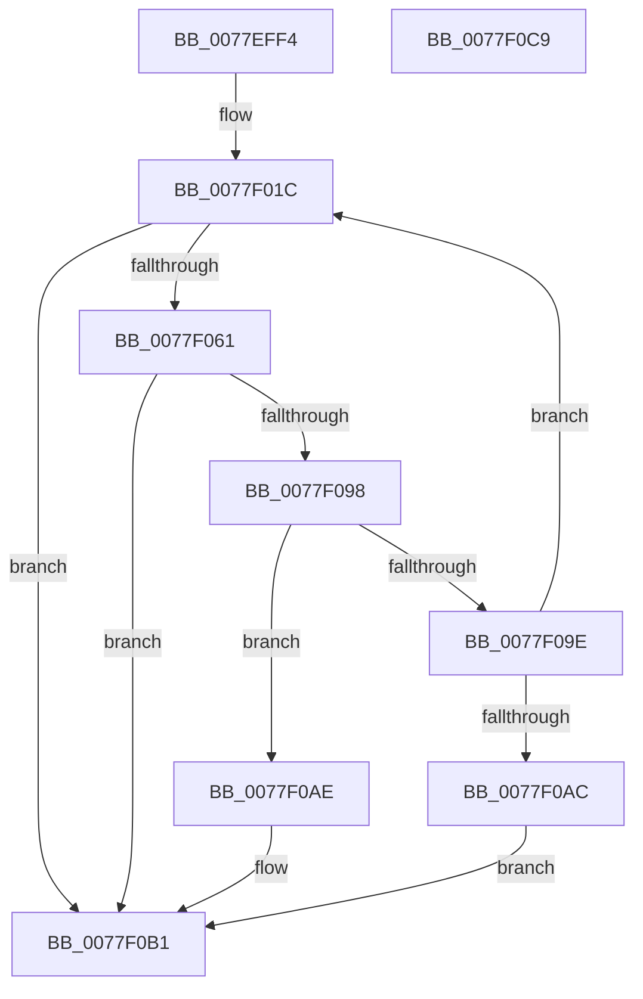

# PspIsDfssEnabled

- RVA: `0x0077EFF4`–`0x0077F0CA` (길이 `214` bytes)
- VA: `0x000000014077EFF4`
- 실행 섹션: `PAGE`
- PDB 이름 있음: `예`; PDB Function 태그: `아니요`
- unwind 정보 RVA: `0x000C7968`
- 디코드: `59`개 명령, `214/214` bytes 표시
- 미해석 바이트: `0` (있으면 어셈블리에 `.byte`로 보존)

> 이 문서는 커널 이미지의 기계어와 PDB 기호를 분석해 생성했습니다. 4번과 5번은 함수 원형과 자료형을 바이너리 사용 방식에서 추정한 C 해석이며 원본 소스 복구 결과는 아닙니다.

## 1. Dependencies

- 직접 호출 지점: **4**; 고유 호출 대상: **4**
- 직접 호출자로 확인된 함수: **1**
- RIP 상대 이미지 참조: **2**

### Outgoing calls
- `0x0077F058` → [ZwOpenKey](../../text/6A/ZwOpenKey_function_006AD310.md) (function, `0x006AD310`)
- `0x0077F084` → [RtlQueryImageFileKeyOption](../A2/RtlQueryImageFileKeyOption_function_00A2D110.md) (function, `0x00A2D110`)
- `0x0077F08F` → [ZwClose](../../text/6A/ZwClose_function_006AD2B0.md) (function, `0x006AD2B0`)
- `0x0077F0B1` → [PspReadDfssConfigurationValues](../../text/5E/PspReadDfssConfigurationValues_function_005E2508.md) (function, `0x005E2508`)

### Direct callers
- [PsBootPhaseComplete](PsBootPhaseComplete_function_0077EA18.md) at `0x0077ED27`

### Static image references
- `0x0077F021` → RVA `0x00B4B7F0` (`PspQuotaKeyNames`; read)
- `0x0077F06F` → RVA `0x00B04A30` (` ?? ::NNGAKEGL::`string'`; read)

## 2. Other-region calls and transfers

- 다른 실행 섹션으로 향하는 call: **3**
  - `0x0077F058` → [ZwOpenKey](../../text/6A/ZwOpenKey_function_006AD310.md) (`PAGE` → `.text`)
  - `0x0077F08F` → [ZwClose](../../text/6A/ZwClose_function_006AD2B0.md) (`PAGE` → `.text`)
  - `0x0077F0B1` → [PspReadDfssConfigurationValues](../../text/5E/PspReadDfssConfigurationValues_function_005E2508.md) (`PAGE` → `.text`)
- 별도 외부 분기/꼬리 이동을 확인하지 못했습니다.

## 3. Assembly (complete function range)

```asm
0077EFF4  48 89 5C 24 18                  mov qword ptr [rsp + 0x18], rbx
0077EFF9  55                              push rbp
0077EFFA  56                              push rsi
0077EFFB  57                              push rdi
0077EFFC  48 8B EC                        mov rbp, rsp
0077EFFF  48 83 EC 60                     sub rsp, 0x60
0077F003  83 65 20 00                     and dword ptr [rbp + 0x20], 0
0077F007  33 C0                           xor eax, eax
0077F009  48 83 65 28 00                  and qword ptr [rbp + 0x28], 0
0077F00E  40 32 FF                        xor dil, dil
0077F011  21 45 EC                        and dword ptr [rbp - 0x14], eax
0077F014  89 45 D4                        mov dword ptr [rbp - 0x2c], eax
0077F017  21 45 D4                        and dword ptr [rbp - 0x2c], eax
0077F01A  33 F6                           xor esi, esi
0077F01C  48 83 65 D8 00                  and qword ptr [rbp - 0x28], 0
0077F021  48 8D 0D C8 C7 3C 00            lea rcx, [rip + 0x3cc7c8]
0077F028  0F 57 C0                        xorps xmm0, xmm0
0077F02B  8B C6                           mov eax, esi
0077F02D  48 C1 E0 04                     shl rax, 4
0077F031  4C 8D 45 D0                     lea r8, [rbp - 0x30]
0077F035  48 03 C1                        add rax, rcx
0077F038  C7 45 D0 30 00 00 00            mov dword ptr [rbp - 0x30], 0x30
0077F03F  48 8D 4D 28                     lea rcx, [rbp + 0x28]
0077F043  48 89 45 E0                     mov qword ptr [rbp - 0x20], rax
0077F047  BA 01 00 00 00                  mov edx, 1
0077F04C  C7 45 E8 40 02 00 00            mov dword ptr [rbp - 0x18], 0x240
0077F053  F3 0F 7F 45 F0                  movdqu xmmword ptr [rbp - 0x10], xmm0
0077F058  E8 B3 E2 F2 FF                  call 0x1406ad310
0077F05D  85 C0                           test eax, eax
0077F05F  78 50                           js 0x14077f0b1
0077F061  48 83 64 24 28 00               and qword ptr [rsp + 0x28], 0
0077F067  4C 8D 4D 20                     lea r9, [rbp + 0x20]
0077F06B  48 8B 4D 28                     mov rcx, qword ptr [rbp + 0x28]
0077F06F  48 8D 15 BA 59 38 00            lea rdx, [rip + 0x3859ba]
0077F076  41 B8 04 00 00 00               mov r8d, 4
0077F07C  C7 44 24 20 04 00 00 00         mov dword ptr [rsp + 0x20], 4
0077F084  E8 87 E0 2A 00                  call 0x140a2d110
0077F089  48 8B 4D 28                     mov rcx, qword ptr [rbp + 0x28]
0077F08D  8B D8                           mov ebx, eax
0077F08F  E8 1C E2 F2 FF                  call 0x1406ad2b0
0077F094  85 DB                           test ebx, ebx
0077F096  78 19                           js 0x14077f0b1
0077F098  83 7D 20 00                     cmp dword ptr [rbp + 0x20], 0
0077F09C  74 10                           je 0x14077f0ae
0077F09E  FF C6                           inc esi
0077F0A0  40 B7 01                        mov dil, 1
0077F0A3  83 FE 02                        cmp esi, 2
0077F0A6  0F 82 70 FF FF FF               jb 0x14077f01c
0077F0AC  EB 03                           jmp 0x14077f0b1
0077F0AE  40 32 FF                        xor dil, dil
0077F0B1  E8 52 34 E6 FF                  call 0x1405e2508
0077F0B6  48 8B 9C 24 90 00 00 00         mov rbx, qword ptr [rsp + 0x90]
0077F0BE  40 8A C7                        mov al, dil
0077F0C1  48 83 C4 60                     add rsp, 0x60
0077F0C5  5F                              pop rdi
0077F0C6  5E                              pop rsi
0077F0C7  5D                              pop rbp
0077F0C8  C3                              ret
0077F0C9  CC                              int3
```

## 4. C-style interpretation (structured pseudocode)

```c
__int64 __fastcall PspIsDfssEnabled(void)
{
    __int64 result;
    __int64 v_rdi;
    __int64 v_rsi;
    __int64 v_rsp;
    unsigned __int64 v_stack_m28;
    unsigned int v_stack_m2C;
    unsigned int v_stack_m30;
    unsigned __int64 v_stack_m38;
    unsigned __int64 v_stack_m40;
    unsigned int v_stack_m44;
    unsigned __int64 v_stack_m48;
    unsigned __int64 v_stack_m50;
    unsigned int v_stack_m58;
    unsigned __int64 v_stack_p10;
    unsigned __int64 v_stack_p18;
    unsigned int v_stack_p8;

    v_stack_p18 = v_rbx;
    v_rsp = (v_rsp) - (96);
    result = 0;
    v_rdi = 0;
    v_stack_m44 = 0;
    v_rsi = 0;
loc_0077F01C:
    result = (0) << (4);
    result = (result) + (v_rip + 3983304);
    v_stack_m48 = 48;
    v_stack_m38 = result;
    v_stack_m30 = 576;
    v_stack_m28 = v_xmm0;
    result = ZwOpenKey(v_stack_p10, 1, v_stack_m48, a4);
    if (sign_flag) goto loc_0077F0B1;
    v_stack_m58 = 4;
    result = RtlQueryImageFileKeyOption(v_stack_p10, v_rip + 3692986, 4, v_stack_p8);
    result = ZwClose(v_stack_p10, v_rip + 3692986, 4, v_stack_p8);
    if (sign_flag) goto loc_0077F0B1;
    if (v_stack_p8 == 0) goto loc_0077F0AE;
    v_rsi = (unsigned int)((v_rsi) + 1);
    if (((unsigned int)(v_rsi)) < 2) goto loc_0077F01C;
    goto loc_0077F0B1;
loc_0077F0AE:
    v_rdi = 0;
loc_0077F0B1:
    result = PspReadDfssConfigurationValues(v_stack_p10, v_rip + 3692986, 4, v_stack_p8);
    v_rsp = (v_rsp) + (96);
    return 0;
}
```

## 5. (Beta) C Style

```c
void PspIsDfssEnabled(void)
{
    int64_t result;
    int64_t local_rdi;
    int64_t local_rsi;
    int64_t local_rsp;
    uint64_t v_stack_m28;
    uint32_t v_stack_m2C;
    uint32_t v_stack_m30;
    uint64_t v_stack_m38;
    uint64_t v_stack_m40;
    uint32_t v_stack_m44;
    uint64_t v_stack_m48;
    uint64_t v_stack_m50;
    uint32_t v_stack_m58;
    uint64_t v_stack_p10;
    uint64_t v_stack_p18;
    uint32_t v_stack_p8;

    v_stack_p18 = local_rbx;
    local_rsp = (local_rsp) - (96);
    result = 0;
    local_rdi = 0;
    v_stack_m44 = 0;
    local_rsi = 0;
loc_0077F01C:
    result = (0) << (4);
    result = (result) + (v_rip + 3983304);
    v_stack_m48 = 48;
    v_stack_m38 = result;
    v_stack_m30 = 576;
    v_stack_m28 = v_xmm0;
    result = ZwOpenKey(v_stack_p10, 1, v_stack_m48, a4);
    if (sign_flag) goto loc_0077F0B1;
    v_stack_m58 = 4;
    result = RtlQueryImageFileKeyOption(v_stack_p10, v_rip + 3692986, 4, v_stack_p8);
    result = ZwClose(v_stack_p10, v_rip + 3692986, 4, v_stack_p8);
    if (sign_flag) goto loc_0077F0B1;
    if (v_stack_p8 == 0) goto loc_0077F0AE;
    local_rsi = (uint32_t)((local_rsi) + 1);
    if (((uint32_t)(local_rsi)) < 2) goto loc_0077F01C;
    goto loc_0077F0B1;
loc_0077F0AE:
    local_rdi = 0;
loc_0077F0B1:
    result = PspReadDfssConfigurationValues(v_stack_p10, v_rip + 3692986, 4, v_stack_p8);
    local_rsp = (local_rsp) + (96);
    return 0;
}
```

## 6. Execution-region graph

[열기: 2D/3D 그래프와 함수 탐색 컨트롤 패널](../../../control-panel.html?section=page&rva=0x0077EFF4&view=graph)

- 2D 그래프는 위에서 아래로 흐르고, 3D 그래프는 빈 공간을 드래그해 회전합니다. Shift+드래그는 이동, 휠은 확대·축소, 함수 노드 선택은 대상 보고서 이동입니다.

### Static fallback


