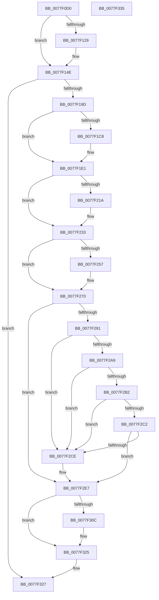

# PspLocateSystemDll

- RVA: `0x0077F0D0`–`0x0077F336` (길이 `614` bytes)
- VA: `0x000000014077F0D0`
- 실행 섹션: `PAGE`
- PDB 이름 있음: `예`; PDB Function 태그: `아니요`
- unwind 정보 RVA: `0x000CDFB8`
- 디코드: `167`개 명령, `614/614` bytes 표시
- 미해석 바이트: `0` (있으면 어셈블리에 `.byte`로 보존)

> 이 문서는 커널 이미지의 기계어와 PDB 기호를 분석해 생성했습니다. 4번과 5번은 함수 원형과 자료형을 바이너리 사용 방식에서 추정한 C 해석이며 원본 소스 복구 결과는 아닙니다.

## 1. Dependencies

- 직접 호출 지점: **18**; 고유 호출 대상: **12**
- 직접 호출자로 확인된 함수: **1**
- RIP 상대 이미지 참조: **2**

### Outgoing calls
- `0x0077F114` → [memset](../../text/6C/memset_function_006C6C40.md) (function, `0x006C6C40`)
- `0x0077F149` → [ZwSystemDebugControl](../../text/6B/ZwSystemDebugControl_function_006B0AF0.md) (function, `0x006B0AF0`)
- `0x0077F190` → [ZwOpenFile](../../text/6A/ZwOpenFile_function_006AD730.md) (function, `0x006AD730`)
- `0x0077F1BF` → [MmCreateSpecialImageSection](../AB/MmCreateSpecialImageSection_function_00AB7360.md) (function, `0x00AB7360`)
- `0x0077F1DB` → [KeBugCheckEx](../../text/4F/KeBugCheckEx_function_004FD660.md) (function, `0x004FD660`)
- `0x0077F1E7` → [ObCloseHandle](../8A/ObCloseHandle_function_008A1870.md) (function, `0x008A1870`)
- `0x0077F211` → [ObReferenceObjectByHandle](../86/ObReferenceObjectByHandle_function_00868DB0.md) (function, `0x00868DB0`)
- `0x0077F22D` → [KeBugCheckEx](../../text/4F/KeBugCheckEx_function_004FD660.md) (function, `0x004FD660`)
- `0x0077F239` → [ObCloseHandle](../8A/ObCloseHandle_function_008A1870.md) (function, `0x008A1870`)
- `0x0077F24E` → [MmGetSectionInformation](../92/MmGetSectionInformation_function_00921910.md) (function, `0x00921910`)
- `0x0077F26A` → [KeBugCheckEx](../../text/4F/KeBugCheckEx_function_004FD660.md) (function, `0x004FD660`)
- `0x0077F27E` → [ObInitializeFastReference](../9F/ObInitializeFastReference_function_009F0D24.md) (function, `0x009F0D24`)
- `0x0077F29D` → [MmGetSectionInformation](../92/MmGetSectionInformation_function_00921910.md) (function, `0x00921910`)
- `0x0077F2B5` → [MiSectionControlArea](../../text/29/MiSectionControlArea_function_00294CB0.md) (function, `0x00294CB0`)
- `0x0077F2C5` → [MiDoesImageContainFunctionOverrideFixups](../8D/MiDoesImageContainFunctionOverrideFixups_function_008D05D8.md) (function, `0x008D05D8`)
- `0x0077F2E1` → [KeBugCheckEx](../../text/4F/KeBugCheckEx_function_004FD660.md) (function, `0x004FD660`)
- `0x0077F303` → [PspMapSystemDll](../8D/PspMapSystemDll_function_008D6908.md) (function, `0x008D6908`)
- `0x0077F31F` → [KeBugCheckEx](../../text/4F/KeBugCheckEx_function_004FD660.md) (function, `0x004FD660`)

### Direct callers
- [PsLocateSystemDlls](PsLocateSystemDlls_function_0077ED90.md) at `0x0077EE2E`

### Static image references
- `0x0077F119` → RVA `0x00FC42C0` (`.data`; read)
- `0x0077F1EC` → RVA `0x00FC6BD8` (`ALMOSTRO`; read)

## 2. Other-region calls and transfers

- 다른 실행 섹션으로 향하는 call: **9**
  - `0x0077F114` → [memset](../../text/6C/memset_function_006C6C40.md) (`PAGE` → `.text`)
  - `0x0077F149` → [ZwSystemDebugControl](../../text/6B/ZwSystemDebugControl_function_006B0AF0.md) (`PAGE` → `.text`)
  - `0x0077F190` → [ZwOpenFile](../../text/6A/ZwOpenFile_function_006AD730.md) (`PAGE` → `.text`)
  - `0x0077F1DB` → [KeBugCheckEx](../../text/4F/KeBugCheckEx_function_004FD660.md) (`PAGE` → `.text`)
  - `0x0077F22D` → [KeBugCheckEx](../../text/4F/KeBugCheckEx_function_004FD660.md) (`PAGE` → `.text`)
  - `0x0077F26A` → [KeBugCheckEx](../../text/4F/KeBugCheckEx_function_004FD660.md) (`PAGE` → `.text`)
  - `0x0077F2B5` → [MiSectionControlArea](../../text/29/MiSectionControlArea_function_00294CB0.md) (`PAGE` → `.text`)
  - `0x0077F2E1` → [KeBugCheckEx](../../text/4F/KeBugCheckEx_function_004FD660.md) (`PAGE` → `.text`)
  - `0x0077F31F` → [KeBugCheckEx](../../text/4F/KeBugCheckEx_function_004FD660.md) (`PAGE` → `.text`)
- 별도 외부 분기/꼬리 이동을 확인하지 못했습니다.

## 3. Assembly (complete function range)

```asm
0077F0D0  40 55                           push rbp
0077F0D2  53                              push rbx
0077F0D3  56                              push rsi
0077F0D4  57                              push rdi
0077F0D5  41 56                           push r14
0077F0D7  48 8D 6C 24 C9                  lea rbp, [rsp - 0x37]
0077F0DC  48 81 EC E0 00 00 00            sub rsp, 0xe0
0077F0E3  45 33 F6                        xor r14d, r14d
0077F0E6  0F 57 C0                        xorps xmm0, xmm0
0077F0E9  8B F2                           mov esi, edx
0077F0EB  4C 89 75 87                     mov qword ptr [rbp - 0x79], r14
0077F0EF  48 8B D9                        mov rbx, rcx
0077F0F2  4C 89 75 67                     mov qword ptr [rbp + 0x67], r14
0077F0F6  33 D2                           xor edx, edx
0077F0F8  44 89 75 93                     mov dword ptr [rbp - 0x6d], r14d
0077F0FC  45 8D 46 48                     lea r8d, [r14 + 0x48]
0077F100  44 89 75 AB                     mov dword ptr [rbp - 0x55], r14d
0077F104  48 8D 4D E7                     lea rcx, [rbp - 0x19]
0077F108  4C 89 75 77                     mov qword ptr [rbp + 0x77], r14
0077F10C  0F 11 45 CF                     movups xmmword ptr [rbp - 0x31], xmm0
0077F110  0F 11 45 BF                     movups xmmword ptr [rbp - 0x41], xmm0
0077F114  E8 27 7B F4 FF                  call 0x1406c6c40
0077F119  F7 05 9D 51 84 00 00 00 04 00   test dword ptr [rip + 0x84519d], 0x40000
0077F123  41 8D 7E 10                     lea edi, [r14 + 0x10]
0077F127  74 25                           je 0x14077f14e
0077F129  0F 10 43 10                     movups xmm0, xmmword ptr [rbx + 0x10]
0077F12D  4C 89 74 24 28                  mov qword ptr [rsp + 0x28], r14
0077F132  48 8D 55 BF                     lea rdx, [rbp - 0x41]
0077F136  45 33 C9                        xor r9d, r9d
0077F139  44 89 74 24 20                  mov dword ptr [rsp + 0x20], r14d
0077F13E  44 8B C7                        mov r8d, edi
0077F141  8D 4F 16                        lea ecx, [rdi + 0x16]
0077F144  F3 0F 7F 45 BF                  movdqu xmmword ptr [rbp - 0x41], xmm0
0077F149  E8 A2 19 F3 FF                  call 0x1406b0af0
0077F14E  0F 57 C0                        xorps xmm0, xmm0
0077F151  44 89 74 24 28                  mov dword ptr [rsp + 0x28], r14d
0077F156  48 8B C3                        mov rax, rbx
0077F159  C7 45 8F 30 00 00 00            mov dword ptr [rbp - 0x71], 0x30
0077F160  48 03 C7                        add rax, rdi
0077F163  4C 89 75 97                     mov qword ptr [rbp - 0x69], r14
0077F167  4C 8D 4D CF                     lea r9, [rbp - 0x31]
0077F16B  48 89 45 9F                     mov qword ptr [rbp - 0x61], rax
0077F16F  4C 8D 45 8F                     lea r8, [rbp - 0x71]
0077F173  C7 45 A7 40 02 00 00            mov dword ptr [rbp - 0x59], 0x240
0077F17A  BA 20 00 10 00                  mov edx, 0x100020
0077F17F  C7 44 24 20 01 00 00 00         mov dword ptr [rsp + 0x20], 1
0077F187  48 8D 4D 67                     lea rcx, [rbp + 0x67]
0077F18B  F3 0F 7F 45 AF                  movdqu xmmword ptr [rbp - 0x51], xmm0
0077F190  E8 9B E5 F2 FF                  call 0x1406ad730
0077F195  85 C0                           test eax, eax
0077F197  0F 88 8A 01 00 00               js 0x14077f327
0077F19D  48 8B 45 67                     mov rax, qword ptr [rbp + 0x67]
0077F1A1  48 8D 55 8F                     lea rdx, [rbp - 0x71]
0077F1A5  83 CE 02                        or esi, 2
0077F1A8  4C 89 75 9F                     mov qword ptr [rbp - 0x61], r14
0077F1AC  89 74 24 28                     mov dword ptr [rsp + 0x28], esi
0077F1B0  48 8D 4D 77                     lea rcx, [rbp + 0x77]
0077F1B4  41 B1 0C                        mov r9b, 0xc
0077F1B7  48 89 44 24 20                  mov qword ptr [rsp + 0x20], rax
0077F1BC  45 33 C0                        xor r8d, r8d
0077F1BF  E8 9C 81 33 00                  call 0x140ab7360
0077F1C4  85 C0                           test eax, eax
0077F1C6  79 19                           jns 0x14077f1e1
0077F1C8  45 33 C9                        xor r9d, r9d
0077F1CB  48 63 D0                        movsxd rdx, eax
0077F1CE  4C 89 74 24 20                  mov qword ptr [rsp + 0x20], r14
0077F1D3  41 8D 49 6B                     lea ecx, [r9 + 0x6b]
0077F1D7  45 8D 41 03                     lea r8d, [r9 + 3]
0077F1DB  E8 80 E4 D7 FF                  call 0x1404fd660
0077F1E0  CC                              int3
0077F1E1  48 8B 4D 67                     mov rcx, qword ptr [rbp + 0x67]
0077F1E5  33 D2                           xor edx, edx
0077F1E7  E8 84 26 12 00                  call 0x1408a1870
0077F1EC  4C 8B 05 E5 79 84 00            mov r8, qword ptr [rip + 0x8479e5]
0077F1F3  48 8D 45 7F                     lea rax, [rbp + 0x7f]
0077F1F7  48 8B 4D 77                     mov rcx, qword ptr [rbp + 0x77]
0077F1FB  45 33 C9                        xor r9d, r9d
0077F1FE  4C 89 74 24 28                  mov qword ptr [rsp + 0x28], r14
0077F203  BA 1F 00 0F 00                  mov edx, 0xf001f
0077F208  48 89 44 24 20                  mov qword ptr [rsp + 0x20], rax
0077F20D  4C 89 75 7F                     mov qword ptr [rbp + 0x7f], r14
0077F211  E8 9A 9B 0E 00                  call 0x140868db0
0077F216  85 C0                           test eax, eax
0077F218  79 19                           jns 0x14077f233
0077F21A  45 33 C9                        xor r9d, r9d
0077F21D  48 63 D0                        movsxd rdx, eax
0077F220  4C 89 74 24 20                  mov qword ptr [rsp + 0x20], r14
0077F225  41 8D 49 6B                     lea ecx, [r9 + 0x6b]
0077F229  45 8D 41 04                     lea r8d, [r9 + 4]
0077F22D  E8 2E E4 D7 FF                  call 0x1404fd660
0077F232  CC                              int3
0077F233  48 8B 4D 77                     mov rcx, qword ptr [rbp + 0x77]
0077F237  33 D2                           xor edx, edx
0077F239  E8 32 26 12 00                  call 0x1408a1870
0077F23E  48 8B 7D 7F                     mov rdi, qword ptr [rbp + 0x7f]
0077F242  4C 8D 45 87                     lea r8, [rbp - 0x79]
0077F246  48 8B CF                        mov rcx, rdi
0077F249  BA 02 00 00 00                  mov edx, 2
0077F24E  E8 BD 26 1A 00                  call 0x140921910
0077F253  85 C0                           test eax, eax
0077F255  79 19                           jns 0x14077f270
0077F257  45 33 C9                        xor r9d, r9d
0077F25A  48 63 D0                        movsxd rdx, eax
0077F25D  4C 89 74 24 20                  mov qword ptr [rsp + 0x20], r14
0077F262  41 8D 49 6B                     lea ecx, [r9 + 0x6b]
0077F266  45 8D 41 08                     lea r8d, [r9 + 8]
0077F26A  E8 F1 E3 D7 FF                  call 0x1404fd660
0077F26F  CC                              int3
0077F270  48 8B 45 87                     mov rax, qword ptr [rbp - 0x79]
0077F274  48 8B D7                        mov rdx, rdi
0077F277  48 8B 0B                        mov rcx, qword ptr [rbx]
0077F27A  48 89 43 38                     mov qword ptr [rbx + 0x38], rax
0077F27E  E8 A1 1A 27 00                  call 0x1409f0d24
0077F283  48 8B 03                        mov rax, qword ptr [rbx]
0077F286  4C 89 70 08                     mov qword ptr [rax + 8], r14
0077F28A  8B 43 08                        mov eax, dword ptr [rbx + 8]
0077F28D  A8 21                           test al, 0x21
0077F28F  74 56                           je 0x14077f2e7
0077F291  4C 8D 45 E7                     lea r8, [rbp - 0x19]
0077F295  BA 04 00 00 00                  mov edx, 4
0077F29A  48 8B CF                        mov rcx, rdi
0077F29D  E8 6E 26 1A 00                  call 0x140921910
0077F2A2  4C 63 C8                        movsxd r9, eax
0077F2A5  85 C0                           test eax, eax
0077F2A7  78 25                           js 0x14077f2ce
0077F2A9  F7 45 27 00 02 00 00            test dword ptr [rbp + 0x27], 0x200
0077F2B0  74 1C                           je 0x14077f2ce
0077F2B2  48 8B CF                        mov rcx, rdi
0077F2B5  E8 F6 59 B1 FF                  call 0x140294cb0
0077F2BA  8B 48 38                        mov ecx, dword ptr [rax + 0x38]
0077F2BD  F6 C1 20                        test cl, 0x20
0077F2C0  74 0C                           je 0x14077f2ce
0077F2C2  48 8B C8                        mov rcx, rax
0077F2C5  E8 0E 13 15 00                  call 0x1408d05d8
0077F2CA  85 C0                           test eax, eax
0077F2CC  75 19                           jne 0x14077f2e7
0077F2CE  49 8B D1                        mov rdx, r9
0077F2D1  4C 89 74 24 20                  mov qword ptr [rsp + 0x20], r14
0077F2D6  45 33 C9                        xor r9d, r9d
0077F2D9  41 8D 49 6B                     lea ecx, [r9 + 0x6b]
0077F2DD  45 8D 41 09                     lea r8d, [r9 + 9]
0077F2E1  E8 7A E3 D7 FF                  call 0x1404fd660
0077F2E6  CC                              int3
0077F2E7  65 48 8B 04 25 88 01 00 00      mov rax, qword ptr gs:[0x188]
0077F2F0  41 B9 01 00 00 00               mov r9d, 1
0077F2F6  45 33 C0                        xor r8d, r8d
0077F2F9  48 8B D3                        mov rdx, rbx
0077F2FC  48 8B 88 B8 00 00 00            mov rcx, qword ptr [rax + 0xb8]
0077F303  E8 00 76 15 00                  call 0x1408d6908
0077F308  85 C0                           test eax, eax
0077F30A  79 19                           jns 0x14077f325
0077F30C  45 33 C9                        xor r9d, r9d
0077F30F  48 63 D0                        movsxd rdx, eax
0077F312  4C 89 74 24 20                  mov qword ptr [rsp + 0x20], r14
0077F317  41 8D 49 6B                     lea ecx, [r9 + 0x6b]
0077F31B  45 8D 41 05                     lea r8d, [r9 + 5]
0077F31F  E8 3C E3 D7 FF                  call 0x1404fd660
0077F324  CC                              int3
0077F325  33 C0                           xor eax, eax
0077F327  48 81 C4 E0 00 00 00            add rsp, 0xe0
0077F32E  41 5E                           pop r14
0077F330  5F                              pop rdi
0077F331  5E                              pop rsi
0077F332  5B                              pop rbx
0077F333  5D                              pop rbp
0077F334  C3                              ret
0077F335  CC                              int3
```

## 4. C-style interpretation (structured pseudocode)

```c
__int64 __fastcall PspLocateSystemDll(__int64 a1, int a2, __int64 a3, int a4)
{
    __int64 result;
    __int64 v_r14;
    __int64 v_rsi;
    __int64 v_rsp;
    unsigned int v_stack_m38;
    unsigned __int64 v_stack_m5F;
    unsigned __int64 v_stack_m78;
    unsigned __int64 v_stack_m90;
    unsigned __int64 v_stack_mA0;
    unsigned __int64 v_stack_mB0;
    unsigned int v_stack_mB4;
    unsigned int v_stack_mB8;
    unsigned __int64 v_stack_mC0;
    unsigned __int64 v_stack_mC8;
    unsigned int v_stack_mCC;
    unsigned int v_stack_mD0;
    unsigned __int64 v_stack_mD8;
    unsigned __int64 v_stack_mE0;
    unsigned int v_stack_mE8;
    unsigned __int64 v_stack_p18;
    unsigned __int64 v_stack_p20;
    unsigned __int64 v_stack_p8;

    v_rsp = (v_rsp) - (224);
    v_r14 = 0;
    v_stack_mD8 = 0;
    v_stack_p8 = 0;
    a2 = 0;
    v_stack_mCC = 0;
    v_stack_mB4 = 0;
    v_stack_p18 = 0;
    v_stack_m90 = v_xmm0;
    v_stack_mA0 = v_xmm0;
    result = memset(v_stack_m78, a2, v_r14 + 72, a4);
    if (((*(unsigned int *)(v_rip + 8671645)) & (0x40000ULL)) != 0) {
        v_stack_mE0 = 0;
        a2 = v_stack_mA0;
        a4 = 0;
        v_stack_mE8 = 0;
        a3 = (unsigned int)(v_r14 + 16);
        a1 = v_r14 + 16 + 22;
        v_stack_mA0 = v_xmm0;
        result = ZwSystemDebugControl(a1, a2, a3, a4);
    }
    v_stack_mE0 = 0;
    v_stack_mD0 = 48;
    result = (a1) + (v_r14 + 16);
    v_stack_mC8 = 0;
    v_stack_mC0 = result;
    v_stack_mB8 = 576;
    v_stack_mE8 = 1;
    v_stack_mB0 = v_xmm0;
    result = ZwOpenFile(v_stack_p8, (unsigned int)(0x100020ULL), v_stack_mD0, v_stack_m90);
    if (sign_flag) goto loc_0077F327;
    v_rsi = (unsigned int)(((unsigned int)(a2)) | (2));
    v_stack_mC0 = 0;
    v_stack_mE0 = (unsigned int)(v_rsi);
    v_stack_mE8 = v_stack_p8;
    a3 = 0;
    result = MmCreateSpecialImageSection(v_stack_p18, v_stack_mD0, a3, 12);
    if (sign_flag) {
        a4 = 0;
        a2 = (int)((unsigned int)(result));
        v_stack_mE8 = 0;
        a1 = a4 + 107;
        a3 = a4 + 3;
        result = KeBugCheckEx(a1, a2, a3, a4);
    }
    a2 = 0;
    result = ObCloseHandle(v_stack_p8, a2, a3, a4);
    a4 = 0;
    v_stack_mE0 = 0;
    v_stack_mE8 = v_stack_p20;
    v_stack_p20 = 0;
    result = ObReferenceObjectByHandle(v_stack_p18, (unsigned int)(0xF001FULL), *(unsigned __int64 *)(v_rip + 8681957), a4);
    if (sign_flag) {
        a4 = 0;
        a2 = (int)((unsigned int)(result));
        v_stack_mE8 = 0;
        a1 = a4 + 107;
        a3 = a4 + 4;
        result = KeBugCheckEx(a1, a2, a3, a4);
    }
    a2 = 0;
    result = ObCloseHandle(v_stack_p18, a2, a3, a4);
    result = MmGetSectionInformation(v_stack_p20, 2, v_stack_mD8, a4);
    if (sign_flag) {
        a4 = 0;
        a2 = (int)((unsigned int)(result));
        v_stack_mE8 = 0;
        a1 = a4 + 107;
        a3 = a4 + 8;
        result = KeBugCheckEx(a1, a2, a3, a4);
    }
    *(unsigned __int64 *)(a1 + 56) = v_stack_mD8;
    result = ObInitializeFastReference(*(unsigned __int64 *)(a1), v_stack_p20, a3, a4);
    *(unsigned __int64 *)(*(unsigned __int64 *)(a1) + 8) = 0;
    if ((((unsigned __int8)((unsigned int)(*(unsigned int *)(a1 + 8)))) & (33)) == 0) goto loc_0077F2E7;
    result = MmGetSectionInformation(v_stack_p20, 4, v_stack_m78, a4);
    if (sign_flag) goto loc_0077F2CE;
    if (((v_stack_m38) & (512)) == 0) goto loc_0077F2CE;
    result = MiSectionControlArea(v_stack_p20, 4, v_stack_m78, (int)((unsigned int)(result)));
    if ((((unsigned __int8)((unsigned int)(*(unsigned int *)(result + 56)))) & (32)) == 0) goto loc_0077F2CE;
    result = MiDoesImageContainFunctionOverrideFixups(result, 4, v_stack_m78, (int)((unsigned int)(result)));
    if ((unsigned int)(result) == 0) {
        a2 = (int)((unsigned int)(result));
        v_stack_mE8 = 0;
        a4 = 0;
        a1 = a4 + 107;
        a3 = a4 + 9;
        result = KeBugCheckEx(a1, a2, a3, a4);
    }
    a3 = 0;
    result = PspMapSystemDll(*(unsigned __int64 *)(*(unsigned __int64 *)(gs_base + (0 + 392)) + 184), a1, a3, 1);
    if (sign_flag) {
        a4 = 0;
        a2 = (int)((unsigned int)(result));
        v_stack_mE8 = 0;
        a1 = a4 + 107;
        a3 = a4 + 5;
        result = KeBugCheckEx(a1, a2, a3, a4);
    }
    result = 0;
loc_0077F327:
    v_rsp = (v_rsp) + (224);
    return result;
}
```

## 5. (Beta) C Style

```c
int64_t PspLocateSystemDll(void *Arg1, int32_t Arg2, int64_t Arg3, int32_t Arg4)
{
    uint8_t *arg1 = (uint8_t *)Arg1;

    int64_t result;
    int64_t local_r14;
    int64_t local_rsi;
    int64_t local_rsp;
    uint32_t v_stack_m38;
    uint64_t v_stack_m5F;
    uint64_t v_stack_m78;
    uint64_t v_stack_m90;
    uint64_t v_stack_mA0;
    uint64_t v_stack_mB0;
    uint32_t v_stack_mB4;
    uint32_t v_stack_mB8;
    uint64_t v_stack_mC0;
    uint64_t v_stack_mC8;
    uint32_t v_stack_mCC;
    uint32_t v_stack_mD0;
    uint64_t v_stack_mD8;
    uint64_t v_stack_mE0;
    uint32_t v_stack_mE8;
    uint64_t v_stack_p18;
    uint64_t v_stack_p20;
    uint64_t v_stack_p8;

    local_rsp = (local_rsp) - (224);
    local_r14 = 0;
    v_stack_mD8 = 0;
    v_stack_p8 = 0;
    Arg2 = 0;
    v_stack_mCC = 0;
    v_stack_mB4 = 0;
    v_stack_p18 = 0;
    v_stack_m90 = v_xmm0;
    v_stack_mA0 = v_xmm0;
    result = memset(v_stack_m78, Arg2, local_r14 + 72, Arg4);
    if (((*(uint32_t *)(v_rip + 0x84519D)) & (0x40000ULL)) != 0) {
        v_stack_mE0 = 0;
        Arg2 = v_stack_mA0;
        Arg4 = 0;
        v_stack_mE8 = 0;
        Arg3 = (uint32_t)(local_r14 + 16);
        Arg1 = local_r14 + 16 + 22;
        v_stack_mA0 = v_xmm0;
        result = ZwSystemDebugControl(Arg1, Arg2, Arg3, Arg4);
    }
    v_stack_mE0 = 0;
    v_stack_mD0 = 48;
    result = (Arg1) + (local_r14 + 16);
    v_stack_mC8 = 0;
    v_stack_mC0 = result;
    v_stack_mB8 = 576;
    v_stack_mE8 = 1;
    v_stack_mB0 = v_xmm0;
    result = ZwOpenFile(v_stack_p8, (uint32_t)(0x100020ULL), v_stack_mD0, v_stack_m90);
    if (sign_flag) goto loc_0077F327;
    local_rsi = (uint32_t)(((uint32_t)(Arg2)) | (2));
    v_stack_mC0 = 0;
    v_stack_mE0 = (uint32_t)(local_rsi);
    v_stack_mE8 = v_stack_p8;
    Arg3 = 0;
    result = MmCreateSpecialImageSection(v_stack_p18, v_stack_mD0, Arg3, 12);
    if (sign_flag) {
        Arg4 = 0;
        Arg2 = (int32_t)((uint32_t)(result));
        v_stack_mE8 = 0;
        Arg1 = Arg4 + 107;
        Arg3 = Arg4 + 3;
        result = KeBugCheckEx(Arg1, Arg2, Arg3, Arg4);
    }
    Arg2 = 0;
    result = ObCloseHandle(v_stack_p8, Arg2, Arg3, Arg4);
    Arg4 = 0;
    v_stack_mE0 = 0;
    v_stack_mE8 = v_stack_p20;
    v_stack_p20 = 0;
    result = ObReferenceObjectByHandle(v_stack_p18, (uint32_t)(0xF001FULL), *(uint64_t *)(v_rip + 0x8479E5), Arg4);
    if (sign_flag) {
        Arg4 = 0;
        Arg2 = (int32_t)((uint32_t)(result));
        v_stack_mE8 = 0;
        Arg1 = Arg4 + 107;
        Arg3 = Arg4 + 4;
        result = KeBugCheckEx(Arg1, Arg2, Arg3, Arg4);
    }
    Arg2 = 0;
    result = ObCloseHandle(v_stack_p18, Arg2, Arg3, Arg4);
    result = MmGetSectionInformation(v_stack_p20, 2, v_stack_mD8, Arg4);
    if (sign_flag) {
        Arg4 = 0;
        Arg2 = (int32_t)((uint32_t)(result));
        v_stack_mE8 = 0;
        Arg1 = Arg4 + 107;
        Arg3 = Arg4 + 8;
        result = KeBugCheckEx(Arg1, Arg2, Arg3, Arg4);
    }
    *(uint64_t *)(arg1 + 0x38) = v_stack_mD8;
    result = ObInitializeFastReference(*(uint64_t *)(arg1), v_stack_p20, Arg3, Arg4);
    *(uint64_t *)(*(uint64_t *)(arg1) + 0x8) = 0;
    if ((((uint8_t)((uint32_t)(*(uint32_t *)(arg1 + 0x8)))) & (33)) == 0) goto loc_0077F2E7;
    result = MmGetSectionInformation(v_stack_p20, 4, v_stack_m78, Arg4);
    if (sign_flag) goto loc_0077F2CE;
    if (((v_stack_m38) & (512)) == 0) goto loc_0077F2CE;
    result = MiSectionControlArea(v_stack_p20, 4, v_stack_m78, (int32_t)((uint32_t)(result)));
    if ((((uint8_t)((uint32_t)(*(uint32_t *)(result + 0x38)))) & (32)) == 0) goto loc_0077F2CE;
    result = MiDoesImageContainFunctionOverrideFixups(result, 4, v_stack_m78, (int32_t)((uint32_t)(result)));
    if ((uint32_t)(result) == 0) {
        Arg2 = (int32_t)((uint32_t)(result));
        v_stack_mE8 = 0;
        Arg4 = 0;
        Arg1 = Arg4 + 107;
        Arg3 = Arg4 + 9;
        result = KeBugCheckEx(Arg1, Arg2, Arg3, Arg4);
    }
    Arg3 = 0;
    result = PspMapSystemDll(*(uint64_t *)(*(uint64_t *)(gs_base + (0 + 0x188)) + 0xB8), Arg1, Arg3, 1);
    if (sign_flag) {
        Arg4 = 0;
        Arg2 = (int32_t)((uint32_t)(result));
        v_stack_mE8 = 0;
        Arg1 = Arg4 + 107;
        Arg3 = Arg4 + 5;
        result = KeBugCheckEx(Arg1, Arg2, Arg3, Arg4);
    }
    result = 0;
loc_0077F327:
    local_rsp = (local_rsp) + (224);
    return result;
}
```

### 관측된 메모리 오프셋

구조체 형식이 확인되지 않은 접근은 인자 기준의 오프셋으로만 기록했습니다.

| 기준 인자 | 오프셋 표현 | 폭 (bit) | 접근 |
|---|---:|---:|---|
| `Arg1` | `+ 0x0` | `64` | `R` |
| `Arg1` | `+ 0x8` | `32` | `R` |
| `Arg1` | `+ 0x10` | `128` | `R` |
| `Arg1` | `+ 0x38` | `64` | `W` |

## 6. Execution-region graph

[열기: 2D/3D 그래프와 함수 탐색 컨트롤 패널](../../../control-panel.html?section=page&rva=0x0077F0D0&view=graph)

- 2D 그래프는 위에서 아래로 흐르고, 3D 그래프는 빈 공간을 드래그해 회전합니다. Shift+드래그는 이동, 휠은 확대·축소, 함수 노드 선택은 대상 보고서 이동입니다.

### Static fallback


