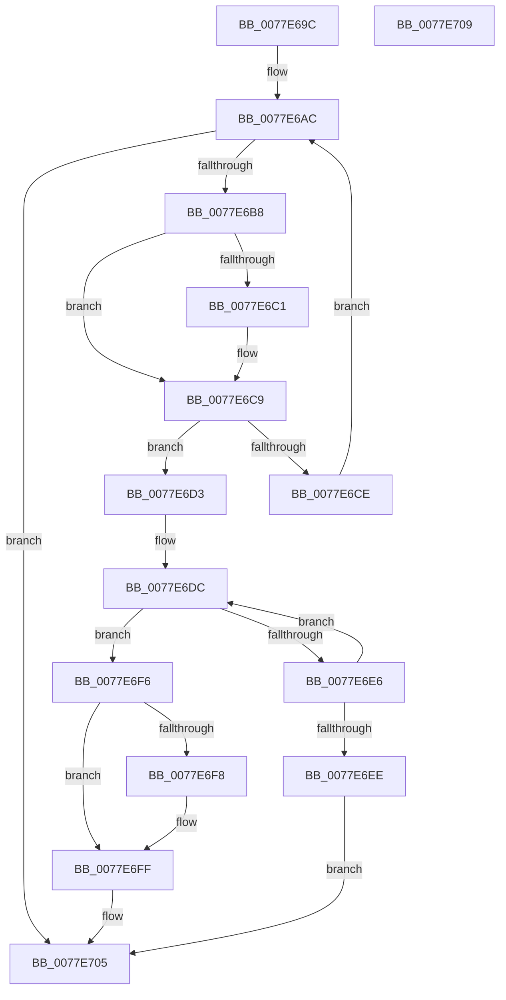

# PspLookupSyscallProviderByIdNoLock

- RVA: `0x0077E69C`–`0x0077E70A` (길이 `110` bytes)
- VA: `0x000000014077E69C`
- 실행 섹션: `PAGE`
- PDB 이름 있음: `예`; PDB Function 태그: `아니요`
- unwind 정보 RVA: `0x000DB714`
- 디코드: `32`개 명령, `110/110` bytes 표시
- 미해석 바이트: `0` (있으면 어셈블리에 `.byte`로 보존)

> 이 문서는 커널 이미지의 기계어와 PDB 기호를 분석해 생성했습니다. 4번과 5번은 함수 원형과 자료형을 바이너리 사용 방식에서 추정한 C 해석이며 원본 소스 복구 결과는 아닙니다.

## 1. Dependencies

- 직접 호출 지점: **0**; 고유 호출 대상: **0**
- 직접 호출자로 확인된 함수: **2**
- RIP 상대 이미지 참조: **1**

### Outgoing calls
- 직접 디코드된 call 명령이 없습니다.

### Direct callers
- [PspLookupSyscallProviderById](../../text/5E/PspLookupSyscallProviderById_function_005E237C.md) at `0x005E23EF`
- [PsRegisterSyscallProvider](PsRegisterSyscallProvider_function_0077E140.md) at `0x0077E267`

### Static image references
- `0x0077E69C` → RVA `0x00FD82D0` (`PAGEDATA`; read)

## 2. Other-region calls and transfers

- 다른 실행 섹션으로 향하는 call: **0**
- 별도 외부 분기/꼬리 이동을 확인하지 못했습니다.

## 3. Assembly (complete function range)

```asm
0077E69C  4C 8B 05 2D 9C 85 00            mov r8, qword ptr [rip + 0x859c2d]
0077E6A3  4C 8B D2                        mov r10, rdx
0077E6A6  41 B9 25 02 00 C0               mov r9d, 0xc0000225
0077E6AC  48 8D 05 1D 9C 85 00            lea rax, [rip + 0x859c1d]
0077E6B3  4C 3B C0                        cmp r8, rax
0077E6B6  74 4D                           je 0x14077e705
0077E6B8  49 8B 50 10                     mov rdx, qword ptr [r8 + 0x10]
0077E6BC  48 2B 11                        sub rdx, qword ptr [rcx]
0077E6BF  75 08                           jne 0x14077e6c9
0077E6C1  49 8B 50 18                     mov rdx, qword ptr [r8 + 0x18]
0077E6C5  48 2B 51 08                     sub rdx, qword ptr [rcx + 8]
0077E6C9  48 85 D2                        test rdx, rdx
0077E6CC  74 05                           je 0x14077e6d3
0077E6CE  4D 8B 00                        mov r8, qword ptr [r8]
0077E6D1  EB D9                           jmp 0x14077e6ac
0077E6D3  41 0F 0D 48 30                  prefetchw byte ptr [r8 + 0x30]
0077E6D8  49 8B 40 30                     mov rax, qword ptr [r8 + 0x30]
0077E6DC  48 8D 48 01                     lea rcx, [rax + 1]
0077E6E0  48 83 F9 01                     cmp rcx, 1
0077E6E4  76 10                           jbe 0x14077e6f6
0077E6E6  F0 49 0F B1 48 30               lock cmpxchg qword ptr [r8 + 0x30], rcx
0077E6EC  75 EE                           jne 0x14077e6dc
0077E6EE  4D 89 02                        mov qword ptr [r10], r8
0077E6F1  45 33 C9                        xor r9d, r9d
0077E6F4  EB 0F                           jmp 0x14077e705
0077E6F6  74 07                           je 0x14077e6ff
0077E6F8  B9 0E 00 00 00                  mov ecx, 0xe
0077E6FD  CD 29                           int 0x29
0077E6FF  41 B9 56 00 00 C0               mov r9d, 0xc0000056
0077E705  41 8B C1                        mov eax, r9d
0077E708  C3                              ret
0077E709  CC                              int3
```

## 4. C-style interpretation (structured pseudocode)

```c
__int64 __fastcall PspLookupSyscallProviderByIdNoLock(__int64 a1, __int64 a2)
{
loc_0077E6AC:
    if ((*(unsigned __int64 *)(v_rip + 8756269)) == (v_rip + 8756253)) goto loc_0077E705;
    a2 = (*(unsigned __int64 *)(*(unsigned __int64 *)(v_rip + 8756269) + 16)) - (*(unsigned __int64 *)(a1));
    if (!(condition_is_not_equal)) {
        a2 = *(unsigned __int64 *)(*(unsigned __int64 *)(v_rip + 8756269) + 24);
        a2 = (a2) - (*(unsigned __int64 *)(a1 + 8));
    }
    if (a2 == 0) goto loc_0077E6D3;
    goto loc_0077E6AC;
loc_0077E6D3:
loc_0077E6DC:
    if ((*(unsigned __int64 *)(*(unsigned __int64 *)(*(unsigned __int64 *)(v_rip + 8756269)) + 48) + 1) <= 1) goto loc_0077E6F6;
    if ((*(unsigned __int64 *)(*(unsigned __int64 *)(*(unsigned __int64 *)(v_rip + 8756269)) + 48) + 1) != 1) goto loc_0077E6DC;
    *(unsigned __int64 *)(a2) = *(unsigned __int64 *)(*(unsigned __int64 *)(v_rip + 8756269));
    a4 = 0;
    goto loc_0077E705;
loc_0077E6F6:
    if (!(condition_is_equal)) {
        a1 = 14;
    }
loc_0077E705:
    return (unsigned int)((unsigned int)((unsigned int)(0xC0000056ULL)));
}
```

## 5. (Beta) C Style

```c
int64_t PspLookupSyscallProviderByIdNoLock(void *Arg1, void *Arg2)
{
    uint8_t *arg1 = (uint8_t *)Arg1;
    uint8_t *arg2 = (uint8_t *)Arg2;

loc_0077E6AC:
    if ((*(uint64_t *)(v_rip + 0x859C2D)) == (v_rip + 8756253)) goto loc_0077E705;
    Arg2 = (*(uint64_t *)(*(uint64_t *)(v_rip + 0x859C2D) + 0x10)) - (*(uint64_t *)(arg1));
    if (!(condition_is_not_equal)) {
        Arg2 = *(uint64_t *)(*(uint64_t *)(v_rip + 0x859C2D) + 0x18);
        Arg2 = (Arg2) - (*(uint64_t *)(arg1 + 0x8));
    }
    if (Arg2 == NULL) goto loc_0077E6D3;
    goto loc_0077E6AC;
loc_0077E6D3:
loc_0077E6DC:
    if ((*(uint64_t *)(*(uint64_t *)(*(uint64_t *)(v_rip + 0x859C2D)) + 0x30) + 1) <= 1) goto loc_0077E6F6;
    if ((*(uint64_t *)(*(uint64_t *)(*(uint64_t *)(v_rip + 0x859C2D)) + 0x30) + 1) != 1) goto loc_0077E6DC;
    *(uint64_t *)(arg2) = *(uint64_t *)(*(uint64_t *)(v_rip + 0x859C2D));
    a4 = 0;
    goto loc_0077E705;
loc_0077E6F6:
    if (!(condition_is_equal)) {
        Arg1 = 14;
    }
loc_0077E705:
    return (uint32_t)((uint32_t)((uint32_t)(0xC0000056ULL)));
}
```

### 관측된 메모리 오프셋

구조체 형식이 확인되지 않은 접근은 인자 기준의 오프셋으로만 기록했습니다.

| 기준 인자 | 오프셋 표현 | 폭 (bit) | 접근 |
|---|---:|---:|---|
| `Arg1` | `+ 0x0` | `64` | `R` |
| `Arg1` | `+ 0x8` | `64` | `R` |
| `Arg2` | `+ 0x0` | `64` | `W` |

## 6. Execution-region graph

[열기: 2D/3D 그래프와 함수 탐색 컨트롤 패널](../../../control-panel.html?section=page&rva=0x0077E69C&view=graph)

- 2D 그래프는 위에서 아래로 흐르고, 3D 그래프는 빈 공간을 드래그해 회전합니다. Shift+드래그는 이동, 휠은 확대·축소, 함수 노드 선택은 대상 보고서 이동입니다.

### Static fallback


