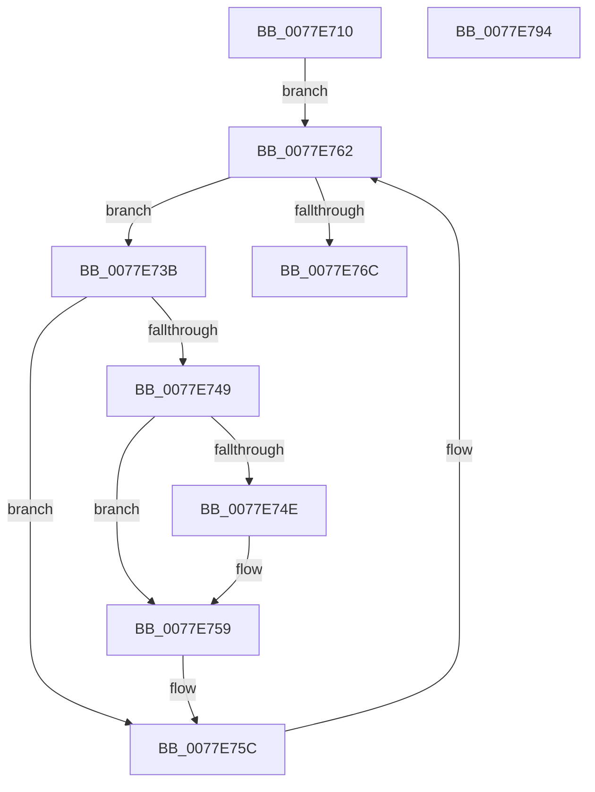

# PspQuerySyscallProviderProcessList

- RVA: `0x0077E710`–`0x0077E795` (길이 `133` bytes)
- VA: `0x000000014077E710`
- 실행 섹션: `PAGE`
- PDB 이름 있음: `예`; PDB Function 태그: `아니요`
- unwind 정보 RVA: `0x0005E6B4`
- 디코드: `39`개 명령, `133/133` bytes 표시
- 미해석 바이트: `0` (있으면 어셈블리에 `.byte`로 보존)

> 이 문서는 커널 이미지의 기계어와 PDB 기호를 분석해 생성했습니다. 4번과 5번은 함수 원형과 자료형을 바이너리 사용 방식에서 추정한 C 해석이며 원본 소스 복구 결과는 아닙니다.

## 1. Dependencies

- 직접 호출 지점: **1**; 고유 호출 대상: **1**
- 직접 호출자로 확인된 함수: **1**
- RIP 상대 이미지 참조: **0**

### Outgoing calls
- `0x0077E762` → [PspGetNextSyscallProviderProcess](PspGetNextSyscallProviderProcess_function_0077E598.md) (function, `0x0077E598`)

### Direct callers
- [PsQuerySyscallProviderInformation](PsQuerySyscallProviderInformation_function_0077E0E0.md) at `0x0077E0FC`

### Static image references
- 디코드된 RIP-relative 메모리 참조가 없습니다.

## 2. Other-region calls and transfers

- 다른 실행 섹션으로 향하는 call: **0**
- 별도 외부 분기/꼬리 이동을 확인하지 못했습니다.

## 3. Assembly (complete function range)

```asm
0077E710  48 8B C4                        mov rax, rsp
0077E713  48 89 58 08                     mov qword ptr [rax + 8], rbx
0077E717  48 89 68 10                     mov qword ptr [rax + 0x10], rbp
0077E71B  48 89 70 18                     mov qword ptr [rax + 0x18], rsi
0077E71F  48 89 78 20                     mov qword ptr [rax + 0x20], rdi
0077E723  41 56                           push r14
0077E725  48 83 EC 20                     sub rsp, 0x20
0077E729  48 8B 3A                        mov rdi, qword ptr [rdx]
0077E72C  33 DB                           xor ebx, ebx
0077E72E  48 8B F2                        mov rsi, rdx
0077E731  4D 8B F0                        mov r14, r8
0077E734  33 D2                           xor edx, edx
0077E736  48 8B E9                        mov rbp, rcx
0077E739  EB 27                           jmp 0x14077e762
0077E73B  8B 88 F4 01 00 00               mov ecx, dword ptr [rax + 0x1f4]
0077E741  F7 C1 08 00 00 40               test ecx, 0x40000008
0077E747  75 13                           jne 0x14077e75c
0077E749  48 3B DF                        cmp rbx, rdi
0077E74C  73 0B                           jae 0x14077e759
0077E74E  48 8B 88 D0 01 00 00            mov rcx, qword ptr [rax + 0x1d0]
0077E755  49 89 0C DE                     mov qword ptr [r14 + rbx*8], rcx
0077E759  48 FF C3                        inc rbx
0077E75C  48 8B D0                        mov rdx, rax
0077E75F  48 8B CD                        mov rcx, rbp
0077E762  E8 31 FE FF FF                  call 0x14077e598
0077E767  48 85 C0                        test rax, rax
0077E76A  75 CF                           jne 0x14077e73b
0077E76C  48 8B 6C 24 38                  mov rbp, qword ptr [rsp + 0x38]
0077E771  48 3B FB                        cmp rdi, rbx
0077E774  48 8B 7C 24 48                  mov rdi, qword ptr [rsp + 0x48]
0077E779  48 89 1E                        mov qword ptr [rsi], rbx
0077E77C  1B C0                           sbb eax, eax
0077E77E  48 8B 5C 24 30                  mov rbx, qword ptr [rsp + 0x30]
0077E783  25 05 00 00 80                  and eax, 0x80000005
0077E788  48 8B 74 24 40                  mov rsi, qword ptr [rsp + 0x40]
0077E78D  48 83 C4 20                     add rsp, 0x20
0077E791  41 5E                           pop r14
0077E793  C3                              ret
0077E794  CC                              int3
```

## 4. C-style interpretation (structured pseudocode)

```c
__int64 __fastcall PspQuerySyscallProviderProcessList(__int64 a1, __int64 a2, __int64 a3)
{
    __int64 result;
    __int64 v_rbx;
    __int64 v_rsp;
    unsigned __int64 v_stack_p10;
    unsigned __int64 v_stack_p18;
    unsigned __int64 v_stack_p20;
    unsigned __int64 v_stack_p8;

    *(unsigned __int64 *)(v_rsp + 8) = v_rbx;
    *(unsigned __int64 *)(v_rsp + 16) = v_rbp;
    *(unsigned __int64 *)(v_rsp + 24) = v_rsi;
    *(unsigned __int64 *)(v_rsp + 32) = v_rdi;
    v_rsp = (v_rsp) - (32);
    v_rbx = 0;
    a2 = 0;
    goto loc_0077E762;
loc_0077E73B:
    if ((((unsigned int)((unsigned int)(*(unsigned int *)(v_rsp + 500)))) & (0x40000008ULL)) != 0) goto loc_0077E75C;
    if (0 < (*(unsigned __int64 *)(a2))) {
        a1 = *(unsigned __int64 *)(v_rsp + 464);
        *(unsigned __int64 *)(a3 + v_rbx * 8) = a1;
    }
    v_rbx = (v_rbx) + 1;
loc_0077E75C:
loc_0077E762:
    result = PspGetNextSyscallProviderProcess(a1, v_rsp, a3, a4);
    if (result != 0) goto loc_0077E73B;
    *(unsigned __int64 *)(a2) = v_rbx;
    result = (unsigned int)((result) & (0x80000005ULL));
    v_rsp = (v_rsp) + (32);
    return result;
}
```

## 5. (Beta) C Style

```c
int64_t PspQuerySyscallProviderProcessList(int64_t Arg1, void *Arg2, void *Arg3)
{
    uint8_t *arg2 = (uint8_t *)Arg2;
    uint8_t *arg3 = (uint8_t *)Arg3;

    int64_t result;
    int64_t local_rbx;
    int64_t local_rsp;
    uint64_t v_stack_p10;
    uint64_t v_stack_p18;
    uint64_t v_stack_p20;
    uint64_t v_stack_p8;

    *(uint64_t *)(local_rsp + 0x8) = local_rbx;
    *(uint64_t *)(local_rsp + 0x10) = local_rbp;
    *(uint64_t *)(local_rsp + 0x18) = local_rsi;
    *(uint64_t *)(local_rsp + 0x20) = local_rdi;
    local_rsp = (local_rsp) - (32);
    local_rbx = 0;
    Arg2 = 0;
    goto loc_0077E762;
loc_0077E73B:
    if ((((uint32_t)((uint32_t)(*(uint32_t *)(local_rsp + 0x1F4)))) & (0x40000008ULL)) != 0) goto loc_0077E75C;
    if (0 < (*(uint64_t *)(arg2))) {
        Arg1 = *(uint64_t *)(local_rsp + 0x1D0);
        *(uint64_t *)(arg3 + local_rbx * 8) = Arg1;
    }
    local_rbx = (local_rbx) + 1;
loc_0077E75C:
loc_0077E762:
    result = PspGetNextSyscallProviderProcess(Arg1, local_rsp, Arg3, a4);
    if (result != 0) goto loc_0077E73B;
    *(uint64_t *)(arg2) = local_rbx;
    result = (uint32_t)((result) & (0x80000005ULL));
    local_rsp = (local_rsp) + (32);
    return result;
}
```

### 관측된 메모리 오프셋

구조체 형식이 확인되지 않은 접근은 인자 기준의 오프셋으로만 기록했습니다.

| 기준 인자 | 오프셋 표현 | 폭 (bit) | 접근 |
|---|---:|---:|---|
| `Arg2` | `+ 0x0` | `64` | `R` |
| `Arg2` | `+ 0x0` | `64` | `W` |
| `Arg3` | `+ 0x0 + rbx*8` | `64` | `W` |

## 6. Execution-region graph

[열기: 2D/3D 그래프와 함수 탐색 컨트롤 패널](../../../control-panel.html?section=page&rva=0x0077E710&view=graph)

- 2D 그래프는 위에서 아래로 흐르고, 3D 그래프는 빈 공간을 드래그해 회전합니다. Shift+드래그는 이동, 휠은 확대·축소, 함수 노드 선택은 대상 보고서 이동입니다.

### Static fallback


