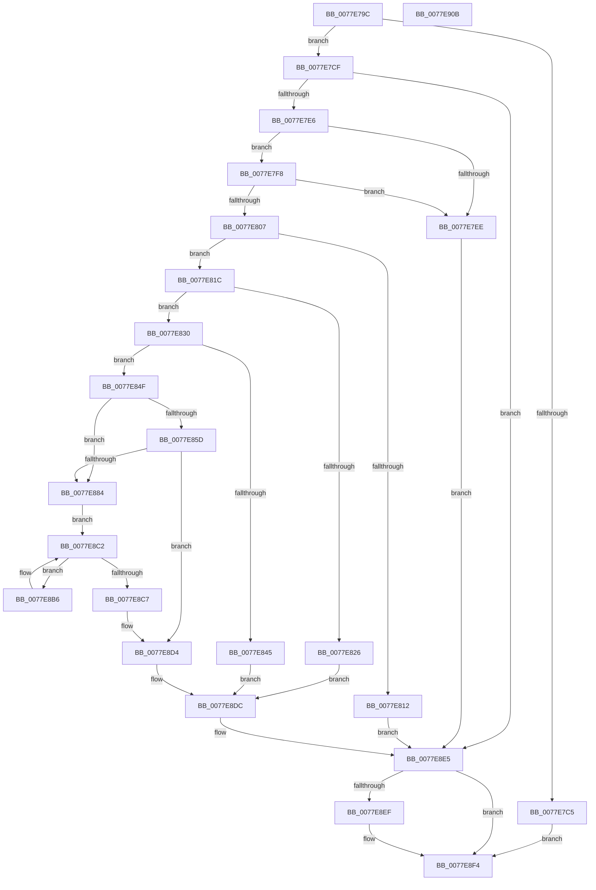

# PspSyscallProviderOptIn

- RVA: `0x0077E79C`–`0x0077E90C` (길이 `368` bytes)
- VA: `0x000000014077E79C`
- 실행 섹션: `PAGE`
- PDB 이름 있음: `예`; PDB Function 태그: `아니요`
- unwind 정보 RVA: `0x000A118C`
- 디코드: `93`개 명령, `368/368` bytes 표시
- 미해석 바이트: `0` (있으면 어셈블리에 `.byte`로 보존)

> 이 문서는 커널 이미지의 기계어와 PDB 기호를 분석해 생성했습니다. 4번과 5번은 함수 원형과 자료형을 바이너리 사용 방식에서 추정한 C 해석이며 원본 소스 복구 결과는 아닙니다.

## 1. Dependencies

- 직접 호출 지점: **8**; 고유 호출 대상: **8**
- 직접 호출자로 확인된 함수: **1**
- RIP 상대 이미지 참조: **0**

### Outgoing calls
- `0x0077E7D7` → [PspLookupSyscallProviderById](../../text/5E/PspLookupSyscallProviderById_function_005E237C.md) (function, `0x005E237C`)
- `0x0077E83C` → [ExAcquireRundownProtection](../../text/21/ExAcquireRundownProtection_function_00216620.md) (function, `0x00216620`)
- `0x0077E879` → [guard_dispatch_icall](../../text/6B/guard_dispatch_icall_function_006BAAD0.md) (function, `0x006BAAD0`)
- `0x0077E893` → [PspLockProcessExclusive](../../text/46/PspLockProcessExclusive_function_00460164.md) (function, `0x00460164`)
- `0x0077E8A5` → [PspAttachProcessToSyscallProvider](PspAttachProcessToSyscallProvider_function_0077E36C.md) (function, `0x0077E36C`)
- `0x0077E8CD` → [PspUnlockProcessExclusive](../../text/46/PspUnlockProcessExclusive_function_004601C0.md) (function, `0x004601C0`)
- `0x0077E8D7` → [ExReleaseRundownProtection](../../text/34/ExReleaseRundownProtection_function_00349E80.md) (function, `0x00349E80`)
- `0x0077E8EF` → [PspDereferenceSyscallProvider](../../text/5E/PspDereferenceSyscallProvider_function_005E22E8.md) (function, `0x005E22E8`)

### Direct callers
- [NtSetInformationProcess](../AE/NtSetInformationProcess_function_00AE5370.md) at `0x00AE9944`

### Static image references
- 디코드된 RIP-relative 메모리 참조가 없습니다.

## 2. Other-region calls and transfers

- 다른 실행 섹션으로 향하는 call: **7**
  - `0x0077E7D7` → [PspLookupSyscallProviderById](../../text/5E/PspLookupSyscallProviderById_function_005E237C.md) (`PAGE` → `.text`)
  - `0x0077E83C` → [ExAcquireRundownProtection](../../text/21/ExAcquireRundownProtection_function_00216620.md) (`PAGE` → `.text`)
  - `0x0077E879` → [guard_dispatch_icall](../../text/6B/guard_dispatch_icall_function_006BAAD0.md) (`PAGE` → `.text`)
  - `0x0077E893` → [PspLockProcessExclusive](../../text/46/PspLockProcessExclusive_function_00460164.md) (`PAGE` → `.text`)
  - `0x0077E8CD` → [PspUnlockProcessExclusive](../../text/46/PspUnlockProcessExclusive_function_004601C0.md) (`PAGE` → `.text`)
  - `0x0077E8D7` → [ExReleaseRundownProtection](../../text/34/ExReleaseRundownProtection_function_00349E80.md) (`PAGE` → `.text`)
  - `0x0077E8EF` → [PspDereferenceSyscallProvider](../../text/5E/PspDereferenceSyscallProvider_function_005E22E8.md) (`PAGE` → `.text`)
- 별도 외부 분기/꼬리 이동을 확인하지 못했습니다.

## 3. Assembly (complete function range)

```asm
0077E79C  48 8B C4                        mov rax, rsp
0077E79F  48 89 58 10                     mov qword ptr [rax + 0x10], rbx
0077E7A3  48 89 68 18                     mov qword ptr [rax + 0x18], rbp
0077E7A7  48 89 70 20                     mov qword ptr [rax + 0x20], rsi
0077E7AB  57                              push rdi
0077E7AC  48 83 EC 30                     sub rsp, 0x30
0077E7B0  48 83 60 08 00                  and qword ptr [rax + 8], 0
0077E7B5  48 8B F2                        mov rsi, rdx
0077E7B8  8B 81 FC 05 00 00               mov eax, dword ptr [rcx + 0x5fc]
0077E7BE  48 8B F9                        mov rdi, rcx
0077E7C1  A8 01                           test al, 1
0077E7C3  74 0A                           je 0x14077e7cf
0077E7C5  BB BB 00 00 C0                  mov ebx, 0xc00000bb
0077E7CA  E9 25 01 00 00                  jmp 0x14077e8f4
0077E7CF  48 8D 54 24 40                  lea rdx, [rsp + 0x40]
0077E7D4  48 8B CE                        mov rcx, rsi
0077E7D7  E8 A0 3B E6 FF                  call 0x1405e237c
0077E7DC  8B D8                           mov ebx, eax
0077E7DE  85 C0                           test eax, eax
0077E7E0  0F 88 FF 00 00 00               js 0x14077e8e5
0077E7E6  0F B6 46 10                     movzx eax, byte ptr [rsi + 0x10]
0077E7EA  3C 01                           cmp al, 1
0077E7EC  72 0A                           jb 0x14077e7f8
0077E7EE  BB 0D 00 00 C0                  mov ebx, 0xc000000d
0077E7F3  E9 ED 00 00 00                  jmp 0x14077e8e5
0077E7F8  48 8B C8                        mov rcx, rax
0077E7FB  48 8B 44 24 40                  mov rax, qword ptr [rsp + 0x40]
0077E800  83 7C C8 5C FF                  cmp dword ptr [rax + rcx*8 + 0x5c], -1
0077E805  74 E7                           je 0x14077e7ee
0077E807  F0 0F BA AF FC 05 00 00 19      lock bts dword ptr [rdi + 0x5fc], 0x19
0077E810  73 0A                           jae 0x14077e81c
0077E812  BB 01 00 00 C0                  mov ebx, 0xc0000001
0077E817  E9 C9 00 00 00                  jmp 0x14077e8e5
0077E81C  48 83 BF B8 07 00 00 00         cmp qword ptr [rdi + 0x7b8], 0
0077E824  74 0A                           je 0x14077e830
0077E826  BB 22 00 00 C0                  mov ebx, 0xc0000022
0077E82B  E9 AC 00 00 00                  jmp 0x14077e8dc
0077E830  48 8B 5C 24 40                  mov rbx, qword ptr [rsp + 0x40]
0077E835  48 8D 6B 38                     lea rbp, [rbx + 0x38]
0077E839  48 8B CD                        mov rcx, rbp
0077E83C  E8 DF 7D A9 FF                  call 0x140216620
0077E841  84 C0                           test al, al
0077E843  75 0A                           jne 0x14077e84f
0077E845  BB 56 00 00 C0                  mov ebx, 0xc0000056
0077E84A  E9 8D 00 00 00                  jmp 0x14077e8dc
0077E84F  83 64 24 2C 00                  and dword ptr [rsp + 0x2c], 0
0077E854  48 8B 43 28                     mov rax, qword ptr [rbx + 0x28]
0077E858  48 85 C0                        test rax, rax
0077E85B  74 27                           je 0x14077e884
0077E85D  48 8B 8F D0 02 00 00            mov rcx, qword ptr [rdi + 0x2d0]
0077E864  48 8D 54 24 20                  lea rdx, [rsp + 0x20]
0077E869  48 89 4C 24 20                  mov qword ptr [rsp + 0x20], rcx
0077E86E  0F B6 4E 10                     movzx ecx, byte ptr [rsi + 0x10]
0077E872  89 4C 24 28                     mov dword ptr [rsp + 0x28], ecx
0077E876  48 8B CF                        mov rcx, rdi
0077E879  E8 52 C2 F3 FF                  call 0x1406baad0
0077E87E  8B D8                           mov ebx, eax
0077E880  85 C0                           test eax, eax
0077E882  78 50                           js 0x14077e8d4
0077E884  65 48 8B 1C 25 88 01 00 00      mov rbx, qword ptr gs:[0x188]
0077E88D  48 8B CF                        mov rcx, rdi
0077E890  48 8B D3                        mov rdx, rbx
0077E893  E8 CC 18 CE FF                  call 0x140460164
0077E898  44 0F B6 46 10                  movzx r8d, byte ptr [rsi + 0x10]
0077E89D  48 8B CF                        mov rcx, rdi
0077E8A0  48 8B 54 24 40                  mov rdx, qword ptr [rsp + 0x40]
0077E8A5  E8 C2 FA FF FF                  call 0x14077e36c
0077E8AA  4C 8D 87 70 03 00 00            lea r8, [rdi + 0x370]
0077E8B1  49 8B 00                        mov rax, qword ptr [r8]
0077E8B4  EB 0C                           jmp 0x14077e8c2
0077E8B6  F0 0F BA A8 88 FA FF FF 1D      lock bts dword ptr [rax - 0x578], 0x1d
0077E8BF  48 8B 00                        mov rax, qword ptr [rax]
0077E8C2  49 3B C0                        cmp rax, r8
0077E8C5  75 EF                           jne 0x14077e8b6
0077E8C7  48 8B D3                        mov rdx, rbx
0077E8CA  48 8B CF                        mov rcx, rdi
0077E8CD  E8 EE 18 CE FF                  call 0x1404601c0
0077E8D2  33 DB                           xor ebx, ebx
0077E8D4  48 8B CD                        mov rcx, rbp
0077E8D7  E8 A4 B5 BC FF                  call 0x140349e80
0077E8DC  F0 0F BA B7 FC 05 00 00 19      lock btr dword ptr [rdi + 0x5fc], 0x19
0077E8E5  48 8B 4C 24 40                  mov rcx, qword ptr [rsp + 0x40]
0077E8EA  48 85 C9                        test rcx, rcx
0077E8ED  74 05                           je 0x14077e8f4
0077E8EF  E8 F4 39 E6 FF                  call 0x1405e22e8
0077E8F4  48 8B 6C 24 50                  mov rbp, qword ptr [rsp + 0x50]
0077E8F9  8B C3                           mov eax, ebx
0077E8FB  48 8B 5C 24 48                  mov rbx, qword ptr [rsp + 0x48]
0077E900  48 8B 74 24 58                  mov rsi, qword ptr [rsp + 0x58]
0077E905  48 83 C4 30                     add rsp, 0x30
0077E909  5F                              pop rdi
0077E90A  C3                              ret
0077E90B  CC                              int3
```

## 4. C-style interpretation (structured pseudocode)

```c
__int64 __fastcall PspSyscallProviderOptIn(__int64 a1, __int64 a2)
{
    __int64 result;
    __int64 v_rbx;
    __int64 v_rsp;
    unsigned int v_stack_m10;
    unsigned __int64 v_stack_m18;
    unsigned int v_stack_mC;
    unsigned __int64 v_stack_p10;
    unsigned __int64 v_stack_p18;
    unsigned __int64 v_stack_p20;
    unsigned __int64 v_stack_p8;

    *(unsigned __int64 *)(v_rsp + 16) = v_rbx;
    *(unsigned __int64 *)(v_rsp + 24) = v_rbp;
    *(unsigned __int64 *)(v_rsp + 32) = v_rsi;
    v_rsp = (v_rsp) - (48);
    if ((((unsigned __int8)((unsigned int)(*(unsigned int *)(a1 + 1532)))) & (1)) == 0) goto loc_0077E7CF;
    goto loc_0077E8F4;
loc_0077E7CF:
    result = PspLookupSyscallProviderById(a2, v_stack_p8, a3, a4);
    if (sign_flag) goto loc_0077E8E5;
    if (((unsigned __int8)(*(unsigned __int8 *)(a2 + 16))) < 1) goto loc_0077E7F8;
loc_0077E7EE:
    goto loc_0077E8E5;
loc_0077E7F8:
    if ((*(unsigned int *)(v_stack_p8 + *(unsigned __int8 *)(a2 + 16) * 8 + 92)) == -1) goto loc_0077E7EE;
    if ((*(unsigned int *)(v_stack_p8 + *(unsigned __int8 *)(a2 + 16) * 8 + 92)) >= -1) goto loc_0077E81C;
    goto loc_0077E8E5;
loc_0077E81C:
    if ((*(unsigned __int64 *)(a1 + 1976)) == 0) goto loc_0077E830;
    goto loc_0077E8DC;
loc_0077E830:
    result = ExAcquireRundownProtection(v_stack_p8 + 56, v_stack_p8, a3, a4);
    if ((unsigned __int8)(result) != 0) goto loc_0077E84F;
    goto loc_0077E8DC;
loc_0077E84F:
    if (*(unsigned __int64 *)((unsigned int)(0xC0000056ULL) + 40) == 0) goto loc_0077E884;
    v_stack_m18 = *(unsigned __int64 *)(a1 + 720);
    v_stack_m10 = (unsigned int)(*(unsigned __int8 *)(a2 + 16));
    result = guard_dispatch_icall(a1, v_stack_m18, a3, a4);
    if (sign_flag) goto loc_0077E8D4;
loc_0077E884:
    result = PspLockProcessExclusive(a1, *(unsigned __int64 *)(gs_base + (0 + 392)), a3, a4);
    result = PspAttachProcessToSyscallProvider(a1, v_stack_p8, *(unsigned __int8 *)(a2 + 16), a4);
    goto loc_0077E8C2;
loc_0077E8B6:
loc_0077E8C2:
    if ((*(unsigned __int64 *)(*(unsigned __int64 *)(a1 + 880))) != (a1 + 880)) goto loc_0077E8B6;
    result = PspUnlockProcessExclusive(a1, *(unsigned __int64 *)(gs_base + (0 + 392)), a1 + 880, a4);
    v_rbx = 0;
loc_0077E8D4:
    result = ExReleaseRundownProtection(v_stack_p8 + 56, *(unsigned __int64 *)(gs_base + (0 + 392)), a1 + 880, a4);
loc_0077E8DC:
loc_0077E8E5:
    if (v_stack_p8 != 0) {
        result = PspDereferenceSyscallProvider(v_stack_p8, *(unsigned __int64 *)(gs_base + (0 + 392)), a1 + 880, a4);
    }
    v_rsp = (v_rsp) + (48);
    return 0;
}
```

## 5. (Beta) C Style

```c
int64_t PspSyscallProviderOptIn(void *Arg1, void *Arg2)
{
    uint8_t *arg1 = (uint8_t *)Arg1;
    uint8_t *arg2 = (uint8_t *)Arg2;

    int64_t result;
    int64_t local_rbx;
    int64_t local_rsp;
    uint32_t v_stack_m10;
    uint64_t v_stack_m18;
    uint32_t v_stack_mC;
    uint64_t v_stack_p10;
    uint64_t v_stack_p18;
    uint64_t v_stack_p20;
    uint64_t v_stack_p8;

    *(uint64_t *)(local_rsp + 0x10) = local_rbx;
    *(uint64_t *)(local_rsp + 0x18) = local_rbp;
    *(uint64_t *)(local_rsp + 0x20) = local_rsi;
    local_rsp = (local_rsp) - (48);
    if ((((uint8_t)((uint32_t)(*(uint32_t *)(arg1 + 0x5FC)))) & (1)) == 0) goto loc_0077E7CF;
    goto loc_0077E8F4;
loc_0077E7CF:
    result = PspLookupSyscallProviderById(Arg2, v_stack_p8, a3, a4);
    if (sign_flag) goto loc_0077E8E5;
    if (((uint8_t)(*(uint8_t *)(arg2 + 0x10))) < 1) goto loc_0077E7F8;
loc_0077E7EE:
    goto loc_0077E8E5;
loc_0077E7F8:
    if ((*(uint32_t *)(v_stack_p8 + *(uint8_t *)(arg2 + 0x10) * 8 + 0x5C)) == -1) goto loc_0077E7EE;
    if ((*(uint32_t *)(v_stack_p8 + *(uint8_t *)(arg2 + 0x10) * 8 + 0x5C)) >= -1) goto loc_0077E81C;
    goto loc_0077E8E5;
loc_0077E81C:
    if ((*(uint64_t *)(arg1 + 0x7B8)) == 0) goto loc_0077E830;
    goto loc_0077E8DC;
loc_0077E830:
    result = ExAcquireRundownProtection(v_stack_p8 + 56, v_stack_p8, a3, a4);
    if ((uint8_t)(result) != 0) goto loc_0077E84F;
    goto loc_0077E8DC;
loc_0077E84F:
    if (*(uint64_t *)((uint32_t)(0xC0000056ULL) + 0x28) == 0) goto loc_0077E884;
    v_stack_m18 = *(uint64_t *)(arg1 + 0x2D0);
    v_stack_m10 = (uint32_t)(*(uint8_t *)(arg2 + 0x10));
    result = guard_dispatch_icall(Arg1, v_stack_m18, a3, a4);
    if (sign_flag) goto loc_0077E8D4;
loc_0077E884:
    result = PspLockProcessExclusive(Arg1, *(uint64_t *)(gs_base + (0 + 0x188)), a3, a4);
    result = PspAttachProcessToSyscallProvider(Arg1, v_stack_p8, *(uint8_t *)(arg2 + 0x10), a4);
    goto loc_0077E8C2;
loc_0077E8B6:
loc_0077E8C2:
    if ((*(uint64_t *)(*(uint64_t *)(arg1 + 0x370))) != (Arg1 + 880)) goto loc_0077E8B6;
    result = PspUnlockProcessExclusive(Arg1, *(uint64_t *)(gs_base + (0 + 0x188)), Arg1 + 880, a4);
    local_rbx = 0;
loc_0077E8D4:
    result = ExReleaseRundownProtection(v_stack_p8 + 56, *(uint64_t *)(gs_base + (0 + 0x188)), Arg1 + 880, a4);
loc_0077E8DC:
loc_0077E8E5:
    if (v_stack_p8 != 0) {
        result = PspDereferenceSyscallProvider(v_stack_p8, *(uint64_t *)(gs_base + (0 + 0x188)), Arg1 + 880, a4);
    }
    local_rsp = (local_rsp) + (48);
    return 0;
}
```

### 관측된 메모리 오프셋

구조체 형식이 확인되지 않은 접근은 인자 기준의 오프셋으로만 기록했습니다.

| 기준 인자 | 오프셋 표현 | 폭 (bit) | 접근 |
|---|---:|---:|---|
| `Arg1` | `+ 0x0` | `64` | `R` |
| `Arg1` | `+ 0x2D0` | `64` | `R` |
| `Arg1` | `+ 0x370` | `64` | `R` |
| `Arg1` | `+ 0x5FC` | `32` | `R` |
| `Arg1` | `+ 0x5FC` | `32` | `R/W` |
| `Arg1` | `+ 0x7B8` | `64` | `R` |
| `Arg2` | `+ 0x10` | `8` | `R` |

## 6. Execution-region graph

[열기: 2D/3D 그래프와 함수 탐색 컨트롤 패널](../../../control-panel.html?section=page&rva=0x0077E79C&view=graph)

- 2D 그래프는 위에서 아래로 흐르고, 3D 그래프는 빈 공간을 드래그해 회전합니다. Shift+드래그는 이동, 휠은 확대·축소, 함수 노드 선택은 대상 보고서 이동입니다.

### Static fallback


