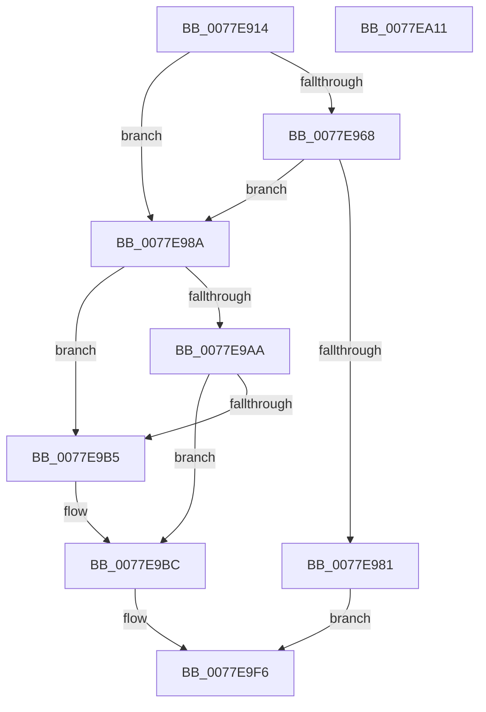

# PspSyscallProviderServiceDispatchGeneric

- RVA: `0x0077E914`–`0x0077EA12` (길이 `254` bytes)
- VA: `0x000000014077E914`
- 실행 섹션: `PAGE`
- PDB 이름 있음: `예`; PDB Function 태그: `아니요`
- unwind 정보 RVA: `0x000BEABC`
- 디코드: `66`개 명령, `254/254` bytes 표시
- 미해석 바이트: `0` (있으면 어셈블리에 `.byte`로 보존)

> 이 문서는 커널 이미지의 기계어와 PDB 기호를 분석해 생성했습니다. 4번과 5번은 함수 원형과 자료형을 바이너리 사용 방식에서 추정한 C 해석이며 원본 소스 복구 결과는 아닙니다.

## 1. Dependencies

- 직접 호출 지점: **3**; 고유 호출 대상: **3**
- 직접 호출자로 확인된 함수: **1**
- RIP 상대 이미지 참조: **3**

### Outgoing calls
- `0x0077E978` → [PspCaptureSystemServiceInMemoryArgs](PspCaptureSystemServiceInMemoryArgs_function_0077E400.md) (function, `0x0077E400`)
- `0x0077E9F1` → [guard_dispatch_icall](../../text/6B/guard_dispatch_icall_function_006BAAD0.md) (function, `0x006BAAD0`)
- `0x0077EA01` → [_security_check_cookie](../../text/6A/_security_check_cookie_function_006AC640.md) (function, `0x006AC640`)

### Direct callers
- [PsSyscallProviderDispatch](../AB/PsSyscallProviderDispatch_function_00AB3D80.md) at `0x00AB3ECC`

### Static image references
- `0x0077E91F` → RVA `0x00E0A740` (`.data`; read)
- `0x0077E9AA` → RVA `0x00FC73C0` (`ALMOSTRO`; read)
- `0x0077E9B5` → RVA `0x00FC7280` (`ALMOSTRO`; read)

## 2. Other-region calls and transfers

- 다른 실행 섹션으로 향하는 call: **2**
  - `0x0077E9F1` → [guard_dispatch_icall](../../text/6B/guard_dispatch_icall_function_006BAAD0.md) (`PAGE` → `.text`)
  - `0x0077EA01` → [_security_check_cookie](../../text/6A/_security_check_cookie_function_006AC640.md) (`PAGE` → `.text`)
- 별도 외부 분기/꼬리 이동을 확인하지 못했습니다.

## 3. Assembly (complete function range)

```asm
0077E914  40 53                           push rbx
0077E916  56                              push rsi
0077E917  57                              push rdi
0077E918  48 81 EC E0 00 00 00            sub rsp, 0xe0
0077E91F  48 8B 05 1A BE 68 00            mov rax, qword ptr [rip + 0x68be1a]
0077E926  48 33 C4                        xor rax, rsp
0077E929  48 89 84 24 D0 00 00 00         mov qword ptr [rsp + 0xd0], rax
0077E931  48 8B 41 38                     mov rax, qword ptr [rcx + 0x38]
0077E935  48 8B F2                        mov rsi, rdx
0077E938  48 8B BC 24 20 01 00 00         mov rdi, qword ptr [rsp + 0x120]
0077E940  48 89 44 24 30                  mov qword ptr [rsp + 0x30], rax
0077E945  48 8B 41 40                     mov rax, qword ptr [rcx + 0x40]
0077E949  48 89 44 24 38                  mov qword ptr [rsp + 0x38], rax
0077E94E  48 8B 41 48                     mov rax, qword ptr [rcx + 0x48]
0077E952  48 89 44 24 40                  mov qword ptr [rsp + 0x40], rax
0077E957  48 8B 41 50                     mov rax, qword ptr [rcx + 0x50]
0077E95B  48 89 44 24 48                  mov qword ptr [rsp + 0x48], rax
0077E960  41 8B D9                        mov ebx, r9d
0077E963  45 84 C0                        test r8b, r8b
0077E966  74 22                           je 0x14077e98a
0077E968  48 8B 89 80 01 00 00            mov rcx, qword ptr [rcx + 0x180]
0077E96F  48 8D 54 24 50                  lea rdx, [rsp + 0x50]
0077E974  48 83 C1 28                     add rcx, 0x28
0077E978  E8 83 FA FF FF                  call 0x14077e400
0077E97D  85 C0                           test eax, eax
0077E97F  79 09                           jns 0x14077e98a
0077E981  8B C0                           mov eax, eax
0077E983  48 89 07                        mov qword ptr [rdi], rax
0077E986  33 C0                           xor eax, eax
0077E988  EB 6C                           jmp 0x14077e9f6
0077E98A  65 48 8B 04 25 88 01 00 00      mov rax, qword ptr gs:[0x188]
0077E993  8B 48 78                        mov ecx, dword ptr [rax + 0x78]
0077E996  8B C3                           mov eax, ebx
0077E998  25 00 70 00 00                  and eax, 0x7000
0077E99D  81 E1 00 00 20 00               and ecx, 0x200000
0077E9A3  3D 00 10 00 00                  cmp eax, 0x1000
0077E9A8  75 0B                           jne 0x14077e9b5
0077E9AA  48 8D 15 0F 8A 84 00            lea rdx, [rip + 0x848a0f]
0077E9B1  85 C9                           test ecx, ecx
0077E9B3  75 07                           jne 0x14077e9bc
0077E9B5  48 8D 15 C4 88 84 00            lea rdx, [rip + 0x8488c4]
0077E9BC  48 8B CB                        mov rcx, rbx
0077E9BF  4C 8D 44 24 30                  lea r8, [rsp + 0x30]
0077E9C4  81 E1 FF 0F 00 00               and ecx, 0xfff
0077E9CA  48 8B C3                        mov rax, rbx
0077E9CD  48 C1 E8 0C                     shr rax, 0xc
0077E9D1  4C 8B CF                        mov r9, rdi
0077E9D4  83 E0 07                        and eax, 7
0077E9D7  48 C1 E0 05                     shl rax, 5
0077E9DB  48 03 C2                        add rax, rdx
0077E9DE  8B D3                           mov edx, ebx
0077E9E0  48 8B 00                        mov rax, qword ptr [rax]
0077E9E3  48 63 0C 88                     movsxd rcx, dword ptr [rax + rcx*4]
0077E9E7  48 C1 F9 04                     sar rcx, 4
0077E9EB  48 03 C8                        add rcx, rax
0077E9EE  48 8B C6                        mov rax, rsi
0077E9F1  E8 DA C0 F3 FF                  call 0x1406baad0
0077E9F6  48 8B 8C 24 D0 00 00 00         mov rcx, qword ptr [rsp + 0xd0]
0077E9FE  48 33 CC                        xor rcx, rsp
0077EA01  E8 3A DC F2 FF                  call 0x1406ac640
0077EA06  48 81 C4 E0 00 00 00            add rsp, 0xe0
0077EA0D  5F                              pop rdi
0077EA0E  5E                              pop rsi
0077EA0F  5B                              pop rbx
0077EA10  C3                              ret
0077EA11  CC                              int3
```

## 4. C-style interpretation (structured pseudocode)

```c
__int64 __fastcall PspSyscallProviderServiceDispatchGeneric(__int64 a1, __int64 a2, unsigned __int8 a3, int a4, __int64 a5)
{
    __int64 result;
    __int64 v_rsp;
    unsigned __int64 v_stack_m28;
    unsigned __int64 v_stack_mA8;
    unsigned __int64 v_stack_mB0;
    unsigned __int64 v_stack_mB8;
    unsigned __int64 v_stack_mC0;
    unsigned __int64 v_stack_mC8;

    v_rsp = (v_rsp) - (224);
    result = (*(unsigned __int64 *)(v_rip + 6864410)) ^ (v_rsp);
    v_stack_m28 = result;
    v_stack_mC8 = *(unsigned __int64 *)(a1 + 56);
    v_stack_mC0 = *(unsigned __int64 *)(a1 + 64);
    v_stack_mB8 = *(unsigned __int64 *)(a1 + 72);
    v_stack_mB0 = *(unsigned __int64 *)(a1 + 80);
    if (a3 == 0) goto loc_0077E98A;
    a1 = (*(unsigned __int64 *)(a1 + 384)) + (40);
    result = PspCaptureSystemServiceInMemoryArgs(a1, v_stack_mA8, a3, a4);
    if (!sign_flag) goto loc_0077E98A;
    *(unsigned __int64 *)(a5) = (unsigned int)((unsigned int)(result));
    result = 0;
    goto loc_0077E9F6;
loc_0077E98A:
    result = (unsigned int)(((unsigned int)((unsigned int)((unsigned int)(a4)))) & (0x7000ULL));
    a1 = (unsigned int)(((unsigned int)(*(unsigned int *)(*(unsigned __int64 *)(gs_base + (0 + 392)) + 120))) & (0x200000ULL));
    if (((unsigned int)(result)) != 0x1000ULL) goto loc_0077E9B5;
    if ((unsigned int)(a1) == 0) {
        a2 = v_rip + 8685764;
    }
    a1 = (unsigned int)(((unsigned int)(a4)) & (0xFFFULL));
    result = ((unsigned int)(a4)) >> (12);
    result = (unsigned int)((result) & (7));
    result = (result) << (5);
    result = (result) + (a2);
    a1 = ((int)(*(unsigned int *)(*(unsigned __int64 *)(result) + a1 * 4))) >> (4);
    a1 = (a1) + (*(unsigned __int64 *)(result));
    result = guard_dispatch_icall(a1, (unsigned int)((unsigned int)((unsigned int)(a4))), v_stack_mC8, a5);
loc_0077E9F6:
    a1 = (v_stack_m28) ^ (v_rsp);
    result = _security_check_cookie(a1, (unsigned int)((unsigned int)((unsigned int)(a4))), v_stack_mC8, a5);
    v_rsp = (v_rsp) + (224);
    return result;
}
```

## 5. (Beta) C Style

```c
int64_t PspSyscallProviderServiceDispatchGeneric(void *Arg1, int64_t Arg2, uint8_t Arg3, int32_t Arg4, void *Arg5)
{
    uint8_t *arg1 = (uint8_t *)Arg1;
    uint8_t *arg5 = (uint8_t *)Arg5;

    int64_t result;
    int64_t local_rsp;
    uint64_t v_stack_m28;
    uint64_t v_stack_mA8;
    uint64_t v_stack_mB0;
    uint64_t v_stack_mB8;
    uint64_t v_stack_mC0;
    uint64_t v_stack_mC8;

    local_rsp = (local_rsp) - (224);
    result = (*(uint64_t *)(v_rip + 0x68BE1A)) ^ (local_rsp);
    v_stack_m28 = result;
    v_stack_mC8 = *(uint64_t *)(arg1 + 0x38);
    v_stack_mC0 = *(uint64_t *)(arg1 + 0x40);
    v_stack_mB8 = *(uint64_t *)(arg1 + 0x48);
    v_stack_mB0 = *(uint64_t *)(arg1 + 0x50);
    if (Arg3 == 0) goto loc_0077E98A;
    Arg1 = (*(uint64_t *)(arg1 + 0x180)) + (40);
    result = PspCaptureSystemServiceInMemoryArgs(Arg1, v_stack_mA8, Arg3, Arg4);
    if (!sign_flag) goto loc_0077E98A;
    *(uint64_t *)(arg5) = (uint32_t)((uint32_t)(result));
    result = 0;
    goto loc_0077E9F6;
loc_0077E98A:
    result = (uint32_t)(((uint32_t)((uint32_t)((uint32_t)(Arg4)))) & (0x7000ULL));
    Arg1 = (uint32_t)(((uint32_t)(*(uint32_t *)(*(uint64_t *)(gs_base + (0 + 0x188)) + 0x78))) & (0x200000ULL));
    if (((uint32_t)(result)) != 0x1000ULL) goto loc_0077E9B5;
    if ((uint32_t)(Arg1) == 0) {
        Arg2 = v_rip + 8685764;
    }
    Arg1 = (uint32_t)(((uint32_t)(Arg4)) & (0xFFFULL));
    result = ((uint32_t)(Arg4)) >> (12);
    result = (uint32_t)((result) & (7));
    result = (result) << (5);
    result = (result) + (Arg2);
    Arg1 = ((int32_t)(*(uint32_t *)(*(uint64_t *)(result) + arg1 * 4))) >> (4);
    Arg1 = (Arg1) + (*(uint64_t *)(result));
    result = guard_dispatch_icall(Arg1, (uint32_t)((uint32_t)((uint32_t)(Arg4))), v_stack_mC8, Arg5);
loc_0077E9F6:
    Arg1 = (v_stack_m28) ^ (local_rsp);
    result = _security_check_cookie(Arg1, (uint32_t)((uint32_t)((uint32_t)(Arg4))), v_stack_mC8, Arg5);
    local_rsp = (local_rsp) + (224);
    return result;
}
```

### 관측된 메모리 오프셋

구조체 형식이 확인되지 않은 접근은 인자 기준의 오프셋으로만 기록했습니다.

| 기준 인자 | 오프셋 표현 | 폭 (bit) | 접근 |
|---|---:|---:|---|
| `Arg1` | `+ 0x38` | `64` | `R` |
| `Arg1` | `+ 0x40` | `64` | `R` |
| `Arg1` | `+ 0x48` | `64` | `R` |
| `Arg1` | `+ 0x50` | `64` | `R` |
| `Arg1` | `+ 0x180` | `64` | `R` |
| `Arg5` | `+ 0x0` | `64` | `W` |

## 6. Execution-region graph

[열기: 2D/3D 그래프와 함수 탐색 컨트롤 패널](../../../control-panel.html?section=page&rva=0x0077E914&view=graph)

- 2D 그래프는 위에서 아래로 흐르고, 3D 그래프는 빈 공간을 드래그해 회전합니다. Shift+드래그는 이동, 휠은 확대·축소, 함수 노드 선택은 대상 보고서 이동입니다.

### Static fallback


