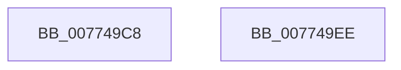

# SSHSupportEtwRegister

- RVA: `0x007749C8`–`0x007749EF` (길이 `39` bytes)
- VA: `0x00000001407749C8`
- 실행 섹션: `PAGE`
- PDB 이름 있음: `예`; PDB Function 태그: `아니요`
- unwind 정보 RVA: `0x0005C788`
- 디코드: `9`개 명령, `39/39` bytes 표시
- 미해석 바이트: `0` (있으면 어셈블리에 `.byte`로 보존)

> 이 문서는 커널 이미지의 기계어와 PDB 기호를 분석해 생성했습니다. 4번과 5번은 함수 원형과 자료형을 바이너리 사용 방식에서 추정한 C 해석이며 원본 소스 복구 결과는 아닙니다.

## 1. Dependencies

- 직접 호출 지점: **1**; 고유 호출 대상: **1**
- 직접 호출자로 확인된 함수: **1**
- RIP 상대 이미지 참조: **3**

### Outgoing calls
- `0x007749E4` → [EtwRegister](../92/EtwRegister_function_00920960.md) (function, `0x00920960`)

### Direct callers
- [SshInitialize](../../init/C4/SshInitialize_function_00C4465C.md) at `0x00C4473B`

### Static image references
- `0x007749CC` → RVA `0x00F07010` (`.data`; read)
- `0x007749D6` → RVA `0x00A8E410` (`SshpEtwEnableCallback`; read)
- `0x007749DD` → RVA `0x0001BDD8` (`.rdata`; read)

## 2. Other-region calls and transfers

- 다른 실행 섹션으로 향하는 call: **0**
- 별도 외부 분기/꼬리 이동을 확인하지 못했습니다.

## 3. Assembly (complete function range)

```asm
007749C8  48 83 EC 28                     sub rsp, 0x28
007749CC  4C 8D 0D 3D 26 79 00            lea r9, [rip + 0x79263d]
007749D3  45 33 C0                        xor r8d, r8d
007749D6  48 8D 15 33 9A 31 00            lea rdx, [rip + 0x319a33]
007749DD  48 8D 0D F4 73 8A FF            lea rcx, [rip - 0x758c0c]
007749E4  E8 77 BF 1A 00                  call 0x140920960
007749E9  48 83 C4 28                     add rsp, 0x28
007749ED  C3                              ret
007749EE  CC                              int3
```

## 4. C-style interpretation (structured pseudocode)

```c
__int64 __fastcall SSHSupportEtwRegister(__int64 a1, __int64 a2, int a3)
{
    __int64 result;
    __int64 v_rsp;

    v_rsp = (v_rsp) - (40);
    a3 = 0;
    result = EtwRegister(v_rip - 7703564, v_rip + 3250739, a3, v_rip + 7939645);
    v_rsp = (v_rsp) + (40);
    return result;
}
```

## 5. (Beta) C Style

```c
int64_t SSHSupportEtwRegister(int64_t Arg1, int64_t Arg2, int32_t Arg3)
{
    int64_t result;
    int64_t local_rsp;

    local_rsp = (local_rsp) - (40);
    Arg3 = 0;
    result = EtwRegister(v_rip - 7703564, v_rip + 3250739, Arg3, v_rip + 7939645);
    local_rsp = (local_rsp) + (40);
    return result;
}
```

## 6. Execution-region graph

[열기: 2D/3D 그래프와 함수 탐색 컨트롤 패널](../../../control-panel.html?section=page&rva=0x007749C8&view=graph)

- 2D 그래프는 위에서 아래로 흐르고, 3D 그래프는 빈 공간을 드래그해 회전합니다. Shift+드래그는 이동, 휠은 확대·축소, 함수 노드 선택은 대상 보고서 이동입니다.

### Static fallback


