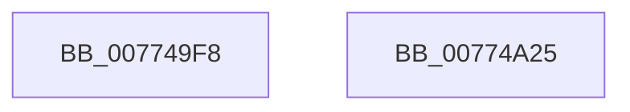

# SSHSupportRegisterPowerSettingCallback

- RVA: `0x007749F8`–`0x00774A26` (길이 `46` bytes)
- VA: `0x00000001407749F8`
- 실행 섹션: `PAGE`
- PDB 이름 있음: `예`; PDB Function 태그: `아니요`
- unwind 정보 RVA: `0x0005D2F4`
- 디코드: `11`개 명령, `46/46` bytes 표시
- 미해석 바이트: `0` (있으면 어셈블리에 `.byte`로 보존)

> 이 문서는 커널 이미지의 기계어와 PDB 기호를 분석해 생성했습니다. 4번과 5번은 함수 원형과 자료형을 바이너리 사용 방식에서 추정한 C 해석이며 원본 소스 복구 결과는 아닙니다.

## 1. Dependencies

- 직접 호출 지점: **1**; 고유 호출 대상: **1**
- 직접 호출자로 확인된 함수: **1**
- RIP 상대 이미지 참조: **3**

### Outgoing calls
- `0x00774A1B` → [PoRegisterPowerSettingCallback](../A8/PoRegisterPowerSettingCallback_function_00A82150.md) (function, `0x00A82150`)

### Direct callers
- [SshInitialize](../../init/C4/SshInitialize_function_00C4465C.md) at `0x00C44771`

### Static image references
- `0x007749FC` → RVA `0x00F06B58` (`.data`; read)
- `0x00774A06` → RVA `0x00AA20F0` (`SshpPowerSettingCallback`; read)
- `0x00774A12` → RVA `0x0001A268` (`.rdata`; read)

## 2. Other-region calls and transfers

- 다른 실행 섹션으로 향하는 call: **0**
- 별도 외부 분기/꼬리 이동을 확인하지 못했습니다.

## 3. Assembly (complete function range)

```asm
007749F8  48 83 EC 38                     sub rsp, 0x38
007749FC  48 8D 05 55 21 79 00            lea rax, [rip + 0x792155]
00774A03  45 33 C9                        xor r9d, r9d
00774A06  4C 8D 05 E3 D6 32 00            lea r8, [rip + 0x32d6e3]
00774A0D  48 89 44 24 20                  mov qword ptr [rsp + 0x20], rax
00774A12  48 8D 15 4F 58 8A FF            lea rdx, [rip - 0x75a7b1]
00774A19  33 C9                           xor ecx, ecx
00774A1B  E8 30 D7 30 00                  call 0x140a82150
00774A20  48 83 C4 38                     add rsp, 0x38
00774A24  C3                              ret
00774A25  CC                              int3
```

## 4. C-style interpretation (structured pseudocode)

```c
__int64 __fastcall SSHSupportRegisterPowerSettingCallback(int a1, __int64 a2, __int64 a3, int a4)
{
    __int64 result;
    __int64 v_rsp;
    unsigned __int64 v_stack_m18;

    v_rsp = (v_rsp) - (56);
    a4 = 0;
    v_stack_m18 = v_rip + 7938389;
    a1 = 0;
    result = PoRegisterPowerSettingCallback(a1, v_rip - 7710641, v_rip + 3331811, a4);
    v_rsp = (v_rsp) + (56);
    return result;
}
```

## 5. (Beta) C Style

```c
int64_t SSHSupportRegisterPowerSettingCallback(int32_t Arg1, int64_t Arg2, int64_t Arg3, int32_t Arg4)
{
    int64_t result;
    int64_t local_rsp;
    uint64_t v_stack_m18;

    local_rsp = (local_rsp) - (56);
    Arg4 = 0;
    v_stack_m18 = v_rip + 7938389;
    Arg1 = 0;
    result = PoRegisterPowerSettingCallback(Arg1, v_rip - 7710641, v_rip + 3331811, Arg4);
    local_rsp = (local_rsp) + (56);
    return result;
}
```

## 6. Execution-region graph

[열기: 2D/3D 그래프와 함수 탐색 컨트롤 패널](../../../control-panel.html?section=page&rva=0x007749F8&view=graph)

- 2D 그래프는 위에서 아래로 흐르고, 3D 그래프는 빈 공간을 드래그해 회전합니다. Shift+드래그는 이동, 휠은 확대·축소, 함수 노드 선택은 대상 보고서 이동입니다.

### Static fallback


