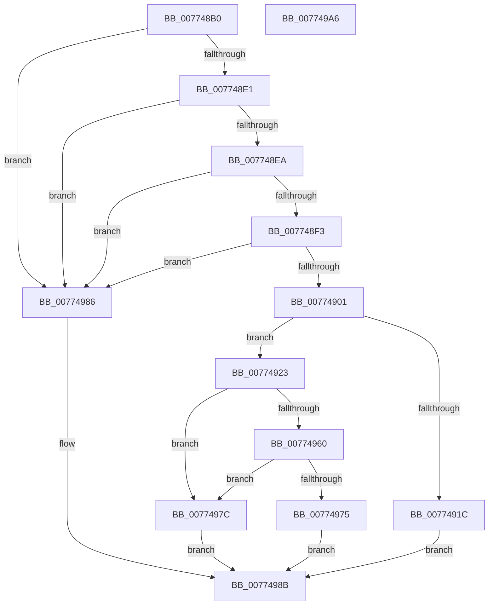

# SleepstudyHelperCreateBlockerFromComponent

- RVA: `0x007748B0`–`0x007749A7` (길이 `247` bytes)
- VA: `0x00000001407748B0`
- 실행 섹션: `PAGE`
- PDB 이름 있음: `예`; PDB Function 태그: `아니요`
- unwind 정보 RVA: `0x000C559C`
- 디코드: `71`개 명령, `247/247` bytes 표시
- 미해석 바이트: `0` (있으면 어셈블리에 `.byte`로 보존)

> 이 문서는 커널 이미지의 기계어와 PDB 기호를 분석해 생성했습니다. 4번과 5번은 함수 원형과 자료형을 바이너리 사용 방식에서 추정한 C 해석이며 원본 소스 복구 결과는 아닙니다.

## 1. Dependencies

- 직접 호출 지점: **4**; 고유 호출 대상: **4**
- 직접 호출자로 확인된 함수: **0**
- RIP 상대 이미지 참조: **0**

### Outgoing calls
- `0x0077490F` → [ExAllocatePool2](../../poolcode/B8/ExAllocatePool2_function_00B820F0.md) (function, `0x00B820F0`)
- `0x00774955` → [SshpGenerateDeviceFriendlyName](../A2/SshpGenerateDeviceFriendlyName_function_00A2E184.md) (function, `0x00A2E184`)
- `0x0077496A` → [SshpGenerateDeviceVerboseDescription](../A2/SshpGenerateDeviceVerboseDescription_function_00A2E448.md) (function, `0x00A2E448`)
- `0x0077497F` → [SleepstudyHelperDestroyBlockerBuilder](../A2/SleepstudyHelperDestroyBlockerBuilder_function_00A2DE80.md) (function, `0x00A2DE80`)

### Direct callers
- 이 함수 시작 RVA로 연결되는 직접 call은 확인되지 않았습니다. 간접 호출은 완전히 역산할 수 없습니다.

### Static image references
- 디코드된 RIP-relative 메모리 참조가 없습니다.

## 2. Other-region calls and transfers

- 다른 실행 섹션으로 향하는 call: **1**
  - `0x0077490F` → [ExAllocatePool2](../../poolcode/B8/ExAllocatePool2_function_00B820F0.md) (`PAGE` → `POOLCODE`)
- 별도 외부 분기/꼬리 이동을 확인하지 못했습니다.

## 3. Assembly (complete function range)

```asm
007748B0  48 8B C4                        mov rax, rsp
007748B3  48 89 58 08                     mov qword ptr [rax + 8], rbx
007748B7  48 89 68 10                     mov qword ptr [rax + 0x10], rbp
007748BB  48 89 70 18                     mov qword ptr [rax + 0x18], rsi
007748BF  44 89 48 20                     mov dword ptr [rax + 0x20], r9d
007748C3  57                              push rdi
007748C4  41 56                           push r14
007748C6  41 57                           push r15
007748C8  48 83 EC 20                     sub rsp, 0x20
007748CC  45 8B F9                        mov r15d, r9d
007748CF  49 8B E8                        mov rbp, r8
007748D2  48 8B DA                        mov rbx, rdx
007748D5  48 8B F1                        mov rsi, rcx
007748D8  48 85 C9                        test rcx, rcx
007748DB  0F 84 A5 00 00 00               je 0x140774986
007748E1  48 85 D2                        test rdx, rdx
007748E4  0F 84 9C 00 00 00               je 0x140774986
007748EA  4D 85 C0                        test r8, r8
007748ED  0F 84 93 00 00 00               je 0x140774986
007748F3  4C 8B 74 24 60                  mov r14, qword ptr [rsp + 0x60]
007748F8  4D 85 F6                        test r14, r14
007748FB  0F 84 85 00 00 00               je 0x140774986
00774901  44 8B 41 18                     mov r8d, dword ptr [rcx + 0x18]
00774905  BA 60 00 00 00                  mov edx, 0x60
0077490A  B9 00 01 00 00                  mov ecx, 0x100
0077490F  E8 DC D7 40 00                  call 0x140b820f0
00774914  48 8B F8                        mov rdi, rax
00774917  48 85 C0                        test rax, rax
0077491A  75 07                           jne 0x140774923
0077491C  BB 9A 00 00 C0                  mov ebx, 0xc000009a
00774921  EB 68                           jmp 0x14077498b
00774923  83 60 08 00                     and dword ptr [rax + 8], 0
00774927  4C 8D 48 30                     lea r9, [rax + 0x30]
0077492B  48 89 30                        mov qword ptr [rax], rsi
0077492E  48 8D 54 24 58                  lea rdx, [rsp + 0x58]
00774933  0F 10 03                        movups xmm0, xmmword ptr [rbx]
00774936  48 89 68 20                     mov qword ptr [rax + 0x20], rbp
0077493A  48 8B CD                        mov rcx, rbp
0077493D  44 89 78 2C                     mov dword ptr [rax + 0x2c], r15d
00774941  F3 0F 7F 40 10                  movdqu xmmword ptr [rax + 0x10], xmm0
00774946  C7 40 28 CC CC 00 00            mov dword ptr [rax + 0x28], 0xcccc
0077494D  C6 40 58 01                     mov byte ptr [rax + 0x58], 1
00774951  44 8B 46 18                     mov r8d, dword ptr [rsi + 0x18]
00774955  E8 2A 98 2B 00                  call 0x140a2e184
0077495A  8B D8                           mov ebx, eax
0077495C  85 C0                           test eax, eax
0077495E  78 1C                           js 0x14077497c
00774960  8B 56 18                        mov edx, dword ptr [rsi + 0x18]
00774963  4C 8D 47 48                     lea r8, [rdi + 0x48]
00774967  48 8B CD                        mov rcx, rbp
0077496A  E8 D9 9A 2B 00                  call 0x140a2e448
0077496F  8B D8                           mov ebx, eax
00774971  85 C0                           test eax, eax
00774973  78 07                           js 0x14077497c
00774975  49 89 3E                        mov qword ptr [r14], rdi
00774978  33 DB                           xor ebx, ebx
0077497A  EB 0F                           jmp 0x14077498b
0077497C  48 8B CF                        mov rcx, rdi
0077497F  E8 FC 94 2B 00                  call 0x140a2de80
00774984  EB 05                           jmp 0x14077498b
00774986  BB 0D 00 00 C0                  mov ebx, 0xc000000d
0077498B  48 8B 6C 24 48                  mov rbp, qword ptr [rsp + 0x48]
00774990  8B C3                           mov eax, ebx
00774992  48 8B 5C 24 40                  mov rbx, qword ptr [rsp + 0x40]
00774997  48 8B 74 24 50                  mov rsi, qword ptr [rsp + 0x50]
0077499C  48 83 C4 20                     add rsp, 0x20
007749A0  41 5F                           pop r15
007749A2  41 5E                           pop r14
007749A4  5F                              pop rdi
007749A5  C3                              ret
007749A6  CC                              int3
```

## 4. C-style interpretation (structured pseudocode)

```c
__int64 __fastcall SleepstudyHelperCreateBlockerFromComponent(__int64 a1, __int64 a2, __int64 a3, int a4, __int64 a5)
{
    __int64 result;
    __int64 v_rbx;
    __int64 v_rsp;
    unsigned __int64 v_stack_p10;
    unsigned __int64 v_stack_p18;
    unsigned __int64 v_stack_p20;
    unsigned __int64 v_stack_p8;

    *(unsigned __int64 *)(v_rsp + 8) = v_rbx;
    *(unsigned __int64 *)(v_rsp + 16) = v_rbp;
    *(unsigned __int64 *)(v_rsp + 24) = v_rsi;
    *(unsigned int *)(v_rsp + 32) = a4;
    v_rsp = (v_rsp) - (32);
    if (a1 == 0) goto loc_00774986;
    if (a2 == 0) goto loc_00774986;
    if (a3 == 0) goto loc_00774986;
    if (a5 == 0) goto loc_00774986;
    result = ExAllocatePool2(256, 96, (unsigned int)(*(unsigned int *)(a1 + 24)), a4);
    if (result != 0) goto loc_00774923;
    goto loc_0077498B;
loc_00774923:
    *(unsigned __int64 *)(result) = a1;
    *(unsigned __int64 *)(result + 32) = a3;
    *(unsigned int *)(result + 44) = (unsigned int)((unsigned int)(a4));
    *(unsigned __int64 *)(result + 16) = v_xmm0;
    *(unsigned int *)(result + 40) = 0xCCCCULL;
    *(unsigned __int8 *)(result + 88) = 1;
    result = SshpGenerateDeviceFriendlyName(a3, v_stack_p20, (unsigned int)(*(unsigned int *)(a1 + 24)), result + 48);
    if (sign_flag) goto loc_0077497C;
    result = SshpGenerateDeviceVerboseDescription(a3, (unsigned int)(*(unsigned int *)(a1 + 24)), result + 72, result + 48);
    if (sign_flag) goto loc_0077497C;
    *(unsigned __int64 *)(a5) = result;
    v_rbx = 0;
    goto loc_0077498B;
loc_0077497C:
    result = SleepstudyHelperDestroyBlockerBuilder(result, (unsigned int)(*(unsigned int *)(a1 + 24)), result + 72, result + 48);
    goto loc_0077498B;
loc_00774986:
loc_0077498B:
    v_rsp = (v_rsp) + (32);
    return (unsigned int)((unsigned int)((unsigned int)(0xC000000DULL)));
}
```

## 5. (Beta) C Style

```c
int64_t SleepstudyHelperCreateBlockerFromComponent(void *Arg1, void *Arg2, int64_t Arg3, int32_t Arg4, int64_t Arg5)
{
    uint8_t *arg1 = (uint8_t *)Arg1;
    uint8_t *arg2 = (uint8_t *)Arg2;

    int64_t result;
    int64_t local_rbx;
    int64_t local_rsp;
    uint64_t v_stack_p10;
    uint64_t v_stack_p18;
    uint64_t v_stack_p20;
    uint64_t v_stack_p8;

    *(uint64_t *)(local_rsp + 0x8) = local_rbx;
    *(uint64_t *)(local_rsp + 0x10) = local_rbp;
    *(uint64_t *)(local_rsp + 0x18) = local_rsi;
    *(uint32_t *)(local_rsp + 0x20) = Arg4;
    local_rsp = (local_rsp) - (32);
    if (Arg1 == NULL) goto loc_00774986;
    if (Arg2 == NULL) goto loc_00774986;
    if (Arg3 == 0) goto loc_00774986;
    if (Arg5 == 0) goto loc_00774986;
    result = ExAllocatePool2(256, 96, (uint32_t)(*(uint32_t *)(arg1 + 0x18)), Arg4);
    if (result != 0) goto loc_00774923;
    goto loc_0077498B;
loc_00774923:
    *(void **)(result) = Arg1;
    *(uint64_t *)(result + 0x20) = Arg3;
    *(uint32_t *)(result + 0x2C) = (uint32_t)((uint32_t)(Arg4));
    *(uint64_t *)(result + 0x10) = v_xmm0;
    *(uint32_t *)(result + 0x28) = 0xCCCCULL;
    *(uint8_t *)(result + 0x58) = 1;
    result = SshpGenerateDeviceFriendlyName(Arg3, v_stack_p20, (uint32_t)(*(uint32_t *)(arg1 + 0x18)), result + 48);
    if (sign_flag) goto loc_0077497C;
    result = SshpGenerateDeviceVerboseDescription(Arg3, (uint32_t)(*(uint32_t *)(arg1 + 0x18)), result + 72, result + 48);
    if (sign_flag) goto loc_0077497C;
    *(uint64_t *)(Arg5) = result;
    local_rbx = 0;
    goto loc_0077498B;
loc_0077497C:
    result = SleepstudyHelperDestroyBlockerBuilder(result, (uint32_t)(*(uint32_t *)(arg1 + 0x18)), result + 72, result + 48);
    goto loc_0077498B;
loc_00774986:
loc_0077498B:
    local_rsp = (local_rsp) + (32);
    return (uint32_t)((uint32_t)((uint32_t)(0xC000000DULL)));
}
```

### 관측된 메모리 오프셋

구조체 형식이 확인되지 않은 접근은 인자 기준의 오프셋으로만 기록했습니다.

| 기준 인자 | 오프셋 표현 | 폭 (bit) | 접근 |
|---|---:|---:|---|
| `Arg1` | `+ 0x18` | `32` | `R` |
| `Arg2` | `+ 0x0` | `128` | `R` |

## 6. Execution-region graph

[열기: 2D/3D 그래프와 함수 탐색 컨트롤 패널](../../../control-panel.html?section=page&rva=0x007748B0&view=graph)

- 2D 그래프는 위에서 아래로 흐르고, 3D 그래프는 빈 공간을 드래그해 회전합니다. Shift+드래그는 이동, 휠은 확대·축소, 함수 노드 선택은 대상 보고서 이동입니다.

### Static fallback


