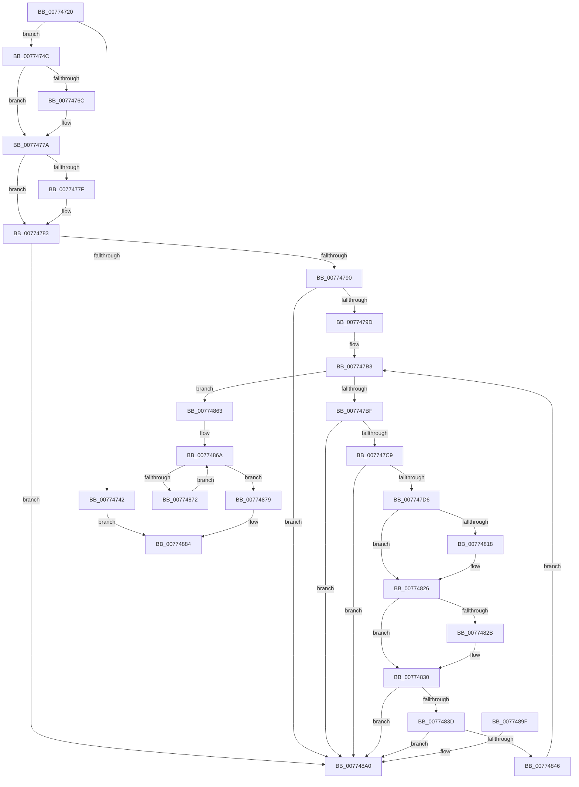

# SleepstudyHelperDestroyLibrary

- RVA: `0x00774720`–`0x007748A7` (길이 `391` bytes)
- VA: `0x0000000140774720`
- 실행 섹션: `PAGE`
- PDB 이름 있음: `예`; PDB Function 태그: `아니요`
- unwind 정보 RVA: `0x00075210`
- 디코드: `106`개 명령, `391/391` bytes 표시
- 미해석 바이트: `0` (있으면 어셈블리에 `.byte`로 보존)

> 이 문서는 커널 이미지의 기계어와 PDB 기호를 분석해 생성했습니다. 4번과 5번은 함수 원형과 자료형을 바이너리 사용 방식에서 추정한 C 해석이며 원본 소스 복구 결과는 아닙니다.

## 1. Dependencies

- 직접 호출 지점: **10**; 고유 호출 대상: **7**
- 직접 호출자로 확인된 함수: **2**
- RIP 상대 이미지 참조: **2**

### Outgoing calls
- `0x0077475B` → [KeAbPreAcquire](../../text/21/KeAbPreAcquire_function_00210230.md) (function, `0x00210230`)
- `0x00774775` → [ExfAcquirePushLockExclusiveEx](../../text/20/ExfAcquirePushLockExclusiveEx_function_0020FC90.md) (function, `0x0020FC90`)
- `0x007747A7` → [SSHSupportReleasePushLockExclusive](../../text/49/SSHSupportReleasePushLockExclusive_function_004954EC.md) (function, `0x004954EC`)
- `0x007747E4` → [SshpCacheRemoveBlocker](../A4/SshpCacheRemoveBlocker_function_00A4E124.md) (function, `0x00A4E124`)
- `0x00774807` → [KeAbPreAcquire](../../text/21/KeAbPreAcquire_function_00210230.md) (function, `0x00210230`)
- `0x00774821` → [ExfAcquirePushLockExclusiveEx](../../text/20/ExfAcquirePushLockExclusiveEx_function_0020FC90.md) (function, `0x0020FC90`)
- `0x00774850` → [SSHSupportReleasePushLockExclusive](../../text/49/SSHSupportReleasePushLockExclusive_function_004954EC.md) (function, `0x004954EC`)
- `0x00774859` → [SshpFreeBlockerEntry](../A4/SshpFreeBlockerEntry_function_00A4E15C.md) (function, `0x00A4E15C`)
- `0x00774872` → [SshpFreeDataEntry](SshpFreeDataEntry_function_00773614.md) (function, `0x00773614`)
- `0x0077487F` → [CmpFreePoolWithTag](../../text/44/CmpFreePoolWithTag_function_004489E0.md) (function, `0x004489E0`)

### Direct callers
- [SleepstudyHelper_Uninitialize](SleepstudyHelper_Uninitialize_function_00774DD0.md) at `0x00774DD4`
- [SshpUninitialize](../../init/C4/SshpUninitialize_function_00C44798.md) at `0x00C44803`

### Static image references
- `0x0077474C` → RVA `0x00F07030` (`.data`; read)
- `0x007747F6` → RVA `0x00E08400` (`.data`; read)

## 2. Other-region calls and transfers

- 다른 실행 섹션으로 향하는 call: **7**
  - `0x0077475B` → [KeAbPreAcquire](../../text/21/KeAbPreAcquire_function_00210230.md) (`PAGE` → `.text`)
  - `0x00774775` → [ExfAcquirePushLockExclusiveEx](../../text/20/ExfAcquirePushLockExclusiveEx_function_0020FC90.md) (`PAGE` → `.text`)
  - `0x007747A7` → [SSHSupportReleasePushLockExclusive](../../text/49/SSHSupportReleasePushLockExclusive_function_004954EC.md) (`PAGE` → `.text`)
  - `0x00774807` → [KeAbPreAcquire](../../text/21/KeAbPreAcquire_function_00210230.md) (`PAGE` → `.text`)
  - `0x00774821` → [ExfAcquirePushLockExclusiveEx](../../text/20/ExfAcquirePushLockExclusiveEx_function_0020FC90.md) (`PAGE` → `.text`)
  - `0x00774850` → [SSHSupportReleasePushLockExclusive](../../text/49/SSHSupportReleasePushLockExclusive_function_004954EC.md) (`PAGE` → `.text`)
  - `0x0077487F` → [CmpFreePoolWithTag](../../text/44/CmpFreePoolWithTag_function_004489E0.md) (`PAGE` → `.text`)
- 별도 외부 분기/꼬리 이동을 확인하지 못했습니다.

## 3. Assembly (complete function range)

```asm
00774720  48 89 5C 24 08                  mov qword ptr [rsp + 8], rbx
00774725  48 89 6C 24 10                  mov qword ptr [rsp + 0x10], rbp
0077472A  48 89 74 24 18                  mov qword ptr [rsp + 0x18], rsi
0077472F  57                              push rdi
00774730  41 56                           push r14
00774732  41 57                           push r15
00774734  48 83 EC 20                     sub rsp, 0x20
00774738  33 F6                           xor esi, esi
0077473A  48 8B D9                        mov rbx, rcx
0077473D  48 85 C9                        test rcx, rcx
00774740  75 0A                           jne 0x14077474c
00774742  BE 0D 00 00 C0                  mov esi, 0xc000000d
00774747  E9 38 01 00 00                  jmp 0x140774884
0077474C  48 8D 2D DD 28 79 00            lea rbp, [rip + 0x7928dd]
00774753  45 33 C0                        xor r8d, r8d
00774756  48 8B CD                        mov rcx, rbp
00774759  33 D2                           xor edx, edx
0077475B  E8 D0 BA A9 FF                  call 0x140210230
00774760  F0 48 0F BA 6D 00 00            lock bts qword ptr [rbp], 0
00774767  48 8B F8                        mov rdi, rax
0077476A  73 0E                           jae 0x14077477a
0077476C  4C 8B C5                        mov r8, rbp
0077476F  48 8B D0                        mov rdx, rax
00774772  48 8B CD                        mov rcx, rbp
00774775  E8 16 B5 A9 FF                  call 0x14020fc90
0077477A  48 85 FF                        test rdi, rdi
0077477D  74 04                           je 0x140774783
0077477F  C6 47 0A 01                     mov byte ptr [rdi + 0xa], 1
00774783  48 8B 13                        mov rdx, qword ptr [rbx]
00774786  48 39 5A 08                     cmp qword ptr [rdx + 8], rbx
0077478A  0F 85 10 01 00 00               jne 0x1407748a0
00774790  48 8B 43 08                     mov rax, qword ptr [rbx + 8]
00774794  48 39 18                        cmp qword ptr [rax], rbx
00774797  0F 85 03 01 00 00               jne 0x1407748a0
0077479D  48 89 10                        mov qword ptr [rax], rdx
007747A0  48 8B CD                        mov rcx, rbp
007747A3  48 89 42 08                     mov qword ptr [rdx + 8], rax
007747A7  E8 40 0D D2 FF                  call 0x1404954ec
007747AC  4C 8D B3 98 00 00 00            lea r14, [rbx + 0x98]
007747B3  49 8B 3E                        mov rdi, qword ptr [r14]
007747B6  49 3B FE                        cmp rdi, r14
007747B9  0F 84 A4 00 00 00               je 0x140774863
007747BF  4C 39 77 08                     cmp qword ptr [rdi + 8], r14
007747C3  0F 85 D7 00 00 00               jne 0x1407748a0
007747C9  48 8B 07                        mov rax, qword ptr [rdi]
007747CC  48 39 78 08                     cmp qword ptr [rax + 8], rdi
007747D0  0F 85 CA 00 00 00               jne 0x1407748a0
007747D6  49 89 06                        mov qword ptr [r14], rax
007747D9  48 8B CB                        mov rcx, rbx
007747DC  4C 89 70 08                     mov qword ptr [rax + 8], r14
007747E0  48 8B 57 70                     mov rdx, qword ptr [rdi + 0x70]
007747E4  E8 3B 99 2D 00                  call 0x140a4e124
007747E9  48 63 47 28                     movsxd rax, dword ptr [rdi + 0x28]
007747ED  45 33 C0                        xor r8d, r8d
007747F0  33 D2                           xor edx, edx
007747F2  48 8D 2C 40                     lea rbp, [rax + rax*2]
007747F6  48 8D 05 03 3C 69 00            lea rax, [rip + 0x693c03]
007747FD  48 C1 E5 04                     shl rbp, 4
00774801  48 03 E8                        add rbp, rax
00774804  48 8B CD                        mov rcx, rbp
00774807  E8 24 BA A9 FF                  call 0x140210230
0077480C  F0 48 0F BA 6D 00 00            lock bts qword ptr [rbp], 0
00774813  4C 8B F8                        mov r15, rax
00774816  73 0E                           jae 0x140774826
00774818  4C 8B C5                        mov r8, rbp
0077481B  48 8B D0                        mov rdx, rax
0077481E  48 8B CD                        mov rcx, rbp
00774821  E8 6A B4 A9 FF                  call 0x14020fc90
00774826  4D 85 FF                        test r15, r15
00774829  74 05                           je 0x140774830
0077482B  41 C6 47 0A 01                  mov byte ptr [r15 + 0xa], 1
00774830  48 8D 47 10                     lea rax, [rdi + 0x10]
00774834  48 8B 10                        mov rdx, qword ptr [rax]
00774837  48 39 42 08                     cmp qword ptr [rdx + 8], rax
0077483B  75 63                           jne 0x1407748a0
0077483D  48 8B 48 08                     mov rcx, qword ptr [rax + 8]
00774841  48 39 01                        cmp qword ptr [rcx], rax
00774844  75 5A                           jne 0x1407748a0
00774846  48 89 11                        mov qword ptr [rcx], rdx
00774849  48 89 4A 08                     mov qword ptr [rdx + 8], rcx
0077484D  48 8B CD                        mov rcx, rbp
00774850  E8 97 0C D2 FF                  call 0x1404954ec
00774855  48 8B 4F 70                     mov rcx, qword ptr [rdi + 0x70]
00774859  E8 FE 98 2D 00                  call 0x140a4e15c
0077485E  E9 50 FF FF FF                  jmp 0x1407747b3
00774863  48 8D BB A8 00 00 00            lea rdi, [rbx + 0xa8]
0077486A  48 8B 0F                        mov rcx, qword ptr [rdi]
0077486D  48 3B CF                        cmp rcx, rdi
00774870  74 07                           je 0x140774879
00774872  E8 9D ED FF FF                  call 0x140773614
00774877  EB F1                           jmp 0x14077486a
00774879  8B 53 18                        mov edx, dword ptr [rbx + 0x18]
0077487C  48 8B CB                        mov rcx, rbx
0077487F  E8 5C 41 CD FF                  call 0x1404489e0
00774884  48 8B 5C 24 40                  mov rbx, qword ptr [rsp + 0x40]
00774889  8B C6                           mov eax, esi
0077488B  48 8B 74 24 50                  mov rsi, qword ptr [rsp + 0x50]
00774890  48 8B 6C 24 48                  mov rbp, qword ptr [rsp + 0x48]
00774895  48 83 C4 20                     add rsp, 0x20
00774899  41 5F                           pop r15
0077489B  41 5E                           pop r14
0077489D  5F                              pop rdi
0077489E  C3                              ret
0077489F  CC                              int3
007748A0  B9 03 00 00 00                  mov ecx, 3
007748A5  CD 29                           int 0x29
```

## 4. C-style interpretation (structured pseudocode)

```c
__int64 __fastcall SleepstudyHelperDestroyLibrary(__int64 a1, int a2, int a3)
{
    __int64 result;
    __int64 v_rbp;
    __int64 v_rsi;
    __int64 v_rsp;
    unsigned __int64 v_stack_p10;
    unsigned __int64 v_stack_p18;
    unsigned __int64 v_stack_p8;

    v_stack_p8 = v_rbx;
    v_stack_p10 = v_rbp;
    v_stack_p18 = v_rsi;
    v_rsp = (v_rsp) - (32);
    v_rsi = 0;
    if (a1 != 0) goto loc_0077474C;
    goto loc_00774884;
loc_0077474C:
    a3 = 0;
    a2 = 0;
    result = KeAbPreAcquire(v_rip + 7940317, a2, a3, a4);
    if (!(condition_is_above_or_equal)) {
        a3 = v_rip + 7940317;
        a2 = result;
        a1 = v_rip + 7940317;
        result = ExfAcquirePushLockExclusiveEx(a1, a2, a3, a4);
    }
    if (result != 0) {
        *(unsigned __int8 *)(result + 10) = 1;
    }
    if ((*(unsigned __int64 *)(*(unsigned __int64 *)(a1) + 8)) != a1) goto loc_007748A0;
    if ((*(unsigned __int64 *)(*(unsigned __int64 *)(a1 + 8))) != a1) goto loc_007748A0;
    *(unsigned __int64 *)(*(unsigned __int64 *)(a1 + 8)) = *(unsigned __int64 *)(a1);
    *(unsigned __int64 *)(*(unsigned __int64 *)(a1) + 8) = *(unsigned __int64 *)(a1 + 8);
    result = SSHSupportReleasePushLockExclusive(v_rip + 7940317, *(unsigned __int64 *)(a1), a3, a4);
loc_007747B3:
    if ((*(unsigned __int64 *)(a1 + 152)) == (a1 + 152)) goto loc_00774863;
    if ((*(unsigned __int64 *)(*(unsigned __int64 *)(a1 + 152) + 8)) != (a1 + 152)) goto loc_007748A0;
    if ((*(unsigned __int64 *)(*(unsigned __int64 *)(*(unsigned __int64 *)(a1 + 152)) + 8)) != (*(unsigned __int64 *)(a1 + 152))) goto loc_007748A0;
    *(unsigned __int64 *)(a1 + 152) = *(unsigned __int64 *)(*(unsigned __int64 *)(a1 + 152));
    *(unsigned __int64 *)(*(unsigned __int64 *)(*(unsigned __int64 *)(a1 + 152)) + 8) = a1 + 152;
    result = SshpCacheRemoveBlocker(a1, *(unsigned __int64 *)(*(unsigned __int64 *)(a1 + 152) + 112), a3, a4);
    a3 = 0;
    a2 = 0;
    v_rbp = ((int)(*(unsigned int *)(*(unsigned __int64 *)(a1 + 152) + 40)) + (int)(*(unsigned int *)(*(unsigned __int64 *)(a1 + 152) + 40)) * 2) << (4);
    v_rbp = (v_rbp) + (v_rip + 6896643);
    result = KeAbPreAcquire(v_rbp, a2, a3, a4);
    if (!(condition_is_above_or_equal)) {
        a3 = v_rbp;
        a2 = result;
        a1 = v_rbp;
        result = ExfAcquirePushLockExclusiveEx(a1, a2, a3, a4);
    }
    if (result != 0) {
        *(unsigned __int8 *)(result + 10) = 1;
    }
    if ((*(unsigned __int64 *)(*(unsigned __int64 *)(*(unsigned __int64 *)(a1 + 152) + 16) + 8)) != (*(unsigned __int64 *)(a1 + 152) + 16)) goto loc_007748A0;
    if ((*(unsigned __int64 *)(*(unsigned __int64 *)(*(unsigned __int64 *)(a1 + 152) + 16 + 8))) != (*(unsigned __int64 *)(a1 + 152) + 16)) goto loc_007748A0;
    *(unsigned __int64 *)(*(unsigned __int64 *)(*(unsigned __int64 *)(a1 + 152) + 16 + 8)) = *(unsigned __int64 *)(*(unsigned __int64 *)(a1 + 152) + 16);
    *(unsigned __int64 *)(*(unsigned __int64 *)(*(unsigned __int64 *)(a1 + 152) + 16) + 8) = *(unsigned __int64 *)(*(unsigned __int64 *)(a1 + 152) + 16 + 8);
    result = SSHSupportReleasePushLockExclusive(v_rbp, *(unsigned __int64 *)(*(unsigned __int64 *)(a1 + 152) + 16), a3, a4);
    result = SshpFreeBlockerEntry(*(unsigned __int64 *)(*(unsigned __int64 *)(a1 + 152) + 112), *(unsigned __int64 *)(*(unsigned __int64 *)(a1 + 152) + 16), a3, a4);
    goto loc_007747B3;
loc_00774863:
loc_0077486A:
    if ((*(unsigned __int64 *)(a1 + 168)) == (a1 + 168)) goto loc_00774879;
    result = SshpFreeDataEntry(*(unsigned __int64 *)(a1 + 168), *(unsigned __int64 *)(*(unsigned __int64 *)(a1 + 152) + 16), a3, a4);
    goto loc_0077486A;
loc_00774879:
    result = CmpFreePoolWithTag(a1, (unsigned int)(*(unsigned int *)(a1 + 24)), a3, a4);
loc_00774884:
    v_rsp = (v_rsp) + (32);
    return (unsigned int)((unsigned int)((unsigned int)(0xC000000DULL)));
loc_007748A0:
    return (unsigned int)((unsigned int)((unsigned int)(0xC000000DULL)));
}
```

## 5. (Beta) C Style

```c
int64_t SleepstudyHelperDestroyLibrary(void *Arg1, int32_t Arg2, int32_t Arg3)
{
    uint8_t *arg1 = (uint8_t *)Arg1;

    int64_t result;
    int64_t local_rbp;
    int64_t local_rsi;
    int64_t local_rsp;
    uint64_t v_stack_p10;
    uint64_t v_stack_p18;
    uint64_t v_stack_p8;

    v_stack_p8 = local_rbx;
    v_stack_p10 = local_rbp;
    v_stack_p18 = local_rsi;
    local_rsp = (local_rsp) - (32);
    local_rsi = 0;
    if (Arg1 != NULL) goto loc_0077474C;
    goto loc_00774884;
loc_0077474C:
    Arg3 = 0;
    Arg2 = 0;
    result = KeAbPreAcquire(v_rip + 7940317, Arg2, Arg3, a4);
    if (!(condition_is_above_or_equal)) {
        Arg3 = v_rip + 7940317;
        Arg2 = result;
        Arg1 = v_rip + 7940317;
        result = ExfAcquirePushLockExclusiveEx(Arg1, Arg2, Arg3, a4);
    }
    if (result != 0) {
        *(uint8_t *)(result + 0xA) = 1;
    }
    if ((*(uint64_t *)(*(uint64_t *)(arg1) + 0x8)) != Arg1) goto loc_007748A0;
    if ((*(uint64_t *)(*(uint64_t *)(arg1 + 0x8))) != Arg1) goto loc_007748A0;
    *(uint64_t *)(*(uint64_t *)(arg1 + 0x8)) = *(uint64_t *)(arg1);
    *(uint64_t *)(*(uint64_t *)(arg1) + 0x8) = *(uint64_t *)(arg1 + 0x8);
    result = SSHSupportReleasePushLockExclusive(v_rip + 7940317, *(uint64_t *)(arg1), Arg3, a4);
loc_007747B3:
    if ((*(uint64_t *)(arg1 + 0x98)) == (Arg1 + 152)) goto loc_00774863;
    if ((*(uint64_t *)(*(uint64_t *)(arg1 + 0x98) + 0x8)) != (Arg1 + 152)) goto loc_007748A0;
    if ((*(uint64_t *)(*(uint64_t *)(*(uint64_t *)(arg1 + 0x98)) + 0x8)) != (*(uint64_t *)(arg1 + 0x98))) goto loc_007748A0;
    *(uint64_t *)(arg1 + 0x98) = *(uint64_t *)(*(uint64_t *)(arg1 + 0x98));
    *(void **)(*(uint64_t *)(*(uint64_t *)(arg1 + 0x98)) + 0x8) = Arg1 + 152;
    result = SshpCacheRemoveBlocker(Arg1, *(uint64_t *)(*(uint64_t *)(arg1 + 0x98) + 0x70), Arg3, a4);
    Arg3 = 0;
    Arg2 = 0;
    local_rbp = ((int32_t)(*(uint32_t *)(*(uint64_t *)(arg1 + 0x98) + 0x28)) + (int32_t)(*(uint32_t *)(*(uint64_t *)(arg1 + 0x98) + 0x28)) * 2) << (4);
    local_rbp = (local_rbp) + (v_rip + 6896643);
    result = KeAbPreAcquire(local_rbp, Arg2, Arg3, a4);
    if (!(condition_is_above_or_equal)) {
        Arg3 = local_rbp;
        Arg2 = result;
        Arg1 = local_rbp;
        result = ExfAcquirePushLockExclusiveEx(Arg1, Arg2, Arg3, a4);
    }
    if (result != 0) {
        *(uint8_t *)(result + 0xA) = 1;
    }
    if ((*(uint64_t *)(*(uint64_t *)(*(uint64_t *)(arg1 + 0x98) + 0x10) + 0x8)) != (*(uint64_t *)(arg1 + 0x98) + 16)) goto loc_007748A0;
    if ((*(uint64_t *)(*(uint64_t *)(*(uint64_t *)(arg1 + 0x98) + 0x10 + 0x8))) != (*(uint64_t *)(arg1 + 0x98) + 16)) goto loc_007748A0;
    *(uint64_t *)(*(uint64_t *)(*(uint64_t *)(arg1 + 0x98) + 0x10 + 0x8)) = *(uint64_t *)(*(uint64_t *)(arg1 + 0x98) + 0x10);
    *(uint64_t *)(*(uint64_t *)(*(uint64_t *)(arg1 + 0x98) + 0x10) + 0x8) = *(uint64_t *)(*(uint64_t *)(arg1 + 0x98) + 0x10 + 0x8);
    result = SSHSupportReleasePushLockExclusive(local_rbp, *(uint64_t *)(*(uint64_t *)(arg1 + 0x98) + 0x10), Arg3, a4);
    result = SshpFreeBlockerEntry(*(uint64_t *)(*(uint64_t *)(arg1 + 0x98) + 0x70), *(uint64_t *)(*(uint64_t *)(arg1 + 0x98) + 0x10), Arg3, a4);
    goto loc_007747B3;
loc_00774863:
loc_0077486A:
    if ((*(uint64_t *)(arg1 + 0xA8)) == (Arg1 + 168)) goto loc_00774879;
    result = SshpFreeDataEntry(*(uint64_t *)(arg1 + 0xA8), *(uint64_t *)(*(uint64_t *)(arg1 + 0x98) + 0x10), Arg3, a4);
    goto loc_0077486A;
loc_00774879:
    result = CmpFreePoolWithTag(Arg1, (uint32_t)(*(uint32_t *)(arg1 + 0x18)), Arg3, a4);
loc_00774884:
    local_rsp = (local_rsp) + (32);
    return (uint32_t)((uint32_t)((uint32_t)(0xC000000DULL)));
loc_007748A0:
    return (uint32_t)((uint32_t)((uint32_t)(0xC000000DULL)));
}
```

### 관측된 메모리 오프셋

구조체 형식이 확인되지 않은 접근은 인자 기준의 오프셋으로만 기록했습니다.

| 기준 인자 | 오프셋 표현 | 폭 (bit) | 접근 |
|---|---:|---:|---|
| `Arg1` | `+ 0x0` | `64` | `R` |
| `Arg1` | `+ 0x0` | `64` | `W` |
| `Arg1` | `+ 0x8` | `64` | `R` |
| `Arg1` | `+ 0x18` | `32` | `R` |
| `Arg1` | `+ 0x98` | `64` | `R` |
| `Arg1` | `+ 0xA8` | `64` | `R` |

## 6. Execution-region graph

[열기: 2D/3D 그래프와 함수 탐색 컨트롤 패널](../../../control-panel.html?section=page&rva=0x00774720&view=graph)

- 2D 그래프는 위에서 아래로 흐르고, 3D 그래프는 빈 공간을 드래그해 회전합니다. Shift+드래그는 이동, 휠은 확대·축소, 함수 노드 선택은 대상 보고서 이동입니다.

### Static fallback


