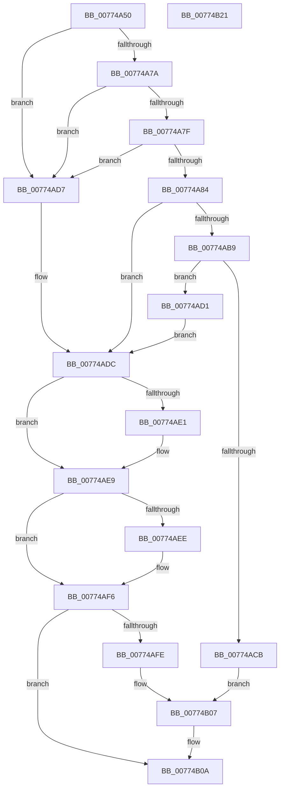

# SleepstudyHelper_RegisterComponentEx

- RVA: `0x00774A50`–`0x00774B22` (길이 `210` bytes)
- VA: `0x0000000140774A50`
- 실행 섹션: `PAGE`
- PDB 이름 있음: `예`; PDB Function 태그: `아니요`
- unwind 정보 RVA: `0x000C89F4`
- 디코드: `66`개 명령, `210/210` bytes 표시
- 미해석 바이트: `0` (있으면 어셈블리에 `.byte`로 보존)

> 이 문서는 커널 이미지의 기계어와 PDB 기호를 분석해 생성했습니다. 4번과 5번은 함수 원형과 자료형을 바이너리 사용 방식에서 추정한 C 해석이며 원본 소스 복구 결과는 아닙니다.

## 1. Dependencies

- 직접 호출 지점: **4**; 고유 호출 대상: **4**
- 직접 호출자로 확인된 함수: **0**
- RIP 상대 이미지 참조: **1**

### Outgoing calls
- `0x00774AAA` → [SleepstudyHelperCreateBlockerFromGuid](../../text/3D/SleepstudyHelperCreateBlockerFromGuid_function_003D3F70.md) (function, `0x003D3F70`)
- `0x00774AC0` → [SleepstudyHelperBuildBlocker](../A2/SleepstudyHelperBuildBlocker_function_00A2DAD0.md) (function, `0x00A2DAD0`)
- `0x00774AE4` → [SleepstudyHelperDestroyBlockerBuilder](../A2/SleepstudyHelperDestroyBlockerBuilder_function_00A2DE80.md) (function, `0x00A2DE80`)
- `0x00774AF1` → [SleepstudyHelperDestroyBlocker](../../text/48/SleepstudyHelperDestroyBlocker_function_00486930.md) (function, `0x00486930`)

### Direct callers
- 이 함수 시작 RVA로 연결되는 직접 call은 확인되지 않았습니다. 간접 호출은 완전히 역산할 수 없습니다.

### Static image references
- `0x00774AFE` → RVA `0x00F06B68` (`.data`; read)

## 2. Other-region calls and transfers

- 다른 실행 섹션으로 향하는 call: **2**
  - `0x00774AAA` → [SleepstudyHelperCreateBlockerFromGuid](../../text/3D/SleepstudyHelperCreateBlockerFromGuid_function_003D3F70.md) (`PAGE` → `.text`)
  - `0x00774AF1` → [SleepstudyHelperDestroyBlocker](../../text/48/SleepstudyHelperDestroyBlocker_function_00486930.md) (`PAGE` → `.text`)
- 별도 외부 분기/꼬리 이동을 확인하지 못했습니다.

## 3. Assembly (complete function range)

```asm
00774A50  48 89 5C 24 10                  mov qword ptr [rsp + 0x10], rbx
00774A55  48 89 74 24 18                  mov qword ptr [rsp + 0x18], rsi
00774A5A  55                              push rbp
00774A5B  57                              push rdi
00774A5C  41 56                           push r14
00774A5E  48 8B EC                        mov rbp, rsp
00774A61  48 83 EC 60                     sub rsp, 0x60
00774A65  4C 8B 75 40                     mov r14, qword ptr [rbp + 0x40]
00774A69  33 F6                           xor esi, esi
00774A6B  33 FF                           xor edi, edi
00774A6D  48 89 75 20                     mov qword ptr [rbp + 0x20], rsi
00774A71  48 89 7D D0                     mov qword ptr [rbp - 0x30], rdi
00774A75  48 85 C9                        test rcx, rcx
00774A78  74 5D                           je 0x140774ad7
00774A7A  4D 85 C9                        test r9, r9
00774A7D  74 58                           je 0x140774ad7
00774A7F  4D 85 F6                        test r14, r14
00774A82  74 53                           je 0x140774ad7
00774A84  0F 10 02                        movups xmm0, xmmword ptr [rdx]
00774A87  48 8D 45 D0                     lea rax, [rbp - 0x30]
00774A8B  41 0F 10 08                     movups xmm1, xmmword ptr [r8]
00774A8F  48 89 44 24 28                  mov qword ptr [rsp + 0x28], rax
00774A94  4C 8D 45 D8                     lea r8, [rbp - 0x28]
00774A98  21 74 24 20                     and dword ptr [rsp + 0x20], esi
00774A9C  48 8D 55 E8                     lea rdx, [rbp - 0x18]
00774AA0  F3 0F 7F 45 E8                  movdqu xmmword ptr [rbp - 0x18], xmm0
00774AA5  F3 0F 7F 4D D8                  movdqu xmmword ptr [rbp - 0x28], xmm1
00774AAA  E8 C1 F4 C5 FF                  call 0x1403d3f70
00774AAF  48 8B 7D D0                     mov rdi, qword ptr [rbp - 0x30]
00774AB3  8B D8                           mov ebx, eax
00774AB5  85 C0                           test eax, eax
00774AB7  78 23                           js 0x140774adc
00774AB9  48 8D 55 20                     lea rdx, [rbp + 0x20]
00774ABD  48 8B CF                        mov rcx, rdi
00774AC0  E8 0B 90 2B 00                  call 0x140a2dad0
00774AC5  8B D8                           mov ebx, eax
00774AC7  85 C0                           test eax, eax
00774AC9  78 06                           js 0x140774ad1
00774ACB  48 8B 45 20                     mov rax, qword ptr [rbp + 0x20]
00774ACF  EB 36                           jmp 0x140774b07
00774AD1  48 8B 75 20                     mov rsi, qword ptr [rbp + 0x20]
00774AD5  EB 05                           jmp 0x140774adc
00774AD7  BB 0D 00 00 C0                  mov ebx, 0xc000000d
00774ADC  48 85 FF                        test rdi, rdi
00774ADF  74 08                           je 0x140774ae9
00774AE1  48 8B CF                        mov rcx, rdi
00774AE4  E8 97 93 2B 00                  call 0x140a2de80
00774AE9  48 85 F6                        test rsi, rsi
00774AEC  74 08                           je 0x140774af6
00774AEE  48 8B CE                        mov rcx, rsi
00774AF1  E8 3A 1E D1 FF                  call 0x140486930
00774AF6  81 FB BB 00 00 C0               cmp ebx, 0xc00000bb
00774AFC  75 0C                           jne 0x140774b0a
00774AFE  48 8D 05 63 20 79 00            lea rax, [rip + 0x792063]
00774B05  33 DB                           xor ebx, ebx
00774B07  49 89 06                        mov qword ptr [r14], rax
00774B0A  4C 8D 5C 24 60                  lea r11, [rsp + 0x60]
00774B0F  8B C3                           mov eax, ebx
00774B11  49 8B 5B 28                     mov rbx, qword ptr [r11 + 0x28]
00774B15  49 8B 73 30                     mov rsi, qword ptr [r11 + 0x30]
00774B19  49 8B E3                        mov rsp, r11
00774B1C  41 5E                           pop r14
00774B1E  5F                              pop rdi
00774B1F  5D                              pop rbp
00774B20  C3                              ret
00774B21  CC                              int3
```

## 4. C-style interpretation (structured pseudocode)

```c
__int64 __fastcall SleepstudyHelper_RegisterComponentEx(__int64 a1, __int64 a2, __int64 a3, __int64 a4, __int64 a5)
{
    __int64 result;
    __int64 v_rbx;
    __int64 v_rdi;
    __int64 v_rsi;
    __int64 v_rsp;
    unsigned __int64 v_stack_m18;
    unsigned __int64 v_stack_m30;
    unsigned __int64 v_stack_m40;
    unsigned __int64 v_stack_m48;
    unsigned __int64 v_stack_m50;
    unsigned int v_stack_m58;
    unsigned __int64 v_stack_p10;
    unsigned __int64 v_stack_p18;
    unsigned __int64 v_stack_p8;

    v_stack_p10 = v_rbx;
    v_stack_p18 = v_rsi;
    v_rsp = (v_rsp) - (96);
    v_rsi = 0;
    v_rdi = 0;
    v_stack_p8 = 0;
    v_stack_m48 = 0;
    if (a1 == 0) goto loc_00774AD7;
    if (a4 == 0) goto loc_00774AD7;
    if (a5 == 0) goto loc_00774AD7;
    v_stack_m50 = v_stack_m48;
    v_stack_m30 = v_xmm0;
    v_stack_m40 = v_xmm1;
    result = SleepstudyHelperCreateBlockerFromGuid(a1, v_stack_m30, v_stack_m40, a4);
    if (sign_flag) goto loc_00774ADC;
    result = SleepstudyHelperBuildBlocker(v_stack_m48, v_stack_p8, v_stack_m40, a4);
    if (sign_flag) goto loc_00774AD1;
    goto loc_00774B07;
loc_00774AD1:
    goto loc_00774ADC;
loc_00774AD7:
loc_00774ADC:
    result = v_stack_p8;
    if (v_stack_m48 != 0) {
        a1 = v_stack_m48;
        result = SleepstudyHelperDestroyBlockerBuilder(a1, v_stack_p8, v_stack_m40, a4);
    }
    if (v_stack_p8 != 0) {
        a1 = v_stack_p8;
        result = SleepstudyHelperDestroyBlocker(a1, v_stack_p8, v_stack_m40, a4);
    }
    if (((unsigned int)((unsigned int)(0xC000000DULL))) != 0xC00000BBULL) goto loc_00774B0A;
    v_rbx = 0;
loc_00774B07:
    *(unsigned __int64 *)(a5) = v_rip + 7938147;
loc_00774B0A:
    return 0;
}
```

## 5. (Beta) C Style

```c
int64_t SleepstudyHelper_RegisterComponentEx(int64_t Arg1, void *Arg2, void *Arg3, int64_t Arg4, int64_t Arg5)
{
    uint8_t *arg2 = (uint8_t *)Arg2;
    uint8_t *arg3 = (uint8_t *)Arg3;

    int64_t result;
    int64_t local_rbx;
    int64_t local_rdi;
    int64_t local_rsi;
    int64_t local_rsp;
    uint64_t v_stack_m18;
    uint64_t v_stack_m30;
    uint64_t v_stack_m40;
    uint64_t v_stack_m48;
    uint64_t v_stack_m50;
    uint32_t v_stack_m58;
    uint64_t v_stack_p10;
    uint64_t v_stack_p18;
    uint64_t v_stack_p8;

    v_stack_p10 = local_rbx;
    v_stack_p18 = local_rsi;
    local_rsp = (local_rsp) - (96);
    local_rsi = 0;
    local_rdi = 0;
    v_stack_p8 = 0;
    v_stack_m48 = 0;
    if (Arg1 == 0) goto loc_00774AD7;
    if (Arg4 == 0) goto loc_00774AD7;
    if (Arg5 == 0) goto loc_00774AD7;
    v_stack_m50 = v_stack_m48;
    v_stack_m30 = v_xmm0;
    v_stack_m40 = v_xmm1;
    result = SleepstudyHelperCreateBlockerFromGuid(Arg1, v_stack_m30, v_stack_m40, Arg4);
    if (sign_flag) goto loc_00774ADC;
    result = SleepstudyHelperBuildBlocker(v_stack_m48, v_stack_p8, v_stack_m40, Arg4);
    if (sign_flag) goto loc_00774AD1;
    goto loc_00774B07;
loc_00774AD1:
    goto loc_00774ADC;
loc_00774AD7:
loc_00774ADC:
    result = v_stack_p8;
    if (v_stack_m48 != 0) {
        Arg1 = v_stack_m48;
        result = SleepstudyHelperDestroyBlockerBuilder(Arg1, v_stack_p8, v_stack_m40, Arg4);
    }
    if (v_stack_p8 != 0) {
        Arg1 = v_stack_p8;
        result = SleepstudyHelperDestroyBlocker(Arg1, v_stack_p8, v_stack_m40, Arg4);
    }
    if (((uint32_t)((uint32_t)(0xC000000DULL))) != 0xC00000BBULL) goto loc_00774B0A;
    local_rbx = 0;
loc_00774B07:
    *(uint64_t *)(Arg5) = v_rip + 7938147;
loc_00774B0A:
    return 0;
}
```

### 관측된 메모리 오프셋

구조체 형식이 확인되지 않은 접근은 인자 기준의 오프셋으로만 기록했습니다.

| 기준 인자 | 오프셋 표현 | 폭 (bit) | 접근 |
|---|---:|---:|---|
| `Arg2` | `+ 0x0` | `128` | `R` |
| `Arg3` | `+ 0x0` | `128` | `R` |

## 6. Execution-region graph

[열기: 2D/3D 그래프와 함수 탐색 컨트롤 패널](../../../control-panel.html?section=page&rva=0x00774A50&view=graph)

- 2D 그래프는 위에서 아래로 흐르고, 3D 그래프는 빈 공간을 드래그해 회전합니다. Shift+드래그는 이동, 휠은 확대·축소, 함수 노드 선택은 대상 보고서 이동입니다.

### Static fallback


