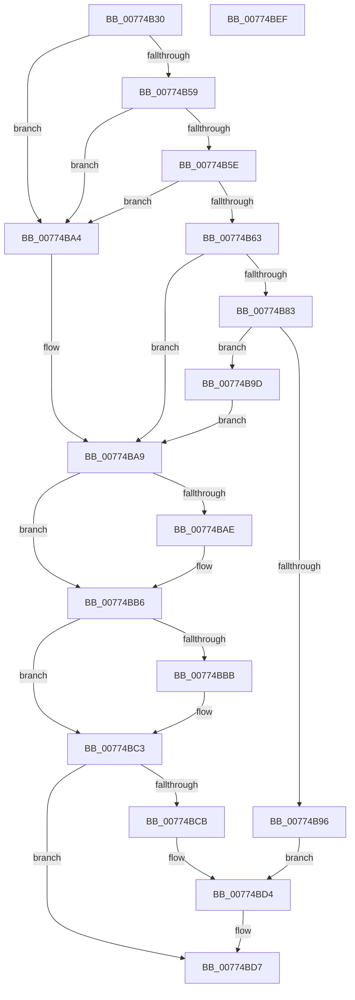

# SleepstudyHelper_RegisterPdoWithParentGuid

- RVA: `0x00774B30`–`0x00774BF0` (길이 `192` bytes)
- VA: `0x0000000140774B30`
- 실행 섹션: `PAGE`
- PDB 이름 있음: `예`; PDB Function 태그: `아니요`
- unwind 정보 RVA: `0x000CDACC`
- 디코드: `58`개 명령, `192/192` bytes 표시
- 미해석 바이트: `0` (있으면 어셈블리에 `.byte`로 보존)

> 이 문서는 커널 이미지의 기계어와 PDB 기호를 분석해 생성했습니다. 4번과 5번은 함수 원형과 자료형을 바이너리 사용 방식에서 추정한 C 해석이며 원본 소스 복구 결과는 아닙니다.

## 1. Dependencies

- 직접 호출 지점: **4**; 고유 호출 대상: **4**
- 직접 호출자로 확인된 함수: **0**
- RIP 상대 이미지 참조: **1**

### Outgoing calls
- `0x00774B73` → [SleepstudyHelperCreateBlockerFromDevice](../A2/SleepstudyHelperCreateBlockerFromDevice_function_00A2D5F0.md) (function, `0x00A2D5F0`)
- `0x00774B8B` → [SleepstudyHelperBuildBlocker](../A2/SleepstudyHelperBuildBlocker_function_00A2DAD0.md) (function, `0x00A2DAD0`)
- `0x00774BB1` → [SleepstudyHelperDestroyBlockerBuilder](../A2/SleepstudyHelperDestroyBlockerBuilder_function_00A2DE80.md) (function, `0x00A2DE80`)
- `0x00774BBE` → [SleepstudyHelperDestroyBlocker](../../text/48/SleepstudyHelperDestroyBlocker_function_00486930.md) (function, `0x00486930`)

### Direct callers
- 이 함수 시작 RVA로 연결되는 직접 call은 확인되지 않았습니다. 간접 호출은 완전히 역산할 수 없습니다.

### Static image references
- `0x00774BCB` → RVA `0x00F06B68` (`.data`; read)

## 2. Other-region calls and transfers

- 다른 실행 섹션으로 향하는 call: **1**
  - `0x00774BBE` → [SleepstudyHelperDestroyBlocker](../../text/48/SleepstudyHelperDestroyBlocker_function_00486930.md) (`PAGE` → `.text`)
- 별도 외부 분기/꼬리 이동을 확인하지 못했습니다.

## 3. Assembly (complete function range)

```asm
00774B30  48 8B C4                        mov rax, rsp
00774B33  48 89 58 10                     mov qword ptr [rax + 0x10], rbx
00774B37  48 89 70 18                     mov qword ptr [rax + 0x18], rsi
00774B3B  48 89 78 20                     mov qword ptr [rax + 0x20], rdi
00774B3F  41 56                           push r14
00774B41  48 83 EC 40                     sub rsp, 0x40
00774B45  33 F6                           xor esi, esi
00774B47  33 FF                           xor edi, edi
00774B49  48 89 70 08                     mov qword ptr [rax + 8], rsi
00774B4D  4D 8B F1                        mov r14, r9
00774B50  48 89 78 D8                     mov qword ptr [rax - 0x28], rdi
00774B54  48 85 C9                        test rcx, rcx
00774B57  74 4B                           je 0x140774ba4
00774B59  4D 85 C0                        test r8, r8
00774B5C  74 46                           je 0x140774ba4
00774B5E  4D 85 C9                        test r9, r9
00774B61  74 41                           je 0x140774ba4
00774B63  0F 10 02                        movups xmm0, xmmword ptr [rdx]
00774B66  4C 8D 48 D8                     lea r9, [rax - 0x28]
00774B6A  48 8D 50 E0                     lea rdx, [rax - 0x20]
00774B6E  F3 0F 7F 40 E0                  movdqu xmmword ptr [rax - 0x20], xmm0
00774B73  E8 78 8A 2B 00                  call 0x140a2d5f0
00774B78  48 8B 7C 24 20                  mov rdi, qword ptr [rsp + 0x20]
00774B7D  8B D8                           mov ebx, eax
00774B7F  85 C0                           test eax, eax
00774B81  78 26                           js 0x140774ba9
00774B83  48 8D 54 24 50                  lea rdx, [rsp + 0x50]
00774B88  48 8B CF                        mov rcx, rdi
00774B8B  E8 40 8F 2B 00                  call 0x140a2dad0
00774B90  8B D8                           mov ebx, eax
00774B92  85 C0                           test eax, eax
00774B94  78 07                           js 0x140774b9d
00774B96  48 8B 44 24 50                  mov rax, qword ptr [rsp + 0x50]
00774B9B  EB 37                           jmp 0x140774bd4
00774B9D  48 8B 74 24 50                  mov rsi, qword ptr [rsp + 0x50]
00774BA2  EB 05                           jmp 0x140774ba9
00774BA4  BB 0D 00 00 C0                  mov ebx, 0xc000000d
00774BA9  48 85 FF                        test rdi, rdi
00774BAC  74 08                           je 0x140774bb6
00774BAE  48 8B CF                        mov rcx, rdi
00774BB1  E8 CA 92 2B 00                  call 0x140a2de80
00774BB6  48 85 F6                        test rsi, rsi
00774BB9  74 08                           je 0x140774bc3
00774BBB  48 8B CE                        mov rcx, rsi
00774BBE  E8 6D 1D D1 FF                  call 0x140486930
00774BC3  81 FB BB 00 00 C0               cmp ebx, 0xc00000bb
00774BC9  75 0C                           jne 0x140774bd7
00774BCB  48 8D 05 96 1F 79 00            lea rax, [rip + 0x791f96]
00774BD2  33 DB                           xor ebx, ebx
00774BD4  49 89 06                        mov qword ptr [r14], rax
00774BD7  48 8B 74 24 60                  mov rsi, qword ptr [rsp + 0x60]
00774BDC  8B C3                           mov eax, ebx
00774BDE  48 8B 5C 24 58                  mov rbx, qword ptr [rsp + 0x58]
00774BE3  48 8B 7C 24 68                  mov rdi, qword ptr [rsp + 0x68]
00774BE8  48 83 C4 40                     add rsp, 0x40
00774BEC  41 5E                           pop r14
00774BEE  C3                              ret
00774BEF  CC                              int3
```

## 4. C-style interpretation (structured pseudocode)

```c
__int64 __fastcall SleepstudyHelper_RegisterPdoWithParentGuid(__int64 a1, __int64 a2, __int64 a3, __int64 a4)
{
    __int64 result;
    __int64 v_rbx;
    __int64 v_rdi;
    __int64 v_rsi;
    __int64 v_rsp;
    unsigned __int64 v_stack_m28;
    unsigned __int64 v_stack_p10;
    unsigned __int64 v_stack_p18;
    unsigned __int64 v_stack_p20;
    unsigned __int64 v_stack_p8;

    *(unsigned __int64 *)(v_rsp + 16) = v_rbx;
    *(unsigned __int64 *)(v_rsp + 24) = v_rsi;
    *(unsigned __int64 *)(v_rsp + 32) = v_rdi;
    v_rsp = (v_rsp) - (64);
    v_rsi = 0;
    v_rdi = 0;
    *(unsigned __int64 *)(v_rsp + 8) = 0;
    *(unsigned __int64 *)(v_rsp - 40) = 0;
    if (a1 == 0) goto loc_00774BA4;
    if (a3 == 0) goto loc_00774BA4;
    if (a4 == 0) goto loc_00774BA4;
    *(unsigned __int64 *)(v_rsp - 32) = v_xmm0;
    result = SleepstudyHelperCreateBlockerFromDevice(a1, v_rsp - 32, a3, v_rsp - 40);
    if (sign_flag) goto loc_00774BA9;
    result = SleepstudyHelperBuildBlocker(v_stack_m28, v_stack_p8, a3, v_rsp - 40);
    if (sign_flag) goto loc_00774B9D;
    goto loc_00774BD4;
loc_00774B9D:
    goto loc_00774BA9;
loc_00774BA4:
loc_00774BA9:
    result = v_stack_p8;
    if (v_stack_m28 != 0) {
        a1 = v_stack_m28;
        result = SleepstudyHelperDestroyBlockerBuilder(a1, v_stack_p8, a3, v_rsp - 40);
    }
    if (v_stack_p8 != 0) {
        a1 = v_stack_p8;
        result = SleepstudyHelperDestroyBlocker(a1, v_stack_p8, a3, v_rsp - 40);
    }
    if (((unsigned int)((unsigned int)(0xC000000DULL))) != 0xC00000BBULL) goto loc_00774BD7;
    v_rbx = 0;
loc_00774BD4:
    *(unsigned __int64 *)(a4) = v_rip + 7937942;
loc_00774BD7:
    v_rsp = (v_rsp) + (64);
    return 0;
}
```

## 5. (Beta) C Style

```c
int64_t SleepstudyHelper_RegisterPdoWithParentGuid(int64_t Arg1, void *Arg2, int64_t Arg3, void *Arg4)
{
    uint8_t *arg2 = (uint8_t *)Arg2;
    uint8_t *arg4 = (uint8_t *)Arg4;

    int64_t result;
    int64_t local_rbx;
    int64_t local_rdi;
    int64_t local_rsi;
    int64_t local_rsp;
    uint64_t v_stack_m28;
    uint64_t v_stack_p10;
    uint64_t v_stack_p18;
    uint64_t v_stack_p20;
    uint64_t v_stack_p8;

    *(uint64_t *)(local_rsp + 0x10) = local_rbx;
    *(uint64_t *)(local_rsp + 0x18) = local_rsi;
    *(uint64_t *)(local_rsp + 0x20) = local_rdi;
    local_rsp = (local_rsp) - (64);
    local_rsi = 0;
    local_rdi = 0;
    *(uint64_t *)(local_rsp + 0x8) = 0;
    *(uint64_t *)(local_rsp - 0x28) = 0;
    if (Arg1 == 0) goto loc_00774BA4;
    if (Arg3 == 0) goto loc_00774BA4;
    if (Arg4 == NULL) goto loc_00774BA4;
    *(uint64_t *)(local_rsp - 0x20) = v_xmm0;
    result = SleepstudyHelperCreateBlockerFromDevice(Arg1, local_rsp - 32, Arg3, local_rsp - 40);
    if (sign_flag) goto loc_00774BA9;
    result = SleepstudyHelperBuildBlocker(v_stack_m28, v_stack_p8, Arg3, local_rsp - 40);
    if (sign_flag) goto loc_00774B9D;
    goto loc_00774BD4;
loc_00774B9D:
    goto loc_00774BA9;
loc_00774BA4:
loc_00774BA9:
    result = v_stack_p8;
    if (v_stack_m28 != 0) {
        Arg1 = v_stack_m28;
        result = SleepstudyHelperDestroyBlockerBuilder(Arg1, v_stack_p8, Arg3, local_rsp - 40);
    }
    if (v_stack_p8 != 0) {
        Arg1 = v_stack_p8;
        result = SleepstudyHelperDestroyBlocker(Arg1, v_stack_p8, Arg3, local_rsp - 40);
    }
    if (((uint32_t)((uint32_t)(0xC000000DULL))) != 0xC00000BBULL) goto loc_00774BD7;
    local_rbx = 0;
loc_00774BD4:
    *(uint64_t *)(arg4) = v_rip + 7937942;
loc_00774BD7:
    local_rsp = (local_rsp) + (64);
    return 0;
}
```

### 관측된 메모리 오프셋

구조체 형식이 확인되지 않은 접근은 인자 기준의 오프셋으로만 기록했습니다.

| 기준 인자 | 오프셋 표현 | 폭 (bit) | 접근 |
|---|---:|---:|---|
| `Arg2` | `+ 0x0` | `128` | `R` |
| `Arg4` | `+ 0x0` | `64` | `W` |

## 6. Execution-region graph

[열기: 2D/3D 그래프와 함수 탐색 컨트롤 패널](../../../control-panel.html?section=page&rva=0x00774B30&view=graph)

- 2D 그래프는 위에서 아래로 흐르고, 3D 그래프는 빈 공간을 드래그해 회전합니다. Shift+드래그는 이동, 휠은 확대·축소, 함수 노드 선택은 대상 보고서 이동입니다.

### Static fallback


