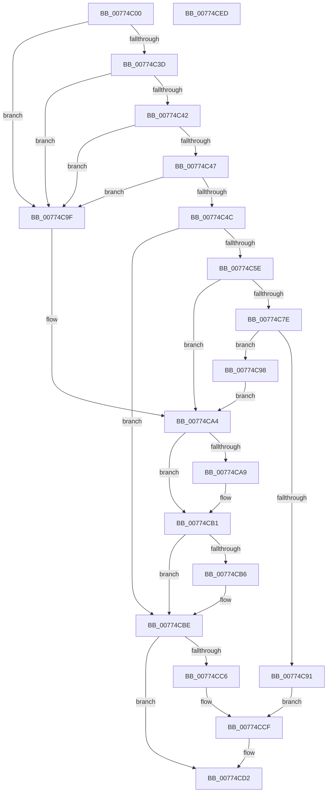

# SleepstudyHelper_RegisterPdoWithParentHandle

- RVA: `0x00774C00`–`0x00774CEE` (길이 `238` bytes)
- VA: `0x0000000140774C00`
- 실행 섹션: `PAGE`
- PDB 이름 있음: `예`; PDB Function 태그: `아니요`
- unwind 정보 RVA: `0x000BDE04`
- 디코드: `75`개 명령, `238/238` bytes 표시
- 미해석 바이트: `0` (있으면 어셈블리에 `.byte`로 보존)

> 이 문서는 커널 이미지의 기계어와 PDB 기호를 분석해 생성했습니다. 4번과 5번은 함수 원형과 자료형을 바이너리 사용 방식에서 추정한 C 해석이며 원본 소스 복구 결과는 아닙니다.

## 1. Dependencies

- 직접 호출 지점: **5**; 고유 호출 대상: **5**
- 직접 호출자로 확인된 함수: **0**
- RIP 상대 이미지 참조: **1**

### Outgoing calls
- `0x00774C53` → [SleepstudyHelperGetBlockerGuid](../A7/SleepstudyHelperGetBlockerGuid_function_00A775C0.md) (function, `0x00A775C0`)
- `0x00774C6E` → [SleepstudyHelperCreateBlockerFromDevice](../A2/SleepstudyHelperCreateBlockerFromDevice_function_00A2D5F0.md) (function, `0x00A2D5F0`)
- `0x00774C86` → [SleepstudyHelperBuildBlocker](../A2/SleepstudyHelperBuildBlocker_function_00A2DAD0.md) (function, `0x00A2DAD0`)
- `0x00774CAC` → [SleepstudyHelperDestroyBlockerBuilder](../A2/SleepstudyHelperDestroyBlockerBuilder_function_00A2DE80.md) (function, `0x00A2DE80`)
- `0x00774CB9` → [SleepstudyHelperDestroyBlocker](../../text/48/SleepstudyHelperDestroyBlocker_function_00486930.md) (function, `0x00486930`)

### Direct callers
- 이 함수 시작 RVA로 연결되는 직접 call은 확인되지 않았습니다. 간접 호출은 완전히 역산할 수 없습니다.

### Static image references
- `0x00774CC6` → RVA `0x00F06B68` (`.data`; read)

## 2. Other-region calls and transfers

- 다른 실행 섹션으로 향하는 call: **1**
  - `0x00774CB9` → [SleepstudyHelperDestroyBlocker](../../text/48/SleepstudyHelperDestroyBlocker_function_00486930.md) (`PAGE` → `.text`)
- 별도 외부 분기/꼬리 이동을 확인하지 못했습니다.

## 3. Assembly (complete function range)

```asm
00774C00  4C 8B DC                        mov r11, rsp
00774C03  49 89 5B 10                     mov qword ptr [r11 + 0x10], rbx
00774C07  49 89 6B 18                     mov qword ptr [r11 + 0x18], rbp
00774C0B  49 89 73 20                     mov qword ptr [r11 + 0x20], rsi
00774C0F  57                              push rdi
00774C10  41 56                           push r14
00774C12  41 57                           push r15
00774C14  48 83 EC 40                     sub rsp, 0x40
00774C18  33 F6                           xor esi, esi
00774C1A  33 FF                           xor edi, edi
00774C1C  49 89 73 08                     mov qword ptr [r11 + 8], rsi
00774C20  0F 57 C0                        xorps xmm0, xmm0
00774C23  49 89 7B C8                     mov qword ptr [r11 - 0x38], rdi
00774C27  4D 8B F1                        mov r14, r9
00774C2A  49 8B E8                        mov rbp, r8
00774C2D  48 8B C2                        mov rax, rdx
00774C30  4C 8B F9                        mov r15, rcx
00774C33  0F 11 44 24 28                  movups xmmword ptr [rsp + 0x28], xmm0
00774C38  48 85 C9                        test rcx, rcx
00774C3B  74 62                           je 0x140774c9f
00774C3D  48 85 C0                        test rax, rax
00774C40  74 5D                           je 0x140774c9f
00774C42  4D 85 C0                        test r8, r8
00774C45  74 58                           je 0x140774c9f
00774C47  4D 85 C9                        test r9, r9
00774C4A  74 53                           je 0x140774c9f
00774C4C  49 8D 53 D0                     lea rdx, [r11 - 0x30]
00774C50  48 8B C8                        mov rcx, rax
00774C53  E8 68 29 30 00                  call 0x140a775c0
00774C58  8B D8                           mov ebx, eax
00774C5A  85 C0                           test eax, eax
00774C5C  78 60                           js 0x140774cbe
00774C5E  4C 8D 4C 24 20                  lea r9, [rsp + 0x20]
00774C63  4C 8B C5                        mov r8, rbp
00774C66  48 8D 54 24 28                  lea rdx, [rsp + 0x28]
00774C6B  49 8B CF                        mov rcx, r15
00774C6E  E8 7D 89 2B 00                  call 0x140a2d5f0
00774C73  48 8B 7C 24 20                  mov rdi, qword ptr [rsp + 0x20]
00774C78  8B D8                           mov ebx, eax
00774C7A  85 C0                           test eax, eax
00774C7C  78 26                           js 0x140774ca4
00774C7E  48 8D 54 24 60                  lea rdx, [rsp + 0x60]
00774C83  48 8B CF                        mov rcx, rdi
00774C86  E8 45 8E 2B 00                  call 0x140a2dad0
00774C8B  8B D8                           mov ebx, eax
00774C8D  85 C0                           test eax, eax
00774C8F  78 07                           js 0x140774c98
00774C91  48 8B 44 24 60                  mov rax, qword ptr [rsp + 0x60]
00774C96  EB 37                           jmp 0x140774ccf
00774C98  48 8B 74 24 60                  mov rsi, qword ptr [rsp + 0x60]
00774C9D  EB 05                           jmp 0x140774ca4
00774C9F  BB 0D 00 00 C0                  mov ebx, 0xc000000d
00774CA4  48 85 FF                        test rdi, rdi
00774CA7  74 08                           je 0x140774cb1
00774CA9  48 8B CF                        mov rcx, rdi
00774CAC  E8 CF 91 2B 00                  call 0x140a2de80
00774CB1  48 85 F6                        test rsi, rsi
00774CB4  74 08                           je 0x140774cbe
00774CB6  48 8B CE                        mov rcx, rsi
00774CB9  E8 72 1C D1 FF                  call 0x140486930
00774CBE  81 FB BB 00 00 C0               cmp ebx, 0xc00000bb
00774CC4  75 0C                           jne 0x140774cd2
00774CC6  48 8D 05 9B 1E 79 00            lea rax, [rip + 0x791e9b]
00774CCD  33 DB                           xor ebx, ebx
00774CCF  49 89 06                        mov qword ptr [r14], rax
00774CD2  48 8B 6C 24 70                  mov rbp, qword ptr [rsp + 0x70]
00774CD7  8B C3                           mov eax, ebx
00774CD9  48 8B 5C 24 68                  mov rbx, qword ptr [rsp + 0x68]
00774CDE  48 8B 74 24 78                  mov rsi, qword ptr [rsp + 0x78]
00774CE3  48 83 C4 40                     add rsp, 0x40
00774CE7  41 5F                           pop r15
00774CE9  41 5E                           pop r14
00774CEB  5F                              pop rdi
00774CEC  C3                              ret
00774CED  CC                              int3
```

## 4. C-style interpretation (structured pseudocode)

```c
__int64 __fastcall SleepstudyHelper_RegisterPdoWithParentHandle(__int64 a1, __int64 a2, __int64 a3, __int64 a4)
{
    __int64 result;
    __int64 v_rbx;
    __int64 v_rdi;
    __int64 v_rsi;
    __int64 v_rsp;
    unsigned __int64 v_stack_m30;
    unsigned __int64 v_stack_m38;
    unsigned __int64 v_stack_p10;
    unsigned __int64 v_stack_p18;
    unsigned __int64 v_stack_p20;
    unsigned __int64 v_stack_p8;

    *(unsigned __int64 *)(v_rsp + 16) = v_rbx;
    *(unsigned __int64 *)(v_rsp + 24) = v_rbp;
    *(unsigned __int64 *)(v_rsp + 32) = v_rsi;
    v_rsp = (v_rsp) - (64);
    v_rsi = 0;
    v_rdi = 0;
    *(unsigned __int64 *)(v_rsp + 8) = 0;
    *(unsigned __int64 *)(v_rsp - 56) = 0;
    v_stack_m30 = v_xmm0;
    if (a1 == 0) goto loc_00774C9F;
    if (a2 == 0) goto loc_00774C9F;
    if (a3 == 0) goto loc_00774C9F;
    if (a4 == 0) goto loc_00774C9F;
    result = SleepstudyHelperGetBlockerGuid(a2, v_rsp - 48, a3, a4);
    if (sign_flag) goto loc_00774CBE;
    result = SleepstudyHelperCreateBlockerFromDevice(a1, v_stack_m30, a3, v_stack_m38);
    if (sign_flag) goto loc_00774CA4;
    result = SleepstudyHelperBuildBlocker(v_stack_m38, v_stack_p8, a3, v_stack_m38);
    if (sign_flag) goto loc_00774C98;
    goto loc_00774CCF;
loc_00774C98:
    goto loc_00774CA4;
loc_00774C9F:
loc_00774CA4:
    result = v_stack_p8;
    if (v_stack_m38 != 0) {
        a1 = v_stack_m38;
        result = SleepstudyHelperDestroyBlockerBuilder(a1, v_stack_p8, a3, v_stack_m38);
    }
    if (v_stack_p8 != 0) {
        a1 = v_stack_p8;
        result = SleepstudyHelperDestroyBlocker(a1, v_stack_p8, a3, v_stack_m38);
    }
    if (((unsigned int)((unsigned int)(0xC000000DULL))) != 0xC00000BBULL) goto loc_00774CD2;
    v_rbx = 0;
loc_00774CCF:
    *(unsigned __int64 *)(a4) = v_rip + 7937691;
loc_00774CD2:
    v_rsp = (v_rsp) + (64);
    return 0;
}
```

## 5. (Beta) C Style

```c
int64_t SleepstudyHelper_RegisterPdoWithParentHandle(int64_t Arg1, int64_t Arg2, int64_t Arg3, void *Arg4)
{
    uint8_t *arg4 = (uint8_t *)Arg4;

    int64_t result;
    int64_t local_rbx;
    int64_t local_rdi;
    int64_t local_rsi;
    int64_t local_rsp;
    uint64_t v_stack_m30;
    uint64_t v_stack_m38;
    uint64_t v_stack_p10;
    uint64_t v_stack_p18;
    uint64_t v_stack_p20;
    uint64_t v_stack_p8;

    *(uint64_t *)(local_rsp + 0x10) = local_rbx;
    *(uint64_t *)(local_rsp + 0x18) = local_rbp;
    *(uint64_t *)(local_rsp + 0x20) = local_rsi;
    local_rsp = (local_rsp) - (64);
    local_rsi = 0;
    local_rdi = 0;
    *(uint64_t *)(local_rsp + 0x8) = 0;
    *(uint64_t *)(local_rsp - 0x38) = 0;
    v_stack_m30 = v_xmm0;
    if (Arg1 == 0) goto loc_00774C9F;
    if (Arg2 == 0) goto loc_00774C9F;
    if (Arg3 == 0) goto loc_00774C9F;
    if (Arg4 == NULL) goto loc_00774C9F;
    result = SleepstudyHelperGetBlockerGuid(Arg2, local_rsp - 48, Arg3, Arg4);
    if (sign_flag) goto loc_00774CBE;
    result = SleepstudyHelperCreateBlockerFromDevice(Arg1, v_stack_m30, Arg3, v_stack_m38);
    if (sign_flag) goto loc_00774CA4;
    result = SleepstudyHelperBuildBlocker(v_stack_m38, v_stack_p8, Arg3, v_stack_m38);
    if (sign_flag) goto loc_00774C98;
    goto loc_00774CCF;
loc_00774C98:
    goto loc_00774CA4;
loc_00774C9F:
loc_00774CA4:
    result = v_stack_p8;
    if (v_stack_m38 != 0) {
        Arg1 = v_stack_m38;
        result = SleepstudyHelperDestroyBlockerBuilder(Arg1, v_stack_p8, Arg3, v_stack_m38);
    }
    if (v_stack_p8 != 0) {
        Arg1 = v_stack_p8;
        result = SleepstudyHelperDestroyBlocker(Arg1, v_stack_p8, Arg3, v_stack_m38);
    }
    if (((uint32_t)((uint32_t)(0xC000000DULL))) != 0xC00000BBULL) goto loc_00774CD2;
    local_rbx = 0;
loc_00774CCF:
    *(uint64_t *)(arg4) = v_rip + 7937691;
loc_00774CD2:
    local_rsp = (local_rsp) + (64);
    return 0;
}
```

### 관측된 메모리 오프셋

구조체 형식이 확인되지 않은 접근은 인자 기준의 오프셋으로만 기록했습니다.

| 기준 인자 | 오프셋 표현 | 폭 (bit) | 접근 |
|---|---:|---:|---|
| `Arg4` | `+ 0x0` | `64` | `W` |

## 6. Execution-region graph

[열기: 2D/3D 그래프와 함수 탐색 컨트롤 패널](../../../control-panel.html?section=page&rva=0x00774C00&view=graph)

- 2D 그래프는 위에서 아래로 흐르고, 3D 그래프는 빈 공간을 드래그해 회전합니다. Shift+드래그는 이동, 휠은 확대·축소, 함수 노드 선택은 대상 보고서 이동입니다.

### Static fallback


