# SshSessionManagerFlushBuffers

- RVA: `0x007736D8`–`0x00773923` (길이 `587` bytes)
- VA: `0x00000001407736D8`
- 실행 섹션: `PAGE`
- PDB 이름 있음: `예`; PDB Function 태그: `아니요`
- unwind 정보 RVA: `0x000CDAB0`
- 디코드: `147`개 명령, `587/587` bytes 표시
- 미해석 바이트: `0` (있으면 어셈블리에 `.byte`로 보존)

> 이 문서는 커널 이미지의 기계어와 PDB 기호를 분석해 생성했습니다. 4번과 5번은 함수 원형과 자료형을 바이너리 사용 방식에서 추정한 C 해석이며 원본 소스 복구 결과는 아닙니다.

## 1. Dependencies

- 직접 호출 지점: **17**; 고유 호출 대상: **7**
- 직접 호출자로 확인된 함수: **1**
- RIP 상대 이미지 참조: **9**

### Outgoing calls
- `0x00773700` → [KeAbPreAcquire](../../text/21/KeAbPreAcquire_function_00210230.md) (function, `0x00210230`)
- `0x00773719` → [ExfAcquirePushLockExclusiveEx](../../text/20/ExfAcquirePushLockExclusiveEx_function_0020FC90.md) (function, `0x0020FC90`)
- `0x0077373B` → [SSHSupportReleasePushLockExclusive](../../text/49/SSHSupportReleasePushLockExclusive_function_004954EC.md) (function, `0x004954EC`)
- `0x00773757` → [KeAbPreAcquire](../../text/21/KeAbPreAcquire_function_00210230.md) (function, `0x00210230`)
- `0x00773771` → [ExfAcquirePushLockExclusiveEx](../../text/20/ExfAcquirePushLockExclusiveEx_function_0020FC90.md) (function, `0x0020FC90`)
- `0x007737CD` → [wil_details_FeatureReporting_ReportUsageToService](../../text/53/wil_details_FeatureReporting_ReportUsageToService_function_0053E6E4.md) (function, `0x0053E6E4`)
- `0x007737DD` → [wil_details_FeatureStateCache_TryEnableDeviceUsageFastPath](../../text/53/wil_details_FeatureStateCache_TryEnableDeviceUsageFastPath_function_0053E774.md) (function, `0x0053E774`)
- `0x007737EF` → [SSHSupportReleasePushLockExclusive](../../text/49/SSHSupportReleasePushLockExclusive_function_004954EC.md) (function, `0x004954EC`)
- `0x00773816` → [KeWaitForSingleObject](../../text/20/KeWaitForSingleObject_function_0020E6B0.md) (function, `0x0020E6B0`)
- `0x00773825` → [KeAbPreAcquire](../../text/21/KeAbPreAcquire_function_00210230.md) (function, `0x00210230`)
- `0x0077383F` → [ExfAcquirePushLockExclusiveEx](../../text/20/ExfAcquirePushLockExclusiveEx_function_0020FC90.md) (function, `0x0020FC90`)
- `0x00773889` → [wil_details_FeatureReporting_ReportUsageToService](../../text/53/wil_details_FeatureReporting_ReportUsageToService_function_0053E6E4.md) (function, `0x0053E6E4`)
- `0x00773899` → [wil_details_FeatureStateCache_TryEnableDeviceUsageFastPath](../../text/53/wil_details_FeatureStateCache_TryEnableDeviceUsageFastPath_function_0053E774.md) (function, `0x0053E774`)
- `0x007738AA` → [ZwClose](../../text/6A/ZwClose_function_006AD2B0.md) (function, `0x006AD2B0`)
- `0x007738BA` → [SSHSupportReleasePushLockExclusive](../../text/49/SSHSupportReleasePushLockExclusive_function_004954EC.md) (function, `0x004954EC`)
- `0x007738F3` → [wil_details_FeatureReporting_ReportUsageToService](../../text/53/wil_details_FeatureReporting_ReportUsageToService_function_0053E6E4.md) (function, `0x0053E6E4`)
- `0x00773903` → [wil_details_FeatureStateCache_TryEnableDeviceUsageFastPath](../../text/53/wil_details_FeatureStateCache_TryEnableDeviceUsageFastPath_function_0053E774.md) (function, `0x0053E774`)

### Direct callers
- [PopGracefulShutdown](../../pagelk/B6/PopGracefulShutdown_function_00B6BEC8.md) at `0x00B6C0C7`

### Static image references
- `0x007736F1` → RVA `0x00F069C8` (`.data`; read)
- `0x0077372D` → RVA `0x00F069D0` (`.data`; read)
- `0x00773748` → RVA `0x00F06B70` (`.data`; read)
- `0x00773785` → RVA `0x000DD780` (`.rdata`; read)
- `0x0077378C` → RVA `0x00F06C08` (`.data`; read)
- `0x0077379F` → RVA `0x00FC47A0` (`.data`; read)
- `0x007737E2` → RVA `0x00F06BA8` (`.data`; read)
- `0x0077380D` → RVA `0x00F06BF0` (`.data`; read)
- `0x007738AF` → RVA `0x00F06BA8` (`.data`; read/write)

## 2. Other-region calls and transfers

- 다른 실행 섹션으로 향하는 call: **17**
  - `0x00773700` → [KeAbPreAcquire](../../text/21/KeAbPreAcquire_function_00210230.md) (`PAGE` → `.text`)
  - `0x00773719` → [ExfAcquirePushLockExclusiveEx](../../text/20/ExfAcquirePushLockExclusiveEx_function_0020FC90.md) (`PAGE` → `.text`)
  - `0x0077373B` → [SSHSupportReleasePushLockExclusive](../../text/49/SSHSupportReleasePushLockExclusive_function_004954EC.md) (`PAGE` → `.text`)
  - `0x00773757` → [KeAbPreAcquire](../../text/21/KeAbPreAcquire_function_00210230.md) (`PAGE` → `.text`)
  - `0x00773771` → [ExfAcquirePushLockExclusiveEx](../../text/20/ExfAcquirePushLockExclusiveEx_function_0020FC90.md) (`PAGE` → `.text`)
  - `0x007737CD` → [wil_details_FeatureReporting_ReportUsageToService](../../text/53/wil_details_FeatureReporting_ReportUsageToService_function_0053E6E4.md) (`PAGE` → `.text`)
  - `0x007737DD` → [wil_details_FeatureStateCache_TryEnableDeviceUsageFastPath](../../text/53/wil_details_FeatureStateCache_TryEnableDeviceUsageFastPath_function_0053E774.md) (`PAGE` → `.text`)
  - `0x007737EF` → [SSHSupportReleasePushLockExclusive](../../text/49/SSHSupportReleasePushLockExclusive_function_004954EC.md) (`PAGE` → `.text`)
  - `0x00773816` → [KeWaitForSingleObject](../../text/20/KeWaitForSingleObject_function_0020E6B0.md) (`PAGE` → `.text`)
  - `0x00773825` → [KeAbPreAcquire](../../text/21/KeAbPreAcquire_function_00210230.md) (`PAGE` → `.text`)
  - `0x0077383F` → [ExfAcquirePushLockExclusiveEx](../../text/20/ExfAcquirePushLockExclusiveEx_function_0020FC90.md) (`PAGE` → `.text`)
  - `0x00773889` → [wil_details_FeatureReporting_ReportUsageToService](../../text/53/wil_details_FeatureReporting_ReportUsageToService_function_0053E6E4.md) (`PAGE` → `.text`)
  - `0x00773899` → [wil_details_FeatureStateCache_TryEnableDeviceUsageFastPath](../../text/53/wil_details_FeatureStateCache_TryEnableDeviceUsageFastPath_function_0053E774.md) (`PAGE` → `.text`)
  - `0x007738AA` → [ZwClose](../../text/6A/ZwClose_function_006AD2B0.md) (`PAGE` → `.text`)
  - `0x007738BA` → [SSHSupportReleasePushLockExclusive](../../text/49/SSHSupportReleasePushLockExclusive_function_004954EC.md) (`PAGE` → `.text`)
  - `0x007738F3` → [wil_details_FeatureReporting_ReportUsageToService](../../text/53/wil_details_FeatureReporting_ReportUsageToService_function_0053E6E4.md) (`PAGE` → `.text`)
  - `0x00773903` → [wil_details_FeatureStateCache_TryEnableDeviceUsageFastPath](../../text/53/wil_details_FeatureStateCache_TryEnableDeviceUsageFastPath_function_0053E774.md) (`PAGE` → `.text`)
- 별도 외부 분기/꼬리 이동을 확인하지 못했습니다.

## 3. Assembly (complete function range)

```asm
007736D8  48 89 5C 24 08                  mov qword ptr [rsp + 8], rbx
007736DD  48 89 6C 24 18                  mov qword ptr [rsp + 0x18], rbp
007736E2  48 89 7C 24 20                  mov qword ptr [rsp + 0x20], rdi
007736E7  41 54                           push r12
007736E9  41 56                           push r14
007736EB  41 57                           push r15
007736ED  48 83 EC 30                     sub rsp, 0x30
007736F1  48 8D 3D D0 32 79 00            lea rdi, [rip + 0x7932d0]
007736F8  45 33 C0                        xor r8d, r8d
007736FB  48 8B CF                        mov rcx, rdi
007736FE  33 D2                           xor edx, edx
00773700  E8 2B CB A9 FF                  call 0x140210230
00773705  F0 48 0F BA 2F 00               lock bts qword ptr [rdi], 0
0077370B  48 8B D8                        mov rbx, rax
0077370E  73 0E                           jae 0x14077371e
00773710  4C 8B C7                        mov r8, rdi
00773713  48 8B D0                        mov rdx, rax
00773716  48 8B CF                        mov rcx, rdi
00773719  E8 72 C5 A9 FF                  call 0x14020fc90
0077371E  41 BE 01 00 00 00               mov r14d, 1
00773724  48 85 DB                        test rbx, rbx
00773727  74 04                           je 0x14077372d
00773729  44 88 73 0A                     mov byte ptr [rbx + 0xa], r14b
0077372D  48 83 3D 9B 32 79 00 00         cmp qword ptr [rip + 0x79329b], 0
00773735  48 8B CF                        mov rcx, rdi
00773738  0F 95 C3                        setne bl
0077373B  E8 AC 1D D2 FF                  call 0x1404954ec
00773740  84 DB                           test bl, bl
00773742  0F 84 C0 01 00 00               je 0x140773908
00773748  48 8D 2D 21 34 79 00            lea rbp, [rip + 0x793421]
0077374F  45 33 C0                        xor r8d, r8d
00773752  48 8B CD                        mov rcx, rbp
00773755  33 D2                           xor edx, edx
00773757  E8 D4 CA A9 FF                  call 0x140210230
0077375C  F0 48 0F BA 6D 00 00            lock bts qword ptr [rbp], 0
00773763  48 8B D8                        mov rbx, rax
00773766  73 0E                           jae 0x140773776
00773768  4C 8B C5                        mov r8, rbp
0077376B  48 8B D0                        mov rdx, rax
0077376E  48 8B CD                        mov rcx, rbp
00773771  E8 1A C5 A9 FF                  call 0x14020fc90
00773776  48 85 DB                        test rbx, rbx
00773779  74 04                           je 0x14077377f
0077377B  44 88 73 0A                     mov byte ptr [rbx + 0xa], r14b
0077377F  41 BF 03 00 00 00               mov r15d, 3
00773785  4C 8D 25 F4 9F 96 FF            lea r12, [rip - 0x69600c]
0077378C  83 3D 75 34 79 00 00            cmp dword ptr [rip + 0x793475], 0
00773793  0F 84 BC 00 00 00               je 0x140773855
00773799  48 83 64 24 58 00               and qword ptr [rsp + 0x58], 0
0077379F  8B 0D FB 0F 85 00               mov ecx, dword ptr [rip + 0x850ffb]
007737A5  89 4C 24 58                     mov dword ptr [rsp + 0x58], ecx
007737A9  F6 C1 10                        test cl, 0x10
007737AC  75 34                           jne 0x1407737e2
007737AE  48 8B 44 24 58                  mov rax, qword ptr [rsp + 0x58]
007737B3  41 0B CE                        or ecx, r14d
007737B6  48 89 44 24 58                  mov qword ptr [rsp + 0x58], rax
007737BB  4D 8B CE                        mov r9, r14
007737BE  89 4C 24 58                     mov dword ptr [rsp + 0x58], ecx
007737C2  45 8B C7                        mov r8d, r15d
007737C5  48 8B 54 24 58                  mov rdx, qword ptr [rsp + 0x58]
007737CA  49 8B CC                        mov rcx, r12
007737CD  E8 12 AF DC FF                  call 0x14053e6e4
007737D2  48 8B 4C 24 58                  mov rcx, qword ptr [rsp + 0x58]
007737D7  4D 8B C4                        mov r8, r12
007737DA  41 8B D7                        mov edx, r15d
007737DD  E8 92 AF DC FF                  call 0x14053e774
007737E2  48 83 3D BE 33 79 00 00         cmp qword ptr [rip + 0x7933be], 0
007737EA  74 69                           je 0x140773855
007737EC  48 8B CD                        mov rcx, rbp
007737EF  E8 F8 1C D2 FF                  call 0x1404954ec
007737F4  48 8D 44 24 58                  lea rax, [rsp + 0x58]
007737F9  48 C7 44 24 58 80 69 67 FF      mov qword ptr [rsp + 0x58], 0xffffffffff676980
00773802  45 33 C9                        xor r9d, r9d
00773805  48 89 44 24 20                  mov qword ptr [rsp + 0x20], rax
0077380A  45 33 C0                        xor r8d, r8d
0077380D  48 8D 0D DC 33 79 00            lea rcx, [rip + 0x7933dc]
00773814  33 D2                           xor edx, edx
00773816  E8 95 AE A9 FF                  call 0x14020e6b0
0077381B  45 33 C0                        xor r8d, r8d
0077381E  33 D2                           xor edx, edx
00773820  48 8B CD                        mov rcx, rbp
00773823  8B F8                           mov edi, eax
00773825  E8 06 CA A9 FF                  call 0x140210230
0077382A  F0 48 0F BA 6D 00 00            lock bts qword ptr [rbp], 0
00773831  48 8B D8                        mov rbx, rax
00773834  73 0E                           jae 0x140773844
00773836  4C 8B C5                        mov r8, rbp
00773839  48 8B D0                        mov rdx, rax
0077383C  48 8B CD                        mov rcx, rbp
0077383F  E8 4C C4 A9 FF                  call 0x14020fc90
00773844  48 85 DB                        test rbx, rbx
00773847  74 04                           je 0x14077384d
00773849  44 88 73 0A                     mov byte ptr [rbx + 0xa], r14b
0077384D  85 FF                           test edi, edi
0077384F  0F 89 37 FF FF FF               jns 0x14077378c
00773855  48 83 64 24 58 00               and qword ptr [rsp + 0x58], 0
0077385B  8B 0D 3F 0F 85 00               mov ecx, dword ptr [rip + 0x850f3f]
00773861  89 4C 24 58                     mov dword ptr [rsp + 0x58], ecx
00773865  F6 C1 10                        test cl, 0x10
00773868  75 34                           jne 0x14077389e
0077386A  48 8B 44 24 58                  mov rax, qword ptr [rsp + 0x58]
0077386F  41 0B CE                        or ecx, r14d
00773872  48 89 44 24 58                  mov qword ptr [rsp + 0x58], rax
00773877  4D 8B CE                        mov r9, r14
0077387A  89 4C 24 58                     mov dword ptr [rsp + 0x58], ecx
0077387E  45 8B C7                        mov r8d, r15d
00773881  48 8B 54 24 58                  mov rdx, qword ptr [rsp + 0x58]
00773886  49 8B CC                        mov rcx, r12
00773889  E8 56 AE DC FF                  call 0x14053e6e4
0077388E  48 8B 4C 24 58                  mov rcx, qword ptr [rsp + 0x58]
00773893  4D 8B C4                        mov r8, r12
00773896  41 8B D7                        mov edx, r15d
00773899  E8 D6 AE DC FF                  call 0x14053e774
0077389E  48 8B 0D 03 33 79 00            mov rcx, qword ptr [rip + 0x793303]
007738A5  48 85 C9                        test rcx, rcx
007738A8  74 0D                           je 0x1407738b7
007738AA  E8 01 9A F3 FF                  call 0x1406ad2b0
007738AF  48 83 25 F1 32 79 00 00         and qword ptr [rip + 0x7932f1], 0
007738B7  48 8B CD                        mov rcx, rbp
007738BA  E8 2D 1C D2 FF                  call 0x1404954ec
007738BF  48 83 64 24 58 00               and qword ptr [rsp + 0x58], 0
007738C5  8B 0D D5 0E 85 00               mov ecx, dword ptr [rip + 0x850ed5]
007738CB  89 4C 24 58                     mov dword ptr [rsp + 0x58], ecx
007738CF  F6 C1 10                        test cl, 0x10
007738D2  75 34                           jne 0x140773908
007738D4  48 8B 44 24 58                  mov rax, qword ptr [rsp + 0x58]
007738D9  41 0B CE                        or ecx, r14d
007738DC  48 89 44 24 58                  mov qword ptr [rsp + 0x58], rax
007738E1  4D 8B CE                        mov r9, r14
007738E4  89 4C 24 58                     mov dword ptr [rsp + 0x58], ecx
007738E8  45 8B C7                        mov r8d, r15d
007738EB  48 8B 54 24 58                  mov rdx, qword ptr [rsp + 0x58]
007738F0  49 8B CC                        mov rcx, r12
007738F3  E8 EC AD DC FF                  call 0x14053e6e4
007738F8  48 8B 4C 24 58                  mov rcx, qword ptr [rsp + 0x58]
007738FD  4D 8B C4                        mov r8, r12
00773900  41 8B D7                        mov edx, r15d
00773903  E8 6C AE DC FF                  call 0x14053e774
00773908  48 8B 5C 24 50                  mov rbx, qword ptr [rsp + 0x50]
0077390D  48 8B 6C 24 60                  mov rbp, qword ptr [rsp + 0x60]
00773912  48 8B 7C 24 68                  mov rdi, qword ptr [rsp + 0x68]
00773917  48 83 C4 30                     add rsp, 0x30
0077391B  41 5F                           pop r15
0077391D  41 5E                           pop r14
0077391F  41 5C                           pop r12
00773921  C3                              ret
00773922  CC                              int3
```

## 4. C-style interpretation (structured pseudocode)

```c
__int64 __fastcall SshSessionManagerFlushBuffers(__int64 a1, int a2, int a3)
{
    __int64 result;
    __int64 v_rbx;
    __int64 v_rsp;
    unsigned __int64 v_stack_m28;
    unsigned __int64 v_stack_p10;
    unsigned __int64 v_stack_p18;
    unsigned __int64 v_stack_p20;
    unsigned __int64 v_stack_p8;

    v_stack_p8 = v_rbx;
    v_stack_p18 = v_rbp;
    v_stack_p20 = v_rdi;
    v_rsp = (v_rsp) - (48);
    a3 = 0;
    a2 = 0;
    result = KeAbPreAcquire(v_rip + 7942864, a2, a3, a4);
    if (!(condition_is_above_or_equal)) {
        a3 = v_rip + 7942864;
        a2 = result;
        a1 = v_rip + 7942864;
        result = ExfAcquirePushLockExclusiveEx(a1, a2, a3, a4);
    }
    if (result != 0) {
        *(unsigned __int8 *)(result + 10) = 1;
    }
    v_rbx = ((*(unsigned __int64 *)(v_rip + 7942811)) != 0) ? 1 : 0;
    result = SSHSupportReleasePushLockExclusive(v_rip + 7942864, a2, a3, a4);
    if ((unsigned __int8)(v_rbx) == 0) goto loc_00773908;
    a3 = 0;
    a2 = 0;
    result = KeAbPreAcquire(v_rip + 7943201, a2, a3, a4);
    if (!(condition_is_above_or_equal)) {
        a3 = v_rip + 7943201;
        a2 = result;
        a1 = v_rip + 7943201;
        result = ExfAcquirePushLockExclusiveEx(a1, a2, a3, a4);
    }
    if (result != 0) {
        *(unsigned __int8 *)(result + 10) = 1;
    }
loc_0077378C:
    if ((*(unsigned int *)(v_rip + 7943285)) == 0) goto loc_00773855;
    v_stack_p10 = (unsigned int)((unsigned int)(*(unsigned int *)(v_rip + 8720379)));
    if ((((unsigned __int8)((unsigned int)(*(unsigned int *)(v_rip + 8720379)))) & (16)) == 0) {
        result = v_stack_p10;
        a1 = (unsigned int)(((unsigned int)(*(unsigned int *)(v_rip + 8720379))) | (1));
        v_stack_p10 = result;
        a4 = 1;
        v_stack_p10 = (unsigned int)(a1);
        a3 = 3;
        a2 = v_stack_p10;
        a1 = v_rip - 6905868;
        result = wil_details_FeatureReporting_ReportUsageToService(a1, a2, a3, a4);
        a1 = v_stack_p10;
        a3 = v_rip - 6905868;
        a2 = 3;
        result = wil_details_FeatureStateCache_TryEnableDeviceUsageFastPath(a1, a2, a3, a4);
    }
    if ((*(unsigned __int64 *)(v_rip + 7943102)) == 0) goto loc_00773855;
    result = SSHSupportReleasePushLockExclusive(v_rip + 7943201, a2, a3, a4);
    v_stack_p10 = 0xFFFFFFFFFF676980ULL;
    a4 = 0;
    v_stack_m28 = v_stack_p10;
    a3 = 0;
    a2 = 0;
    result = KeWaitForSingleObject(v_rip + 7943132, a2, a3, a4);
    a3 = 0;
    a2 = 0;
    result = KeAbPreAcquire(v_rip + 7943201, a2, a3, a4);
    if (!(condition_is_above_or_equal)) {
        a3 = v_rip + 7943201;
        a2 = result;
        a1 = v_rip + 7943201;
        result = ExfAcquirePushLockExclusiveEx(a1, a2, a3, a4);
    }
    if (result != 0) {
        *(unsigned __int8 *)(result + 10) = 1;
    }
    if (!sign_flag) goto loc_0077378C;
loc_00773855:
    v_stack_p10 = (unsigned int)((unsigned int)(*(unsigned int *)(v_rip + 8720191)));
    if ((((unsigned __int8)((unsigned int)(*(unsigned int *)(v_rip + 8720191)))) & (16)) == 0) {
        result = v_stack_p10;
        a1 = (unsigned int)(((unsigned int)(*(unsigned int *)(v_rip + 8720191))) | (1));
        v_stack_p10 = result;
        a4 = 1;
        v_stack_p10 = (unsigned int)(a1);
        a3 = 3;
        a2 = v_stack_p10;
        a1 = v_rip - 6905868;
        result = wil_details_FeatureReporting_ReportUsageToService(a1, a2, a3, a4);
        a1 = v_stack_p10;
        a3 = v_rip - 6905868;
        a2 = 3;
        result = wil_details_FeatureStateCache_TryEnableDeviceUsageFastPath(a1, a2, a3, a4);
    }
    if (*(unsigned __int64 *)(v_rip + 7942915) != 0) {
        result = ZwClose(*(unsigned __int64 *)(v_rip + 7942915), a2, a3, a4);
    }
    result = SSHSupportReleasePushLockExclusive(v_rip + 7943201, a2, a3, a4);
    v_stack_p10 = (unsigned int)((unsigned int)(*(unsigned int *)(v_rip + 8720085)));
    if ((((unsigned __int8)((unsigned int)(*(unsigned int *)(v_rip + 8720085)))) & (16)) == 0) {
        result = v_stack_p10;
        a1 = (unsigned int)(((unsigned int)(*(unsigned int *)(v_rip + 8720085))) | (1));
        v_stack_p10 = result;
        a4 = 1;
        v_stack_p10 = (unsigned int)(a1);
        a3 = 3;
        a2 = v_stack_p10;
        a1 = v_rip - 6905868;
        result = wil_details_FeatureReporting_ReportUsageToService(a1, a2, a3, a4);
        a1 = v_stack_p10;
        a3 = v_rip - 6905868;
        a2 = 3;
        result = wil_details_FeatureStateCache_TryEnableDeviceUsageFastPath(a1, a2, a3, a4);
    }
    v_rsp = (v_rsp) + (48);
    return result;
}
```

## 5. (Beta) C Style

```c
int64_t SshSessionManagerFlushBuffers(int64_t Arg1, int32_t Arg2, int32_t Arg3)
{
    int64_t result;
    int64_t local_rbx;
    int64_t local_rsp;
    uint64_t v_stack_m28;
    uint64_t v_stack_p10;
    uint64_t v_stack_p18;
    uint64_t v_stack_p20;
    uint64_t v_stack_p8;

    v_stack_p8 = local_rbx;
    v_stack_p18 = local_rbp;
    v_stack_p20 = local_rdi;
    local_rsp = (local_rsp) - (48);
    Arg3 = 0;
    Arg2 = 0;
    result = KeAbPreAcquire(v_rip + 7942864, Arg2, Arg3, a4);
    if (!(condition_is_above_or_equal)) {
        Arg3 = v_rip + 7942864;
        Arg2 = result;
        Arg1 = v_rip + 7942864;
        result = ExfAcquirePushLockExclusiveEx(Arg1, Arg2, Arg3, a4);
    }
    if (result != 0) {
        *(uint8_t *)(result + 0xA) = 1;
    }
    local_rbx = ((*(uint64_t *)(v_rip + 0x79329B)) != 0) ? 1 : 0;
    result = SSHSupportReleasePushLockExclusive(v_rip + 7942864, Arg2, Arg3, a4);
    if ((uint8_t)(local_rbx) == 0) goto loc_00773908;
    Arg3 = 0;
    Arg2 = 0;
    result = KeAbPreAcquire(v_rip + 7943201, Arg2, Arg3, a4);
    if (!(condition_is_above_or_equal)) {
        Arg3 = v_rip + 7943201;
        Arg2 = result;
        Arg1 = v_rip + 7943201;
        result = ExfAcquirePushLockExclusiveEx(Arg1, Arg2, Arg3, a4);
    }
    if (result != 0) {
        *(uint8_t *)(result + 0xA) = 1;
    }
loc_0077378C:
    if ((*(uint32_t *)(v_rip + 0x793475)) == 0) goto loc_00773855;
    v_stack_p10 = (uint32_t)((uint32_t)(*(uint32_t *)(v_rip + 0x850FFB)));
    if ((((uint8_t)((uint32_t)(*(uint32_t *)(v_rip + 0x850FFB)))) & (16)) == 0) {
        result = v_stack_p10;
        Arg1 = (uint32_t)(((uint32_t)(*(uint32_t *)(v_rip + 0x850FFB))) | (1));
        v_stack_p10 = result;
        a4 = 1;
        v_stack_p10 = (uint32_t)(Arg1);
        Arg3 = 3;
        Arg2 = v_stack_p10;
        Arg1 = v_rip - 6905868;
        result = wil_details_FeatureReporting_ReportUsageToService(Arg1, Arg2, Arg3, a4);
        Arg1 = v_stack_p10;
        Arg3 = v_rip - 6905868;
        Arg2 = 3;
        result = wil_details_FeatureStateCache_TryEnableDeviceUsageFastPath(Arg1, Arg2, Arg3, a4);
    }
    if ((*(uint64_t *)(v_rip + 0x7933BE)) == 0) goto loc_00773855;
    result = SSHSupportReleasePushLockExclusive(v_rip + 7943201, Arg2, Arg3, a4);
    v_stack_p10 = 0xFFFFFFFFFF676980ULL;
    a4 = 0;
    v_stack_m28 = v_stack_p10;
    Arg3 = 0;
    Arg2 = 0;
    result = KeWaitForSingleObject(v_rip + 7943132, Arg2, Arg3, a4);
    Arg3 = 0;
    Arg2 = 0;
    result = KeAbPreAcquire(v_rip + 7943201, Arg2, Arg3, a4);
    if (!(condition_is_above_or_equal)) {
        Arg3 = v_rip + 7943201;
        Arg2 = result;
        Arg1 = v_rip + 7943201;
        result = ExfAcquirePushLockExclusiveEx(Arg1, Arg2, Arg3, a4);
    }
    if (result != 0) {
        *(uint8_t *)(result + 0xA) = 1;
    }
    if (!sign_flag) goto loc_0077378C;
loc_00773855:
    v_stack_p10 = (uint32_t)((uint32_t)(*(uint32_t *)(v_rip + 0x850F3F)));
    if ((((uint8_t)((uint32_t)(*(uint32_t *)(v_rip + 0x850F3F)))) & (16)) == 0) {
        result = v_stack_p10;
        Arg1 = (uint32_t)(((uint32_t)(*(uint32_t *)(v_rip + 0x850F3F))) | (1));
        v_stack_p10 = result;
        a4 = 1;
        v_stack_p10 = (uint32_t)(Arg1);
        Arg3 = 3;
        Arg2 = v_stack_p10;
        Arg1 = v_rip - 6905868;
        result = wil_details_FeatureReporting_ReportUsageToService(Arg1, Arg2, Arg3, a4);
        Arg1 = v_stack_p10;
        Arg3 = v_rip - 6905868;
        Arg2 = 3;
        result = wil_details_FeatureStateCache_TryEnableDeviceUsageFastPath(Arg1, Arg2, Arg3, a4);
    }
    if (*(uint64_t *)(v_rip + 0x793303) != 0) {
        result = ZwClose(*(uint64_t *)(v_rip + 0x793303), Arg2, Arg3, a4);
    }
    result = SSHSupportReleasePushLockExclusive(v_rip + 7943201, Arg2, Arg3, a4);
    v_stack_p10 = (uint32_t)((uint32_t)(*(uint32_t *)(v_rip + 0x850ED5)));
    if ((((uint8_t)((uint32_t)(*(uint32_t *)(v_rip + 0x850ED5)))) & (16)) == 0) {
        result = v_stack_p10;
        Arg1 = (uint32_t)(((uint32_t)(*(uint32_t *)(v_rip + 0x850ED5))) | (1));
        v_stack_p10 = result;
        a4 = 1;
        v_stack_p10 = (uint32_t)(Arg1);
        Arg3 = 3;
        Arg2 = v_stack_p10;
        Arg1 = v_rip - 6905868;
        result = wil_details_FeatureReporting_ReportUsageToService(Arg1, Arg2, Arg3, a4);
        Arg1 = v_stack_p10;
        Arg3 = v_rip - 6905868;
        Arg2 = 3;
        result = wil_details_FeatureStateCache_TryEnableDeviceUsageFastPath(Arg1, Arg2, Arg3, a4);
    }
    local_rsp = (local_rsp) + (48);
    return result;
}
```

## 6. Execution-region graph

[열기: 2D/3D 그래프와 함수 탐색 컨트롤 패널](../../../control-panel.html?section=page&rva=0x007736D8&view=graph)

- 2D 그래프는 위에서 아래로 흐르고, 3D 그래프는 빈 공간을 드래그해 회전합니다. Shift+드래그는 이동, 휠은 확대·축소, 함수 노드 선택은 대상 보고서 이동입니다.

### Static fallback

```mermaid
flowchart TD
  bb_007736D8[BB_007736D8]
  bb_00773710[BB_00773710]
  bb_0077371E[BB_0077371E]
  bb_00773729[BB_00773729]
  bb_0077372D[BB_0077372D]
  bb_00773748[BB_00773748]
  bb_00773768[BB_00773768]
  bb_00773776[BB_00773776]
  bb_0077377B[BB_0077377B]
  bb_0077377F[BB_0077377F]
  bb_0077378C[BB_0077378C]
  bb_00773799[BB_00773799]
  bb_007737AE[BB_007737AE]
  bb_007737E2[BB_007737E2]
  bb_007737EC[BB_007737EC]
  bb_00773836[BB_00773836]
  bb_00773844[BB_00773844]
  bb_00773849[BB_00773849]
  bb_0077384D[BB_0077384D]
  bb_00773855[BB_00773855]
  bb_0077386A[BB_0077386A]
  bb_0077389E[BB_0077389E]
  bb_007738AA[BB_007738AA]
  bb_007738B7[BB_007738B7]
  bb_007738D4[BB_007738D4]
  bb_00773908[BB_00773908]
  bb_00773922[BB_00773922]
  bb_007736D8 -->|branch| bb_0077371E
  bb_007736D8 -->|fallthrough| bb_00773710
  bb_00773710 -->|flow| bb_0077371E
  bb_0077371E -->|branch| bb_0077372D
  bb_0077371E -->|fallthrough| bb_00773729
  bb_00773729 -->|flow| bb_0077372D
  bb_0077372D -->|branch| bb_00773908
  bb_0077372D -->|fallthrough| bb_00773748
  bb_00773748 -->|branch| bb_00773776
  bb_00773748 -->|fallthrough| bb_00773768
  bb_00773768 -->|flow| bb_00773776
  bb_00773776 -->|branch| bb_0077377F
  bb_00773776 -->|fallthrough| bb_0077377B
  bb_0077377B -->|flow| bb_0077377F
  bb_0077377F -->|flow| bb_0077378C
  bb_0077378C -->|branch| bb_00773855
  bb_0077378C -->|fallthrough| bb_00773799
  bb_00773799 -->|branch| bb_007737E2
  bb_00773799 -->|fallthrough| bb_007737AE
  bb_007737AE -->|flow| bb_007737E2
  bb_007737E2 -->|branch| bb_00773855
  bb_007737E2 -->|fallthrough| bb_007737EC
  bb_007737EC -->|branch| bb_00773844
  bb_007737EC -->|fallthrough| bb_00773836
  bb_00773836 -->|flow| bb_00773844
  bb_00773844 -->|branch| bb_0077384D
  bb_00773844 -->|fallthrough| bb_00773849
  bb_00773849 -->|flow| bb_0077384D
  bb_0077384D -->|branch| bb_0077378C
  bb_0077384D -->|fallthrough| bb_00773855
  bb_00773855 -->|branch| bb_0077389E
  bb_00773855 -->|fallthrough| bb_0077386A
  bb_0077386A -->|flow| bb_0077389E
  bb_0077389E -->|branch| bb_007738B7
  bb_0077389E -->|fallthrough| bb_007738AA
  bb_007738AA -->|flow| bb_007738B7
  bb_007738B7 -->|branch| bb_00773908
  bb_007738B7 -->|fallthrough| bb_007738D4
  bb_007738D4 -->|flow| bb_00773908
```


