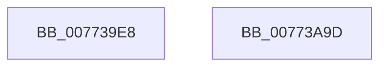

# SshSessionManagerTraceBatteryCountChange

- RVA: `0x007739E8`–`0x00773A9E` (길이 `182` bytes)
- VA: `0x00000001407739E8`
- 실행 섹션: `PAGE`
- PDB 이름 있음: `예`; PDB Function 태그: `아니요`
- unwind 정보 RVA: `0x0008A288`
- 디코드: `40`개 명령, `182/182` bytes 표시
- 미해석 바이트: `0` (있으면 어셈블리에 `.byte`로 보존)

> 이 문서는 커널 이미지의 기계어와 PDB 기호를 분석해 생성했습니다. 4번과 5번은 함수 원형과 자료형을 바이너리 사용 방식에서 추정한 C 해석이며 원본 소스 복구 결과는 아닙니다.

## 1. Dependencies

- 직접 호출 지점: **2**; 고유 호출 대상: **2**
- 직접 호출자로 확인된 함수: **1**
- RIP 상대 이미지 참조: **2**

### Outgoing calls
- `0x00773A83` → [SshpSessionManagerSendControlEvent](../A8/SshpSessionManagerSendControlEvent_function_00A871C0.md) (function, `0x00A871C0`)
- `0x00773A8F` → [_security_check_cookie](../../text/6A/_security_check_cookie_function_006AC640.md) (function, `0x006AC640`)

### Direct callers
- [PopDiagTraceBatteryCountChange](../76/PopDiagTraceBatteryCountChange_function_00760B54.md) at `0x00760C36`

### Static image references
- `0x00773A05` → RVA `0x00E0A740` (`.data`; read)
- `0x00773A37` → RVA `0x000297B8` (`.rdata`; read)

## 2. Other-region calls and transfers

- 다른 실행 섹션으로 향하는 call: **1**
  - `0x00773A8F` → [_security_check_cookie](../../text/6A/_security_check_cookie_function_006AC640.md) (`PAGE` → `.text`)
- 별도 외부 분기/꼬리 이동을 확인하지 못했습니다.

## 3. Assembly (complete function range)

```asm
007739E8  48 8B C4                        mov rax, rsp
007739EB  44 88 48 20                     mov byte ptr [rax + 0x20], r9b
007739EF  44 89 40 18                     mov dword ptr [rax + 0x18], r8d
007739F3  89 50 10                        mov dword ptr [rax + 0x10], edx
007739F6  89 48 08                        mov dword ptr [rax + 8], ecx
007739F9  55                              push rbp
007739FA  48 8D 68 B1                     lea rbp, [rax - 0x4f]
007739FE  48 81 EC 90 00 00 00            sub rsp, 0x90
00773A05  48 8B 05 34 6D 69 00            mov rax, qword ptr [rip + 0x696d34]
00773A0C  48 33 C4                        xor rax, rsp
00773A0F  48 89 45 37                     mov qword ptr [rbp + 0x37], rax
00773A13  48 8D 45 57                     lea rax, [rbp + 0x57]
00773A17  48 C7 45 DF 04 00 00 00         mov qword ptr [rbp - 0x21], 4
00773A1F  48 89 45 D7                     mov qword ptr [rbp - 0x29], rax
00773A23  4C 8D 45 D7                     lea r8, [rbp - 0x29]
00773A27  48 8D 45 5F                     lea rax, [rbp + 0x5f]
00773A2B  48 C7 45 EF 04 00 00 00         mov qword ptr [rbp - 0x11], 4
00773A33  48 89 45 E7                     mov qword ptr [rbp - 0x19], rax
00773A37  48 8D 0D 7A 5D 8B FF            lea rcx, [rip - 0x74a286]
00773A3E  48 8D 45 67                     lea rax, [rbp + 0x67]
00773A42  48 C7 45 FF 04 00 00 00         mov qword ptr [rbp - 1], 4
00773A4A  48 89 45 F7                     mov qword ptr [rbp - 9], rax
00773A4E  BA 06 00 00 00                  mov edx, 6
00773A53  48 8D 45 6F                     lea rax, [rbp + 0x6f]
00773A57  48 C7 45 0F 01 00 00 00         mov qword ptr [rbp + 0xf], 1
00773A5F  48 89 45 07                     mov qword ptr [rbp + 7], rax
00773A63  48 8D 45 77                     lea rax, [rbp + 0x77]
00773A67  48 89 45 17                     mov qword ptr [rbp + 0x17], rax
00773A6B  48 8D 45 7F                     lea rax, [rbp + 0x7f]
00773A6F  48 89 45 27                     mov qword ptr [rbp + 0x27], rax
00773A73  48 C7 45 1F 01 00 00 00         mov qword ptr [rbp + 0x1f], 1
00773A7B  48 C7 45 2F 01 00 00 00         mov qword ptr [rbp + 0x2f], 1
00773A83  E8 38 37 31 00                  call 0x140a871c0
00773A88  48 8B 4D 37                     mov rcx, qword ptr [rbp + 0x37]
00773A8C  48 33 CC                        xor rcx, rsp
00773A8F  E8 AC 8B F3 FF                  call 0x1406ac640
00773A94  48 81 C4 90 00 00 00            add rsp, 0x90
00773A9B  5D                              pop rbp
00773A9C  C3                              ret
00773A9D  CC                              int3
```

## 4. C-style interpretation (structured pseudocode)

```c
__int64 __fastcall SshSessionManagerTraceBatteryCountChange(int a1, int a2, int a3, unsigned __int8 a4)
{
    __int64 result;
    __int64 v_rsp;

    *(unsigned __int8 *)(v_rsp + 32) = a4;
    *(unsigned int *)(v_rsp + 24) = a3;
    *(unsigned int *)(v_rsp + 16) = a2;
    *(unsigned int *)(v_rsp + 8) = a1;
    v_rsp = (v_rsp) - (144);
    result = (*(unsigned __int64 *)(v_rip + 6909236)) ^ (v_rsp);
    *(unsigned __int64 *)(v_rsp - 79 + 55) = result;
    *(unsigned __int64 *)(v_rsp - 79 - 33) = 4;
    *(unsigned __int64 *)(v_rsp - 79 - 41) = v_rsp - 79 + 87;
    *(unsigned __int64 *)(v_rsp - 79 - 17) = 4;
    *(unsigned __int64 *)(v_rsp - 79 - 25) = v_rsp - 79 + 95;
    *(unsigned __int64 *)(v_rsp - 79 - 1) = 4;
    *(unsigned __int64 *)(v_rsp - 79 - 9) = v_rsp - 79 + 103;
    *(unsigned __int64 *)(v_rsp - 79 + 15) = 1;
    *(unsigned __int64 *)(v_rsp - 79 + 7) = v_rsp - 79 + 111;
    *(unsigned __int64 *)(v_rsp - 79 + 23) = v_rsp - 79 + 119;
    *(unsigned __int64 *)(v_rsp - 79 + 39) = v_rsp - 79 + 127;
    *(unsigned __int64 *)(v_rsp - 79 + 31) = 1;
    *(unsigned __int64 *)(v_rsp - 79 + 47) = 1;
    result = SshpSessionManagerSendControlEvent(v_rip - 7643782, 6, v_rsp - 79 - 41, a4);
    a1 = (*(unsigned __int64 *)(v_rsp - 79 + 55)) ^ (v_rsp);
    result = _security_check_cookie(a1, 6, v_rsp - 79 - 41, a4);
    v_rsp = (v_rsp) + (144);
    return result;
}
```

## 5. (Beta) C Style

```c
int64_t SshSessionManagerTraceBatteryCountChange(int32_t Arg1, int32_t Arg2, int32_t Arg3, uint8_t Arg4)
{
    int64_t result;
    int64_t local_rsp;

    *(uint8_t *)(local_rsp + 0x20) = Arg4;
    *(uint32_t *)(local_rsp + 0x18) = Arg3;
    *(uint32_t *)(local_rsp + 0x10) = Arg2;
    *(uint32_t *)(local_rsp + 0x8) = Arg1;
    local_rsp = (local_rsp) - (144);
    result = (*(uint64_t *)(v_rip + 0x696D34)) ^ (local_rsp);
    *(uint64_t *)(local_rsp - 0x4F + 0x37) = result;
    *(uint64_t *)(local_rsp - 0x4F - 0x21) = 4;
    *(uint64_t *)(local_rsp - 0x4F - 0x29) = local_rsp - 79 + 87;
    *(uint64_t *)(local_rsp - 0x4F - 0x11) = 4;
    *(uint64_t *)(local_rsp - 0x4F - 0x19) = local_rsp - 79 + 95;
    *(uint64_t *)(local_rsp - 0x4F - 0x1) = 4;
    *(uint64_t *)(local_rsp - 0x4F - 0x9) = local_rsp - 79 + 103;
    *(uint64_t *)(local_rsp - 0x4F + 0xF) = 1;
    *(uint64_t *)(local_rsp - 0x4F + 0x7) = local_rsp - 79 + 111;
    *(uint64_t *)(local_rsp - 0x4F + 0x17) = local_rsp - 79 + 119;
    *(uint64_t *)(local_rsp - 0x4F + 0x27) = local_rsp - 79 + 127;
    *(uint64_t *)(local_rsp - 0x4F + 0x1F) = 1;
    *(uint64_t *)(local_rsp - 0x4F + 0x2F) = 1;
    result = SshpSessionManagerSendControlEvent(v_rip - 7643782, 6, local_rsp - 79 - 41, Arg4);
    Arg1 = (*(uint64_t *)(local_rsp - 0x4F + 0x37)) ^ (local_rsp);
    result = _security_check_cookie(Arg1, 6, local_rsp - 79 - 41, Arg4);
    local_rsp = (local_rsp) + (144);
    return result;
}
```

## 6. Execution-region graph

[열기: 2D/3D 그래프와 함수 탐색 컨트롤 패널](../../../control-panel.html?section=page&rva=0x007739E8&view=graph)

- 2D 그래프는 위에서 아래로 흐르고, 3D 그래프는 빈 공간을 드래그해 회전합니다. Shift+드래그는 이동, 휠은 확대·축소, 함수 노드 선택은 대상 보고서 이동입니다.

### Static fallback


