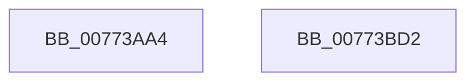

# SshSessionManagerTraceCsEnterReason

- RVA: `0x00773AA4`–`0x00773BD3` (길이 `303` bytes)
- VA: `0x0000000140773AA4`
- 실행 섹션: `PAGE`
- PDB 이름 있음: `예`; PDB Function 태그: `아니요`
- unwind 정보 RVA: `0x000A68C4`
- 디코드: `61`개 명령, `303/303` bytes 표시
- 미해석 바이트: `0` (있으면 어셈블리에 `.byte`로 보존)

> 이 문서는 커널 이미지의 기계어와 PDB 기호를 분석해 생성했습니다. 4번과 5번은 함수 원형과 자료형을 바이너리 사용 방식에서 추정한 C 해석이며 원본 소스 복구 결과는 아닙니다.

## 1. Dependencies

- 직접 호출 지점: **2**; 고유 호출 대상: **2**
- 직접 호출자로 확인된 함수: **1**
- RIP 상대 이미지 참조: **2**

### Outgoing calls
- `0x00773BB8` → [SshpSessionManagerSendControlEvent](../A8/SshpSessionManagerSendControlEvent_function_00A871C0.md) (function, `0x00A871C0`)
- `0x00773BC4` → [_security_check_cookie](../../text/6A/_security_check_cookie_function_006AC640.md) (function, `0x006AC640`)

### Direct callers
- [PopSleepstudyCaptureSessionStatistics](../AD/PopSleepstudyCaptureSessionStatistics_function_00AD7554.md) at `0x00AD7715`

### Static image references
- `0x00773AB2` → RVA `0x00E0A740` (`.data`; read)
- `0x00773B65` → RVA `0x000297E8` (`.rdata`; read)

## 2. Other-region calls and transfers

- 다른 실행 섹션으로 향하는 call: **1**
  - `0x00773BC4` → [_security_check_cookie](../../text/6A/_security_check_cookie_function_006AC640.md) (`PAGE` → `.text`)
- 별도 외부 분기/꼬리 이동을 확인하지 못했습니다.

## 3. Assembly (complete function range)

```asm
00773AA4  40 55                           push rbp
00773AA6  48 8D 6C 24 A9                  lea rbp, [rsp - 0x57]
00773AAB  48 81 EC 00 01 00 00            sub rsp, 0x100
00773AB2  48 8B 05 87 6C 69 00            mov rax, qword ptr [rip + 0x696c87]
00773AB9  48 33 C4                        xor rax, rsp
00773ABC  48 89 45 47                     mov qword ptr [rbp + 0x47], rax
00773AC0  48 8D 41 20                     lea rax, [rcx + 0x20]
00773AC4  48 C7 45 8F 04 00 00 00         mov qword ptr [rbp - 0x71], 4
00773ACC  48 89 45 87                     mov qword ptr [rbp - 0x79], rax
00773AD0  4C 8D 45 87                     lea r8, [rbp - 0x79]
00773AD4  48 8D 41 28                     lea rax, [rcx + 0x28]
00773AD8  48 C7 45 9F 04 00 00 00         mov qword ptr [rbp - 0x61], 4
00773AE0  48 89 45 97                     mov qword ptr [rbp - 0x69], rax
00773AE4  BA 0C 00 00 00                  mov edx, 0xc
00773AE9  48 8D 41 30                     lea rax, [rcx + 0x30]
00773AED  48 C7 45 AF 04 00 00 00         mov qword ptr [rbp - 0x51], 4
00773AF5  48 89 45 A7                     mov qword ptr [rbp - 0x59], rax
00773AF9  48 8D 41 08                     lea rax, [rcx + 8]
00773AFD  48 89 45 B7                     mov qword ptr [rbp - 0x49], rax
00773B01  48 B8 C4 02 00 00 80 F7 FF FF   movabs rax, 0xfffff780000002c4
00773B0B  48 89 45 C7                     mov qword ptr [rbp - 0x39], rax
00773B0F  48 8D 41 39                     lea rax, [rcx + 0x39]
00773B13  48 89 45 D7                     mov qword ptr [rbp - 0x29], rax
00773B17  0F B6 41 3F                     movzx eax, byte ptr [rcx + 0x3f]
00773B1B  89 44 24 20                     mov dword ptr [rsp + 0x20], eax
00773B1F  48 8D 44 24 20                  lea rax, [rsp + 0x20]
00773B24  48 89 45 E7                     mov qword ptr [rbp - 0x19], rax
00773B28  0F B6 41 40                     movzx eax, byte ptr [rcx + 0x40]
00773B2C  89 44 24 24                     mov dword ptr [rsp + 0x24], eax
00773B30  48 8D 44 24 24                  lea rax, [rsp + 0x24]
00773B35  48 89 45 F7                     mov qword ptr [rbp - 9], rax
00773B39  0F B6 41 41                     movzx eax, byte ptr [rcx + 0x41]
00773B3D  89 44 24 28                     mov dword ptr [rsp + 0x28], eax
00773B41  48 8D 44 24 28                  lea rax, [rsp + 0x28]
00773B46  48 89 45 07                     mov qword ptr [rbp + 7], rax
00773B4A  0F B6 41 42                     movzx eax, byte ptr [rcx + 0x42]
00773B4E  89 45 83                        mov dword ptr [rbp - 0x7d], eax
00773B51  48 8D 45 83                     lea rax, [rbp - 0x7d]
00773B55  48 89 45 17                     mov qword ptr [rbp + 0x17], rax
00773B59  48 8D 41 3B                     lea rax, [rcx + 0x3b]
00773B5D  48 89 45 27                     mov qword ptr [rbp + 0x27], rax
00773B61  48 8D 41 3D                     lea rax, [rcx + 0x3d]
00773B65  48 8D 0D 7C 5C 8B FF            lea rcx, [rip - 0x74a384]
00773B6C  48 89 45 37                     mov qword ptr [rbp + 0x37], rax
00773B70  48 C7 45 BF 08 00 00 00         mov qword ptr [rbp - 0x41], 8
00773B78  48 C7 45 CF 04 00 00 00         mov qword ptr [rbp - 0x31], 4
00773B80  48 C7 45 DF 01 00 00 00         mov qword ptr [rbp - 0x21], 1
00773B88  48 C7 45 EF 04 00 00 00         mov qword ptr [rbp - 0x11], 4
00773B90  48 C7 45 FF 04 00 00 00         mov qword ptr [rbp - 1], 4
00773B98  48 C7 45 0F 04 00 00 00         mov qword ptr [rbp + 0xf], 4
00773BA0  48 C7 45 1F 04 00 00 00         mov qword ptr [rbp + 0x1f], 4
00773BA8  48 C7 45 2F 01 00 00 00         mov qword ptr [rbp + 0x2f], 1
00773BB0  48 C7 45 3F 01 00 00 00         mov qword ptr [rbp + 0x3f], 1
00773BB8  E8 03 36 31 00                  call 0x140a871c0
00773BBD  48 8B 4D 47                     mov rcx, qword ptr [rbp + 0x47]
00773BC1  48 33 CC                        xor rcx, rsp
00773BC4  E8 77 8A F3 FF                  call 0x1406ac640
00773BC9  48 81 C4 00 01 00 00            add rsp, 0x100
00773BD0  5D                              pop rbp
00773BD1  C3                              ret
00773BD2  CC                              int3
```

## 4. C-style interpretation (structured pseudocode)

```c
__int64 __fastcall SshSessionManagerTraceCsEnterReason(__int64 a1)
{
    __int64 result;
    __int64 v_rsp;
    unsigned __int64 v_stack_m18;
    unsigned __int64 v_stack_m20;
    unsigned __int64 v_stack_m28;
    unsigned __int64 v_stack_m30;
    unsigned __int64 v_stack_m38;
    unsigned __int64 v_stack_m40;
    unsigned __int64 v_stack_m48;
    unsigned __int64 v_stack_m50;
    unsigned __int64 v_stack_m58;
    unsigned __int64 v_stack_m5F;
    unsigned __int64 v_stack_m60;
    unsigned __int64 v_stack_m68;
    unsigned __int64 v_stack_m70;
    unsigned __int64 v_stack_m78;
    unsigned __int64 v_stack_m80;
    unsigned __int64 v_stack_m88;
    unsigned __int64 v_stack_m90;
    unsigned __int64 v_stack_m98;
    unsigned __int64 v_stack_mA0;
    unsigned __int64 v_stack_mA8;
    unsigned __int64 v_stack_mB0;
    unsigned __int64 v_stack_mB8;
    unsigned __int64 v_stack_mC0;
    unsigned __int64 v_stack_mC8;
    unsigned __int64 v_stack_mD0;
    unsigned __int64 v_stack_mD8;
    unsigned int v_stack_mDC;
    unsigned int v_stack_mE0;
    unsigned int v_stack_mE4;
    unsigned int v_stack_mE8;

    v_rsp = (v_rsp) - (256);
    result = (*(unsigned __int64 *)(v_rip + 6909063)) ^ (v_rsp);
    v_stack_m18 = result;
    v_stack_mD0 = 4;
    v_stack_mD8 = a1 + 32;
    v_stack_mC0 = 4;
    v_stack_mC8 = a1 + 40;
    v_stack_mB0 = 4;
    v_stack_mB8 = a1 + 48;
    v_stack_mA8 = a1 + 8;
    v_stack_m98 = a1 + 8;
    v_stack_m88 = a1 + 57;
    v_stack_mE8 = (unsigned int)(*(unsigned __int8 *)(a1 + 63));
    v_stack_m78 = v_stack_mE8;
    v_stack_mE4 = (unsigned int)(*(unsigned __int8 *)(a1 + 64));
    v_stack_m68 = v_stack_mE4;
    v_stack_mE0 = (unsigned int)(*(unsigned __int8 *)(a1 + 65));
    v_stack_m58 = v_stack_mE0;
    v_stack_mDC = (unsigned int)(*(unsigned __int8 *)(a1 + 66));
    v_stack_m48 = v_stack_mDC;
    v_stack_m38 = a1 + 59;
    v_stack_m28 = a1 + 61;
    v_stack_mA0 = 8;
    v_stack_m90 = 4;
    v_stack_m80 = 1;
    v_stack_m70 = 4;
    v_stack_m60 = 4;
    v_stack_m50 = 4;
    v_stack_m40 = 4;
    v_stack_m30 = 1;
    v_stack_m20 = 1;
    result = SshpSessionManagerSendControlEvent(v_rip - 7644036, 12, v_stack_mD8, a4);
    a1 = (v_stack_m18) ^ (v_rsp);
    result = _security_check_cookie(a1, 12, v_stack_mD8, a4);
    v_rsp = (v_rsp) + (256);
    return result;
}
```

## 5. (Beta) C Style

```c
int64_t SshSessionManagerTraceCsEnterReason(void *Arg1)
{
    uint8_t *arg1 = (uint8_t *)Arg1;

    int64_t result;
    int64_t local_rsp;
    uint64_t v_stack_m18;
    uint64_t v_stack_m20;
    uint64_t v_stack_m28;
    uint64_t v_stack_m30;
    uint64_t v_stack_m38;
    uint64_t v_stack_m40;
    uint64_t v_stack_m48;
    uint64_t v_stack_m50;
    uint64_t v_stack_m58;
    uint64_t v_stack_m5F;
    uint64_t v_stack_m60;
    uint64_t v_stack_m68;
    uint64_t v_stack_m70;
    uint64_t v_stack_m78;
    uint64_t v_stack_m80;
    uint64_t v_stack_m88;
    uint64_t v_stack_m90;
    uint64_t v_stack_m98;
    uint64_t v_stack_mA0;
    uint64_t v_stack_mA8;
    uint64_t v_stack_mB0;
    uint64_t v_stack_mB8;
    uint64_t v_stack_mC0;
    uint64_t v_stack_mC8;
    uint64_t v_stack_mD0;
    uint64_t v_stack_mD8;
    uint32_t v_stack_mDC;
    uint32_t v_stack_mE0;
    uint32_t v_stack_mE4;
    uint32_t v_stack_mE8;

    local_rsp = (local_rsp) - (256);
    result = (*(uint64_t *)(v_rip + 0x696C87)) ^ (local_rsp);
    v_stack_m18 = result;
    v_stack_mD0 = 4;
    v_stack_mD8 = Arg1 + 32;
    v_stack_mC0 = 4;
    v_stack_mC8 = Arg1 + 40;
    v_stack_mB0 = 4;
    v_stack_mB8 = Arg1 + 48;
    v_stack_mA8 = Arg1 + 8;
    v_stack_m98 = Arg1 + 8;
    v_stack_m88 = Arg1 + 57;
    v_stack_mE8 = (uint32_t)(*(uint8_t *)(arg1 + 0x3F));
    v_stack_m78 = v_stack_mE8;
    v_stack_mE4 = (uint32_t)(*(uint8_t *)(arg1 + 0x40));
    v_stack_m68 = v_stack_mE4;
    v_stack_mE0 = (uint32_t)(*(uint8_t *)(arg1 + 0x41));
    v_stack_m58 = v_stack_mE0;
    v_stack_mDC = (uint32_t)(*(uint8_t *)(arg1 + 0x42));
    v_stack_m48 = v_stack_mDC;
    v_stack_m38 = Arg1 + 59;
    v_stack_m28 = Arg1 + 61;
    v_stack_mA0 = 8;
    v_stack_m90 = 4;
    v_stack_m80 = 1;
    v_stack_m70 = 4;
    v_stack_m60 = 4;
    v_stack_m50 = 4;
    v_stack_m40 = 4;
    v_stack_m30 = 1;
    v_stack_m20 = 1;
    result = SshpSessionManagerSendControlEvent(v_rip - 7644036, 12, v_stack_mD8, a4);
    Arg1 = (v_stack_m18) ^ (local_rsp);
    result = _security_check_cookie(Arg1, 12, v_stack_mD8, a4);
    local_rsp = (local_rsp) + (256);
    return result;
}
```

### 관측된 메모리 오프셋

구조체 형식이 확인되지 않은 접근은 인자 기준의 오프셋으로만 기록했습니다.

| 기준 인자 | 오프셋 표현 | 폭 (bit) | 접근 |
|---|---:|---:|---|
| `Arg1` | `+ 0x8` | `64` | `R` |
| `Arg1` | `+ 0x20` | `64` | `R` |
| `Arg1` | `+ 0x28` | `64` | `R` |
| `Arg1` | `+ 0x30` | `64` | `R` |
| `Arg1` | `+ 0x39` | `64` | `R` |
| `Arg1` | `+ 0x3B` | `64` | `R` |
| `Arg1` | `+ 0x3D` | `64` | `R` |
| `Arg1` | `+ 0x3F` | `8` | `R` |
| `Arg1` | `+ 0x40` | `8` | `R` |
| `Arg1` | `+ 0x41` | `8` | `R` |
| `Arg1` | `+ 0x42` | `8` | `R` |

## 6. Execution-region graph

[열기: 2D/3D 그래프와 함수 탐색 컨트롤 패널](../../../control-panel.html?section=page&rva=0x00773AA4&view=graph)

- 2D 그래프는 위에서 아래로 흐르고, 3D 그래프는 빈 공간을 드래그해 회전합니다. Shift+드래그는 이동, 휠은 확대·축소, 함수 노드 선택은 대상 보고서 이동입니다.

### Static fallback


