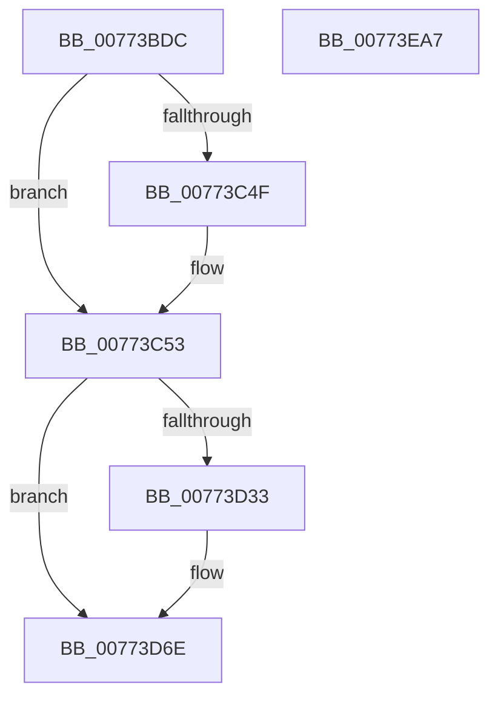

# SshSessionManagerTraceCsExitReason

- RVA: `0x00773BDC`–`0x00773EA8` (길이 `716` bytes)
- VA: `0x0000000140773BDC`
- 실행 섹션: `PAGE`
- PDB 이름 있음: `예`; PDB Function 태그: `아니요`
- unwind 정보 RVA: `0x000CD168`
- 디코드: `141`개 명령, `716/716` bytes 표시
- 미해석 바이트: `0` (있으면 어셈블리에 `.byte`로 보존)

> 이 문서는 커널 이미지의 기계어와 PDB 기호를 분석해 생성했습니다. 4번과 5번은 함수 원형과 자료형을 바이너리 사용 방식에서 추정한 C 해석이며 원본 소스 복구 결과는 아닙니다.

## 1. Dependencies

- 직접 호출 지점: **2**; 고유 호출 대상: **2**
- 직접 호출자로 확인된 함수: **1**
- RIP 상대 이미지 참조: **2**

### Outgoing calls
- `0x00773E7E` → [SshpSessionManagerSendControlEvent](../A8/SshpSessionManagerSendControlEvent_function_00A871C0.md) (function, `0x00A871C0`)
- `0x00773E8D` → [_security_check_cookie](../../text/6A/_security_check_cookie_function_006AC640.md) (function, `0x006AC640`)

### Direct callers
- [PopSleepstudyCaptureSessionStatistics](../AD/PopSleepstudyCaptureSessionStatistics_function_00AD7554.md) at `0x00AD76DF`

### Static image references
- `0x00773BF6` → RVA `0x00E0A740` (`.data`; read)
- `0x00773D7F` → RVA `0x000297C8` (`.rdata`; read)

## 2. Other-region calls and transfers

- 다른 실행 섹션으로 향하는 call: **1**
  - `0x00773E8D` → [_security_check_cookie](../../text/6A/_security_check_cookie_function_006AC640.md) (`PAGE` → `.text`)
- 별도 외부 분기/꼬리 이동을 확인하지 못했습니다.

## 3. Assembly (complete function range)

```asm
00773BDC  48 89 5C 24 08                  mov qword ptr [rsp + 8], rbx
00773BE1  48 89 7C 24 10                  mov qword ptr [rsp + 0x10], rdi
00773BE6  55                              push rbp
00773BE7  48 8D AC 24 20 FF FF FF         lea rbp, [rsp - 0xe0]
00773BEF  48 81 EC E0 01 00 00            sub rsp, 0x1e0
00773BF6  48 8B 05 43 6B 69 00            mov rax, qword ptr [rip + 0x696b43]
00773BFD  48 33 C4                        xor rax, rsp
00773C00  48 89 85 D0 00 00 00            mov qword ptr [rbp + 0xd0], rax
00773C07  49 8D 40 20                     lea rax, [r8 + 0x20]
00773C0B  48 C7 44 24 68 04 00 00 00      mov qword ptr [rsp + 0x68], 4
00773C14  48 89 44 24 60                  mov qword ptr [rsp + 0x60], rax
00773C19  45 33 D2                        xor r10d, r10d
00773C1C  0F B6 41 38                     movzx eax, byte ptr [rcx + 0x38]
00773C20  4C 8B CA                        mov r9, rdx
00773C23  89 44 24 38                     mov dword ptr [rsp + 0x38], eax
00773C27  48 8D 44 24 38                  lea rax, [rsp + 0x38]
00773C2C  48 89 44 24 70                  mov qword ptr [rsp + 0x70], rax
00773C31  41 8B 00                        mov eax, dword ptr [r8]
00773C34  41 8D 5A 01                     lea ebx, [r10 + 1]
00773C38  2B C3                           sub eax, ebx
00773C3A  48 C7 44 24 78 04 00 00 00      mov qword ptr [rsp + 0x78], 4
00773C43  44 89 54 24 20                  mov dword ptr [rsp + 0x20], r10d
00773C48  A9 FD FF FF FF                  test eax, 0xfffffffd
00773C4D  75 04                           jne 0x140773c53
00773C4F  89 5C 24 20                     mov dword ptr [rsp + 0x20], ebx
00773C53  48 8D 44 24 20                  lea rax, [rsp + 0x20]
00773C58  48 C7 45 88 04 00 00 00         mov qword ptr [rbp - 0x78], 4
00773C60  48 89 45 80                     mov qword ptr [rbp - 0x80], rax
00773C64  48 BF CD CC CC CC CC CC CC CC   movabs rdi, 0xcccccccccccccccd
00773C6E  48 8D 41 08                     lea rax, [rcx + 8]
00773C72  48 C7 45 98 08 00 00 00         mov qword ptr [rbp - 0x68], 8
00773C7A  48 89 45 90                     mov qword ptr [rbp - 0x70], rax
00773C7E  48 B8 C4 02 00 00 80 F7 FF FF   movabs rax, 0xfffff780000002c4
00773C88  48 89 45 A0                     mov qword ptr [rbp - 0x60], rax
00773C8C  48 8D 44 24 24                  lea rax, [rsp + 0x24]
00773C91  48 89 45 B0                     mov qword ptr [rbp - 0x50], rax
00773C95  48 8D 41 28                     lea rax, [rcx + 0x28]
00773C99  48 89 45 C0                     mov qword ptr [rbp - 0x40], rax
00773C9D  48 8D 41 2C                     lea rax, [rcx + 0x2c]
00773CA1  48 89 45 D0                     mov qword ptr [rbp - 0x30], rax
00773CA5  48 8D 41 30                     lea rax, [rcx + 0x30]
00773CA9  48 89 45 E0                     mov qword ptr [rbp - 0x20], rax
00773CAD  48 8D 41 34                     lea rax, [rcx + 0x34]
00773CB1  48 89 45 F0                     mov qword ptr [rbp - 0x10], rax
00773CB5  48 8B 41 10                     mov rax, qword ptr [rcx + 0x10]
00773CB9  48 8B 49 18                     mov rcx, qword ptr [rcx + 0x18]
00773CBD  48 2B C8                        sub rcx, rax
00773CC0  48 C7 45 A8 04 00 00 00         mov qword ptr [rbp - 0x58], 4
00773CC8  48 8B C7                        mov rax, rdi
00773CCB  48 C7 45 B8 04 00 00 00         mov qword ptr [rbp - 0x48], 4
00773CD3  48 F7 E1                        mul rcx
00773CD6  48 8D 44 24 58                  lea rax, [rsp + 0x58]
00773CDB  48 C7 45 C8 04 00 00 00         mov qword ptr [rbp - 0x38], 4
00773CE3  48 C1 EA 03                     shr rdx, 3
00773CE7  48 C7 45 D8 04 00 00 00         mov qword ptr [rbp - 0x28], 4
00773CEF  48 C7 45 E8 04 00 00 00         mov qword ptr [rbp - 0x18], 4
00773CF7  48 C7 45 F8 04 00 00 00         mov qword ptr [rbp - 8], 4
00773CFF  48 89 54 24 58                  mov qword ptr [rsp + 0x58], rdx
00773D04  48 89 45 00                     mov qword ptr [rbp], rax
00773D08  48 C7 45 08 08 00 00 00         mov qword ptr [rbp + 8], 8
00773D10  44 89 54 24 24                  mov dword ptr [rsp + 0x24], r10d
00773D15  44 89 54 24 28                  mov dword ptr [rsp + 0x28], r10d
00773D1A  44 89 54 24 2C                  mov dword ptr [rsp + 0x2c], r10d
00773D1F  44 89 54 24 30                  mov dword ptr [rsp + 0x30], r10d
00773D24  44 89 54 24 34                  mov dword ptr [rsp + 0x34], r10d
00773D29  4C 89 54 24 50                  mov qword ptr [rsp + 0x50], r10
00773D2E  4D 85 C9                        test r9, r9
00773D31  74 3B                           je 0x140773d6e
00773D33  41 8B 49 28                     mov ecx, dword ptr [r9 + 0x28]
00773D37  48 8B C7                        mov rax, rdi
00773D3A  49 8B 51 18                     mov rdx, qword ptr [r9 + 0x18]
00773D3E  49 2B 51 10                     sub rdx, qword ptr [r9 + 0x10]
00773D42  89 4C 24 28                     mov dword ptr [rsp + 0x28], ecx
00773D46  41 8B 49 2C                     mov ecx, dword ptr [r9 + 0x2c]
00773D4A  89 4C 24 2C                     mov dword ptr [rsp + 0x2c], ecx
00773D4E  41 8B 49 30                     mov ecx, dword ptr [r9 + 0x30]
00773D52  48 F7 E2                        mul rdx
00773D55  89 4C 24 30                     mov dword ptr [rsp + 0x30], ecx
00773D59  41 8B 49 34                     mov ecx, dword ptr [r9 + 0x34]
00773D5D  48 C1 EA 03                     shr rdx, 3
00773D61  48 89 54 24 50                  mov qword ptr [rsp + 0x50], rdx
00773D66  89 5C 24 24                     mov dword ptr [rsp + 0x24], ebx
00773D6A  89 4C 24 34                     mov dword ptr [rsp + 0x34], ecx
00773D6E  48 8D 44 24 28                  lea rax, [rsp + 0x28]
00773D73  48 C7 45 18 04 00 00 00         mov qword ptr [rbp + 0x18], 4
00773D7B  48 89 45 10                     mov qword ptr [rbp + 0x10], rax
00773D7F  48 8D 0D 42 5A 8B FF            lea rcx, [rip - 0x74a5be]
00773D86  48 8D 44 24 2C                  lea rax, [rsp + 0x2c]
00773D8B  48 C7 45 28 04 00 00 00         mov qword ptr [rbp + 0x28], 4
00773D93  48 89 45 20                     mov qword ptr [rbp + 0x20], rax
00773D97  BA 17 00 00 00                  mov edx, 0x17
00773D9C  48 8D 44 24 30                  lea rax, [rsp + 0x30]
00773DA1  48 C7 45 38 04 00 00 00         mov qword ptr [rbp + 0x38], 4
00773DA9  48 89 45 30                     mov qword ptr [rbp + 0x30], rax
00773DAD  48 8D 44 24 34                  lea rax, [rsp + 0x34]
00773DB2  48 89 45 40                     mov qword ptr [rbp + 0x40], rax
00773DB6  48 8D 44 24 50                  lea rax, [rsp + 0x50]
00773DBB  48 89 45 50                     mov qword ptr [rbp + 0x50], rax
00773DBF  49 8D 40 39                     lea rax, [r8 + 0x39]
00773DC3  48 89 45 60                     mov qword ptr [rbp + 0x60], rax
00773DC7  41 0F B6 40 3F                  movzx eax, byte ptr [r8 + 0x3f]
00773DCC  89 44 24 3C                     mov dword ptr [rsp + 0x3c], eax
00773DD0  48 8D 44 24 3C                  lea rax, [rsp + 0x3c]
00773DD5  48 89 45 70                     mov qword ptr [rbp + 0x70], rax
00773DD9  41 0F B6 40 40                  movzx eax, byte ptr [r8 + 0x40]
00773DDE  89 44 24 40                     mov dword ptr [rsp + 0x40], eax
00773DE2  48 8D 44 24 40                  lea rax, [rsp + 0x40]
00773DE7  48 89 85 80 00 00 00            mov qword ptr [rbp + 0x80], rax
00773DEE  41 0F B6 40 41                  movzx eax, byte ptr [r8 + 0x41]
00773DF3  89 44 24 44                     mov dword ptr [rsp + 0x44], eax
00773DF7  48 8D 44 24 44                  lea rax, [rsp + 0x44]
00773DFC  48 89 85 90 00 00 00            mov qword ptr [rbp + 0x90], rax
00773E03  41 0F B6 40 42                  movzx eax, byte ptr [r8 + 0x42]
00773E08  89 44 24 48                     mov dword ptr [rsp + 0x48], eax
00773E0C  48 8D 44 24 48                  lea rax, [rsp + 0x48]
00773E11  48 89 85 A0 00 00 00            mov qword ptr [rbp + 0xa0], rax
00773E18  49 8D 40 3B                     lea rax, [r8 + 0x3b]
00773E1C  48 89 85 B0 00 00 00            mov qword ptr [rbp + 0xb0], rax
00773E23  49 8D 40 3D                     lea rax, [r8 + 0x3d]
00773E27  4C 8D 44 24 60                  lea r8, [rsp + 0x60]
00773E2C  48 89 85 C0 00 00 00            mov qword ptr [rbp + 0xc0], rax
00773E33  48 C7 45 48 04 00 00 00         mov qword ptr [rbp + 0x48], 4
00773E3B  48 C7 45 58 08 00 00 00         mov qword ptr [rbp + 0x58], 8
00773E43  48 89 5D 68                     mov qword ptr [rbp + 0x68], rbx
00773E47  48 C7 45 78 04 00 00 00         mov qword ptr [rbp + 0x78], 4
00773E4F  48 C7 85 88 00 00 00 04 00 00 00  mov qword ptr [rbp + 0x88], 4
00773E5A  48 C7 85 98 00 00 00 04 00 00 00  mov qword ptr [rbp + 0x98], 4
00773E65  48 C7 85 A8 00 00 00 04 00 00 00  mov qword ptr [rbp + 0xa8], 4
00773E70  48 89 9D B8 00 00 00            mov qword ptr [rbp + 0xb8], rbx
00773E77  48 89 9D C8 00 00 00            mov qword ptr [rbp + 0xc8], rbx
00773E7E  E8 3D 33 31 00                  call 0x140a871c0
00773E83  48 8B 8D D0 00 00 00            mov rcx, qword ptr [rbp + 0xd0]
00773E8A  48 33 CC                        xor rcx, rsp
00773E8D  E8 AE 87 F3 FF                  call 0x1406ac640
00773E92  4C 8D 9C 24 E0 01 00 00         lea r11, [rsp + 0x1e0]
00773E9A  49 8B 5B 10                     mov rbx, qword ptr [r11 + 0x10]
00773E9E  49 8B 7B 18                     mov rdi, qword ptr [r11 + 0x18]
00773EA2  49 8B E3                        mov rsp, r11
00773EA5  5D                              pop rbp
00773EA6  C3                              ret
00773EA7  CC                              int3
```

## 4. C-style interpretation (structured pseudocode)

```c
__int64 __fastcall SshSessionManagerTraceCsExitReason(__int64 a1, __int64 a2, __int64 a3)
{
    __int64 result;
    __int64 v_r10;
    __int64 v_rsp;
    unsigned __int64 v_stack_m100;
    unsigned __int64 v_stack_m108;
    unsigned __int64 v_stack_m110;
    unsigned __int64 v_stack_m118;
    unsigned __int64 v_stack_m120;
    unsigned __int64 v_stack_m128;
    unsigned __int64 v_stack_m130;
    unsigned __int64 v_stack_m138;
    unsigned __int64 v_stack_m140;
    unsigned __int64 v_stack_m148;
    unsigned __int64 v_stack_m150;
    unsigned __int64 v_stack_m158;
    unsigned __int64 v_stack_m160;
    unsigned __int64 v_stack_m168;
    unsigned __int64 v_stack_m170;
    unsigned __int64 v_stack_m178;
    unsigned __int64 v_stack_m18;
    unsigned __int64 v_stack_m180;
    unsigned __int64 v_stack_m188;
    unsigned __int64 v_stack_m190;
    unsigned __int64 v_stack_m198;
    unsigned int v_stack_m1A0;
    unsigned int v_stack_m1A4;
    unsigned int v_stack_m1A8;
    unsigned int v_stack_m1AC;
    unsigned int v_stack_m1B0;
    unsigned int v_stack_m1B4;
    unsigned int v_stack_m1B8;
    unsigned int v_stack_m1BC;
    unsigned int v_stack_m1C0;
    unsigned __int64 v_stack_m1C4;
    unsigned int v_stack_m1C8;
    unsigned __int64 v_stack_m20;
    unsigned __int64 v_stack_m28;
    unsigned __int64 v_stack_m30;
    unsigned __int64 v_stack_m38;
    unsigned __int64 v_stack_m40;
    unsigned __int64 v_stack_m48;
    unsigned __int64 v_stack_m50;
    unsigned __int64 v_stack_m58;
    unsigned __int64 v_stack_m60;
    unsigned __int64 v_stack_m68;
    unsigned __int64 v_stack_m70;
    unsigned __int64 v_stack_m78;
    unsigned __int64 v_stack_m8;
    unsigned __int64 v_stack_m80;
    unsigned __int64 v_stack_m88;
    unsigned __int64 v_stack_m90;
    unsigned __int64 v_stack_m98;
    unsigned __int64 v_stack_mA0;
    unsigned __int64 v_stack_mA8;
    unsigned __int64 v_stack_mB0;
    unsigned __int64 v_stack_mB8;
    unsigned __int64 v_stack_mC0;
    unsigned __int64 v_stack_mC8;
    unsigned __int64 v_stack_mD0;
    unsigned __int64 v_stack_mD8;
    unsigned __int64 v_stack_mE0;
    unsigned __int64 v_stack_mE8;
    unsigned __int64 v_stack_mF0;
    unsigned __int64 v_stack_mF8;
    unsigned __int64 v_stack_p10;
    unsigned __int64 v_stack_p8;

    v_stack_p8 = v_rbx;
    v_stack_p10 = v_rdi;
    v_rsp = (v_rsp) - (480);
    result = (*(unsigned __int64 *)(v_rip + 6908739)) ^ (v_rsp);
    v_stack_m18 = result;
    v_stack_m180 = 4;
    v_stack_m188 = a3 + 32;
    v_r10 = 0;
    v_stack_m1B0 = (unsigned int)(*(unsigned __int8 *)(a1 + 56));
    v_stack_m178 = v_stack_m1B0;
    result = (unsigned int)(((unsigned int)(*(unsigned int *)(a3))) - ((unsigned int)(v_r10 + 1)));
    v_stack_m170 = 4;
    v_stack_m1C8 = 0;
    if ((((unsigned int)(result)) & (0xFFFFFFFDULL)) == 0) {
        v_stack_m1C8 = (unsigned int)(v_r10 + 1);
    }
    v_stack_m160 = 4;
    v_stack_m168 = v_stack_m1C8;
    v_stack_m150 = 8;
    v_stack_m158 = a1 + 8;
    v_stack_m148 = a1 + 8;
    v_stack_m138 = v_stack_m1C4;
    v_stack_m128 = a1 + 40;
    v_stack_m118 = a1 + 44;
    v_stack_m108 = a1 + 48;
    v_stack_mF8 = a1 + 52;
    a1 = (*(unsigned __int64 *)(a1 + 24)) - (*(unsigned __int64 *)(a1 + 16));
    v_stack_m140 = 4;
    v_stack_m130 = 4;
    v_stack_m120 = 4;
    a2 = (a2) >> (3);
    v_stack_m110 = 4;
    v_stack_m100 = 4;
    v_stack_mF0 = 4;
    v_stack_m190 = a2;
    v_stack_mE8 = v_stack_m190;
    v_stack_mE0 = 8;
    v_stack_m1C4 = 0;
    v_stack_m1C0 = 0;
    v_stack_m1BC = 0;
    v_stack_m1B8 = 0;
    v_stack_m1B4 = 0;
    v_stack_m198 = 0;
    result = v_stack_m190;
    if (a2 != 0) {
        a1 = *(unsigned int *)(a2 + 40);
        result = v_rdi;
        a2 = *(unsigned __int64 *)(a2 + 24);
        a2 = (a2) - (*(unsigned __int64 *)(a2 + 16));
        v_stack_m1C0 = (unsigned int)(a1);
        a1 = *(unsigned int *)(a2 + 44);
        v_stack_m1BC = (unsigned int)(a1);
        a1 = *(unsigned int *)(a2 + 48);
        v_stack_m1B8 = (unsigned int)(a1);
        a1 = *(unsigned int *)(a2 + 52);
        a2 = (a2) >> (3);
        v_stack_m198 = a2;
        v_stack_m1C4 = (unsigned int)(v_r10 + 1);
        v_stack_m1B4 = (unsigned int)(a1);
    }
    v_stack_mD0 = 4;
    v_stack_mD8 = v_stack_m1C0;
    v_stack_mC0 = 4;
    v_stack_mC8 = v_stack_m1BC;
    v_stack_mB0 = 4;
    v_stack_mB8 = v_stack_m1B8;
    v_stack_mA8 = v_stack_m1B4;
    v_stack_m98 = v_stack_m198;
    v_stack_m88 = a3 + 57;
    v_stack_m1AC = (unsigned int)(*(unsigned __int8 *)(a3 + 63));
    v_stack_m78 = v_stack_m1AC;
    v_stack_m1A8 = (unsigned int)(*(unsigned __int8 *)(a3 + 64));
    v_stack_m68 = v_stack_m1A8;
    v_stack_m1A4 = (unsigned int)(*(unsigned __int8 *)(a3 + 65));
    v_stack_m58 = v_stack_m1A4;
    v_stack_m1A0 = (unsigned int)(*(unsigned __int8 *)(a3 + 66));
    v_stack_m48 = v_stack_m1A0;
    v_stack_m38 = a3 + 59;
    v_stack_m28 = a3 + 61;
    v_stack_mA0 = 4;
    v_stack_m90 = 8;
    v_stack_m80 = v_r10 + 1;
    v_stack_m70 = 4;
    v_stack_m60 = 4;
    v_stack_m50 = 4;
    v_stack_m40 = 4;
    v_stack_m30 = v_r10 + 1;
    v_stack_m20 = v_r10 + 1;
    result = SshpSessionManagerSendControlEvent(v_rip - 7644606, 23, v_stack_m188, a2);
    a1 = (v_stack_m18) ^ (v_rsp);
    result = _security_check_cookie(a1, 23, v_stack_m188, a2);
    return result;
}
```

## 5. (Beta) C Style

```c
int64_t SshSessionManagerTraceCsExitReason(void *Arg1, int64_t Arg2, void *Arg3)
{
    uint8_t *arg1 = (uint8_t *)Arg1;
    uint8_t *arg3 = (uint8_t *)Arg3;

    int64_t result;
    int64_t local_r10;
    int64_t local_rsp;
    uint64_t v_stack_m100;
    uint64_t v_stack_m108;
    uint64_t v_stack_m110;
    uint64_t v_stack_m118;
    uint64_t v_stack_m120;
    uint64_t v_stack_m128;
    uint64_t v_stack_m130;
    uint64_t v_stack_m138;
    uint64_t v_stack_m140;
    uint64_t v_stack_m148;
    uint64_t v_stack_m150;
    uint64_t v_stack_m158;
    uint64_t v_stack_m160;
    uint64_t v_stack_m168;
    uint64_t v_stack_m170;
    uint64_t v_stack_m178;
    uint64_t v_stack_m18;
    uint64_t v_stack_m180;
    uint64_t v_stack_m188;
    uint64_t v_stack_m190;
    uint64_t v_stack_m198;
    uint32_t v_stack_m1A0;
    uint32_t v_stack_m1A4;
    uint32_t v_stack_m1A8;
    uint32_t v_stack_m1AC;
    uint32_t v_stack_m1B0;
    uint32_t v_stack_m1B4;
    uint32_t v_stack_m1B8;
    uint32_t v_stack_m1BC;
    uint32_t v_stack_m1C0;
    uint64_t v_stack_m1C4;
    uint32_t v_stack_m1C8;
    uint64_t v_stack_m20;
    uint64_t v_stack_m28;
    uint64_t v_stack_m30;
    uint64_t v_stack_m38;
    uint64_t v_stack_m40;
    uint64_t v_stack_m48;
    uint64_t v_stack_m50;
    uint64_t v_stack_m58;
    uint64_t v_stack_m60;
    uint64_t v_stack_m68;
    uint64_t v_stack_m70;
    uint64_t v_stack_m78;
    uint64_t v_stack_m8;
    uint64_t v_stack_m80;
    uint64_t v_stack_m88;
    uint64_t v_stack_m90;
    uint64_t v_stack_m98;
    uint64_t v_stack_mA0;
    uint64_t v_stack_mA8;
    uint64_t v_stack_mB0;
    uint64_t v_stack_mB8;
    uint64_t v_stack_mC0;
    uint64_t v_stack_mC8;
    uint64_t v_stack_mD0;
    uint64_t v_stack_mD8;
    uint64_t v_stack_mE0;
    uint64_t v_stack_mE8;
    uint64_t v_stack_mF0;
    uint64_t v_stack_mF8;
    uint64_t v_stack_p10;
    uint64_t v_stack_p8;

    v_stack_p8 = local_rbx;
    v_stack_p10 = local_rdi;
    local_rsp = (local_rsp) - (480);
    result = (*(uint64_t *)(v_rip + 0x696B43)) ^ (local_rsp);
    v_stack_m18 = result;
    v_stack_m180 = 4;
    v_stack_m188 = Arg3 + 32;
    local_r10 = 0;
    v_stack_m1B0 = (uint32_t)(*(uint8_t *)(arg1 + 0x38));
    v_stack_m178 = v_stack_m1B0;
    result = (uint32_t)(((uint32_t)(*(uint32_t *)(arg3))) - ((uint32_t)(local_r10 + 1)));
    v_stack_m170 = 4;
    v_stack_m1C8 = 0;
    if ((((uint32_t)(result)) & (0xFFFFFFFDULL)) == 0) {
        v_stack_m1C8 = (uint32_t)(local_r10 + 1);
    }
    v_stack_m160 = 4;
    v_stack_m168 = v_stack_m1C8;
    v_stack_m150 = 8;
    v_stack_m158 = Arg1 + 8;
    v_stack_m148 = Arg1 + 8;
    v_stack_m138 = v_stack_m1C4;
    v_stack_m128 = Arg1 + 40;
    v_stack_m118 = Arg1 + 44;
    v_stack_m108 = Arg1 + 48;
    v_stack_mF8 = Arg1 + 52;
    Arg1 = (*(uint64_t *)(arg1 + 0x18)) - (*(uint64_t *)(arg1 + 0x10));
    v_stack_m140 = 4;
    v_stack_m130 = 4;
    v_stack_m120 = 4;
    Arg2 = (Arg2) >> (3);
    v_stack_m110 = 4;
    v_stack_m100 = 4;
    v_stack_mF0 = 4;
    v_stack_m190 = Arg2;
    v_stack_mE8 = v_stack_m190;
    v_stack_mE0 = 8;
    v_stack_m1C4 = 0;
    v_stack_m1C0 = 0;
    v_stack_m1BC = 0;
    v_stack_m1B8 = 0;
    v_stack_m1B4 = 0;
    v_stack_m198 = 0;
    result = v_stack_m190;
    if (Arg2 != 0) {
        Arg1 = *(uint32_t *)(Arg2 + 0x28);
        result = local_rdi;
        Arg2 = *(uint64_t *)(Arg2 + 0x18);
        Arg2 = (Arg2) - (*(uint64_t *)(Arg2 + 0x10));
        v_stack_m1C0 = (uint32_t)(Arg1);
        Arg1 = *(uint32_t *)(Arg2 + 0x2C);
        v_stack_m1BC = (uint32_t)(Arg1);
        Arg1 = *(uint32_t *)(Arg2 + 0x30);
        v_stack_m1B8 = (uint32_t)(Arg1);
        Arg1 = *(uint32_t *)(Arg2 + 0x34);
        Arg2 = (Arg2) >> (3);
        v_stack_m198 = Arg2;
        v_stack_m1C4 = (uint32_t)(local_r10 + 1);
        v_stack_m1B4 = (uint32_t)(Arg1);
    }
    v_stack_mD0 = 4;
    v_stack_mD8 = v_stack_m1C0;
    v_stack_mC0 = 4;
    v_stack_mC8 = v_stack_m1BC;
    v_stack_mB0 = 4;
    v_stack_mB8 = v_stack_m1B8;
    v_stack_mA8 = v_stack_m1B4;
    v_stack_m98 = v_stack_m198;
    v_stack_m88 = Arg3 + 57;
    v_stack_m1AC = (uint32_t)(*(uint8_t *)(arg3 + 0x3F));
    v_stack_m78 = v_stack_m1AC;
    v_stack_m1A8 = (uint32_t)(*(uint8_t *)(arg3 + 0x40));
    v_stack_m68 = v_stack_m1A8;
    v_stack_m1A4 = (uint32_t)(*(uint8_t *)(arg3 + 0x41));
    v_stack_m58 = v_stack_m1A4;
    v_stack_m1A0 = (uint32_t)(*(uint8_t *)(arg3 + 0x42));
    v_stack_m48 = v_stack_m1A0;
    v_stack_m38 = Arg3 + 59;
    v_stack_m28 = Arg3 + 61;
    v_stack_mA0 = 4;
    v_stack_m90 = 8;
    v_stack_m80 = local_r10 + 1;
    v_stack_m70 = 4;
    v_stack_m60 = 4;
    v_stack_m50 = 4;
    v_stack_m40 = 4;
    v_stack_m30 = local_r10 + 1;
    v_stack_m20 = local_r10 + 1;
    result = SshpSessionManagerSendControlEvent(v_rip - 7644606, 23, v_stack_m188, Arg2);
    Arg1 = (v_stack_m18) ^ (local_rsp);
    result = _security_check_cookie(Arg1, 23, v_stack_m188, Arg2);
    return result;
}
```

### 관측된 메모리 오프셋

구조체 형식이 확인되지 않은 접근은 인자 기준의 오프셋으로만 기록했습니다.

| 기준 인자 | 오프셋 표현 | 폭 (bit) | 접근 |
|---|---:|---:|---|
| `Arg1` | `+ 0x8` | `64` | `R` |
| `Arg1` | `+ 0x10` | `64` | `R` |
| `Arg1` | `+ 0x18` | `64` | `R` |
| `Arg1` | `+ 0x28` | `64` | `R` |
| `Arg1` | `+ 0x2C` | `64` | `R` |
| `Arg1` | `+ 0x30` | `64` | `R` |
| `Arg1` | `+ 0x34` | `64` | `R` |
| `Arg1` | `+ 0x38` | `8` | `R` |
| `Arg3` | `+ 0x0` | `32` | `R` |
| `Arg3` | `+ 0x20` | `64` | `R` |
| `Arg3` | `+ 0x39` | `64` | `R` |
| `Arg3` | `+ 0x3B` | `64` | `R` |
| `Arg3` | `+ 0x3D` | `64` | `R` |
| `Arg3` | `+ 0x3F` | `8` | `R` |
| `Arg3` | `+ 0x40` | `8` | `R` |
| `Arg3` | `+ 0x41` | `8` | `R` |
| `Arg3` | `+ 0x42` | `8` | `R` |

## 6. Execution-region graph

[열기: 2D/3D 그래프와 함수 탐색 컨트롤 패널](../../../control-panel.html?section=page&rva=0x00773BDC&view=graph)

- 2D 그래프는 위에서 아래로 흐르고, 3D 그래프는 빈 공간을 드래그해 회전합니다. Shift+드래그는 이동, 휠은 확대·축소, 함수 노드 선택은 대상 보고서 이동입니다.

### Static fallback


