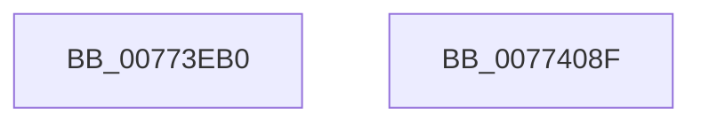

# SshSessionManagerTraceDirtyTransition

- RVA: `0x00773EB0`–`0x00774090` (길이 `480` bytes)
- VA: `0x0000000140773EB0`
- 실행 섹션: `PAGE`
- PDB 이름 있음: `예`; PDB Function 태그: `아니요`
- unwind 정보 RVA: `0x000CDA6C`
- 디코드: `97`개 명령, `480/480` bytes 표시
- 미해석 바이트: `0` (있으면 어셈블리에 `.byte`로 보존)

> 이 문서는 커널 이미지의 기계어와 PDB 기호를 분석해 생성했습니다. 4번과 5번은 함수 원형과 자료형을 바이너리 사용 방식에서 추정한 C 해석이며 원본 소스 복구 결과는 아닙니다.

## 1. Dependencies

- 직접 호출 지점: **2**; 고유 호출 대상: **2**
- 직접 호출자로 확인된 함수: **1**
- RIP 상대 이미지 참조: **12**

### Outgoing calls
- `0x00774075` → [SshpSessionManagerSendControlEvent](../A8/SshpSessionManagerSendControlEvent_function_00A871C0.md) (function, `0x00A871C0`)
- `0x00774081` → [_security_check_cookie](../../text/6A/_security_check_cookie_function_006AC640.md) (function, `0x006AC640`)

### Direct callers
- [PopDiagTraceDirtyTransition](../../init/C3/PopDiagTraceDirtyTransition_function_00C3F6F0.md) at `0x00C3F79A`

### Static image references
- `0x00773EBE` → RVA `0x00E0A740` (`.data`; read)
- `0x00773ECC` → RVA `0x00E674B0` (`.data`; read)
- `0x00773ED3` → RVA `0x00E67480` (`.data`; read)
- `0x00773EDA` → RVA `0x00E674B8` (`.data`; read)
- `0x00773EF1` → RVA `0x00E67488` (`.data`; read)
- `0x00773F06` → RVA `0x00E67490` (`.data`; read)
- `0x00773F12` → RVA `0x00E67498` (`.data`; read)
- `0x00773F1E` → RVA `0x00E674A0` (`.data`; read)
- `0x00773F3D` → RVA `0x00E674D4` (`.data`; read)
- `0x00773F48` → RVA `0x00E674C0` (`.data`; read)
- `0x00773FFF` → RVA `0x00E674D0` (`.data`; read)
- `0x0077406E` → RVA `0x000297F8` (`.rdata`; read)

## 2. Other-region calls and transfers

- 다른 실행 섹션으로 향하는 call: **1**
  - `0x00774081` → [_security_check_cookie](../../text/6A/_security_check_cookie_function_006AC640.md) (`PAGE` → `.text`)
- 별도 외부 분기/꼬리 이동을 확인하지 못했습니다.

## 3. Assembly (complete function range)

```asm
00773EB0  40 55                           push rbp
00773EB2  48 8D 6C 24 80                  lea rbp, [rsp - 0x80]
00773EB7  48 81 EC 80 01 00 00            sub rsp, 0x180
00773EBE  48 8B 05 7B 68 69 00            mov rax, qword ptr [rip + 0x69687b]
00773EC5  48 33 C4                        xor rax, rsp
00773EC8  48 89 45 70                     mov qword ptr [rbp + 0x70], rax
00773ECC  48 8B 15 DD 35 6F 00            mov rdx, qword ptr [rip + 0x6f35dd]
00773ED3  48 8D 05 A6 35 6F 00            lea rax, [rip + 0x6f35a6]
00773EDA  48 8B 0D D7 35 6F 00            mov rcx, qword ptr [rip + 0x6f35d7]
00773EE1  4C 8D 44 24 40                  lea r8, [rsp + 0x40]
00773EE6  48 89 44 24 40                  mov qword ptr [rsp + 0x40], rax
00773EEB  41 B9 01 00 00 00               mov r9d, 1
00773EF1  48 8D 05 90 35 6F 00            lea rax, [rip + 0x6f3590]
00773EF8  48 C7 44 24 48 04 00 00 00      mov qword ptr [rsp + 0x48], 4
00773F01  48 89 44 24 50                  mov qword ptr [rsp + 0x50], rax
00773F06  48 8D 05 83 35 6F 00            lea rax, [rip + 0x6f3583]
00773F0D  48 89 44 24 60                  mov qword ptr [rsp + 0x60], rax
00773F12  48 8D 05 7F 35 6F 00            lea rax, [rip + 0x6f357f]
00773F19  48 89 44 24 70                  mov qword ptr [rsp + 0x70], rax
00773F1E  48 8D 05 7B 35 6F 00            lea rax, [rip + 0x6f357b]
00773F25  48 89 45 80                     mov qword ptr [rbp - 0x80], rax
00773F29  0F B6 42 08                     movzx eax, byte ptr [rdx + 8]
00773F2D  C1 E8 04                        shr eax, 4
00773F30  89 44 24 24                     mov dword ptr [rsp + 0x24], eax
00773F34  48 8D 44 24 24                  lea rax, [rsp + 0x24]
00773F39  48 89 45 90                     mov qword ptr [rbp - 0x70], rax
00773F3D  48 8D 05 90 35 6F 00            lea rax, [rip + 0x6f3590]
00773F44  48 89 45 B0                     mov qword ptr [rbp - 0x50], rax
00773F48  48 8D 05 71 35 6F 00            lea rax, [rip + 0x6f3571]
00773F4F  48 89 45 C0                     mov qword ptr [rbp - 0x40], rax
00773F53  0F B6 42 08                     movzx eax, byte ptr [rdx + 8]
00773F57  D1 E8                           shr eax, 1
00773F59  41 23 C1                        and eax, r9d
00773F5C  48 C7 44 24 58 08 00 00 00      mov qword ptr [rsp + 0x58], 8
00773F65  89 44 24 28                     mov dword ptr [rsp + 0x28], eax
00773F69  48 8D 44 24 28                  lea rax, [rsp + 0x28]
00773F6E  48 89 45 D0                     mov qword ptr [rbp - 0x30], rax
00773F72  48 8D 42 0C                     lea rax, [rdx + 0xc]
00773F76  48 89 45 E0                     mov qword ptr [rbp - 0x20], rax
00773F7A  48 8D 41 18                     lea rax, [rcx + 0x18]
00773F7E  48 89 45 F0                     mov qword ptr [rbp - 0x10], rax
00773F82  8A 42 0E                        mov al, byte ptr [rdx + 0xe]
00773F85  24 0F                           and al, 0xf
00773F87  48 C7 44 24 68 08 00 00 00      mov qword ptr [rsp + 0x68], 8
00773F90  88 44 24 20                     mov byte ptr [rsp + 0x20], al
00773F94  48 8D 44 24 20                  lea rax, [rsp + 0x20]
00773F99  48 89 45 00                     mov qword ptr [rbp], rax
00773F9D  0F B6 42 0E                     movzx eax, byte ptr [rdx + 0xe]
00773FA1  C1 E8 05                        shr eax, 5
00773FA4  41 23 C1                        and eax, r9d
00773FA7  48 C7 44 24 78 08 00 00 00      mov qword ptr [rsp + 0x78], 8
00773FB0  89 44 24 2C                     mov dword ptr [rsp + 0x2c], eax
00773FB4  48 8D 44 24 2C                  lea rax, [rsp + 0x2c]
00773FB9  48 89 45 10                     mov qword ptr [rbp + 0x10], rax
00773FBD  0F B6 41 01                     movzx eax, byte ptr [rcx + 1]
00773FC1  C1 E8 04                        shr eax, 4
00773FC4  41 23 C1                        and eax, r9d
00773FC7  48 C7 45 88 08 00 00 00         mov qword ptr [rbp - 0x78], 8
00773FCF  89 44 24 30                     mov dword ptr [rsp + 0x30], eax
00773FD3  48 8D 44 24 30                  lea rax, [rsp + 0x30]
00773FD8  48 89 45 20                     mov qword ptr [rbp + 0x20], rax
00773FDC  48 8D 41 03                     lea rax, [rcx + 3]
00773FE0  48 89 45 30                     mov qword ptr [rbp + 0x30], rax
00773FE4  48 8D 41 04                     lea rax, [rcx + 4]
00773FE8  48 89 45 40                     mov qword ptr [rbp + 0x40], rax
00773FEC  8A 42 0B                        mov al, byte ptr [rdx + 0xb]
00773FEF  C0 E8 06                        shr al, 6
00773FF2  88 44 24 21                     mov byte ptr [rsp + 0x21], al
00773FF6  48 8D 44 24 21                  lea rax, [rsp + 0x21]
00773FFB  48 89 45 50                     mov qword ptr [rbp + 0x50], rax
00773FFF  48 8D 05 CA 34 6F 00            lea rax, [rip + 0x6f34ca]
00774006  48 89 45 60                     mov qword ptr [rbp + 0x60], rax
0077400A  48 C7 45 98 04 00 00 00         mov qword ptr [rbp - 0x68], 4
00774012  48 89 55 A0                     mov qword ptr [rbp - 0x60], rdx
00774016  48 C7 45 A8 08 00 00 00         mov qword ptr [rbp - 0x58], 8
0077401E  48 C7 45 B8 04 00 00 00         mov qword ptr [rbp - 0x48], 4
00774026  4C 89 4D C8                     mov qword ptr [rbp - 0x38], r9
0077402A  48 C7 45 D8 04 00 00 00         mov qword ptr [rbp - 0x28], 4
00774032  48 C7 45 E8 04 00 00 00         mov qword ptr [rbp - 0x18], 4
0077403A  48 C7 45 F8 08 00 00 00         mov qword ptr [rbp - 8], 8
00774042  4C 89 4D 08                     mov qword ptr [rbp + 8], r9
00774046  48 C7 45 18 04 00 00 00         mov qword ptr [rbp + 0x18], 4
0077404E  48 C7 45 28 04 00 00 00         mov qword ptr [rbp + 0x28], 4
00774056  4C 89 4D 38                     mov qword ptr [rbp + 0x38], r9
0077405A  4C 89 4D 48                     mov qword ptr [rbp + 0x48], r9
0077405E  4C 89 4D 58                     mov qword ptr [rbp + 0x58], r9
00774062  48 C7 45 68 04 00 00 00         mov qword ptr [rbp + 0x68], 4
0077406A  41 8D 51 12                     lea edx, [r9 + 0x12]
0077406E  48 8D 0D 83 57 8B FF            lea rcx, [rip - 0x74a87d]
00774075  E8 46 31 31 00                  call 0x140a871c0
0077407A  48 8B 4D 70                     mov rcx, qword ptr [rbp + 0x70]
0077407E  48 33 CC                        xor rcx, rsp
00774081  E8 BA 85 F3 FF                  call 0x1406ac640
00774086  48 81 C4 80 01 00 00            add rsp, 0x180
0077408D  5D                              pop rbp
0077408E  C3                              ret
0077408F  CC                              int3
```

## 4. C-style interpretation (structured pseudocode)

```c
__int64 __fastcall SshSessionManagerTraceDirtyTransition(void)
{
    __int64 result;
    __int64 v_rsp;
    unsigned __int64 v_stack_m100;
    unsigned __int64 v_stack_m108;
    unsigned __int64 v_stack_m110;
    unsigned __int64 v_stack_m118;
    unsigned __int64 v_stack_m120;
    unsigned __int64 v_stack_m128;
    unsigned __int64 v_stack_m130;
    unsigned __int64 v_stack_m138;
    unsigned __int64 v_stack_m140;
    unsigned __int64 v_stack_m148;
    unsigned int v_stack_m158;
    unsigned int v_stack_m15C;
    unsigned int v_stack_m160;
    unsigned int v_stack_m164;
    unsigned __int8 v_stack_m167;
    unsigned __int8 v_stack_m168;
    unsigned __int64 v_stack_m18;
    unsigned __int64 v_stack_m20;
    unsigned __int64 v_stack_m28;
    unsigned __int64 v_stack_m30;
    unsigned __int64 v_stack_m38;
    unsigned __int64 v_stack_m40;
    unsigned __int64 v_stack_m48;
    unsigned __int64 v_stack_m50;
    unsigned __int64 v_stack_m58;
    unsigned __int64 v_stack_m60;
    unsigned __int64 v_stack_m68;
    unsigned __int64 v_stack_m70;
    unsigned __int64 v_stack_m78;
    unsigned __int64 v_stack_m80;
    unsigned __int64 v_stack_m88;
    unsigned __int64 v_stack_m90;
    unsigned __int64 v_stack_m98;
    unsigned __int64 v_stack_mA0;
    unsigned __int64 v_stack_mA8;
    unsigned __int64 v_stack_mB0;
    unsigned __int64 v_stack_mB8;
    unsigned __int64 v_stack_mC0;
    unsigned __int64 v_stack_mC8;
    unsigned __int64 v_stack_mD0;
    unsigned __int64 v_stack_mD8;
    unsigned __int64 v_stack_mE0;
    unsigned __int64 v_stack_mE8;
    unsigned __int64 v_stack_mF0;
    unsigned __int64 v_stack_mF8;

    v_rsp = (v_rsp) - (384);
    result = (*(unsigned __int64 *)(v_rip + 6908027)) ^ (v_rsp);
    v_stack_m18 = result;
    v_stack_m148 = v_rip + 7288230;
    v_stack_m140 = 4;
    v_stack_m138 = v_rip + 7288208;
    v_stack_m128 = v_rip + 7288195;
    v_stack_m118 = v_rip + 7288191;
    v_stack_m108 = v_rip + 7288187;
    result = (unsigned int)((*(unsigned __int8 *)(*(unsigned __int64 *)(v_rip + 7288285) + 8)) >> (4));
    v_stack_m164 = (unsigned int)(result);
    v_stack_mF8 = v_stack_m164;
    v_stack_mD8 = v_rip + 7288208;
    v_stack_mC8 = v_rip + 7288177;
    result = (unsigned int)((*(unsigned __int8 *)(*(unsigned __int64 *)(v_rip + 7288285) + 8)) >> (1));
    result = (unsigned int)((result) & (1));
    v_stack_m130 = 8;
    v_stack_m160 = (unsigned int)(result);
    v_stack_mB8 = v_stack_m160;
    v_stack_mA8 = *(unsigned __int64 *)(v_rip + 7288285) + 12;
    v_stack_m98 = *(unsigned __int64 *)(v_rip + 7288279) + 24;
    result = (unsigned __int8)((*(unsigned __int8 *)(*(unsigned __int64 *)(v_rip + 7288285) + 14)) & (15));
    v_stack_m120 = 8;
    v_stack_m168 = (unsigned __int8)(result);
    v_stack_m88 = v_stack_m168;
    result = (unsigned int)((*(unsigned __int8 *)(*(unsigned __int64 *)(v_rip + 7288285) + 14)) >> (5));
    result = (unsigned int)((result) & (1));
    v_stack_m110 = 8;
    v_stack_m15C = (unsigned int)(result);
    v_stack_m78 = v_stack_m15C;
    result = (unsigned int)((*(unsigned __int8 *)(*(unsigned __int64 *)(v_rip + 7288279) + 1)) >> (4));
    result = (unsigned int)((result) & (1));
    v_stack_m100 = 8;
    v_stack_m158 = (unsigned int)(result);
    v_stack_m68 = v_stack_m158;
    v_stack_m58 = *(unsigned __int64 *)(v_rip + 7288279) + 3;
    v_stack_m48 = *(unsigned __int64 *)(v_rip + 7288279) + 4;
    result = (unsigned __int8)((*(unsigned __int8 *)(*(unsigned __int64 *)(v_rip + 7288285) + 11)) >> (6));
    v_stack_m167 = (unsigned __int8)(result);
    v_stack_m38 = v_stack_m167;
    v_stack_m28 = v_rip + 7288010;
    v_stack_mF0 = 4;
    v_stack_mE8 = *(unsigned __int64 *)(v_rip + 7288285);
    v_stack_mE0 = 8;
    v_stack_mD0 = 4;
    v_stack_mC0 = 1;
    v_stack_mB0 = 4;
    v_stack_mA0 = 4;
    v_stack_m90 = 8;
    v_stack_m80 = 1;
    v_stack_m70 = 4;
    v_stack_m60 = 4;
    v_stack_m50 = 1;
    v_stack_m40 = 1;
    v_stack_m30 = 1;
    v_stack_m20 = 4;
    result = SshpSessionManagerSendControlEvent(v_rip - 7645309, 1 + 18, v_stack_m148, 1);
    a1 = (v_stack_m18) ^ (v_rsp);
    result = _security_check_cookie(a1, 1 + 18, v_stack_m148, 1);
    v_rsp = (v_rsp) + (384);
    return result;
}
```

## 5. (Beta) C Style

```c
void SshSessionManagerTraceDirtyTransition(void)
{
    int64_t result;
    int64_t local_rsp;
    uint64_t v_stack_m100;
    uint64_t v_stack_m108;
    uint64_t v_stack_m110;
    uint64_t v_stack_m118;
    uint64_t v_stack_m120;
    uint64_t v_stack_m128;
    uint64_t v_stack_m130;
    uint64_t v_stack_m138;
    uint64_t v_stack_m140;
    uint64_t v_stack_m148;
    uint32_t v_stack_m158;
    uint32_t v_stack_m15C;
    uint32_t v_stack_m160;
    uint32_t v_stack_m164;
    uint8_t v_stack_m167;
    uint8_t v_stack_m168;
    uint64_t v_stack_m18;
    uint64_t v_stack_m20;
    uint64_t v_stack_m28;
    uint64_t v_stack_m30;
    uint64_t v_stack_m38;
    uint64_t v_stack_m40;
    uint64_t v_stack_m48;
    uint64_t v_stack_m50;
    uint64_t v_stack_m58;
    uint64_t v_stack_m60;
    uint64_t v_stack_m68;
    uint64_t v_stack_m70;
    uint64_t v_stack_m78;
    uint64_t v_stack_m80;
    uint64_t v_stack_m88;
    uint64_t v_stack_m90;
    uint64_t v_stack_m98;
    uint64_t v_stack_mA0;
    uint64_t v_stack_mA8;
    uint64_t v_stack_mB0;
    uint64_t v_stack_mB8;
    uint64_t v_stack_mC0;
    uint64_t v_stack_mC8;
    uint64_t v_stack_mD0;
    uint64_t v_stack_mD8;
    uint64_t v_stack_mE0;
    uint64_t v_stack_mE8;
    uint64_t v_stack_mF0;
    uint64_t v_stack_mF8;

    local_rsp = (local_rsp) - (384);
    result = (*(uint64_t *)(v_rip + 0x69687B)) ^ (local_rsp);
    v_stack_m18 = result;
    v_stack_m148 = v_rip + 7288230;
    v_stack_m140 = 4;
    v_stack_m138 = v_rip + 7288208;
    v_stack_m128 = v_rip + 7288195;
    v_stack_m118 = v_rip + 7288191;
    v_stack_m108 = v_rip + 7288187;
    result = (uint32_t)((*(uint8_t *)(*(uint64_t *)(v_rip + 0x6F35DD) + 0x8)) >> (4));
    v_stack_m164 = (uint32_t)(result);
    v_stack_mF8 = v_stack_m164;
    v_stack_mD8 = v_rip + 7288208;
    v_stack_mC8 = v_rip + 7288177;
    result = (uint32_t)((*(uint8_t *)(*(uint64_t *)(v_rip + 0x6F35DD) + 0x8)) >> (1));
    result = (uint32_t)((result) & (1));
    v_stack_m130 = 8;
    v_stack_m160 = (uint32_t)(result);
    v_stack_mB8 = v_stack_m160;
    v_stack_mA8 = *(uint64_t *)(v_rip + 0x6F35DD) + 12;
    v_stack_m98 = *(uint64_t *)(v_rip + 0x6F35D7) + 24;
    result = (uint8_t)((*(uint8_t *)(*(uint64_t *)(v_rip + 0x6F35DD) + 0xE)) & (15));
    v_stack_m120 = 8;
    v_stack_m168 = (uint8_t)(result);
    v_stack_m88 = v_stack_m168;
    result = (uint32_t)((*(uint8_t *)(*(uint64_t *)(v_rip + 0x6F35DD) + 0xE)) >> (5));
    result = (uint32_t)((result) & (1));
    v_stack_m110 = 8;
    v_stack_m15C = (uint32_t)(result);
    v_stack_m78 = v_stack_m15C;
    result = (uint32_t)((*(uint8_t *)(*(uint64_t *)(v_rip + 0x6F35D7) + 0x1)) >> (4));
    result = (uint32_t)((result) & (1));
    v_stack_m100 = 8;
    v_stack_m158 = (uint32_t)(result);
    v_stack_m68 = v_stack_m158;
    v_stack_m58 = *(uint64_t *)(v_rip + 0x6F35D7) + 3;
    v_stack_m48 = *(uint64_t *)(v_rip + 0x6F35D7) + 4;
    result = (uint8_t)((*(uint8_t *)(*(uint64_t *)(v_rip + 0x6F35DD) + 0xB)) >> (6));
    v_stack_m167 = (uint8_t)(result);
    v_stack_m38 = v_stack_m167;
    v_stack_m28 = v_rip + 7288010;
    v_stack_mF0 = 4;
    v_stack_mE8 = *(uint64_t *)(v_rip + 0x6F35DD);
    v_stack_mE0 = 8;
    v_stack_mD0 = 4;
    v_stack_mC0 = 1;
    v_stack_mB0 = 4;
    v_stack_mA0 = 4;
    v_stack_m90 = 8;
    v_stack_m80 = 1;
    v_stack_m70 = 4;
    v_stack_m60 = 4;
    v_stack_m50 = 1;
    v_stack_m40 = 1;
    v_stack_m30 = 1;
    v_stack_m20 = 4;
    result = SshpSessionManagerSendControlEvent(v_rip - 7645309, 1 + 18, v_stack_m148, 1);
    a1 = (v_stack_m18) ^ (local_rsp);
    result = _security_check_cookie(a1, 1 + 18, v_stack_m148, 1);
    local_rsp = (local_rsp) + (384);
    return result;
}
```

## 6. Execution-region graph

[열기: 2D/3D 그래프와 함수 탐색 컨트롤 패널](../../../control-panel.html?section=page&rva=0x00773EB0&view=graph)

- 2D 그래프는 위에서 아래로 흐르고, 3D 그래프는 빈 공간을 드래그해 회전합니다. Shift+드래그는 이동, 휠은 확대·축소, 함수 노드 선택은 대상 보고서 이동입니다.

### Static fallback


