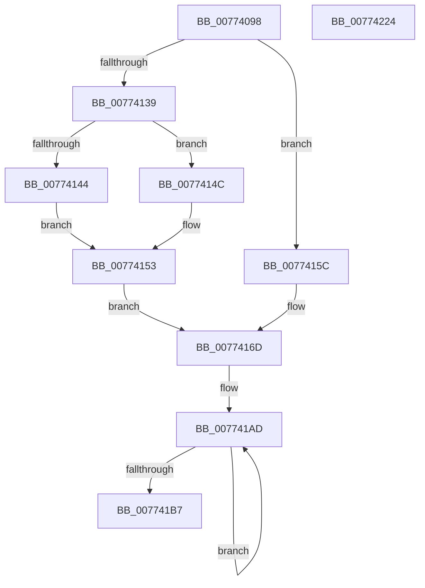

# SshSessionManagerTracePreSleepNotification

- RVA: `0x00774098`–`0x00774225` (길이 `397` bytes)
- VA: `0x0000000140774098`
- 실행 섹션: `PAGE`
- PDB 이름 있음: `예`; PDB Function 태그: `아니요`
- unwind 정보 RVA: `0x000CDA84`
- 디코드: `89`개 명령, `397/397` bytes 표시
- 미해석 바이트: `0` (있으면 어셈블리에 `.byte`로 보존)

> 이 문서는 커널 이미지의 기계어와 PDB 기호를 분석해 생성했습니다. 4번과 5번은 함수 원형과 자료형을 바이너리 사용 방식에서 추정한 C 해석이며 원본 소스 복구 결과는 아닙니다.

## 1. Dependencies

- 직접 호출 지점: **2**; 고유 호출 대상: **2**
- 직접 호출자로 확인된 함수: **1**
- RIP 상대 이미지 참조: **3**

### Outgoing calls
- `0x0077420A` → [SshpSessionManagerSendControlEvent](../A8/SshpSessionManagerSendControlEvent_function_00A871C0.md) (function, `0x00A871C0`)
- `0x00774216` → [_security_check_cookie](../../text/6A/_security_check_cookie_function_006AC640.md) (function, `0x006AC640`)

### Direct callers
- [PopDiagTracePreSleepNotification](../76/PopDiagTracePreSleepNotification_function_00762BE4.md) at `0x00762D25`

### Static image references
- `0x007740B5` → RVA `0x00E0A740` (`.data`; read)
- `0x0077415F` → RVA `0x00013F90` (`.rdata`; read)
- `0x007741DE` → RVA `0x00029798` (`.rdata`; read)

## 2. Other-region calls and transfers

- 다른 실행 섹션으로 향하는 call: **1**
  - `0x00774216` → [_security_check_cookie](../../text/6A/_security_check_cookie_function_006AC640.md) (`PAGE` → `.text`)
- 별도 외부 분기/꼬리 이동을 확인하지 못했습니다.

## 3. Assembly (complete function range)

```asm
00774098  48 8B C4                        mov rax, rsp
0077409B  44 89 48 20                     mov dword ptr [rax + 0x20], r9d
0077409F  44 89 40 18                     mov dword ptr [rax + 0x18], r8d
007740A3  89 50 10                        mov dword ptr [rax + 0x10], edx
007740A6  89 48 08                        mov dword ptr [rax + 8], ecx
007740A9  55                              push rbp
007740AA  48 8D 68 E8                     lea rbp, [rax - 0x18]
007740AE  48 81 EC 10 01 00 00            sub rsp, 0x110
007740B5  48 8B 05 84 66 69 00            mov rax, qword ptr [rip + 0x696684]
007740BC  48 33 C4                        xor rax, rsp
007740BF  48 89 45 00                     mov qword ptr [rbp], rax
007740C3  48 8B 55 50                     mov rdx, qword ptr [rbp + 0x50]
007740C7  48 8D 45 20                     lea rax, [rbp + 0x20]
007740CB  48 89 44 24 30                  mov qword ptr [rsp + 0x30], rax
007740D0  45 33 D2                        xor r10d, r10d
007740D3  48 C7 44 24 38 04 00 00 00      mov qword ptr [rsp + 0x38], 4
007740DC  48 8D 45 28                     lea rax, [rbp + 0x28]
007740E0  48 89 44 24 40                  mov qword ptr [rsp + 0x40], rax
007740E5  48 8D 45 30                     lea rax, [rbp + 0x30]
007740E9  48 89 44 24 50                  mov qword ptr [rsp + 0x50], rax
007740EE  48 8D 45 38                     lea rax, [rbp + 0x38]
007740F2  48 89 44 24 60                  mov qword ptr [rsp + 0x60], rax
007740F7  48 8D 45 40                     lea rax, [rbp + 0x40]
007740FB  48 89 44 24 70                  mov qword ptr [rsp + 0x70], rax
00774100  48 8D 45 48                     lea rax, [rbp + 0x48]
00774104  48 89 45 80                     mov qword ptr [rbp - 0x80], rax
00774108  48 C7 44 24 48 04 00 00 00      mov qword ptr [rsp + 0x48], 4
00774111  48 C7 44 24 58 04 00 00 00      mov qword ptr [rsp + 0x58], 4
0077411A  48 C7 44 24 68 04 00 00 00      mov qword ptr [rsp + 0x68], 4
00774123  48 C7 44 24 78 04 00 00 00      mov qword ptr [rsp + 0x78], 4
0077412C  48 C7 45 88 01 00 00 00         mov qword ptr [rbp - 0x78], 1
00774134  48 85 D2                        test rdx, rdx
00774137  74 23                           je 0x14077415c
00774139  8B 42 08                        mov eax, dword ptr [rdx + 8]
0077413C  89 44 24 20                     mov dword ptr [rsp + 0x20], eax
00774140  85 C0                           test eax, eax
00774142  75 08                           jne 0x14077414c
00774144  83 C9 FF                        or ecx, 0xffffffff
00774147  44 8B C1                        mov r8d, ecx
0077414A  EB 07                           jmp 0x140774153
0077414C  8B 4A 1C                        mov ecx, dword ptr [rdx + 0x1c]
0077414F  44 8B 42 18                     mov r8d, dword ptr [rdx + 0x18]
00774153  4C 8B 4A 10                     mov r9, qword ptr [rdx + 0x10]
00774157  4C 03 CA                        add r9, rdx
0077415A  EB 11                           jmp 0x14077416d
0077415C  83 C9 FF                        or ecx, 0xffffffff
0077415F  4C 8D 0D 2A FE 89 FF            lea r9, [rip - 0x7601d6]
00774166  89 4C 24 20                     mov dword ptr [rsp + 0x20], ecx
0077416A  44 8B C1                        mov r8d, ecx
0077416D  48 8D 44 24 20                  lea rax, [rsp + 0x20]
00774172  44 89 44 24 24                  mov dword ptr [rsp + 0x24], r8d
00774177  48 89 45 90                     mov qword ptr [rbp - 0x70], rax
0077417B  48 8D 44 24 24                  lea rax, [rsp + 0x24]
00774180  48 89 45 A0                     mov qword ptr [rbp - 0x60], rax
00774184  48 8D 44 24 28                  lea rax, [rsp + 0x28]
00774189  48 89 45 B0                     mov qword ptr [rbp - 0x50], rax
0077418D  48 83 C8 FF                     or rax, 0xffffffffffffffff
00774191  89 4C 24 28                     mov dword ptr [rsp + 0x28], ecx
00774195  48 C7 45 98 04 00 00 00         mov qword ptr [rbp - 0x68], 4
0077419D  48 C7 45 A8 04 00 00 00         mov qword ptr [rbp - 0x58], 4
007741A5  48 C7 45 B8 04 00 00 00         mov qword ptr [rbp - 0x48], 4
007741AD  48 FF C0                        inc rax
007741B0  66 45 39 14 41                  cmp word ptr [r9 + rax*2], r10w
007741B5  75 F6                           jne 0x1407741ad
007741B7  89 44 24 2C                     mov dword ptr [rsp + 0x2c], eax
007741BB  48 8D 4C 24 2C                  lea rcx, [rsp + 0x2c]
007741C0  03 C0                           add eax, eax
007741C2  48 89 4D C0                     mov qword ptr [rbp - 0x40], rcx
007741C6  89 45 D8                        mov dword ptr [rbp - 0x28], eax
007741C9  4C 8D 44 24 30                  lea r8, [rsp + 0x30]
007741CE  48 8D 45 58                     lea rax, [rbp + 0x58]
007741D2  48 C7 45 C8 04 00 00 00         mov qword ptr [rbp - 0x38], 4
007741DA  48 89 45 E0                     mov qword ptr [rbp - 0x20], rax
007741DE  48 8D 0D B3 55 8B FF            lea rcx, [rip - 0x74aa4d]
007741E5  48 8D 45 60                     lea rax, [rbp + 0x60]
007741E9  4C 89 4D D0                     mov qword ptr [rbp - 0x30], r9
007741ED  BA 0D 00 00 00                  mov edx, 0xd
007741F2  48 89 45 F0                     mov qword ptr [rbp - 0x10], rax
007741F6  44 89 55 DC                     mov dword ptr [rbp - 0x24], r10d
007741FA  48 C7 45 E8 01 00 00 00         mov qword ptr [rbp - 0x18], 1
00774202  48 C7 45 F8 01 00 00 00         mov qword ptr [rbp - 8], 1
0077420A  E8 B1 2F 31 00                  call 0x140a871c0
0077420F  48 8B 4D 00                     mov rcx, qword ptr [rbp]
00774213  48 33 CC                        xor rcx, rsp
00774216  E8 25 84 F3 FF                  call 0x1406ac640
0077421B  48 81 C4 10 01 00 00            add rsp, 0x110
00774222  5D                              pop rbp
00774223  C3                              ret
00774224  CC                              int3
```

## 4. C-style interpretation (structured pseudocode)

```c
__int64 __fastcall SshSessionManagerTracePreSleepNotification(int a1, int a2, int a3, int a4)
{
    __int64 result;
    __int64 v_r10;
    __int64 v_rsp;
    unsigned __int64 v_stack_mA0;
    unsigned __int64 v_stack_mA8;
    unsigned __int64 v_stack_mB0;
    unsigned __int64 v_stack_mB8;
    unsigned __int64 v_stack_mC0;
    unsigned __int64 v_stack_mC8;
    unsigned __int64 v_stack_mD0;
    unsigned __int64 v_stack_mD8;
    unsigned __int64 v_stack_mE0;
    unsigned __int64 v_stack_mE8;
    unsigned int v_stack_mEC;
    unsigned __int64 v_stack_mF0;
    unsigned int v_stack_mF4;
    unsigned int v_stack_mF8;

    *(unsigned int *)(v_rsp + 32) = a4;
    *(unsigned int *)(v_rsp + 24) = a3;
    *(unsigned int *)(v_rsp + 16) = a2;
    *(unsigned int *)(v_rsp + 8) = a1;
    v_rsp = (v_rsp) - (272);
    result = (*(unsigned __int64 *)(v_rip + 6907524)) ^ (v_rsp);
    *(unsigned __int64 *)(v_rsp - 24) = result;
    v_stack_mE8 = v_rsp - 24 + 32;
    v_r10 = 0;
    v_stack_mE0 = 4;
    v_stack_mD8 = v_rsp - 24 + 40;
    v_stack_mC8 = v_rsp - 24 + 48;
    v_stack_mB8 = v_rsp - 24 + 56;
    v_stack_mA8 = v_rsp - 24 + 64;
    *(unsigned __int64 *)(v_rsp - 24 - 128) = v_rsp - 24 + 72;
    v_stack_mD0 = 4;
    v_stack_mC0 = 4;
    v_stack_mB0 = 4;
    v_stack_mA0 = 4;
    *(unsigned __int64 *)(v_rsp - 24 - 120) = 1;
    if (*(unsigned __int64 *)(v_rsp - 24 + 80) == 0) goto loc_0077415C;
    v_stack_mF8 = (unsigned int)((unsigned int)(*(unsigned int *)(*(unsigned __int64 *)(v_rsp - 24 + 80) + 8)));
    if ((unsigned int)((unsigned int)(*(unsigned int *)(*(unsigned __int64 *)(v_rsp - 24 + 80) + 8))) != 0) goto loc_0077414C;
    a1 = (unsigned int)((a1) | (0xFFFFFFFFULL));
    goto loc_00774153;
loc_0077414C:
loc_00774153:
    a4 = (*(unsigned __int64 *)(*(unsigned __int64 *)(v_rsp - 24 + 80) + 16)) + (*(unsigned __int64 *)(v_rsp - 24 + 80));
    goto loc_0077416D;
loc_0077415C:
    a1 = (unsigned int)(((unsigned int)(*(unsigned int *)(*(unsigned __int64 *)(v_rsp - 24 + 80) + 28))) | (0xFFFFFFFFULL));
    v_stack_mF8 = a1;
loc_0077416D:
    v_stack_mF4 = (unsigned int)((unsigned int)(a1));
    *(unsigned __int64 *)(v_rsp - 24 - 112) = v_stack_mF8;
    *(unsigned __int64 *)(v_rsp - 24 - 96) = v_stack_mF4;
    *(unsigned __int64 *)(v_rsp - 24 - 80) = v_stack_mF0;
    result = (v_stack_mF0) | (-1);
    v_stack_mF0 = a1;
    *(unsigned __int64 *)(v_rsp - 24 - 104) = 4;
    *(unsigned __int64 *)(v_rsp - 24 - 88) = 4;
    *(unsigned __int64 *)(v_rsp - 24 - 72) = 4;
loc_007741AD:
    result = (result) + 1;
    if ((*(unsigned __int16 *)(v_rip - 7733718 + result * 2)) != 0) goto loc_007741AD;
    v_stack_mEC = (unsigned int)(result);
    result = (unsigned int)((result) + ((unsigned int)(result)));
    *(unsigned __int64 *)(v_rsp - 24 - 64) = v_stack_mEC;
    *(unsigned int *)(v_rsp - 24 - 40) = (unsigned int)(result);
    *(unsigned __int64 *)(v_rsp - 24 - 56) = 4;
    *(unsigned __int64 *)(v_rsp - 24 - 32) = v_rsp - 24 + 88;
    *(unsigned __int64 *)(v_rsp - 24 - 48) = v_rip - 7733718;
    *(unsigned __int64 *)(v_rsp - 24 - 16) = v_rsp - 24 + 96;
    *(unsigned int *)(v_rsp - 24 - 36) = 0;
    *(unsigned __int64 *)(v_rsp - 24 - 24) = 1;
    *(unsigned __int64 *)(v_rsp - 24 - 8) = 1;
    result = SshpSessionManagerSendControlEvent(v_rip - 7645773, 13, v_stack_mE8, v_rip - 7733718);
    a1 = (*(unsigned __int64 *)(v_rsp - 24)) ^ (v_rsp);
    result = _security_check_cookie(a1, 13, v_stack_mE8, v_rip - 7733718);
    v_rsp = (v_rsp) + (272);
    return result;
}
```

## 5. (Beta) C Style

```c
int64_t SshSessionManagerTracePreSleepNotification(int32_t Arg1, int32_t Arg2, int32_t Arg3, int32_t Arg4)
{
    int64_t result;
    int64_t local_r10;
    int64_t local_rsp;
    uint64_t v_stack_mA0;
    uint64_t v_stack_mA8;
    uint64_t v_stack_mB0;
    uint64_t v_stack_mB8;
    uint64_t v_stack_mC0;
    uint64_t v_stack_mC8;
    uint64_t v_stack_mD0;
    uint64_t v_stack_mD8;
    uint64_t v_stack_mE0;
    uint64_t v_stack_mE8;
    uint32_t v_stack_mEC;
    uint64_t v_stack_mF0;
    uint32_t v_stack_mF4;
    uint32_t v_stack_mF8;

    *(uint32_t *)(local_rsp + 0x20) = Arg4;
    *(uint32_t *)(local_rsp + 0x18) = Arg3;
    *(uint32_t *)(local_rsp + 0x10) = Arg2;
    *(uint32_t *)(local_rsp + 0x8) = Arg1;
    local_rsp = (local_rsp) - (272);
    result = (*(uint64_t *)(v_rip + 0x696684)) ^ (local_rsp);
    *(uint64_t *)(local_rsp - 0x18) = result;
    v_stack_mE8 = local_rsp - 24 + 32;
    local_r10 = 0;
    v_stack_mE0 = 4;
    v_stack_mD8 = local_rsp - 24 + 40;
    v_stack_mC8 = local_rsp - 24 + 48;
    v_stack_mB8 = local_rsp - 24 + 56;
    v_stack_mA8 = local_rsp - 24 + 64;
    *(uint64_t *)(local_rsp - 0x18 - 0x80) = local_rsp - 24 + 72;
    v_stack_mD0 = 4;
    v_stack_mC0 = 4;
    v_stack_mB0 = 4;
    v_stack_mA0 = 4;
    *(uint64_t *)(local_rsp - 0x18 - 0x78) = 1;
    if (*(uint64_t *)(local_rsp - 0x18 + 0x50) == 0) goto loc_0077415C;
    v_stack_mF8 = (uint32_t)((uint32_t)(*(uint32_t *)(*(uint64_t *)(local_rsp - 0x18 + 0x50) + 0x8)));
    if ((uint32_t)((uint32_t)(*(uint32_t *)(*(uint64_t *)(local_rsp - 0x18 + 0x50) + 0x8))) != 0) goto loc_0077414C;
    Arg1 = (uint32_t)((Arg1) | (0xFFFFFFFFULL));
    goto loc_00774153;
loc_0077414C:
loc_00774153:
    Arg4 = (*(uint64_t *)(*(uint64_t *)(local_rsp - 0x18 + 0x50) + 0x10)) + (*(uint64_t *)(local_rsp - 0x18 + 0x50));
    goto loc_0077416D;
loc_0077415C:
    Arg1 = (uint32_t)(((uint32_t)(*(uint32_t *)(*(uint64_t *)(local_rsp - 0x18 + 0x50) + 0x1C))) | (0xFFFFFFFFULL));
    v_stack_mF8 = Arg1;
loc_0077416D:
    v_stack_mF4 = (uint32_t)((uint32_t)(Arg1));
    *(uint64_t *)(local_rsp - 0x18 - 0x70) = v_stack_mF8;
    *(uint64_t *)(local_rsp - 0x18 - 0x60) = v_stack_mF4;
    *(uint64_t *)(local_rsp - 0x18 - 0x50) = v_stack_mF0;
    result = (v_stack_mF0) | (-1);
    v_stack_mF0 = Arg1;
    *(uint64_t *)(local_rsp - 0x18 - 0x68) = 4;
    *(uint64_t *)(local_rsp - 0x18 - 0x58) = 4;
    *(uint64_t *)(local_rsp - 0x18 - 0x48) = 4;
loc_007741AD:
    result = (result) + 1;
    if ((*(uint16_t *)(v_rip - 0x7601D6 + result * 2)) != 0) goto loc_007741AD;
    v_stack_mEC = (uint32_t)(result);
    result = (uint32_t)((result) + ((uint32_t)(result)));
    *(uint64_t *)(local_rsp - 0x18 - 0x40) = v_stack_mEC;
    *(uint32_t *)(local_rsp - 0x18 - 0x28) = (uint32_t)(result);
    *(uint64_t *)(local_rsp - 0x18 - 0x38) = 4;
    *(uint64_t *)(local_rsp - 0x18 - 0x20) = local_rsp - 24 + 88;
    *(uint64_t *)(local_rsp - 0x18 - 0x30) = v_rip - 7733718;
    *(uint64_t *)(local_rsp - 0x18 - 0x10) = local_rsp - 24 + 96;
    *(uint32_t *)(local_rsp - 0x18 - 0x24) = 0;
    *(uint64_t *)(local_rsp - 0x18 - 0x18) = 1;
    *(uint64_t *)(local_rsp - 0x18 - 0x8) = 1;
    result = SshpSessionManagerSendControlEvent(v_rip - 7645773, 13, v_stack_mE8, v_rip - 7733718);
    Arg1 = (*(uint64_t *)(local_rsp - 0x18)) ^ (local_rsp);
    result = _security_check_cookie(Arg1, 13, v_stack_mE8, v_rip - 7733718);
    local_rsp = (local_rsp) + (272);
    return result;
}
```

## 6. Execution-region graph

[열기: 2D/3D 그래프와 함수 탐색 컨트롤 패널](../../../control-panel.html?section=page&rva=0x00774098&view=graph)

- 2D 그래프는 위에서 아래로 흐르고, 3D 그래프는 빈 공간을 드래그해 회전합니다. Shift+드래그는 이동, 휠은 확대·축소, 함수 노드 선택은 대상 보고서 이동입니다.

### Static fallback


