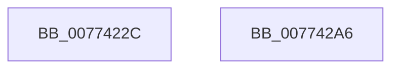

# SshSessionManagerTraceShutdownAction

- RVA: `0x0077422C`–`0x007742A7` (길이 `123` bytes)
- VA: `0x000000014077422C`
- 실행 섹션: `PAGE`
- PDB 이름 있음: `예`; PDB Function 태그: `아니요`
- unwind 정보 RVA: `0x000CDA9C`
- 디코드: `29`개 명령, `123/123` bytes 표시
- 미해석 바이트: `0` (있으면 어셈블리에 `.byte`로 보존)

> 이 문서는 커널 이미지의 기계어와 PDB 기호를 분석해 생성했습니다. 4번과 5번은 함수 원형과 자료형을 바이너리 사용 방식에서 추정한 C 해석이며 원본 소스 복구 결과는 아닙니다.

## 1. Dependencies

- 직접 호출 지점: **2**; 고유 호출 대상: **2**
- 직접 호출자로 확인된 함수: **1**
- RIP 상대 이미지 참조: **2**

### Outgoing calls
- `0x0077428F` → [SshpSessionManagerSendControlEvent](../A8/SshpSessionManagerSendControlEvent_function_00A871C0.md) (function, `0x00A871C0`)
- `0x0077429B` → [_security_check_cookie](../../text/6A/_security_check_cookie_function_006AC640.md) (function, `0x006AC640`)

### Direct callers
- [PopDiagTraceShutdownAction](../../text/5D/PopDiagTraceShutdownAction_function_005D6F08.md) at `0x005D6FD0`

### Static image references
- `0x00774241` → RVA `0x00E0A740` (`.data`; read)
- `0x00774273` → RVA `0x000297D8` (`.rdata`; read)

## 2. Other-region calls and transfers

- 다른 실행 섹션으로 향하는 call: **1**
  - `0x0077429B` → [_security_check_cookie](../../text/6A/_security_check_cookie_function_006AC640.md) (`PAGE` → `.text`)
- 별도 외부 분기/꼬리 이동을 확인하지 못했습니다.

## 3. Assembly (complete function range)

```asm
0077422C  44 89 44 24 18                  mov dword ptr [rsp + 0x18], r8d
00774231  89 54 24 10                     mov dword ptr [rsp + 0x10], edx
00774235  89 4C 24 08                     mov dword ptr [rsp + 8], ecx
00774239  55                              push rbp
0077423A  48 8B EC                        mov rbp, rsp
0077423D  48 83 EC 60                     sub rsp, 0x60
00774241  48 8B 05 F8 64 69 00            mov rax, qword ptr [rip + 0x6964f8]
00774248  48 33 C4                        xor rax, rsp
0077424B  48 89 45 F0                     mov qword ptr [rbp - 0x10], rax
0077424F  48 8D 45 10                     lea rax, [rbp + 0x10]
00774253  48 C7 45 C8 04 00 00 00         mov qword ptr [rbp - 0x38], 4
0077425B  48 89 45 C0                     mov qword ptr [rbp - 0x40], rax
0077425F  4C 8D 45 C0                     lea r8, [rbp - 0x40]
00774263  48 8D 45 18                     lea rax, [rbp + 0x18]
00774267  48 C7 45 D8 04 00 00 00         mov qword ptr [rbp - 0x28], 4
0077426F  48 89 45 D0                     mov qword ptr [rbp - 0x30], rax
00774273  48 8D 0D 5E 55 8B FF            lea rcx, [rip - 0x74aaa2]
0077427A  48 8D 45 20                     lea rax, [rbp + 0x20]
0077427E  48 C7 45 E8 04 00 00 00         mov qword ptr [rbp - 0x18], 4
00774286  BA 03 00 00 00                  mov edx, 3
0077428B  48 89 45 E0                     mov qword ptr [rbp - 0x20], rax
0077428F  E8 2C 2F 31 00                  call 0x140a871c0
00774294  48 8B 4D F0                     mov rcx, qword ptr [rbp - 0x10]
00774298  48 33 CC                        xor rcx, rsp
0077429B  E8 A0 83 F3 FF                  call 0x1406ac640
007742A0  48 83 C4 60                     add rsp, 0x60
007742A4  5D                              pop rbp
007742A5  C3                              ret
007742A6  CC                              int3
```

## 4. C-style interpretation (structured pseudocode)

```c
__int64 __fastcall SshSessionManagerTraceShutdownAction(int a1, int a2, int a3)
{
    __int64 result;
    __int64 v_rsp;
    unsigned __int64 v_stack_m18;
    unsigned __int64 v_stack_m20;
    unsigned __int64 v_stack_m28;
    unsigned __int64 v_stack_m30;
    unsigned __int64 v_stack_m38;
    unsigned __int64 v_stack_m40;
    unsigned __int64 v_stack_m48;
    unsigned int v_stack_p10;
    unsigned int v_stack_p18;
    unsigned int v_stack_p8;

    v_stack_p18 = a3;
    v_stack_p10 = a2;
    v_stack_p8 = a1;
    v_rsp = (v_rsp) - (96);
    result = (*(unsigned __int64 *)(v_rip + 6907128)) ^ (v_rsp);
    v_stack_m18 = result;
    v_stack_m40 = 4;
    v_stack_m48 = v_stack_p8;
    v_stack_m30 = 4;
    v_stack_m38 = v_stack_p10;
    v_stack_m20 = 4;
    v_stack_m28 = v_stack_p18;
    result = SshpSessionManagerSendControlEvent(v_rip - 7645858, 3, v_stack_m48, a4);
    a1 = (v_stack_m18) ^ (v_rsp);
    result = _security_check_cookie(a1, 3, v_stack_m48, a4);
    v_rsp = (v_rsp) + (96);
    return result;
}
```

## 5. (Beta) C Style

```c
int64_t SshSessionManagerTraceShutdownAction(int32_t Arg1, int32_t Arg2, int32_t Arg3)
{
    int64_t result;
    int64_t local_rsp;
    uint64_t v_stack_m18;
    uint64_t v_stack_m20;
    uint64_t v_stack_m28;
    uint64_t v_stack_m30;
    uint64_t v_stack_m38;
    uint64_t v_stack_m40;
    uint64_t v_stack_m48;
    uint32_t v_stack_p10;
    uint32_t v_stack_p18;
    uint32_t v_stack_p8;

    v_stack_p18 = Arg3;
    v_stack_p10 = Arg2;
    v_stack_p8 = Arg1;
    local_rsp = (local_rsp) - (96);
    result = (*(uint64_t *)(v_rip + 0x6964F8)) ^ (local_rsp);
    v_stack_m18 = result;
    v_stack_m40 = 4;
    v_stack_m48 = v_stack_p8;
    v_stack_m30 = 4;
    v_stack_m38 = v_stack_p10;
    v_stack_m20 = 4;
    v_stack_m28 = v_stack_p18;
    result = SshpSessionManagerSendControlEvent(v_rip - 7645858, 3, v_stack_m48, a4);
    Arg1 = (v_stack_m18) ^ (local_rsp);
    result = _security_check_cookie(Arg1, 3, v_stack_m48, a4);
    local_rsp = (local_rsp) + (96);
    return result;
}
```

## 6. Execution-region graph

[열기: 2D/3D 그래프와 함수 탐색 컨트롤 패널](../../../control-panel.html?section=page&rva=0x0077422C&view=graph)

- 2D 그래프는 위에서 아래로 흐르고, 3D 그래프는 빈 공간을 드래그해 회전합니다. Shift+드래그는 이동, 휠은 확대·축소, 함수 노드 선택은 대상 보고서 이동입니다.

### Static fallback


