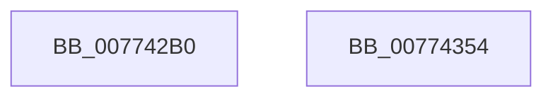

# SshSessionManagerTraceSystemStop

- RVA: `0x007742B0`–`0x00774355` (길이 `165` bytes)
- VA: `0x00000001407742B0`
- 실행 섹션: `PAGE`
- PDB 이름 있음: `예`; PDB Function 태그: `아니요`
- unwind 정보 RVA: `0x000BB624`
- 디코드: `37`개 명령, `165/165` bytes 표시
- 미해석 바이트: `0` (있으면 어셈블리에 `.byte`로 보존)

> 이 문서는 커널 이미지의 기계어와 PDB 기호를 분석해 생성했습니다. 4번과 5번은 함수 원형과 자료형을 바이너리 사용 방식에서 추정한 C 해석이며 원본 소스 복구 결과는 아닙니다.

## 1. Dependencies

- 직접 호출 지점: **2**; 고유 호출 대상: **2**
- 직접 호출자로 확인된 함수: **1**
- RIP 상대 이미지 참조: **2**

### Outgoing calls
- `0x0077433A` → [SshpSessionManagerSendControlEvent](../A8/SshpSessionManagerSendControlEvent_function_00A871C0.md) (function, `0x00A871C0`)
- `0x00774346` → [_security_check_cookie](../../text/6A/_security_check_cookie_function_006AC640.md) (function, `0x006AC640`)

### Direct callers
- [PopDiagTraceGracefulShutdown](../../pagelk/B7/PopDiagTraceGracefulShutdown_function_00B71334.md) at `0x00B713A2`

### Static image references
- `0x007742CC` → RVA `0x00E0A740` (`.data`; read)
- `0x007742FE` → RVA `0x000297A8` (`.rdata`; read)

## 2. Other-region calls and transfers

- 다른 실행 섹션으로 향하는 call: **1**
  - `0x00774346` → [_security_check_cookie](../../text/6A/_security_check_cookie_function_006AC640.md) (`PAGE` → `.text`)
- 별도 외부 분기/꼬리 이동을 확인하지 못했습니다.

## 3. Assembly (complete function range)

```asm
007742B0  48 8B C4                        mov rax, rsp
007742B3  44 88 48 20                     mov byte ptr [rax + 0x20], r9b
007742B7  44 88 40 18                     mov byte ptr [rax + 0x18], r8b
007742BB  89 50 10                        mov dword ptr [rax + 0x10], edx
007742BE  89 48 08                        mov dword ptr [rax + 8], ecx
007742C1  55                              push rbp
007742C2  48 8B EC                        mov rbp, rsp
007742C5  48 81 EC 80 00 00 00            sub rsp, 0x80
007742CC  48 8B 05 6D 64 69 00            mov rax, qword ptr [rip + 0x69646d]
007742D3  48 33 C4                        xor rax, rsp
007742D6  48 89 45 F0                     mov qword ptr [rbp - 0x10], rax
007742DA  48 8D 45 10                     lea rax, [rbp + 0x10]
007742DE  48 C7 45 A8 04 00 00 00         mov qword ptr [rbp - 0x58], 4
007742E6  48 89 45 A0                     mov qword ptr [rbp - 0x60], rax
007742EA  4C 8D 45 A0                     lea r8, [rbp - 0x60]
007742EE  48 8D 45 18                     lea rax, [rbp + 0x18]
007742F2  48 C7 45 B8 04 00 00 00         mov qword ptr [rbp - 0x48], 4
007742FA  48 89 45 B0                     mov qword ptr [rbp - 0x50], rax
007742FE  48 8D 0D A3 54 8B FF            lea rcx, [rip - 0x74ab5d]
00774305  48 8D 45 20                     lea rax, [rbp + 0x20]
00774309  48 C7 45 C8 01 00 00 00         mov qword ptr [rbp - 0x38], 1
00774311  48 89 45 C0                     mov qword ptr [rbp - 0x40], rax
00774315  BA 05 00 00 00                  mov edx, 5
0077431A  48 8D 45 28                     lea rax, [rbp + 0x28]
0077431E  48 C7 45 D8 01 00 00 00         mov qword ptr [rbp - 0x28], 1
00774326  48 89 45 D0                     mov qword ptr [rbp - 0x30], rax
0077432A  48 8D 45 30                     lea rax, [rbp + 0x30]
0077432E  48 89 45 E0                     mov qword ptr [rbp - 0x20], rax
00774332  48 C7 45 E8 01 00 00 00         mov qword ptr [rbp - 0x18], 1
0077433A  E8 81 2E 31 00                  call 0x140a871c0
0077433F  48 8B 4D F0                     mov rcx, qword ptr [rbp - 0x10]
00774343  48 33 CC                        xor rcx, rsp
00774346  E8 F5 82 F3 FF                  call 0x1406ac640
0077434B  48 81 C4 80 00 00 00            add rsp, 0x80
00774352  5D                              pop rbp
00774353  C3                              ret
00774354  CC                              int3
```

## 4. C-style interpretation (structured pseudocode)

```c
__int64 __fastcall SshSessionManagerTraceSystemStop(int a1, int a2, unsigned __int8 a3, unsigned __int8 a4, __int64 a5)
{
    __int64 result;
    __int64 v_rsp;
    unsigned __int64 v_stack_m18;
    unsigned __int64 v_stack_m20;
    unsigned __int64 v_stack_m28;
    unsigned __int64 v_stack_m30;
    unsigned __int64 v_stack_m38;
    unsigned __int64 v_stack_m40;
    unsigned __int64 v_stack_m48;
    unsigned __int64 v_stack_m50;
    unsigned __int64 v_stack_m58;
    unsigned __int64 v_stack_m60;
    unsigned __int64 v_stack_m68;
    unsigned __int64 v_stack_p10;
    unsigned __int64 v_stack_p18;
    unsigned __int64 v_stack_p20;
    unsigned __int64 v_stack_p8;

    *(unsigned __int8 *)(v_rsp + 32) = a4;
    *(unsigned __int8 *)(v_rsp + 24) = a3;
    *(unsigned int *)(v_rsp + 16) = a2;
    *(unsigned int *)(v_rsp + 8) = a1;
    v_rsp = (v_rsp) - (128);
    result = (*(unsigned __int64 *)(v_rip + 6906989)) ^ (v_rsp);
    v_stack_m18 = result;
    v_stack_m60 = 4;
    v_stack_m68 = v_stack_p8;
    v_stack_m50 = 4;
    v_stack_m58 = v_stack_p10;
    v_stack_m40 = 1;
    v_stack_m48 = v_stack_p18;
    v_stack_m30 = 1;
    v_stack_m38 = v_stack_p20;
    v_stack_m28 = a5;
    v_stack_m20 = 1;
    result = SshpSessionManagerSendControlEvent(v_rip - 7646045, 5, v_stack_m68, a4);
    a1 = (v_stack_m18) ^ (v_rsp);
    result = _security_check_cookie(a1, 5, v_stack_m68, a4);
    v_rsp = (v_rsp) + (128);
    return result;
}
```

## 5. (Beta) C Style

```c
int64_t SshSessionManagerTraceSystemStop(int32_t Arg1, int32_t Arg2, uint8_t Arg3, uint8_t Arg4, int64_t Arg5)
{
    int64_t result;
    int64_t local_rsp;
    uint64_t v_stack_m18;
    uint64_t v_stack_m20;
    uint64_t v_stack_m28;
    uint64_t v_stack_m30;
    uint64_t v_stack_m38;
    uint64_t v_stack_m40;
    uint64_t v_stack_m48;
    uint64_t v_stack_m50;
    uint64_t v_stack_m58;
    uint64_t v_stack_m60;
    uint64_t v_stack_m68;
    uint64_t v_stack_p10;
    uint64_t v_stack_p18;
    uint64_t v_stack_p20;
    uint64_t v_stack_p8;

    *(uint8_t *)(local_rsp + 0x20) = Arg4;
    *(uint8_t *)(local_rsp + 0x18) = Arg3;
    *(uint32_t *)(local_rsp + 0x10) = Arg2;
    *(uint32_t *)(local_rsp + 0x8) = Arg1;
    local_rsp = (local_rsp) - (128);
    result = (*(uint64_t *)(v_rip + 0x69646D)) ^ (local_rsp);
    v_stack_m18 = result;
    v_stack_m60 = 4;
    v_stack_m68 = v_stack_p8;
    v_stack_m50 = 4;
    v_stack_m58 = v_stack_p10;
    v_stack_m40 = 1;
    v_stack_m48 = v_stack_p18;
    v_stack_m30 = 1;
    v_stack_m38 = v_stack_p20;
    v_stack_m28 = Arg5;
    v_stack_m20 = 1;
    result = SshpSessionManagerSendControlEvent(v_rip - 7646045, 5, v_stack_m68, Arg4);
    Arg1 = (v_stack_m18) ^ (local_rsp);
    result = _security_check_cookie(Arg1, 5, v_stack_m68, Arg4);
    local_rsp = (local_rsp) + (128);
    return result;
}
```

## 6. Execution-region graph

[열기: 2D/3D 그래프와 함수 탐색 컨트롤 패널](../../../control-panel.html?section=page&rva=0x007742B0&view=graph)

- 2D 그래프는 위에서 아래로 흐르고, 3D 그래프는 빈 공간을 드래그해 회전합니다. Shift+드래그는 이동, 휠은 확대·축소, 함수 노드 선택은 대상 보고서 이동입니다.

### Static fallback


