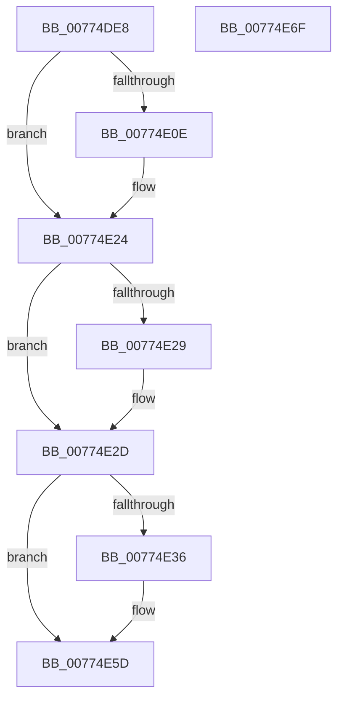

# SshpAlpcCloseTraceSession

- RVA: `0x00774DE8`–`0x00774E70` (길이 `136` bytes)
- VA: `0x0000000140774DE8`
- 실행 섹션: `PAGE`
- PDB 이름 있음: `예`; PDB Function 태그: `아니요`
- unwind 정보 RVA: `0x00064C80`
- 디코드: `31`개 명령, `136/136` bytes 표시
- 미해석 바이트: `0` (있으면 어셈블리에 `.byte`로 보존)

> 이 문서는 커널 이미지의 기계어와 PDB 기호를 분석해 생성했습니다. 4번과 5번은 함수 원형과 자료형을 바이너리 사용 방식에서 추정한 C 해석이며 원본 소스 복구 결과는 아닙니다.

## 1. Dependencies

- 직접 호출 지점: **4**; 고유 호출 대상: **4**
- 직접 호출자로 확인된 함수: **1**
- RIP 상대 이미지 참조: **4**

### Outgoing calls
- `0x00774DFA` → [KeAbPreAcquire](../../text/21/KeAbPreAcquire_function_00210230.md) (function, `0x00210230`)
- `0x00774E1F` → [ExfAcquirePushLockExclusiveEx](../../text/20/ExfAcquirePushLockExclusiveEx_function_0020FC90.md) (function, `0x0020FC90`)
- `0x00774E58` → [KeSetTimer2](../../text/3A/KeSetTimer2_function_003A08E0.md) (function, `0x003A08E0`)
- `0x00774E64` → [SSHSupportReleasePushLockExclusive](../../text/49/SSHSupportReleasePushLockExclusive_function_004954EC.md) (function, `0x004954EC`)

### Direct callers
- [SshpSessionManagerFlushControlEventBuffer](SshpSessionManagerFlushControlEventBuffer_function_007743C4.md) at `0x00774443`

### Static image references
- `0x00774DF1` → RVA `0x00F069C8` (`.data`; read)
- `0x00774DFF` → RVA `0x00F069C8` (`.data`; read/write)
- `0x00774E2D` → RVA `0x00F069D8` (`.data`; read/write)
- `0x00774E47` → RVA `0x00F069E0` (`.data`; read)

## 2. Other-region calls and transfers

- 다른 실행 섹션으로 향하는 call: **4**
  - `0x00774DFA` → [KeAbPreAcquire](../../text/21/KeAbPreAcquire_function_00210230.md) (`PAGE` → `.text`)
  - `0x00774E1F` → [ExfAcquirePushLockExclusiveEx](../../text/20/ExfAcquirePushLockExclusiveEx_function_0020FC90.md) (`PAGE` → `.text`)
  - `0x00774E58` → [KeSetTimer2](../../text/3A/KeSetTimer2_function_003A08E0.md) (`PAGE` → `.text`)
  - `0x00774E64` → [SSHSupportReleasePushLockExclusive](../../text/49/SSHSupportReleasePushLockExclusive_function_004954EC.md) (`PAGE` → `.text`)
- 별도 외부 분기/꼬리 이동을 확인하지 못했습니다.

## 3. Assembly (complete function range)

```asm
00774DE8  40 53                           push rbx
00774DEA  48 83 EC 30                     sub rsp, 0x30
00774DEE  45 33 C0                        xor r8d, r8d
00774DF1  48 8D 0D D0 1B 79 00            lea rcx, [rip + 0x791bd0]
00774DF8  33 D2                           xor edx, edx
00774DFA  E8 31 B4 A9 FF                  call 0x140210230
00774DFF  F0 48 0F BA 2D BF 1B 79 00 00   lock bts qword ptr [rip + 0x791bbf], 0
00774E09  48 8B D8                        mov rbx, rax
00774E0C  73 16                           jae 0x140774e24
00774E0E  4C 8D 05 B3 1B 79 00            lea r8, [rip + 0x791bb3]
00774E15  48 8B D0                        mov rdx, rax
00774E18  48 8D 0D A9 1B 79 00            lea rcx, [rip + 0x791ba9]
00774E1F  E8 6C AE A9 FF                  call 0x14020fc90
00774E24  48 85 DB                        test rbx, rbx
00774E27  74 04                           je 0x140774e2d
00774E29  C6 43 0A 01                     mov byte ptr [rbx + 0xa], 1
00774E2D  83 2D A4 1B 79 00 01            sub dword ptr [rip + 0x791ba4], 1
00774E34  75 27                           jne 0x140774e5d
00774E36  48 83 64 24 20 00               and qword ptr [rsp + 0x20], 0
00774E3C  4C 8D 4C 24 20                  lea r9, [rsp + 0x20]
00774E41  48 83 4C 24 28 FF               or qword ptr [rsp + 0x28], 0xffffffffffffffff
00774E47  48 8D 0D 92 1B 79 00            lea rcx, [rip + 0x791b92]
00774E4E  45 33 C0                        xor r8d, r8d
00774E51  48 C7 C2 80 0F 05 FD            mov rdx, 0xfffffffffd050f80
00774E58  E8 83 BA C2 FF                  call 0x1403a08e0
00774E5D  48 8D 0D 64 1B 79 00            lea rcx, [rip + 0x791b64]
00774E64  E8 83 06 D2 FF                  call 0x1404954ec
00774E69  48 83 C4 30                     add rsp, 0x30
00774E6D  5B                              pop rbx
00774E6E  C3                              ret
00774E6F  CC                              int3
```

## 4. C-style interpretation (structured pseudocode)

```c
__int64 __fastcall SshpAlpcCloseTraceSession(__int64 a1, int a2, int a3)
{
    __int64 result;
    __int64 v_rsp;
    unsigned __int64 v_stack_m10;
    unsigned __int64 v_stack_m18;

    v_rsp = (v_rsp) - (48);
    a3 = 0;
    a2 = 0;
    result = KeAbPreAcquire(v_rip + 7936976, a2, a3, a4);
    if (!(condition_is_above_or_equal)) {
        a3 = v_rip + 7936947;
        a2 = result;
        a1 = v_rip + 7936937;
        result = ExfAcquirePushLockExclusiveEx(a1, a2, a3, a4);
    }
    if (result != 0) {
        *(unsigned __int8 *)(result + 10) = 1;
    }
    if (result == 0) {
        a4 = v_stack_m18;
        a1 = v_rip + 7936914;
        a3 = 0;
        a2 = 0xFFFFFFFFFD050F80ULL;
        result = KeSetTimer2(a1, a2, a3, a4);
    }
    result = SSHSupportReleasePushLockExclusive(v_rip + 7936868, a2, a3, a4);
    v_rsp = (v_rsp) + (48);
    return result;
}
```

## 5. (Beta) C Style

```c
int64_t SshpAlpcCloseTraceSession(int64_t Arg1, int32_t Arg2, int32_t Arg3)
{
    int64_t result;
    int64_t local_rsp;
    uint64_t v_stack_m10;
    uint64_t v_stack_m18;

    local_rsp = (local_rsp) - (48);
    Arg3 = 0;
    Arg2 = 0;
    result = KeAbPreAcquire(v_rip + 7936976, Arg2, Arg3, a4);
    if (!(condition_is_above_or_equal)) {
        Arg3 = v_rip + 7936947;
        Arg2 = result;
        Arg1 = v_rip + 7936937;
        result = ExfAcquirePushLockExclusiveEx(Arg1, Arg2, Arg3, a4);
    }
    if (result != 0) {
        *(uint8_t *)(result + 0xA) = 1;
    }
    if (result == 0) {
        a4 = v_stack_m18;
        Arg1 = v_rip + 7936914;
        Arg3 = 0;
        Arg2 = 0xFFFFFFFFFD050F80ULL;
        result = KeSetTimer2(Arg1, Arg2, Arg3, a4);
    }
    result = SSHSupportReleasePushLockExclusive(v_rip + 7936868, Arg2, Arg3, a4);
    local_rsp = (local_rsp) + (48);
    return result;
}
```

## 6. Execution-region graph

[열기: 2D/3D 그래프와 함수 탐색 컨트롤 패널](../../../control-panel.html?section=page&rva=0x00774DE8&view=graph)

- 2D 그래프는 위에서 아래로 흐르고, 3D 그래프는 빈 공간을 드래그해 회전합니다. Shift+드래그는 이동, 휠은 확대·축소, 함수 노드 선택은 대상 보고서 이동입니다.

### Static fallback


