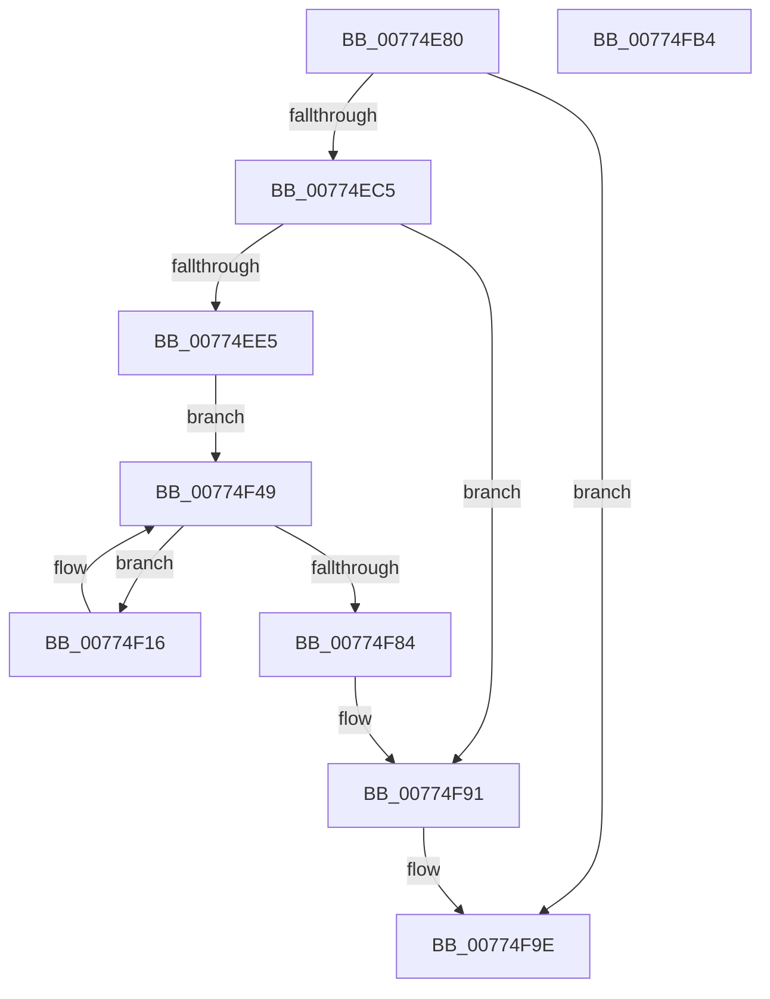

# SshpAlpcMessageCallback

- RVA: `0x00774E80`–`0x00774FB5` (길이 `309` bytes)
- VA: `0x0000000140774E80`
- 실행 섹션: `PAGE`
- PDB 이름 있음: `예`; PDB Function 태그: `아니요`
- unwind 정보 RVA: `0x000CDB24`
- 디코드: `78`개 명령, `309/309` bytes 표시
- 미해석 바이트: `0` (있으면 어셈블리에 `.byte`로 보존)

> 이 문서는 커널 이미지의 기계어와 PDB 기호를 분석해 생성했습니다. 4번과 5번은 함수 원형과 자료형을 바이너리 사용 방식에서 추정한 C 해석이며 원본 소스 복구 결과는 아닙니다.

## 1. Dependencies

- 직접 호출 지점: **11**; 고유 호출 대상: **7**
- 직접 호출자로 확인된 함수: **1**
- RIP 상대 이미지 참조: **1**

### Outgoing calls
- `0x00774EB4` → [ExAllocatePool2](../../poolcode/B8/ExAllocatePool2_function_00B820F0.md) (function, `0x00B820F0`)
- `0x00774ED4` → [ExAllocatePool2](../../poolcode/B8/ExAllocatePool2_function_00B820F0.md) (function, `0x00B820F0`)
- `0x00774EED` → [memset](../../text/6C/memset_function_006C6C40.md) (function, `0x006C6C40`)
- `0x00774EFA` → [memset](../../text/6C/memset_function_006C6C40.md) (function, `0x006C6C40`)
- `0x00774F0F` → [AlpcInitializeMessageAttribute](../../text/45/AlpcInitializeMessageAttribute_function_00450050.md) (function, `0x00450050`)
- `0x00774F1E` → [AlpcGetMessageAttribute](../../text/45/AlpcGetMessageAttribute_function_00450010.md) (function, `0x00450010`)
- `0x00774F29` → [SshpAlpcProcessAlpcMessage](SshpAlpcProcessAlpcMessage_function_0077506C.md) (function, `0x0077506C`)
- `0x00774F3E` → [AlpcInitializeMessageAttribute](../../text/45/AlpcInitializeMessageAttribute_function_00450050.md) (function, `0x00450050`)
- `0x00774F7B` → [ZwAlpcSendWaitReceivePort](../../text/6A/ZwAlpcSendWaitReceivePort_function_006AE290.md) (function, `0x006AE290`)
- `0x00774F8C` → [CmpFreePoolWithTag](../../text/44/CmpFreePoolWithTag_function_004489E0.md) (function, `0x004489E0`)
- `0x00774F99` → [CmpFreePoolWithTag](../../text/44/CmpFreePoolWithTag_function_004489E0.md) (function, `0x004489E0`)

### Direct callers
- [SshpAlpcInitialize](../../init/C4/SshpAlpcInitialize_function_00C448B4.md) at `0x00C44B50`

### Static image references
- `0x00774F49` → RVA `0x00F069C0` (`.data`; read)

## 2. Other-region calls and transfers

- 다른 실행 섹션으로 향하는 call: **10**
  - `0x00774EB4` → [ExAllocatePool2](../../poolcode/B8/ExAllocatePool2_function_00B820F0.md) (`PAGE` → `POOLCODE`)
  - `0x00774ED4` → [ExAllocatePool2](../../poolcode/B8/ExAllocatePool2_function_00B820F0.md) (`PAGE` → `POOLCODE`)
  - `0x00774EED` → [memset](../../text/6C/memset_function_006C6C40.md) (`PAGE` → `.text`)
  - `0x00774EFA` → [memset](../../text/6C/memset_function_006C6C40.md) (`PAGE` → `.text`)
  - `0x00774F0F` → [AlpcInitializeMessageAttribute](../../text/45/AlpcInitializeMessageAttribute_function_00450050.md) (`PAGE` → `.text`)
  - `0x00774F1E` → [AlpcGetMessageAttribute](../../text/45/AlpcGetMessageAttribute_function_00450010.md) (`PAGE` → `.text`)
  - `0x00774F3E` → [AlpcInitializeMessageAttribute](../../text/45/AlpcInitializeMessageAttribute_function_00450050.md) (`PAGE` → `.text`)
  - `0x00774F7B` → [ZwAlpcSendWaitReceivePort](../../text/6A/ZwAlpcSendWaitReceivePort_function_006AE290.md) (`PAGE` → `.text`)
  - `0x00774F8C` → [CmpFreePoolWithTag](../../text/44/CmpFreePoolWithTag_function_004489E0.md) (`PAGE` → `.text`)
  - `0x00774F99` → [CmpFreePoolWithTag](../../text/44/CmpFreePoolWithTag_function_004489E0.md) (`PAGE` → `.text`)
- 별도 외부 분기/꼬리 이동을 확인하지 못했습니다.

## 3. Assembly (complete function range)

```asm
00774E80  48 8B C4                        mov rax, rsp
00774E83  48 89 58 08                     mov qword ptr [rax + 8], rbx
00774E87  48 89 78 10                     mov qword ptr [rax + 0x10], rdi
00774E8B  4C 89 70 18                     mov qword ptr [rax + 0x18], r14
00774E8F  41 57                           push r15
00774E91  48 83 EC 50                     sub rsp, 0x50
00774E95  48 83 60 20 00                  and qword ptr [rax + 0x20], 0
00774E9A  41 BF A0 00 00 00               mov r15d, 0xa0
00774EA0  48 83 60 E8 00                  and qword ptr [rax - 0x18], 0
00774EA5  41 B8 73 73 68 70               mov r8d, 0x70687373
00774EAB  41 8B D7                        mov edx, r15d
00774EAE  41 8D 7F 60                     lea edi, [r15 + 0x60]
00774EB2  8B CF                           mov ecx, edi
00774EB4  E8 37 D2 40 00                  call 0x140b820f0
00774EB9  48 8B D8                        mov rbx, rax
00774EBC  48 85 C0                        test rax, rax
00774EBF  0F 84 D9 00 00 00               je 0x140774f9e
00774EC5  45 8D 77 A0                     lea r14d, [r15 - 0x60]
00774EC9  41 B8 73 73 68 70               mov r8d, 0x70687373
00774ECF  41 8B D6                        mov edx, r14d
00774ED2  8B CF                           mov ecx, edi
00774ED4  E8 17 D2 40 00                  call 0x140b820f0
00774ED9  48 8B F8                        mov rdi, rax
00774EDC  48 85 C0                        test rax, rax
00774EDF  0F 84 AC 00 00 00               je 0x140774f91
00774EE5  45 8B C7                        mov r8d, r15d
00774EE8  33 D2                           xor edx, edx
00774EEA  48 8B CB                        mov rcx, rbx
00774EED  E8 4E 1D F5 FF                  call 0x1406c6c40
00774EF2  45 8B C6                        mov r8d, r14d
00774EF5  33 D2                           xor edx, edx
00774EF7  48 8B CF                        mov rcx, rdi
00774EFA  E8 41 1D F5 FF                  call 0x1406c6c40
00774EFF  4C 8D 4C 24 48                  lea r9, [rsp + 0x48]
00774F04  45 8B C7                        mov r8d, r15d
00774F07  48 8B D3                        mov rdx, rbx
00774F0A  B9 00 00 00 20                  mov ecx, 0x20000000
00774F0F  E8 3C B1 CD FF                  call 0x140450050
00774F14  EB 33                           jmp 0x140774f49
00774F16  BA 00 00 00 20                  mov edx, 0x20000000
00774F1B  48 8B CB                        mov rcx, rbx
00774F1E  E8 ED B0 CD FF                  call 0x140450010
00774F23  48 8B D0                        mov rdx, rax
00774F26  48 8B CF                        mov rcx, rdi
00774F29  E8 3E 01 00 00                  call 0x14077506c
00774F2E  4C 8D 4C 24 48                  lea r9, [rsp + 0x48]
00774F33  4D 8B C7                        mov r8, r15
00774F36  48 8B D3                        mov rdx, rbx
00774F39  B9 00 00 00 20                  mov ecx, 0x20000000
00774F3E  E8 0D B1 CD FF                  call 0x140450050
00774F43  48 83 64 24 40 00               and qword ptr [rsp + 0x40], 0
00774F49  48 8B 0D 70 1A 79 00            mov rcx, qword ptr [rip + 0x791a70]
00774F50  48 8D 44 24 40                  lea rax, [rsp + 0x40]
00774F55  48 89 44 24 38                  mov qword ptr [rsp + 0x38], rax
00774F5A  45 33 C9                        xor r9d, r9d
00774F5D  48 8D 44 24 78                  lea rax, [rsp + 0x78]
00774F62  48 89 5C 24 30                  mov qword ptr [rsp + 0x30], rbx
00774F67  48 89 44 24 28                  mov qword ptr [rsp + 0x28], rax
00774F6C  45 33 C0                        xor r8d, r8d
00774F6F  33 D2                           xor edx, edx
00774F71  48 89 7C 24 20                  mov qword ptr [rsp + 0x20], rdi
00774F76  4C 89 74 24 78                  mov qword ptr [rsp + 0x78], r14
00774F7B  E8 10 93 F3 FF                  call 0x1406ae290
00774F80  85 C0                           test eax, eax
00774F82  74 92                           je 0x140774f16
00774F84  BA 73 73 68 70                  mov edx, 0x70687373
00774F89  48 8B CF                        mov rcx, rdi
00774F8C  E8 4F 3A CD FF                  call 0x1404489e0
00774F91  BA 73 73 68 70                  mov edx, 0x70687373
00774F96  48 8B CB                        mov rcx, rbx
00774F99  E8 42 3A CD FF                  call 0x1404489e0
00774F9E  48 8B 5C 24 60                  mov rbx, qword ptr [rsp + 0x60]
00774FA3  48 8B 7C 24 68                  mov rdi, qword ptr [rsp + 0x68]
00774FA8  4C 8B 74 24 70                  mov r14, qword ptr [rsp + 0x70]
00774FAD  48 83 C4 50                     add rsp, 0x50
00774FB1  41 5F                           pop r15
00774FB3  C3                              ret
00774FB4  CC                              int3
```

## 4. C-style interpretation (structured pseudocode)

```c
__int64 __fastcall SshpAlpcMessageCallback(void)
{
    __int64 result;
    __int64 v_rsp;
    unsigned __int64 v_stack_m10;
    unsigned __int64 v_stack_m18;
    unsigned __int64 v_stack_m20;
    unsigned __int64 v_stack_m28;
    unsigned __int64 v_stack_m30;
    unsigned __int64 v_stack_m38;
    unsigned __int64 v_stack_p10;
    unsigned __int64 v_stack_p18;
    unsigned __int64 v_stack_p20;
    unsigned __int64 v_stack_p8;

    *(unsigned __int64 *)(v_rsp + 8) = v_rbx;
    *(unsigned __int64 *)(v_rsp + 16) = v_rdi;
    *(unsigned __int64 *)(v_rsp + 24) = v_r14;
    v_rsp = (v_rsp) - (80);
    result = ExAllocatePool2((unsigned int)((unsigned int)(160 + 96)), 160, (unsigned int)(0x70687373ULL), a4);
    if (result == 0) goto loc_00774F9E;
    result = ExAllocatePool2((unsigned int)((unsigned int)(160 + 96)), (unsigned int)((unsigned int)(160 - 96)), (unsigned int)(0x70687373ULL), a4);
    if (result == 0) goto loc_00774F91;
    a2 = 0;
    result = memset(result, a2, 160, a4);
    a2 = 0;
    result = memset(result, a2, (unsigned int)((unsigned int)(160 - 96)), a4);
    result = AlpcInitializeMessageAttribute((unsigned int)(0x20000000ULL), result, 160, v_stack_m10);
    goto loc_00774F49;
loc_00774F16:
    result = AlpcGetMessageAttribute(result, (unsigned int)(0x20000000ULL), 160, v_stack_m10);
    result = SshpAlpcProcessAlpcMessage(result, result, 160, v_stack_m10);
    result = AlpcInitializeMessageAttribute((unsigned int)(0x20000000ULL), result, 160, v_stack_m10);
loc_00774F49:
    v_stack_m20 = v_stack_m18;
    a4 = 0;
    v_stack_m28 = result;
    v_stack_m30 = v_stack_p20;
    a3 = 0;
    a2 = 0;
    v_stack_m38 = result;
    v_stack_p20 = 160 - 96;
    result = ZwAlpcSendWaitReceivePort(*(unsigned __int64 *)(v_rip + 7936624), a2, a3, a4);
    if ((unsigned int)(result) == 0) goto loc_00774F16;
    result = CmpFreePoolWithTag(result, (unsigned int)(0x70687373ULL), a3, a4);
loc_00774F91:
    result = CmpFreePoolWithTag(result, (unsigned int)(0x70687373ULL), a3, a4);
loc_00774F9E:
    v_rsp = (v_rsp) + (80);
    return result;
}
```

## 5. (Beta) C Style

```c
void SshpAlpcMessageCallback(void)
{
    int64_t result;
    int64_t local_rsp;
    uint64_t v_stack_m10;
    uint64_t v_stack_m18;
    uint64_t v_stack_m20;
    uint64_t v_stack_m28;
    uint64_t v_stack_m30;
    uint64_t v_stack_m38;
    uint64_t v_stack_p10;
    uint64_t v_stack_p18;
    uint64_t v_stack_p20;
    uint64_t v_stack_p8;

    *(uint64_t *)(local_rsp + 0x8) = local_rbx;
    *(uint64_t *)(local_rsp + 0x10) = local_rdi;
    *(uint64_t *)(local_rsp + 0x18) = local_r14;
    local_rsp = (local_rsp) - (80);
    result = ExAllocatePool2((uint32_t)((uint32_t)(160 + 96)), 160, (uint32_t)(0x70687373ULL), a4);
    if (result == 0) goto loc_00774F9E;
    result = ExAllocatePool2((uint32_t)((uint32_t)(160 + 96)), (uint32_t)((uint32_t)(160 - 96)), (uint32_t)(0x70687373ULL), a4);
    if (result == 0) goto loc_00774F91;
    a2 = 0;
    result = memset(result, a2, 160, a4);
    a2 = 0;
    result = memset(result, a2, (uint32_t)((uint32_t)(160 - 96)), a4);
    result = AlpcInitializeMessageAttribute((uint32_t)(0x20000000ULL), result, 160, v_stack_m10);
    goto loc_00774F49;
loc_00774F16:
    result = AlpcGetMessageAttribute(result, (uint32_t)(0x20000000ULL), 160, v_stack_m10);
    result = SshpAlpcProcessAlpcMessage(result, result, 160, v_stack_m10);
    result = AlpcInitializeMessageAttribute((uint32_t)(0x20000000ULL), result, 160, v_stack_m10);
loc_00774F49:
    v_stack_m20 = v_stack_m18;
    a4 = 0;
    v_stack_m28 = result;
    v_stack_m30 = v_stack_p20;
    a3 = 0;
    a2 = 0;
    v_stack_m38 = result;
    v_stack_p20 = 160 - 96;
    result = ZwAlpcSendWaitReceivePort(*(uint64_t *)(v_rip + 0x791A70), a2, a3, a4);
    if ((uint32_t)(result) == 0) goto loc_00774F16;
    result = CmpFreePoolWithTag(result, (uint32_t)(0x70687373ULL), a3, a4);
loc_00774F91:
    result = CmpFreePoolWithTag(result, (uint32_t)(0x70687373ULL), a3, a4);
loc_00774F9E:
    local_rsp = (local_rsp) + (80);
    return result;
}
```

## 6. Execution-region graph

[열기: 2D/3D 그래프와 함수 탐색 컨트롤 패널](../../../control-panel.html?section=page&rva=0x00774E80&view=graph)

- 2D 그래프는 위에서 아래로 흐르고, 3D 그래프는 빈 공간을 드래그해 회전합니다. Shift+드래그는 이동, 휠은 확대·축소, 함수 노드 선택은 대상 보고서 이동입니다.

### Static fallback


