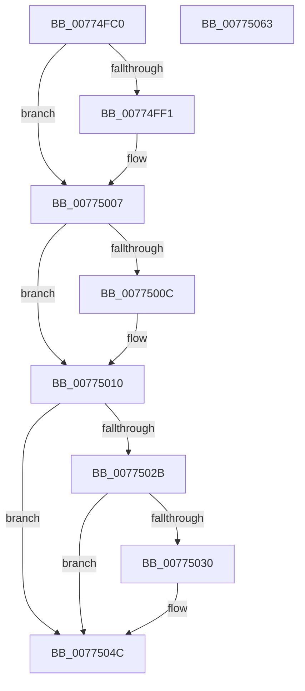

# SshpAlpcOpenGracePeriodWorker

- RVA: `0x00774FC0`–`0x00775064` (길이 `164` bytes)
- VA: `0x0000000140774FC0`
- 실행 섹션: `PAGE`
- PDB 이름 있음: `예`; PDB Function 태그: `아니요`
- unwind 정보 RVA: `0x0008A658`
- 디코드: `41`개 명령, `164/164` bytes 표시
- 미해석 바이트: `0` (있으면 어셈블리에 `.byte`로 보존)

> 이 문서는 커널 이미지의 기계어와 PDB 기호를 분석해 생성했습니다. 4번과 5번은 함수 원형과 자료형을 바이너리 사용 방식에서 추정한 C 해석이며 원본 소스 복구 결과는 아닙니다.

## 1. Dependencies

- 직접 호출 지점: **4**; 고유 호출 대상: **4**
- 직접 호출자로 확인된 함수: **0**
- RIP 상대 이미지 참조: **3**

### Outgoing calls
- `0x00774FDD` → [KeAbPreAcquire](../../text/21/KeAbPreAcquire_function_00210230.md) (function, `0x00210230`)
- `0x00775002` → [ExfAcquirePushLockExclusiveEx](../../text/20/ExfAcquirePushLockExclusiveEx_function_0020FC90.md) (function, `0x0020FC90`)
- `0x00775043` → [SshpAlpcSendMessage](SshpAlpcSendMessage_function_007753E8.md) (function, `0x007753E8`)
- `0x00775053` → [SSHSupportReleasePushLockExclusive](../../text/49/SSHSupportReleasePushLockExclusive_function_004954EC.md) (function, `0x004954EC`)

### Direct callers
- 이 함수 시작 RVA로 연결되는 직접 call은 확인되지 않았습니다. 간접 호출은 완전히 역산할 수 없습니다.

### Static image references
- `0x00774FD0` → RVA `0x00F069C8` (`.data`; read)
- `0x00774FE2` → RVA `0x00F069C8` (`.data`; read/write)
- `0x0077501B` → RVA `0x00F069D8` (`.data`; read)

## 2. Other-region calls and transfers

- 다른 실행 섹션으로 향하는 call: **3**
  - `0x00774FDD` → [KeAbPreAcquire](../../text/21/KeAbPreAcquire_function_00210230.md) (`PAGE` → `.text`)
  - `0x00775002` → [ExfAcquirePushLockExclusiveEx](../../text/20/ExfAcquirePushLockExclusiveEx_function_0020FC90.md) (`PAGE` → `.text`)
  - `0x00775053` → [SSHSupportReleasePushLockExclusive](../../text/49/SSHSupportReleasePushLockExclusive_function_004954EC.md) (`PAGE` → `.text`)
- 별도 외부 분기/꼬리 이동을 확인하지 못했습니다.

## 3. Assembly (complete function range)

```asm
00774FC0  48 89 5C 24 10                  mov qword ptr [rsp + 0x10], rbx
00774FC5  57                              push rdi
00774FC6  48 83 EC 30                     sub rsp, 0x30
00774FCA  48 8B F9                        mov rdi, rcx
00774FCD  45 33 C0                        xor r8d, r8d
00774FD0  48 8D 0D F1 19 79 00            lea rcx, [rip + 0x7919f1]
00774FD7  89 7C 24 40                     mov dword ptr [rsp + 0x40], edi
00774FDB  33 D2                           xor edx, edx
00774FDD  E8 4E B2 A9 FF                  call 0x140210230
00774FE2  F0 48 0F BA 2D DC 19 79 00 00   lock bts qword ptr [rip + 0x7919dc], 0
00774FEC  48 8B D8                        mov rbx, rax
00774FEF  73 16                           jae 0x140775007
00774FF1  4C 8D 05 D0 19 79 00            lea r8, [rip + 0x7919d0]
00774FF8  48 8B D0                        mov rdx, rax
00774FFB  48 8D 0D C6 19 79 00            lea rcx, [rip + 0x7919c6]
00775002  E8 89 AC A9 FF                  call 0x14020fc90
00775007  48 85 DB                        test rbx, rbx
0077500A  74 04                           je 0x140775010
0077500C  C6 43 0A 01                     mov byte ptr [rbx + 0xa], 1
00775010  48 63 C7                        movsxd rax, edi
00775013  48 8D 1C 40                     lea rbx, [rax + rax*2]
00775017  48 C1 E3 06                     shl rbx, 6
0077501B  48 8D 05 B6 19 79 00            lea rax, [rip + 0x7919b6]
00775022  48 03 D8                        add rbx, rax
00775025  80 7B 04 00                     cmp byte ptr [rbx + 4], 0
00775029  74 21                           je 0x14077504c
0077502B  83 3B 00                        cmp dword ptr [rbx], 0
0077502E  75 1C                           jne 0x14077504c
00775030  BA 03 00 00 00                  mov edx, 3
00775035  C6 44 24 20 00                  mov byte ptr [rsp + 0x20], 0
0077503A  4C 8D 4C 24 40                  lea r9, [rsp + 0x40]
0077503F  44 8D 42 01                     lea r8d, [rdx + 1]
00775043  E8 A0 03 00 00                  call 0x1407753e8
00775048  C6 43 04 00                     mov byte ptr [rbx + 4], 0
0077504C  48 8D 0D 75 19 79 00            lea rcx, [rip + 0x791975]
00775053  E8 94 04 D2 FF                  call 0x1404954ec
00775058  48 8B 5C 24 48                  mov rbx, qword ptr [rsp + 0x48]
0077505D  48 83 C4 30                     add rsp, 0x30
00775061  5F                              pop rdi
00775062  C3                              ret
00775063  CC                              int3
```

## 4. C-style interpretation (structured pseudocode)

```c
__int64 __fastcall SshpAlpcOpenGracePeriodWorker(__int64 a1, int a2, int a3)
{
    __int64 result;
    __int64 v_rbx;
    __int64 v_rsp;
    unsigned __int8 v_stack_m18;
    unsigned __int64 v_stack_p10;
    unsigned int v_stack_p8;

    v_stack_p10 = v_rbx;
    v_rsp = (v_rsp) - (48);
    a3 = 0;
    v_stack_p8 = (unsigned int)(a1);
    a2 = 0;
    result = KeAbPreAcquire(v_rip + 7936497, a2, a3, a4);
    if (!(condition_is_above_or_equal)) {
        a3 = v_rip + 7936464;
        a2 = result;
        a1 = v_rip + 7936454;
        result = ExfAcquirePushLockExclusiveEx(a1, a2, a3, a4);
    }
    if (result != 0) {
        *(unsigned __int8 *)(result + 10) = 1;
    }
    v_rbx = ((int)((unsigned int)(a1)) + (int)((unsigned int)(a1)) * 2) << (6);
    v_rbx = (v_rbx) + (v_rip + 7936438);
    if ((*(unsigned __int8 *)(v_rbx + 4)) == 0) goto loc_0077504C;
    result = v_rip + 7936438;
    if ((*(unsigned int *)(v_rbx)) == 0) {
        a2 = 3;
        v_stack_m18 = 0;
        a4 = v_stack_p8;
        a3 = a2 + 1;
        result = SshpAlpcSendMessage(a1, a2, a3, a4);
        *(unsigned __int8 *)(v_rbx + 4) = 0;
    }
    result = SSHSupportReleasePushLockExclusive(v_rip + 7936373, a2, a3, a4);
    v_rsp = (v_rsp) + (48);
    return result;
}
```

## 5. (Beta) C Style

```c
int64_t SshpAlpcOpenGracePeriodWorker(void *Arg1, int32_t Arg2, int32_t Arg3)
{
    uint8_t *arg1 = (uint8_t *)Arg1;

    int64_t result;
    int64_t local_rbx;
    int64_t local_rsp;
    uint8_t v_stack_m18;
    uint64_t v_stack_p10;
    uint32_t v_stack_p8;

    v_stack_p10 = local_rbx;
    local_rsp = (local_rsp) - (48);
    Arg3 = 0;
    v_stack_p8 = (uint32_t)(Arg1);
    Arg2 = 0;
    result = KeAbPreAcquire(v_rip + 7936497, Arg2, Arg3, a4);
    if (!(condition_is_above_or_equal)) {
        Arg3 = v_rip + 7936464;
        Arg2 = result;
        Arg1 = v_rip + 7936454;
        result = ExfAcquirePushLockExclusiveEx(Arg1, Arg2, Arg3, a4);
    }
    if (result != 0) {
        *(uint8_t *)(result + 0xA) = 1;
    }
    local_rbx = ((int32_t)((uint32_t)(Arg1)) + (int32_t)((uint32_t)(Arg1)) * 2) << (6);
    local_rbx = (local_rbx) + (v_rip + 7936438);
    if ((*(uint8_t *)(local_rbx + 0x4)) == 0) goto loc_0077504C;
    result = v_rip + 7936438;
    if ((*(uint32_t *)(local_rbx)) == 0) {
        Arg2 = 3;
        v_stack_m18 = 0;
        a4 = v_stack_p8;
        Arg3 = Arg2 + 1;
        result = SshpAlpcSendMessage(Arg1, Arg2, Arg3, a4);
        *(uint8_t *)(local_rbx + 0x4) = 0;
    }
    result = SSHSupportReleasePushLockExclusive(v_rip + 7936373, Arg2, Arg3, a4);
    local_rsp = (local_rsp) + (48);
    return result;
}
```

### 관측된 메모리 오프셋

구조체 형식이 확인되지 않은 접근은 인자 기준의 오프셋으로만 기록했습니다.

| 기준 인자 | 오프셋 표현 | 폭 (bit) | 접근 |
|---|---:|---:|---|
| `Arg1` | `+ 0x0 + rax*2` | `64` | `R` |

## 6. Execution-region graph

[열기: 2D/3D 그래프와 함수 탐색 컨트롤 패널](../../../control-panel.html?section=page&rva=0x00774FC0&view=graph)

- 2D 그래프는 위에서 아래로 흐르고, 3D 그래프는 빈 공간을 드래그해 회전합니다. Shift+드래그는 이동, 휠은 확대·축소, 함수 노드 선택은 대상 보고서 이동입니다.

### Static fallback


