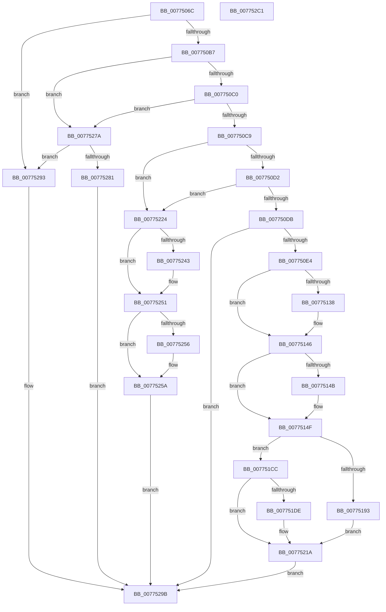

# SshpAlpcProcessAlpcMessage

- RVA: `0x0077506C`–`0x007752C2` (길이 `598` bytes)
- VA: `0x000000014077506C`
- 실행 섹션: `PAGE`
- PDB 이름 있음: `예`; PDB Function 태그: `아니요`
- unwind 정보 RVA: `0x000CDB00`
- 디코드: `149`개 명령, `598/598` bytes 표시
- 미해석 바이트: `0` (있으면 어셈블리에 `.byte`로 보존)

> 이 문서는 커널 이미지의 기계어와 PDB 기호를 분석해 생성했습니다. 4번과 5번은 함수 원형과 자료형을 바이너리 사용 방식에서 추정한 C 해석이며 원본 소스 복구 결과는 아닙니다.

## 1. Dependencies

- 직접 호출 지점: **15**; 고유 호출 대상: **11**
- 직접 호출자로 확인된 함수: **1**
- RIP 상대 이미지 참조: **7**

### Outgoing calls
- `0x0077510C` → [memset](../../text/6C/memset_function_006C6C40.md) (function, `0x006C6C40`)
- `0x00775128` → [KeAbPreAcquire](../../text/21/KeAbPreAcquire_function_00210230.md) (function, `0x00210230`)
- `0x00775141` → [ExfAcquirePushLockExclusiveEx](../../text/20/ExfAcquirePushLockExclusiveEx_function_0020FC90.md) (function, `0x0020FC90`)
- `0x0077518A` → [ZwAlpcAcceptConnectPort](../../text/6A/ZwAlpcAcceptConnectPort_function_006ADFF0.md) (function, `0x006ADFF0`)
- `0x007751C5` → [ZwAlpcAcceptConnectPort](../../text/6A/ZwAlpcAcceptConnectPort_function_006ADFF0.md) (function, `0x006ADFF0`)
- `0x00775203` → [wil_details_FeatureReporting_ReportUsageToService](../../text/53/wil_details_FeatureReporting_ReportUsageToService_function_0053E6E4.md) (function, `0x0053E6E4`)
- `0x00775215` → [wil_details_FeatureStateCache_TryEnableDeviceUsageFastPath](../../text/53/wil_details_FeatureStateCache_TryEnableDeviceUsageFastPath_function_0053E774.md) (function, `0x0053E774`)
- `0x0077521D` → [SSHSupportReleasePushLockExclusive](../../text/49/SSHSupportReleasePushLockExclusive_function_004954EC.md) (function, `0x004954EC`)
- `0x00775233` → [KeAbPreAcquire](../../text/21/KeAbPreAcquire_function_00210230.md) (function, `0x00210230`)
- `0x0077524C` → [ExfAcquirePushLockExclusiveEx](../../text/20/ExfAcquirePushLockExclusiveEx_function_0020FC90.md) (function, `0x0020FC90`)
- `0x0077526B` → [SSHSupportReleasePushLockExclusive](../../text/49/SSHSupportReleasePushLockExclusive_function_004954EC.md) (function, `0x004954EC`)
- `0x00775273` → [ZwClose](../../text/6A/ZwClose_function_006AD2B0.md) (function, `0x006AD2B0`)
- `0x0077528A` → [ZwAlpcCancelMessage](../../text/6A/ZwAlpcCancelMessage_function_006AE010.md) (function, `0x006AE010`)
- `0x00775296` → [SshpAlpcProcessMessage](SshpAlpcProcessMessage_function_007752C8.md) (function, `0x007752C8`)
- `0x007752A4` → [_security_check_cookie](../../text/6A/_security_check_cookie_function_006AC640.md) (function, `0x006AC640`)

### Direct callers
- [SshpAlpcMessageCallback](SshpAlpcMessageCallback_function_00774E80.md) at `0x00774F29`

### Static image references
- `0x00775086` → RVA `0x00E0A740` (`.data`; read)
- `0x00775111` → RVA `0x00F069C8` (`.data`; read)
- `0x0077514F` → RVA `0x00F069D0` (`.data`; read)
- `0x0077515A` → RVA `0x00F069C0` (`.data`; read)
- `0x007751CC` → RVA `0x00FC47A0` (`.data`; read)
- `0x007751F8` → RVA `0x000DD780` (`.rdata`; read)
- `0x00775264` → RVA `0x00F069D0` (`.data`; write)

## 2. Other-region calls and transfers

- 다른 실행 섹션으로 향하는 call: **14**
  - `0x0077510C` → [memset](../../text/6C/memset_function_006C6C40.md) (`PAGE` → `.text`)
  - `0x00775128` → [KeAbPreAcquire](../../text/21/KeAbPreAcquire_function_00210230.md) (`PAGE` → `.text`)
  - `0x00775141` → [ExfAcquirePushLockExclusiveEx](../../text/20/ExfAcquirePushLockExclusiveEx_function_0020FC90.md) (`PAGE` → `.text`)
  - `0x0077518A` → [ZwAlpcAcceptConnectPort](../../text/6A/ZwAlpcAcceptConnectPort_function_006ADFF0.md) (`PAGE` → `.text`)
  - `0x007751C5` → [ZwAlpcAcceptConnectPort](../../text/6A/ZwAlpcAcceptConnectPort_function_006ADFF0.md) (`PAGE` → `.text`)
  - `0x00775203` → [wil_details_FeatureReporting_ReportUsageToService](../../text/53/wil_details_FeatureReporting_ReportUsageToService_function_0053E6E4.md) (`PAGE` → `.text`)
  - `0x00775215` → [wil_details_FeatureStateCache_TryEnableDeviceUsageFastPath](../../text/53/wil_details_FeatureStateCache_TryEnableDeviceUsageFastPath_function_0053E774.md) (`PAGE` → `.text`)
  - `0x0077521D` → [SSHSupportReleasePushLockExclusive](../../text/49/SSHSupportReleasePushLockExclusive_function_004954EC.md) (`PAGE` → `.text`)
  - `0x00775233` → [KeAbPreAcquire](../../text/21/KeAbPreAcquire_function_00210230.md) (`PAGE` → `.text`)
  - `0x0077524C` → [ExfAcquirePushLockExclusiveEx](../../text/20/ExfAcquirePushLockExclusiveEx_function_0020FC90.md) (`PAGE` → `.text`)
  - `0x0077526B` → [SSHSupportReleasePushLockExclusive](../../text/49/SSHSupportReleasePushLockExclusive_function_004954EC.md) (`PAGE` → `.text`)
  - `0x00775273` → [ZwClose](../../text/6A/ZwClose_function_006AD2B0.md) (`PAGE` → `.text`)
  - `0x0077528A` → [ZwAlpcCancelMessage](../../text/6A/ZwAlpcCancelMessage_function_006AE010.md) (`PAGE` → `.text`)
  - `0x007752A4` → [_security_check_cookie](../../text/6A/_security_check_cookie_function_006AC640.md) (`PAGE` → `.text`)
- 별도 외부 분기/꼬리 이동을 확인하지 못했습니다.

## 3. Assembly (complete function range)

```asm
0077506C  48 89 5C 24 18                  mov qword ptr [rsp + 0x18], rbx
00775071  48 89 74 24 20                  mov qword ptr [rsp + 0x20], rsi
00775076  55                              push rbp
00775077  57                              push rdi
00775078  41 56                           push r14
0077507A  48 8D 6C 24 B9                  lea rbp, [rsp - 0x47]
0077507F  48 81 EC F0 00 00 00            sub rsp, 0xf0
00775086  48 8B 05 B3 56 69 00            mov rax, qword ptr [rip + 0x6956b3]
0077508D  48 33 C4                        xor rax, rsp
00775090  48 89 45 37                     mov qword ptr [rbp + 0x37], rax
00775094  4C 8B F1                        mov r14, rcx
00775097  33 FF                           xor edi, edi
00775099  4C 8B C2                        mov r8, rdx
0077509C  89 7D B3                        mov dword ptr [rbp - 0x4d], edi
0077509F  0F B7 51 04                     movzx edx, word ptr [rcx + 4]
007750A3  8B CA                           mov ecx, edx
007750A5  89 7D CB                        mov dword ptr [rbp - 0x35], edi
007750A8  81 E1 FF 00 FF FF               and ecx, 0xffff00ff
007750AE  83 E9 01                        sub ecx, 1
007750B1  0F 84 DC 01 00 00               je 0x140775293
007750B7  83 E9 01                        sub ecx, 1
007750BA  0F 84 BA 01 00 00               je 0x14077527a
007750C0  83 E9 01                        sub ecx, 1
007750C3  0F 84 B1 01 00 00               je 0x14077527a
007750C9  83 E9 02                        sub ecx, 2
007750CC  0F 84 52 01 00 00               je 0x140775224
007750D2  83 E9 01                        sub ecx, 1
007750D5  0F 84 49 01 00 00               je 0x140775224
007750DB  83 F9 04                        cmp ecx, 4
007750DE  0F 85 B7 01 00 00               jne 0x14077529b
007750E4  0F 57 C0                        xorps xmm0, xmm0
007750E7  C7 45 AF 30 00 00 00            mov dword ptr [rbp - 0x51], 0x30
007750EE  33 D2                           xor edx, edx
007750F0  48 89 7D B7                     mov qword ptr [rbp - 0x49], rdi
007750F4  44 8D 47 48                     lea r8d, [rdi + 0x48]
007750F8  C7 45 C7 00 02 00 00            mov dword ptr [rbp - 0x39], 0x200
007750FF  48 8D 4D E7                     lea rcx, [rbp - 0x19]
00775103  48 89 7D BF                     mov qword ptr [rbp - 0x41], rdi
00775107  F3 0F 7F 45 CF                  movdqu xmmword ptr [rbp - 0x31], xmm0
0077510C  E8 2F 1B F5 FF                  call 0x1406c6c40
00775111  48 8D 35 B0 18 79 00            lea rsi, [rip + 0x7918b0]
00775118  48 C7 45 F7 40 00 00 00         mov qword ptr [rbp - 9], 0x40
00775120  48 8B CE                        mov rcx, rsi
00775123  45 33 C0                        xor r8d, r8d
00775126  33 D2                           xor edx, edx
00775128  E8 03 B1 A9 FF                  call 0x140210230
0077512D  F0 48 0F BA 2E 00               lock bts qword ptr [rsi], 0
00775133  48 8B D8                        mov rbx, rax
00775136  73 0E                           jae 0x140775146
00775138  4C 8B C6                        mov r8, rsi
0077513B  48 8B D0                        mov rdx, rax
0077513E  48 8B CE                        mov rcx, rsi
00775141  E8 4A AB A9 FF                  call 0x14020fc90
00775146  48 85 DB                        test rbx, rbx
00775149  74 04                           je 0x14077514f
0077514B  C6 43 0A 01                     mov byte ptr [rbx + 0xa], 1
0077514F  48 39 3D 7A 18 79 00            cmp qword ptr [rip + 0x79187a], rdi
00775156  4C 8D 4D AF                     lea r9, [rbp - 0x51]
0077515A  48 8B 15 5F 18 79 00            mov rdx, qword ptr [rip + 0x79185f]
00775161  48 8D 0D 68 18 79 00            lea rcx, [rip + 0x791868]
00775168  0F 94 C0                        sete al
0077516B  45 33 C0                        xor r8d, r8d
0077516E  88 44 24 40                     mov byte ptr [rsp + 0x40], al
00775172  48 8D 45 E7                     lea rax, [rbp - 0x19]
00775176  48 89 7C 24 38                  mov qword ptr [rsp + 0x38], rdi
0077517B  4C 89 74 24 30                  mov qword ptr [rsp + 0x30], r14
00775180  48 89 7C 24 28                  mov qword ptr [rsp + 0x28], rdi
00775185  48 89 44 24 20                  mov qword ptr [rsp + 0x20], rax
0077518A  E8 61 8E F3 FF                  call 0x1406adff0
0077518F  85 C0                           test eax, eax
00775191  79 39                           jns 0x1407751cc
00775193  48 8B 15 26 18 79 00            mov rdx, qword ptr [rip + 0x791826]
0077519A  48 8D 45 E7                     lea rax, [rbp - 0x19]
0077519E  40 88 7C 24 40                  mov byte ptr [rsp + 0x40], dil
007751A3  4C 8D 4D AF                     lea r9, [rbp - 0x51]
007751A7  48 89 7C 24 38                  mov qword ptr [rsp + 0x38], rdi
007751AC  48 8D 0D 1D 18 79 00            lea rcx, [rip + 0x79181d]
007751B3  4C 89 74 24 30                  mov qword ptr [rsp + 0x30], r14
007751B8  45 33 C0                        xor r8d, r8d
007751BB  48 89 7C 24 28                  mov qword ptr [rsp + 0x28], rdi
007751C0  48 89 44 24 20                  mov qword ptr [rsp + 0x20], rax
007751C5  E8 26 8E F3 FF                  call 0x1406adff0
007751CA  EB 4E                           jmp 0x14077521a
007751CC  8B 0D CE F5 84 00               mov ecx, dword ptr [rip + 0x84f5ce]
007751D2  48 89 7D A7                     mov qword ptr [rbp - 0x59], rdi
007751D6  89 4D A7                        mov dword ptr [rbp - 0x59], ecx
007751D9  F6 C1 10                        test cl, 0x10
007751DC  75 3C                           jne 0x14077521a
007751DE  48 8B 45 A7                     mov rax, qword ptr [rbp - 0x59]
007751E2  83 C9 01                        or ecx, 1
007751E5  48 89 45 A7                     mov qword ptr [rbp - 0x59], rax
007751E9  BB 03 00 00 00                  mov ebx, 3
007751EE  89 4D A7                        mov dword ptr [rbp - 0x59], ecx
007751F1  44 8B C3                        mov r8d, ebx
007751F4  48 8B 55 A7                     mov rdx, qword ptr [rbp - 0x59]
007751F8  48 8D 0D 81 85 96 FF            lea rcx, [rip - 0x697a7f]
007751FF  44 8D 4B FE                     lea r9d, [rbx - 2]
00775203  E8 DC 94 DC FF                  call 0x14053e6e4
00775208  48 8B 4D A7                     mov rcx, qword ptr [rbp - 0x59]
0077520C  4C 8D 05 6D 85 96 FF            lea r8, [rip - 0x697a93]
00775213  8B D3                           mov edx, ebx
00775215  E8 5A 95 DC FF                  call 0x14053e774
0077521A  48 8B CE                        mov rcx, rsi
0077521D  E8 CA 02 D2 FF                  call 0x1404954ec
00775222  EB 77                           jmp 0x14077529b
00775224  48 8D 35 9D 17 79 00            lea rsi, [rip + 0x79179d]
0077522B  45 33 C0                        xor r8d, r8d
0077522E  48 8B CE                        mov rcx, rsi
00775231  33 D2                           xor edx, edx
00775233  E8 F8 AF A9 FF                  call 0x140210230
00775238  F0 48 0F BA 2E 00               lock bts qword ptr [rsi], 0
0077523E  48 8B D8                        mov rbx, rax
00775241  73 0E                           jae 0x140775251
00775243  4C 8B C6                        mov r8, rsi
00775246  48 8B D0                        mov rdx, rax
00775249  48 8B CE                        mov rcx, rsi
0077524C  E8 3F AA A9 FF                  call 0x14020fc90
00775251  48 85 DB                        test rbx, rbx
00775254  74 04                           je 0x14077525a
00775256  C6 43 0A 01                     mov byte ptr [rbx + 0xa], 1
0077525A  48 8B 1D 6F 17 79 00            mov rbx, qword ptr [rip + 0x79176f]
00775261  48 8B CE                        mov rcx, rsi
00775264  48 89 3D 65 17 79 00            mov qword ptr [rip + 0x791765], rdi
0077526B  E8 7C 02 D2 FF                  call 0x1404954ec
00775270  48 8B CB                        mov rcx, rbx
00775273  E8 38 80 F3 FF                  call 0x1406ad2b0
00775278  EB 21                           jmp 0x14077529b
0077527A  66 0F BA E2 0D                  bt dx, 0xd
0077527F  73 12                           jae 0x140775293
00775281  48 8B 0D 38 17 79 00            mov rcx, qword ptr [rip + 0x791738]
00775288  33 D2                           xor edx, edx
0077528A  E8 81 8D F3 FF                  call 0x1406ae010
0077528F  8B F8                           mov edi, eax
00775291  EB 08                           jmp 0x14077529b
00775293  49 8B CE                        mov rcx, r14
00775296  E8 2D 00 00 00                  call 0x1407752c8
0077529B  8B C7                           mov eax, edi
0077529D  48 8B 4D 37                     mov rcx, qword ptr [rbp + 0x37]
007752A1  48 33 CC                        xor rcx, rsp
007752A4  E8 97 73 F3 FF                  call 0x1406ac640
007752A9  4C 8D 9C 24 F0 00 00 00         lea r11, [rsp + 0xf0]
007752B1  49 8B 5B 30                     mov rbx, qword ptr [r11 + 0x30]
007752B5  49 8B 73 38                     mov rsi, qword ptr [r11 + 0x38]
007752B9  49 8B E3                        mov rsp, r11
007752BC  41 5E                           pop r14
007752BE  5F                              pop rdi
007752BF  5D                              pop rbp
007752C0  C3                              ret
007752C1  CC                              int3
```

## 4. C-style interpretation (structured pseudocode)

```c
__int64 __fastcall SshpAlpcProcessAlpcMessage(__int64 a1, __int64 a2)
{
    __int64 result;
    __int64 v_rbx;
    __int64 v_rdi;
    __int64 v_rsp;
    unsigned __int64 v_stack_m18;
    unsigned __int64 v_stack_m28;
    unsigned __int64 v_stack_m5F;
    unsigned __int64 v_stack_m68;
    unsigned __int64 v_stack_m78;
    unsigned __int64 v_stack_m90;
    unsigned int v_stack_m94;
    unsigned int v_stack_m98;
    unsigned __int64 v_stack_mA0;
    unsigned __int64 v_stack_mA8;
    unsigned int v_stack_mAC;
    unsigned int v_stack_mB0;
    unsigned __int64 v_stack_mB8;
    unsigned __int8 v_stack_mC8;
    unsigned __int64 v_stack_mD0;
    unsigned __int64 v_stack_mD8;
    unsigned __int64 v_stack_mE0;
    unsigned __int64 v_stack_mE8;
    unsigned __int64 v_stack_p18;
    unsigned __int64 v_stack_p20;

    v_stack_p18 = v_rbx;
    v_stack_p20 = v_rsi;
    v_rsp = (v_rsp) - (240);
    result = (*(unsigned __int64 *)(v_rip + 6903475)) ^ (v_rsp);
    v_stack_m28 = result;
    v_rdi = 0;
    v_stack_mAC = 0;
    v_stack_m94 = 0;
    a1 = (unsigned int)(((unsigned int)((unsigned int)(*(unsigned __int16 *)(a1 + 4)))) & (0xFFFF00FFULL));
    a1 = (unsigned int)((a1) - (1));
    if (condition_is_equal) goto loc_00775293;
    a1 = (unsigned int)((a1) - (1));
    if (condition_is_equal) goto loc_0077527A;
    a1 = (unsigned int)((a1) - (1));
    if (condition_is_equal) goto loc_0077527A;
    a1 = (unsigned int)((a1) - (2));
    if (condition_is_equal) goto loc_00775224;
    a1 = (unsigned int)((a1) - (1));
    if (condition_is_equal) goto loc_00775224;
    if (((unsigned int)(a1)) != 4) goto loc_0077529B;
    v_stack_mB0 = 48;
    a2 = 0;
    v_stack_mA8 = 0;
    v_stack_m98 = 512;
    v_stack_mA0 = 0;
    v_stack_m90 = v_xmm0;
    result = memset(v_stack_m78, a2, v_rdi + 72, a4);
    v_stack_m68 = 64;
    a3 = 0;
    a2 = 0;
    result = KeAbPreAcquire(v_rip + 7936176, a2, a3, a4);
    if (!(condition_is_above_or_equal)) {
        a3 = v_rip + 7936176;
        a2 = result;
        a1 = v_rip + 7936176;
        result = ExfAcquirePushLockExclusiveEx(a1, a2, a3, a4);
    }
    if (result != 0) {
        *(unsigned __int8 *)(result + 10) = 1;
    }
    result = ((*(unsigned __int64 *)(v_rip + 7936122)) == 0) ? 1 : 0;
    a3 = 0;
    v_stack_mC8 = (unsigned __int8)(result);
    v_stack_mD0 = 0;
    v_stack_mD8 = a1;
    v_stack_mE0 = 0;
    v_stack_mE8 = v_stack_m78;
    result = ZwAlpcAcceptConnectPort(v_rip + 7936104, *(unsigned __int64 *)(v_rip + 7936095), a3, v_stack_mB0);
    if (!sign_flag) goto loc_007751CC;
    v_stack_mC8 = 0;
    v_stack_mD0 = 0;
    v_stack_mD8 = a1;
    a3 = 0;
    v_stack_mE0 = 0;
    v_stack_mE8 = v_stack_m78;
    result = ZwAlpcAcceptConnectPort(v_rip + 7936029, *(unsigned __int64 *)(v_rip + 7936038), a3, v_stack_mB0);
    goto loc_0077521A;
loc_007751CC:
    v_stack_mB8 = 0;
    v_stack_mB8 = (unsigned int)((unsigned int)(*(unsigned int *)(v_rip + 8713678)));
    v_rbx = result;
    if ((((unsigned __int8)((unsigned int)(*(unsigned int *)(v_rip + 8713678)))) & (16)) == 0) {
        result = v_stack_mB8;
        a1 = (unsigned int)(((unsigned int)(*(unsigned int *)(v_rip + 8713678))) | (1));
        v_stack_mB8 = result;
        v_rbx = 3;
        v_stack_mB8 = (unsigned int)(a1);
        a3 = (unsigned int)(v_rbx);
        a2 = v_stack_mB8;
        a1 = v_rip - 6912639;
        a4 = v_rbx - 2;
        result = wil_details_FeatureReporting_ReportUsageToService(a1, a2, a3, a4);
        a1 = v_stack_mB8;
        a3 = v_rip - 6912659;
        a2 = (unsigned int)(v_rbx);
        result = wil_details_FeatureStateCache_TryEnableDeviceUsageFastPath(a1, a2, a3, a4);
    }
    result = SSHSupportReleasePushLockExclusive(v_rip + 7936176, a2, a3, a4);
    goto loc_0077529B;
loc_00775224:
    a3 = 0;
    a2 = 0;
    result = KeAbPreAcquire(v_rip + 7935901, a2, a3, a4);
    if (!(condition_is_above_or_equal)) {
        a3 = v_rip + 7935901;
        a2 = result;
        a1 = v_rip + 7935901;
        result = ExfAcquirePushLockExclusiveEx(a1, a2, a3, a4);
    }
    if (result != 0) {
        *(unsigned __int8 *)(result + 10) = 1;
    }
    *(unsigned __int64 *)(v_rip + 7935845) = 0;
    result = SSHSupportReleasePushLockExclusive(v_rip + 7935901, a2, a3, a4);
    result = ZwClose(*(unsigned __int64 *)(v_rip + 7935855), a2, a3, a4);
    goto loc_0077529B;
loc_0077527A:
    if (condition_is_above_or_equal) goto loc_00775293;
    a2 = 0;
    result = ZwAlpcCancelMessage(*(unsigned __int64 *)(v_rip + 7935800), a2, a3, a4);
    goto loc_0077529B;
loc_00775293:
    result = SshpAlpcProcessMessage(a1, a2, a3, a4);
loc_0077529B:
    a1 = (v_stack_m28) ^ (v_rsp);
    result = _security_check_cookie(a1, a2, a3, a4);
    return result;
}
```

## 5. (Beta) C Style

```c
int64_t SshpAlpcProcessAlpcMessage(void *Arg1, int64_t Arg2)
{
    uint8_t *arg1 = (uint8_t *)Arg1;

    int64_t result;
    int64_t local_rbx;
    int64_t local_rdi;
    int64_t local_rsp;
    uint64_t v_stack_m18;
    uint64_t v_stack_m28;
    uint64_t v_stack_m5F;
    uint64_t v_stack_m68;
    uint64_t v_stack_m78;
    uint64_t v_stack_m90;
    uint32_t v_stack_m94;
    uint32_t v_stack_m98;
    uint64_t v_stack_mA0;
    uint64_t v_stack_mA8;
    uint32_t v_stack_mAC;
    uint32_t v_stack_mB0;
    uint64_t v_stack_mB8;
    uint8_t v_stack_mC8;
    uint64_t v_stack_mD0;
    uint64_t v_stack_mD8;
    uint64_t v_stack_mE0;
    uint64_t v_stack_mE8;
    uint64_t v_stack_p18;
    uint64_t v_stack_p20;

    v_stack_p18 = local_rbx;
    v_stack_p20 = local_rsi;
    local_rsp = (local_rsp) - (240);
    result = (*(uint64_t *)(v_rip + 0x6956B3)) ^ (local_rsp);
    v_stack_m28 = result;
    local_rdi = 0;
    v_stack_mAC = 0;
    v_stack_m94 = 0;
    Arg1 = (uint32_t)(((uint32_t)((uint32_t)(*(uint16_t *)(arg1 + 0x4)))) & (0xFFFF00FFULL));
    Arg1 = (uint32_t)((Arg1) - (1));
    if (condition_is_equal) goto loc_00775293;
    Arg1 = (uint32_t)((Arg1) - (1));
    if (condition_is_equal) goto loc_0077527A;
    Arg1 = (uint32_t)((Arg1) - (1));
    if (condition_is_equal) goto loc_0077527A;
    Arg1 = (uint32_t)((Arg1) - (2));
    if (condition_is_equal) goto loc_00775224;
    Arg1 = (uint32_t)((Arg1) - (1));
    if (condition_is_equal) goto loc_00775224;
    if (((uint32_t)(Arg1)) != 4) goto loc_0077529B;
    v_stack_mB0 = 48;
    Arg2 = 0;
    v_stack_mA8 = 0;
    v_stack_m98 = 512;
    v_stack_mA0 = 0;
    v_stack_m90 = v_xmm0;
    result = memset(v_stack_m78, Arg2, local_rdi + 72, a4);
    v_stack_m68 = 64;
    a3 = 0;
    Arg2 = 0;
    result = KeAbPreAcquire(v_rip + 7936176, Arg2, a3, a4);
    if (!(condition_is_above_or_equal)) {
        a3 = v_rip + 7936176;
        Arg2 = result;
        Arg1 = v_rip + 7936176;
        result = ExfAcquirePushLockExclusiveEx(Arg1, Arg2, a3, a4);
    }
    if (result != 0) {
        *(uint8_t *)(result + 0xA) = 1;
    }
    result = ((*(uint64_t *)(v_rip + 0x79187A)) == 0) ? 1 : 0;
    a3 = 0;
    v_stack_mC8 = (uint8_t)(result);
    v_stack_mD0 = 0;
    v_stack_mD8 = Arg1;
    v_stack_mE0 = 0;
    v_stack_mE8 = v_stack_m78;
    result = ZwAlpcAcceptConnectPort(v_rip + 7936104, *(uint64_t *)(v_rip + 0x79185F), a3, v_stack_mB0);
    if (!sign_flag) goto loc_007751CC;
    v_stack_mC8 = 0;
    v_stack_mD0 = 0;
    v_stack_mD8 = Arg1;
    a3 = 0;
    v_stack_mE0 = 0;
    v_stack_mE8 = v_stack_m78;
    result = ZwAlpcAcceptConnectPort(v_rip + 7936029, *(uint64_t *)(v_rip + 0x791826), a3, v_stack_mB0);
    goto loc_0077521A;
loc_007751CC:
    v_stack_mB8 = 0;
    v_stack_mB8 = (uint32_t)((uint32_t)(*(uint32_t *)(v_rip + 0x84F5CE)));
    local_rbx = result;
    if ((((uint8_t)((uint32_t)(*(uint32_t *)(v_rip + 0x84F5CE)))) & (16)) == 0) {
        result = v_stack_mB8;
        Arg1 = (uint32_t)(((uint32_t)(*(uint32_t *)(v_rip + 0x84F5CE))) | (1));
        v_stack_mB8 = result;
        local_rbx = 3;
        v_stack_mB8 = (uint32_t)(Arg1);
        a3 = (uint32_t)(local_rbx);
        Arg2 = v_stack_mB8;
        Arg1 = v_rip - 6912639;
        a4 = local_rbx - 2;
        result = wil_details_FeatureReporting_ReportUsageToService(Arg1, Arg2, a3, a4);
        Arg1 = v_stack_mB8;
        a3 = v_rip - 6912659;
        Arg2 = (uint32_t)(local_rbx);
        result = wil_details_FeatureStateCache_TryEnableDeviceUsageFastPath(Arg1, Arg2, a3, a4);
    }
    result = SSHSupportReleasePushLockExclusive(v_rip + 7936176, Arg2, a3, a4);
    goto loc_0077529B;
loc_00775224:
    a3 = 0;
    Arg2 = 0;
    result = KeAbPreAcquire(v_rip + 7935901, Arg2, a3, a4);
    if (!(condition_is_above_or_equal)) {
        a3 = v_rip + 7935901;
        Arg2 = result;
        Arg1 = v_rip + 7935901;
        result = ExfAcquirePushLockExclusiveEx(Arg1, Arg2, a3, a4);
    }
    if (result != 0) {
        *(uint8_t *)(result + 0xA) = 1;
    }
    *(uint64_t *)(v_rip + 0x791765) = 0;
    result = SSHSupportReleasePushLockExclusive(v_rip + 7935901, Arg2, a3, a4);
    result = ZwClose(*(uint64_t *)(v_rip + 0x79176F), Arg2, a3, a4);
    goto loc_0077529B;
loc_0077527A:
    if (condition_is_above_or_equal) goto loc_00775293;
    Arg2 = 0;
    result = ZwAlpcCancelMessage(*(uint64_t *)(v_rip + 0x791738), Arg2, a3, a4);
    goto loc_0077529B;
loc_00775293:
    result = SshpAlpcProcessMessage(Arg1, Arg2, a3, a4);
loc_0077529B:
    Arg1 = (v_stack_m28) ^ (local_rsp);
    result = _security_check_cookie(Arg1, Arg2, a3, a4);
    return result;
}
```

### 관측된 메모리 오프셋

구조체 형식이 확인되지 않은 접근은 인자 기준의 오프셋으로만 기록했습니다.

| 기준 인자 | 오프셋 표현 | 폭 (bit) | 접근 |
|---|---:|---:|---|
| `Arg1` | `+ 0x4` | `16` | `R` |

## 6. Execution-region graph

[열기: 2D/3D 그래프와 함수 탐색 컨트롤 패널](../../../control-panel.html?section=page&rva=0x0077506C&view=graph)

- 2D 그래프는 위에서 아래로 흐르고, 3D 그래프는 빈 공간을 드래그해 회전합니다. Shift+드래그는 이동, 휠은 확대·축소, 함수 노드 선택은 대상 보고서 이동입니다.

### Static fallback


