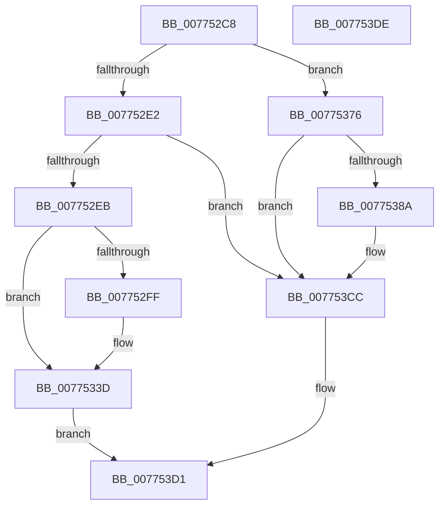

# SshpAlpcProcessMessage

- RVA: `0x007752C8`–`0x007753DF` (길이 `279` bytes)
- VA: `0x00000001407752C8`
- 실행 섹션: `PAGE`
- PDB 이름 있음: `예`; PDB Function 태그: `아니요`
- unwind 정보 RVA: `0x000BED58`
- 디코드: `66`개 명령, `279/279` bytes 표시
- 미해석 바이트: `0` (있으면 어셈블리에 `.byte`로 보존)

> 이 문서는 커널 이미지의 기계어와 PDB 기호를 분석해 생성했습니다. 4번과 5번은 함수 원형과 자료형을 바이너리 사용 방식에서 추정한 C 해석이며 원본 소스 복구 결과는 아닙니다.

## 1. Dependencies

- 직접 호출 지점: **6**; 고유 호출 대상: **4**
- 직접 호출자로 확인된 함수: **1**
- RIP 상대 이미지 참조: **3**

### Outgoing calls
- `0x00775324` → [wil_details_FeatureReporting_ReportUsageToService](../../text/53/wil_details_FeatureReporting_ReportUsageToService_function_0053E6E4.md) (function, `0x0053E6E4`)
- `0x00775338` → [wil_details_FeatureStateCache_TryEnableDeviceUsageFastPath](../../text/53/wil_details_FeatureStateCache_TryEnableDeviceUsageFastPath_function_0053E774.md) (function, `0x0053E774`)
- `0x00775341` → [SshpSessionManagerOpenControlTrace](SshpSessionManagerOpenControlTrace_function_007744C0.md) (function, `0x007744C0`)
- `0x0077536F` → [ZwAlpcSendWaitReceivePort](../../text/6A/ZwAlpcSendWaitReceivePort_function_006AE290.md) (function, `0x006AE290`)
- `0x007753B1` → [wil_details_FeatureReporting_ReportUsageToService](../../text/53/wil_details_FeatureReporting_ReportUsageToService_function_0053E6E4.md) (function, `0x0053E6E4`)
- `0x007753C7` → [wil_details_FeatureStateCache_TryEnableDeviceUsageFastPath](../../text/53/wil_details_FeatureStateCache_TryEnableDeviceUsageFastPath_function_0053E774.md) (function, `0x0053E774`)

### Direct callers
- [SshpAlpcProcessAlpcMessage](SshpAlpcProcessAlpcMessage_function_0077506C.md) at `0x00775296`

### Static image references
- `0x007752EB` → RVA `0x00FC47A0` (`.data`; read)
- `0x0077531D` → RVA `0x000DD780` (`.rdata`; read)
- `0x00775354` → RVA `0x00F069D0` (`.data`; read)

## 2. Other-region calls and transfers

- 다른 실행 섹션으로 향하는 call: **5**
  - `0x00775324` → [wil_details_FeatureReporting_ReportUsageToService](../../text/53/wil_details_FeatureReporting_ReportUsageToService_function_0053E6E4.md) (`PAGE` → `.text`)
  - `0x00775338` → [wil_details_FeatureStateCache_TryEnableDeviceUsageFastPath](../../text/53/wil_details_FeatureStateCache_TryEnableDeviceUsageFastPath_function_0053E774.md) (`PAGE` → `.text`)
  - `0x0077536F` → [ZwAlpcSendWaitReceivePort](../../text/6A/ZwAlpcSendWaitReceivePort_function_006AE290.md) (`PAGE` → `.text`)
  - `0x007753B1` → [wil_details_FeatureReporting_ReportUsageToService](../../text/53/wil_details_FeatureReporting_ReportUsageToService_function_0053E6E4.md) (`PAGE` → `.text`)
  - `0x007753C7` → [wil_details_FeatureStateCache_TryEnableDeviceUsageFastPath](../../text/53/wil_details_FeatureStateCache_TryEnableDeviceUsageFastPath_function_0053E774.md) (`PAGE` → `.text`)
- 별도 외부 분기/꼬리 이동을 확인하지 못했습니다.

## 3. Assembly (complete function range)

```asm
007752C8  48 89 5C 24 10                  mov qword ptr [rsp + 0x10], rbx
007752CD  57                              push rdi
007752CE  48 83 EC 40                     sub rsp, 0x40
007752D2  48 8B F9                        mov rdi, rcx
007752D5  33 DB                           xor ebx, ebx
007752D7  8B 49 28                        mov ecx, dword ptr [rcx + 0x28]
007752DA  85 C9                           test ecx, ecx
007752DC  0F 84 94 00 00 00               je 0x140775376
007752E2  83 F9 01                        cmp ecx, 1
007752E5  0F 85 E1 00 00 00               jne 0x1407753cc
007752EB  8B 0D AF F4 84 00               mov ecx, dword ptr [rip + 0x84f4af]
007752F1  48 89 5C 24 50                  mov qword ptr [rsp + 0x50], rbx
007752F6  89 4C 24 50                     mov dword ptr [rsp + 0x50], ecx
007752FA  F6 C1 10                        test cl, 0x10
007752FD  75 3E                           jne 0x14077533d
007752FF  48 8B 44 24 50                  mov rax, qword ptr [rsp + 0x50]
00775304  44 8D 4B 01                     lea r9d, [rbx + 1]
00775308  83 C9 01                        or ecx, 1
0077530B  48 89 44 24 50                  mov qword ptr [rsp + 0x50], rax
00775310  89 4C 24 50                     mov dword ptr [rsp + 0x50], ecx
00775314  44 8D 43 03                     lea r8d, [rbx + 3]
00775318  48 8B 54 24 50                  mov rdx, qword ptr [rsp + 0x50]
0077531D  48 8D 0D 5C 84 96 FF            lea rcx, [rip - 0x697ba4]
00775324  E8 BB 93 DC FF                  call 0x14053e6e4
00775329  48 8B 4C 24 50                  mov rcx, qword ptr [rsp + 0x50]
0077532E  4C 8D 05 4B 84 96 FF            lea r8, [rip - 0x697bb5]
00775335  8D 53 03                        lea edx, [rbx + 3]
00775338  E8 37 94 DC FF                  call 0x14053e774
0077533D  48 8B 4F 30                     mov rcx, qword ptr [rdi + 0x30]
00775341  E8 7A F1 FF FF                  call 0x1407744c0
00775346  48 89 5C 24 38                  mov qword ptr [rsp + 0x38], rbx
0077534B  45 33 C9                        xor r9d, r9d
0077534E  89 47 30                        mov dword ptr [rdi + 0x30], eax
00775351  4C 8B C7                        mov r8, rdi
00775354  48 8B 0D 75 16 79 00            mov rcx, qword ptr [rip + 0x791675]
0077535B  BA 00 00 01 00                  mov edx, 0x10000
00775360  48 89 5C 24 30                  mov qword ptr [rsp + 0x30], rbx
00775365  48 89 5C 24 28                  mov qword ptr [rsp + 0x28], rbx
0077536A  48 89 5C 24 20                  mov qword ptr [rsp + 0x20], rbx
0077536F  E8 1C 8F F3 FF                  call 0x1406ae290
00775374  EB 5B                           jmp 0x1407753d1
00775376  8B 0D 24 F4 84 00               mov ecx, dword ptr [rip + 0x84f424]
0077537C  48 89 5C 24 50                  mov qword ptr [rsp + 0x50], rbx
00775381  89 4C 24 50                     mov dword ptr [rsp + 0x50], ecx
00775385  F6 C1 10                        test cl, 0x10
00775388  75 42                           jne 0x1407753cc
0077538A  48 8B 44 24 50                  mov rax, qword ptr [rsp + 0x50]
0077538F  83 C9 01                        or ecx, 1
00775392  48 89 44 24 50                  mov qword ptr [rsp + 0x50], rax
00775397  41 B9 01 00 00 00               mov r9d, 1
0077539D  89 4C 24 50                     mov dword ptr [rsp + 0x50], ecx
007753A1  48 8D 0D D8 83 96 FF            lea rcx, [rip - 0x697c28]
007753A8  48 8B 54 24 50                  mov rdx, qword ptr [rsp + 0x50]
007753AD  45 8D 41 02                     lea r8d, [r9 + 2]
007753B1  E8 2E 93 DC FF                  call 0x14053e6e4
007753B6  48 8B 4C 24 50                  mov rcx, qword ptr [rsp + 0x50]
007753BB  4C 8D 05 BE 83 96 FF            lea r8, [rip - 0x697c42]
007753C2  BA 03 00 00 00                  mov edx, 3
007753C7  E8 A8 93 DC FF                  call 0x14053e774
007753CC  BB BB 00 00 C0                  mov ebx, 0xc00000bb
007753D1  8B C3                           mov eax, ebx
007753D3  48 8B 5C 24 58                  mov rbx, qword ptr [rsp + 0x58]
007753D8  48 83 C4 40                     add rsp, 0x40
007753DC  5F                              pop rdi
007753DD  C3                              ret
007753DE  CC                              int3
```

## 4. C-style interpretation (structured pseudocode)

```c
__int64 __fastcall SshpAlpcProcessMessage(__int64 a1)
{
    __int64 result;
    __int64 v_rbx;
    __int64 v_rsp;
    unsigned __int64 v_stack_m10;
    unsigned __int64 v_stack_m18;
    unsigned __int64 v_stack_m20;
    unsigned __int64 v_stack_m28;
    unsigned __int64 v_stack_p10;
    unsigned __int64 v_stack_p8;

    v_stack_p10 = v_rbx;
    v_rsp = (v_rsp) - (64);
    v_rbx = 0;
    if ((unsigned int)((unsigned int)(*(unsigned int *)(a1 + 40))) == 0) goto loc_00775376;
    if (((unsigned int)((unsigned int)(*(unsigned int *)(a1 + 40)))) != 1) goto loc_007753CC;
    v_stack_p8 = 0;
    v_stack_p8 = (unsigned int)((unsigned int)(*(unsigned int *)(v_rip + 8713391)));
    if ((((unsigned __int8)((unsigned int)(*(unsigned int *)(v_rip + 8713391)))) & (16)) == 0) {
        result = v_stack_p8;
        a4 = v_rbx + 1;
        a1 = (unsigned int)(((unsigned int)(*(unsigned int *)(v_rip + 8713391))) | (1));
        v_stack_p8 = result;
        v_stack_p8 = (unsigned int)(a1);
        a3 = v_rbx + 3;
        a2 = v_stack_p8;
        a1 = v_rip - 6912932;
        result = wil_details_FeatureReporting_ReportUsageToService(a1, a2, a3, a4);
        a1 = v_stack_p8;
        a3 = v_rip - 6912949;
        a2 = v_rbx + 3;
        result = wil_details_FeatureStateCache_TryEnableDeviceUsageFastPath(a1, a2, a3, a4);
    }
    result = SshpSessionManagerOpenControlTrace(*(unsigned __int64 *)(a1 + 48), a2, a3, a4);
    v_stack_m10 = 0;
    a4 = 0;
    *(unsigned int *)(a1 + 48) = (unsigned int)(result);
    v_stack_m18 = 0;
    v_stack_m20 = 0;
    v_stack_m28 = 0;
    result = ZwAlpcSendWaitReceivePort(*(unsigned __int64 *)(v_rip + 7935605), (unsigned int)(0x10000ULL), a1, a4);
    goto loc_007753D1;
loc_00775376:
    v_stack_p8 = 0;
    v_stack_p8 = (unsigned int)((unsigned int)(*(unsigned int *)(v_rip + 8713252)));
    if ((((unsigned __int8)((unsigned int)(*(unsigned int *)(v_rip + 8713252)))) & (16)) == 0) {
        result = v_stack_p8;
        a1 = (unsigned int)(((unsigned int)(*(unsigned int *)(v_rip + 8713252))) | (1));
        v_stack_p8 = result;
        a4 = 1;
        v_stack_p8 = (unsigned int)(a1);
        a1 = v_rip - 6913064;
        a2 = v_stack_p8;
        a3 = a4 + 2;
        result = wil_details_FeatureReporting_ReportUsageToService(a1, a2, a3, a4);
        a1 = v_stack_p8;
        a3 = v_rip - 6913090;
        a2 = 3;
        result = wil_details_FeatureStateCache_TryEnableDeviceUsageFastPath(a1, a2, a3, a4);
    }
loc_007753D1:
    v_rsp = (v_rsp) + (64);
    return (unsigned int)((unsigned int)((unsigned int)(0xC00000BBULL)));
}
```

## 5. (Beta) C Style

```c
int64_t SshpAlpcProcessMessage(void *Arg1)
{
    uint8_t *arg1 = (uint8_t *)Arg1;

    int64_t result;
    int64_t local_rbx;
    int64_t local_rsp;
    uint64_t v_stack_m10;
    uint64_t v_stack_m18;
    uint64_t v_stack_m20;
    uint64_t v_stack_m28;
    uint64_t v_stack_p10;
    uint64_t v_stack_p8;

    v_stack_p10 = local_rbx;
    local_rsp = (local_rsp) - (64);
    local_rbx = 0;
    if ((uint32_t)((uint32_t)(*(uint32_t *)(arg1 + 0x28))) == 0) goto loc_00775376;
    if (((uint32_t)((uint32_t)(*(uint32_t *)(arg1 + 0x28)))) != 1) goto loc_007753CC;
    v_stack_p8 = 0;
    v_stack_p8 = (uint32_t)((uint32_t)(*(uint32_t *)(v_rip + 0x84F4AF)));
    if ((((uint8_t)((uint32_t)(*(uint32_t *)(v_rip + 0x84F4AF)))) & (16)) == 0) {
        result = v_stack_p8;
        a4 = local_rbx + 1;
        Arg1 = (uint32_t)(((uint32_t)(*(uint32_t *)(v_rip + 0x84F4AF))) | (1));
        v_stack_p8 = result;
        v_stack_p8 = (uint32_t)(Arg1);
        a3 = local_rbx + 3;
        a2 = v_stack_p8;
        Arg1 = v_rip - 6912932;
        result = wil_details_FeatureReporting_ReportUsageToService(Arg1, a2, a3, a4);
        Arg1 = v_stack_p8;
        a3 = v_rip - 6912949;
        a2 = local_rbx + 3;
        result = wil_details_FeatureStateCache_TryEnableDeviceUsageFastPath(Arg1, a2, a3, a4);
    }
    result = SshpSessionManagerOpenControlTrace(*(uint64_t *)(arg1 + 0x30), a2, a3, a4);
    v_stack_m10 = 0;
    a4 = 0;
    *(uint32_t *)(arg1 + 0x30) = (uint32_t)(result);
    v_stack_m18 = 0;
    v_stack_m20 = 0;
    v_stack_m28 = 0;
    result = ZwAlpcSendWaitReceivePort(*(uint64_t *)(v_rip + 0x791675), (uint32_t)(0x10000ULL), Arg1, a4);
    goto loc_007753D1;
loc_00775376:
    v_stack_p8 = 0;
    v_stack_p8 = (uint32_t)((uint32_t)(*(uint32_t *)(v_rip + 0x84F424)));
    if ((((uint8_t)((uint32_t)(*(uint32_t *)(v_rip + 0x84F424)))) & (16)) == 0) {
        result = v_stack_p8;
        Arg1 = (uint32_t)(((uint32_t)(*(uint32_t *)(v_rip + 0x84F424))) | (1));
        v_stack_p8 = result;
        a4 = 1;
        v_stack_p8 = (uint32_t)(Arg1);
        Arg1 = v_rip - 6913064;
        a2 = v_stack_p8;
        a3 = a4 + 2;
        result = wil_details_FeatureReporting_ReportUsageToService(Arg1, a2, a3, a4);
        Arg1 = v_stack_p8;
        a3 = v_rip - 6913090;
        a2 = 3;
        result = wil_details_FeatureStateCache_TryEnableDeviceUsageFastPath(Arg1, a2, a3, a4);
    }
loc_007753D1:
    local_rsp = (local_rsp) + (64);
    return (uint32_t)((uint32_t)((uint32_t)(0xC00000BBULL)));
}
```

### 관측된 메모리 오프셋

구조체 형식이 확인되지 않은 접근은 인자 기준의 오프셋으로만 기록했습니다.

| 기준 인자 | 오프셋 표현 | 폭 (bit) | 접근 |
|---|---:|---:|---|
| `Arg1` | `+ 0x28` | `32` | `R` |
| `Arg1` | `+ 0x30` | `32` | `W` |
| `Arg1` | `+ 0x30` | `64` | `R` |

## 6. Execution-region graph

[열기: 2D/3D 그래프와 함수 탐색 컨트롤 패널](../../../control-panel.html?section=page&rva=0x007752C8&view=graph)

- 2D 그래프는 위에서 아래로 흐르고, 3D 그래프는 빈 공간을 드래그해 회전합니다. Shift+드래그는 이동, 휠은 확대·축소, 함수 노드 선택은 대상 보고서 이동입니다.

### Static fallback


