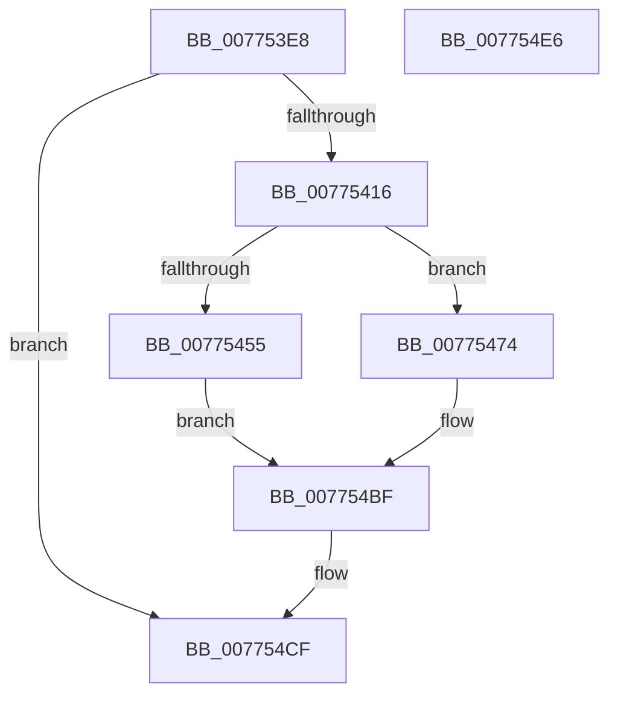

# SshpAlpcSendMessage

- RVA: `0x007753E8`–`0x007754E7` (길이 `255` bytes)
- VA: `0x00000001407753E8`
- 실행 섹션: `PAGE`
- PDB 이름 있음: `예`; PDB Function 태그: `아니요`
- unwind 정보 RVA: `0x000CDAE4`
- 디코드: `60`개 명령, `255/255` bytes 표시
- 미해석 바이트: `0` (있으면 어셈블리에 `.byte`로 보존)

> 이 문서는 커널 이미지의 기계어와 PDB 기호를 분석해 생성했습니다. 4번과 5번은 함수 원형과 자료형을 바이너리 사용 방식에서 추정한 C 해석이며 원본 소스 복구 결과는 아닙니다.

## 1. Dependencies

- 직접 호출 지점: **4**; 고유 호출 대상: **4**
- 직접 호출자로 확인된 함수: **1**
- RIP 상대 이미지 참조: **2**

### Outgoing calls
- `0x00775447` → [memcpy](../../text/6C/memcpy_function_006C6840.md) (function, `0x006C6840`)
- `0x00775480` → [memset](../../text/6C/memset_function_006C6C40.md) (function, `0x006C6C40`)
- `0x007754CA` → [ZwAlpcSendWaitReceivePort](../../text/6A/ZwAlpcSendWaitReceivePort_function_006AE290.md) (function, `0x006AE290`)
- `0x007754D6` → [_security_check_cookie](../../text/6A/_security_check_cookie_function_006AC640.md) (function, `0x006AC640`)

### Direct callers
- [SshpAlpcOpenGracePeriodWorker](SshpAlpcOpenGracePeriodWorker_function_00774FC0.md) at `0x00775043`

### Static image references
- `0x007753F8` → RVA `0x00E0A740` (`.data`; read)
- `0x00775406` → RVA `0x00F069D0` (`.data`; read)

## 2. Other-region calls and transfers

- 다른 실행 섹션으로 향하는 call: **4**
  - `0x00775447` → [memcpy](../../text/6C/memcpy_function_006C6840.md) (`PAGE` → `.text`)
  - `0x00775480` → [memset](../../text/6C/memset_function_006C6C40.md) (`PAGE` → `.text`)
  - `0x007754CA` → [ZwAlpcSendWaitReceivePort](../../text/6A/ZwAlpcSendWaitReceivePort_function_006AE290.md) (`PAGE` → `.text`)
  - `0x007754D6` → [_security_check_cookie](../../text/6A/_security_check_cookie_function_006AC640.md) (`PAGE` → `.text`)
- 별도 외부 분기/꼬리 이동을 확인하지 못했습니다.

## 3. Assembly (complete function range)

```asm
007753E8  40 55                           push rbp
007753EA  53                              push rbx
007753EB  56                              push rsi
007753EC  48 8D 6C 24 C0                  lea rbp, [rsp - 0x40]
007753F1  48 81 EC 40 01 00 00            sub rsp, 0x140
007753F8  48 8B 05 41 53 69 00            mov rax, qword ptr [rip + 0x695341]
007753FF  48 33 C4                        xor rax, rsp
00775402  48 89 45 30                     mov qword ptr [rbp + 0x30], rax
00775406  48 8B 1D C3 15 79 00            mov rbx, qword ptr [rip + 0x7915c3]
0077540D  48 85 DB                        test rbx, rbx
00775410  0F 84 B9 00 00 00               je 0x1407754cf
00775416  0F 57 C0                        xorps xmm0, xmm0
00775419  45 8B C0                        mov r8d, r8d
0077541C  33 C0                           xor eax, eax
0077541E  48 8D 4D 80                     lea rcx, [rbp - 0x80]
00775422  0F 11 44 24 70                  movups xmmword ptr [rsp + 0x70], xmm0
00775427  89 54 24 78                     mov dword ptr [rsp + 0x78], edx
0077542B  49 8B D1                        mov rdx, r9
0077542E  0F 11 44 24 50                  movups xmmword ptr [rsp + 0x50], xmm0
00775433  8D 70 38                        lea esi, [rax + 0x38]
00775436  48 89 45 80                     mov qword ptr [rbp - 0x80], rax
0077543A  0F 11 44 24 60                  movups xmmword ptr [rsp + 0x60], xmm0
0077543F  C7 44 24 50 10 00 38 00         mov dword ptr [rsp + 0x50], 0x380010
00775447  E8 F4 13 F5 FF                  call 0x1406c6840
0077544C  80 BD 80 00 00 00 00            cmp byte ptr [rbp + 0x80], 0
00775453  75 1F                           jne 0x140775474
00775455  48 83 64 24 38 00               and qword ptr [rsp + 0x38], 0
0077545B  BA 00 00 01 00                  mov edx, 0x10000
00775460  48 83 64 24 30 00               and qword ptr [rsp + 0x30], 0
00775466  48 83 64 24 28 00               and qword ptr [rsp + 0x28], 0
0077546C  48 83 64 24 20 00               and qword ptr [rsp + 0x20], 0
00775472  EB 4B                           jmp 0x1407754bf
00775474  33 D2                           xor edx, edx
00775476  48 8D 4D 90                     lea rcx, [rbp - 0x70]
0077547A  41 B8 A0 00 00 00               mov r8d, 0xa0
00775480  E8 BB 17 F5 FF                  call 0x1406c6c40
00775485  48 8D 44 24 40                  lea rax, [rsp + 0x40]
0077548A  48 89 74 24 48                  mov qword ptr [rsp + 0x48], rsi
0077548F  48 89 44 24 38                  mov qword ptr [rsp + 0x38], rax
00775494  BA 00 00 02 00                  mov edx, 0x20000
00775499  48 8D 45 90                     lea rax, [rbp - 0x70]
0077549D  48 C7 44 24 40 80 69 67 FF      mov qword ptr [rsp + 0x40], 0xffffffffff676980
007754A6  48 89 44 24 30                  mov qword ptr [rsp + 0x30], rax
007754AB  48 8D 44 24 48                  lea rax, [rsp + 0x48]
007754B0  48 89 44 24 28                  mov qword ptr [rsp + 0x28], rax
007754B5  48 8D 44 24 50                  lea rax, [rsp + 0x50]
007754BA  48 89 44 24 20                  mov qword ptr [rsp + 0x20], rax
007754BF  45 33 C9                        xor r9d, r9d
007754C2  4C 8D 44 24 50                  lea r8, [rsp + 0x50]
007754C7  48 8B CB                        mov rcx, rbx
007754CA  E8 C1 8D F3 FF                  call 0x1406ae290
007754CF  48 8B 4D 30                     mov rcx, qword ptr [rbp + 0x30]
007754D3  48 33 CC                        xor rcx, rsp
007754D6  E8 65 71 F3 FF                  call 0x1406ac640
007754DB  48 81 C4 40 01 00 00            add rsp, 0x140
007754E2  5E                              pop rsi
007754E3  5B                              pop rbx
007754E4  5D                              pop rbp
007754E5  C3                              ret
007754E6  CC                              int3
```

## 4. C-style interpretation (structured pseudocode)

```c
__int64 __fastcall SshpAlpcSendMessage(__int64 a1, int a2, int a3, __int64 a4, unsigned __int8 a5)
{
    __int64 result;
    __int64 v_rsp;
    unsigned __int64 v_stack_m108;
    unsigned __int64 v_stack_m110;
    unsigned __int64 v_stack_m118;
    unsigned __int64 v_stack_m120;
    unsigned __int64 v_stack_m128;
    unsigned __int64 v_stack_m130;
    unsigned __int64 v_stack_m138;
    unsigned __int64 v_stack_m28;
    unsigned __int64 v_stack_m58;
    unsigned __int64 v_stack_mC8;
    unsigned __int64 v_stack_mD8;
    unsigned int v_stack_mE0;
    unsigned __int64 v_stack_mE8;
    unsigned __int64 v_stack_mF8;

    v_rsp = (v_rsp) - (320);
    result = (*(unsigned __int64 *)(v_rip + 6902593)) ^ (v_rsp);
    v_stack_m28 = result;
    if (*(unsigned __int64 *)(v_rip + 7935427) == 0) goto loc_007754CF;
    result = 0;
    v_stack_mE8 = v_xmm0;
    v_stack_mE0 = a2;
    v_stack_m108 = v_xmm0;
    v_stack_mD8 = 0;
    v_stack_mF8 = v_xmm0;
    v_stack_m108 = 0x380010ULL;
    result = memcpy(v_stack_mD8, a4, (unsigned int)(a3), a4);
    if (a5 != 0) goto loc_00775474;
    goto loc_007754BF;
loc_00775474:
    a2 = 0;
    result = memset(v_stack_mC8, a2, 160, a4);
    v_stack_m110 = result + 56;
    v_stack_m120 = v_stack_m118;
    v_stack_m118 = 0xFFFFFFFFFF676980ULL;
    v_stack_m128 = v_stack_mC8;
    v_stack_m130 = v_stack_m110;
    v_stack_m138 = v_stack_m108;
loc_007754BF:
    a4 = 0;
    result = ZwAlpcSendWaitReceivePort(*(unsigned __int64 *)(v_rip + 7935427), (unsigned int)(0x20000ULL), v_stack_m108, a4);
loc_007754CF:
    a1 = (v_stack_m28) ^ (v_rsp);
    result = _security_check_cookie(a1, (unsigned int)(0x20000ULL), v_stack_m108, a4);
    v_rsp = (v_rsp) + (320);
    return result;
}
```

## 5. (Beta) C Style

```c
int64_t SshpAlpcSendMessage(int64_t Arg1, int32_t Arg2, int32_t Arg3, int64_t Arg4, uint8_t Arg5)
{
    int64_t result;
    int64_t local_rsp;
    uint64_t v_stack_m108;
    uint64_t v_stack_m110;
    uint64_t v_stack_m118;
    uint64_t v_stack_m120;
    uint64_t v_stack_m128;
    uint64_t v_stack_m130;
    uint64_t v_stack_m138;
    uint64_t v_stack_m28;
    uint64_t v_stack_m58;
    uint64_t v_stack_mC8;
    uint64_t v_stack_mD8;
    uint32_t v_stack_mE0;
    uint64_t v_stack_mE8;
    uint64_t v_stack_mF8;

    local_rsp = (local_rsp) - (320);
    result = (*(uint64_t *)(v_rip + 0x695341)) ^ (local_rsp);
    v_stack_m28 = result;
    if (*(uint64_t *)(v_rip + 0x7915C3) == 0) goto loc_007754CF;
    result = 0;
    v_stack_mE8 = v_xmm0;
    v_stack_mE0 = Arg2;
    v_stack_m108 = v_xmm0;
    v_stack_mD8 = 0;
    v_stack_mF8 = v_xmm0;
    v_stack_m108 = 0x380010ULL;
    result = memcpy(v_stack_mD8, Arg4, (uint32_t)(Arg3), Arg4);
    if (Arg5 != 0) goto loc_00775474;
    goto loc_007754BF;
loc_00775474:
    Arg2 = 0;
    result = memset(v_stack_mC8, Arg2, 160, Arg4);
    v_stack_m110 = result + 56;
    v_stack_m120 = v_stack_m118;
    v_stack_m118 = 0xFFFFFFFFFF676980ULL;
    v_stack_m128 = v_stack_mC8;
    v_stack_m130 = v_stack_m110;
    v_stack_m138 = v_stack_m108;
loc_007754BF:
    Arg4 = 0;
    result = ZwAlpcSendWaitReceivePort(*(uint64_t *)(v_rip + 0x7915C3), (uint32_t)(0x20000ULL), v_stack_m108, Arg4);
loc_007754CF:
    Arg1 = (v_stack_m28) ^ (local_rsp);
    result = _security_check_cookie(Arg1, (uint32_t)(0x20000ULL), v_stack_m108, Arg4);
    local_rsp = (local_rsp) + (320);
    return result;
}
```

## 6. Execution-region graph

[열기: 2D/3D 그래프와 함수 탐색 컨트롤 패널](../../../control-panel.html?section=page&rva=0x007753E8&view=graph)

- 2D 그래프는 위에서 아래로 흐르고, 3D 그래프는 빈 공간을 드래그해 회전합니다. Shift+드래그는 이동, 휠은 확대·축소, 함수 노드 선택은 대상 보고서 이동입니다.

### Static fallback


