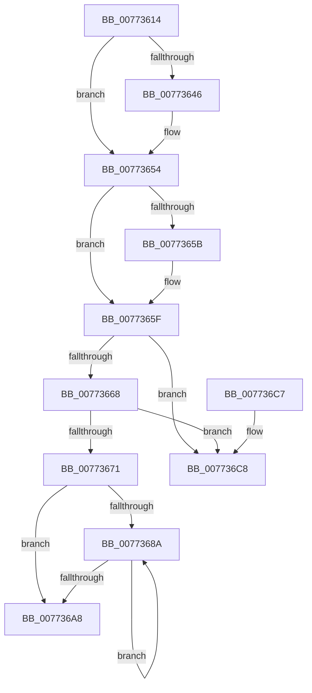

# SshpFreeDataEntry

- RVA: `0x00773614`–`0x007736CF` (길이 `187` bytes)
- VA: `0x0000000140773614`
- 실행 섹션: `PAGE`
- PDB 이름 있음: `예`; PDB Function 태그: `아니요`
- unwind 정보 RVA: `0x0006383C`
- 디코드: `56`개 명령, `187/187` bytes 표시
- 미해석 바이트: `0` (있으면 어셈블리에 `.byte`로 보존)

> 이 문서는 커널 이미지의 기계어와 PDB 기호를 분석해 생성했습니다. 4번과 5번은 함수 원형과 자료형을 바이너리 사용 방식에서 추정한 C 해석이며 원본 소스 복구 결과는 아닙니다.

## 1. Dependencies

- 직접 호출 지점: **5**; 고유 호출 대상: **4**
- 직접 호출자로 확인된 함수: **3**
- RIP 상대 이미지 참조: **0**

### Outgoing calls
- `0x00773636` → [KeAbPreAcquire](../../text/21/KeAbPreAcquire_function_00210230.md) (function, `0x00210230`)
- `0x0077364F` → [ExfAcquirePushLockExclusiveEx](../../text/20/ExfAcquirePushLockExclusiveEx_function_0020FC90.md) (function, `0x0020FC90`)
- `0x00773680` → [SSHSupportReleasePushLockExclusive](../../text/49/SSHSupportReleasePushLockExclusive_function_004954EC.md) (function, `0x004954EC`)
- `0x0077369C` → [CmpFreePoolWithTag](../../text/44/CmpFreePoolWithTag_function_004489E0.md) (function, `0x004489E0`)
- `0x007736B2` → [CmpFreePoolWithTag](../../text/44/CmpFreePoolWithTag_function_004489E0.md) (function, `0x004489E0`)

### Direct callers
- [SleepstudyHelperDestroyBlockerData](SleepstudyHelperDestroyBlockerData_function_007746F0.md) at `0x007746FE`
- [SleepstudyHelperDestroyLibrary](SleepstudyHelperDestroyLibrary_function_00774720.md) at `0x00774872`
- [SleepstudyHelperCreateBlockerData](../AD/SleepstudyHelperCreateBlockerData_function_00AD40B0.md) at `0x00AD41B7`

### Static image references
- 디코드된 RIP-relative 메모리 참조가 없습니다.

## 2. Other-region calls and transfers

- 다른 실행 섹션으로 향하는 call: **5**
  - `0x00773636` → [KeAbPreAcquire](../../text/21/KeAbPreAcquire_function_00210230.md) (`PAGE` → `.text`)
  - `0x0077364F` → [ExfAcquirePushLockExclusiveEx](../../text/20/ExfAcquirePushLockExclusiveEx_function_0020FC90.md) (`PAGE` → `.text`)
  - `0x00773680` → [SSHSupportReleasePushLockExclusive](../../text/49/SSHSupportReleasePushLockExclusive_function_004954EC.md) (`PAGE` → `.text`)
  - `0x0077369C` → [CmpFreePoolWithTag](../../text/44/CmpFreePoolWithTag_function_004489E0.md) (`PAGE` → `.text`)
  - `0x007736B2` → [CmpFreePoolWithTag](../../text/44/CmpFreePoolWithTag_function_004489E0.md) (`PAGE` → `.text`)
- 별도 외부 분기/꼬리 이동을 확인하지 못했습니다.

## 3. Assembly (complete function range)

```asm
00773614  48 89 5C 24 08                  mov qword ptr [rsp + 8], rbx
00773619  48 89 74 24 10                  mov qword ptr [rsp + 0x10], rsi
0077361E  57                              push rdi
0077361F  48 83 EC 20                     sub rsp, 0x20
00773623  48 8B 79 10                     mov rdi, qword ptr [rcx + 0x10]
00773627  48 8B D9                        mov rbx, rcx
0077362A  48 83 C7 10                     add rdi, 0x10
0077362E  45 33 C0                        xor r8d, r8d
00773631  48 8B CF                        mov rcx, rdi
00773634  33 D2                           xor edx, edx
00773636  E8 F5 CB A9 FF                  call 0x140210230
0077363B  F0 48 0F BA 2F 00               lock bts qword ptr [rdi], 0
00773641  48 8B F0                        mov rsi, rax
00773644  73 0E                           jae 0x140773654
00773646  4C 8B C7                        mov r8, rdi
00773649  48 8B D0                        mov rdx, rax
0077364C  48 8B CF                        mov rcx, rdi
0077364F  E8 3C C6 A9 FF                  call 0x14020fc90
00773654  33 FF                           xor edi, edi
00773656  48 85 F6                        test rsi, rsi
00773659  74 04                           je 0x14077365f
0077365B  C6 46 0A 01                     mov byte ptr [rsi + 0xa], 1
0077365F  48 8B 0B                        mov rcx, qword ptr [rbx]
00773662  48 39 59 08                     cmp qword ptr [rcx + 8], rbx
00773666  75 60                           jne 0x1407736c8
00773668  48 8B 43 08                     mov rax, qword ptr [rbx + 8]
0077366C  48 39 18                        cmp qword ptr [rax], rbx
0077366F  75 57                           jne 0x1407736c8
00773671  48 89 08                        mov qword ptr [rax], rcx
00773674  48 89 41 08                     mov qword ptr [rcx + 8], rax
00773678  48 8B 4B 10                     mov rcx, qword ptr [rbx + 0x10]
0077367C  48 83 C1 10                     add rcx, 0x10
00773680  E8 67 1E D2 FF                  call 0x1404954ec
00773685  39 7B 28                        cmp dword ptr [rbx + 0x28], edi
00773688  76 1E                           jbe 0x1407736a8
0077368A  48 8B 53 10                     mov rdx, qword ptr [rbx + 0x10]
0077368E  8B CF                           mov ecx, edi
00773690  48 C1 E1 05                     shl rcx, 5
00773694  8B 52 18                        mov edx, dword ptr [rdx + 0x18]
00773697  48 8B 4C 19 38                  mov rcx, qword ptr [rcx + rbx + 0x38]
0077369C  E8 3F 53 CD FF                  call 0x1404489e0
007736A1  FF C7                           inc edi
007736A3  3B 7B 28                        cmp edi, dword ptr [rbx + 0x28]
007736A6  72 E2                           jb 0x14077368a
007736A8  48 8B 53 10                     mov rdx, qword ptr [rbx + 0x10]
007736AC  48 8B CB                        mov rcx, rbx
007736AF  8B 52 18                        mov edx, dword ptr [rdx + 0x18]
007736B2  E8 29 53 CD FF                  call 0x1404489e0
007736B7  48 8B 5C 24 30                  mov rbx, qword ptr [rsp + 0x30]
007736BC  48 8B 74 24 38                  mov rsi, qword ptr [rsp + 0x38]
007736C1  48 83 C4 20                     add rsp, 0x20
007736C5  5F                              pop rdi
007736C6  C3                              ret
007736C7  CC                              int3
007736C8  B9 03 00 00 00                  mov ecx, 3
007736CD  CD 29                           int 0x29
```

## 4. C-style interpretation (structured pseudocode)

```c
__int64 __fastcall SshpFreeDataEntry(__int64 a1, int a2, int a3)
{
    __int64 result;
    __int64 v_rdi;
    __int64 v_rsp;
    unsigned __int64 v_stack_p10;
    unsigned __int64 v_stack_p8;

    v_stack_p8 = v_rbx;
    v_stack_p10 = v_rsi;
    v_rsp = (v_rsp) - (32);
    v_rdi = (*(unsigned __int64 *)(a1 + 16)) + (16);
    a3 = 0;
    a2 = 0;
    result = KeAbPreAcquire(v_rdi, a2, a3, a4);
    if (!(condition_is_above_or_equal)) {
        a3 = v_rdi;
        a2 = result;
        a1 = v_rdi;
        result = ExfAcquirePushLockExclusiveEx(a1, a2, a3, a4);
    }
    v_rdi = 0;
    if (result != 0) {
        *(unsigned __int8 *)(result + 10) = 1;
    }
    if ((*(unsigned __int64 *)(*(unsigned __int64 *)(a1) + 8)) != a1) goto loc_007736C8;
    if ((*(unsigned __int64 *)(*(unsigned __int64 *)(a1 + 8))) != a1) goto loc_007736C8;
    *(unsigned __int64 *)(*(unsigned __int64 *)(a1 + 8)) = *(unsigned __int64 *)(a1);
    *(unsigned __int64 *)(*(unsigned __int64 *)(a1) + 8) = *(unsigned __int64 *)(a1 + 8);
    a1 = (*(unsigned __int64 *)(a1 + 16)) + (16);
    result = SSHSupportReleasePushLockExclusive(a1, a2, a3, a4);
    if ((*(unsigned int *)(a1 + 40)) <= 0) goto loc_007736A8;
loc_0077368A:
    a1 = (0) << (5);
    result = CmpFreePoolWithTag(*(unsigned __int64 *)(a1 + a1 * 1 + 56), (unsigned int)(*(unsigned int *)(*(unsigned __int64 *)(a1 + 16) + 24)), a3, a4);
    v_rdi = (unsigned int)((v_rdi) + 1);
    if (((unsigned int)(v_rdi)) < (*(unsigned int *)(a1 + 40))) goto loc_0077368A;
loc_007736A8:
    result = CmpFreePoolWithTag(a1, (unsigned int)(*(unsigned int *)(*(unsigned __int64 *)(a1 + 16) + 24)), a3, a4);
    v_rsp = (v_rsp) + (32);
    return result;
loc_007736C8:
    return result;
}
```

## 5. (Beta) C Style

```c
int64_t SshpFreeDataEntry(void *Arg1, int32_t Arg2, int32_t Arg3)
{
    uint8_t *arg1 = (uint8_t *)Arg1;

    int64_t result;
    int64_t local_rdi;
    int64_t local_rsp;
    uint64_t v_stack_p10;
    uint64_t v_stack_p8;

    v_stack_p8 = local_rbx;
    v_stack_p10 = local_rsi;
    local_rsp = (local_rsp) - (32);
    local_rdi = (*(uint64_t *)(arg1 + 0x10)) + (16);
    Arg3 = 0;
    Arg2 = 0;
    result = KeAbPreAcquire(local_rdi, Arg2, Arg3, a4);
    if (!(condition_is_above_or_equal)) {
        Arg3 = local_rdi;
        Arg2 = result;
        Arg1 = local_rdi;
        result = ExfAcquirePushLockExclusiveEx(Arg1, Arg2, Arg3, a4);
    }
    local_rdi = 0;
    if (result != 0) {
        *(uint8_t *)(result + 0xA) = 1;
    }
    if ((*(uint64_t *)(*(uint64_t *)(arg1) + 0x8)) != Arg1) goto loc_007736C8;
    if ((*(uint64_t *)(*(uint64_t *)(arg1 + 0x8))) != Arg1) goto loc_007736C8;
    *(uint64_t *)(*(uint64_t *)(arg1 + 0x8)) = *(uint64_t *)(arg1);
    *(uint64_t *)(*(uint64_t *)(arg1) + 0x8) = *(uint64_t *)(arg1 + 0x8);
    Arg1 = (*(uint64_t *)(arg1 + 0x10)) + (16);
    result = SSHSupportReleasePushLockExclusive(Arg1, Arg2, Arg3, a4);
    if ((*(uint32_t *)(arg1 + 0x28)) <= 0) goto loc_007736A8;
loc_0077368A:
    Arg1 = (0) << (5);
    result = CmpFreePoolWithTag(*(uint64_t *)(arg1 + arg1 * 1 + 0x38), (uint32_t)(*(uint32_t *)(*(uint64_t *)(arg1 + 0x10) + 0x18)), Arg3, a4);
    local_rdi = (uint32_t)((local_rdi) + 1);
    if (((uint32_t)(local_rdi)) < (*(uint32_t *)(arg1 + 0x28))) goto loc_0077368A;
loc_007736A8:
    result = CmpFreePoolWithTag(Arg1, (uint32_t)(*(uint32_t *)(*(uint64_t *)(arg1 + 0x10) + 0x18)), Arg3, a4);
    local_rsp = (local_rsp) + (32);
    return result;
loc_007736C8:
    return result;
}
```

### 관측된 메모리 오프셋

구조체 형식이 확인되지 않은 접근은 인자 기준의 오프셋으로만 기록했습니다.

| 기준 인자 | 오프셋 표현 | 폭 (bit) | 접근 |
|---|---:|---:|---|
| `Arg1` | `+ 0x0` | `64` | `R` |
| `Arg1` | `+ 0x8` | `64` | `R` |
| `Arg1` | `+ 0x10` | `64` | `R` |
| `Arg1` | `+ 0x28` | `32` | `R` |

## 6. Execution-region graph

[열기: 2D/3D 그래프와 함수 탐색 컨트롤 패널](../../../control-panel.html?section=page&rva=0x00773614&view=graph)

- 2D 그래프는 위에서 아래로 흐르고, 3D 그래프는 빈 공간을 드래그해 회전합니다. Shift+드래그는 이동, 휠은 확대·축소, 함수 노드 선택은 대상 보고서 이동입니다.

### Static fallback


