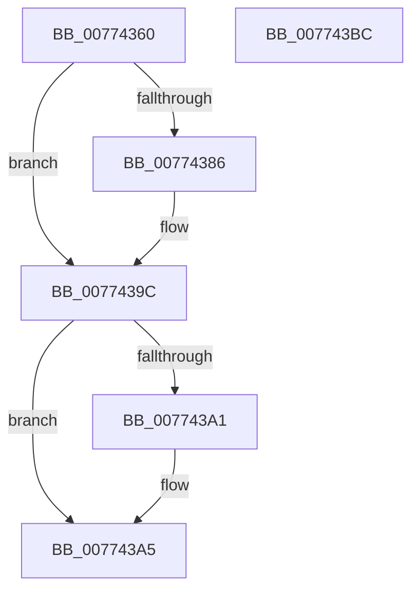

# SshpSessionManagerControlSessionCallback

- RVA: `0x00774360`–`0x007743BD` (길이 `93` bytes)
- VA: `0x0000000140774360`
- 실행 섹션: `PAGE`
- PDB 이름 있음: `예`; PDB Function 태그: `아니요`
- unwind 정보 RVA: `0x0005CF00`
- 디코드: `23`개 명령, `93/93` bytes 표시
- 미해석 바이트: `0` (있으면 어셈블리에 `.byte`로 보존)

> 이 문서는 커널 이미지의 기계어와 PDB 기호를 분석해 생성했습니다. 4번과 5번은 함수 원형과 자료형을 바이너리 사용 방식에서 추정한 C 해석이며 원본 소스 복구 결과는 아닙니다.

## 1. Dependencies

- 직접 호출 지점: **4**; 고유 호출 대상: **4**
- 직접 호출자로 확인된 함수: **0**
- RIP 상대 이미지 참조: **2**

### Outgoing calls
- `0x00774372` → [KeAbPreAcquire](../../text/21/KeAbPreAcquire_function_00210230.md) (function, `0x00210230`)
- `0x00774397` → [ExfAcquirePushLockExclusiveEx](../../text/20/ExfAcquirePushLockExclusiveEx_function_0020FC90.md) (function, `0x0020FC90`)
- `0x007743A5` → [SshpSessionManagerFlushControlEventBuffer](SshpSessionManagerFlushControlEventBuffer_function_007743C4.md) (function, `0x007743C4`)
- `0x007743B1` → [SSHSupportReleasePushLockExclusive](../../text/49/SSHSupportReleasePushLockExclusive_function_004954EC.md) (function, `0x004954EC`)

### Direct callers
- 이 함수 시작 RVA로 연결되는 직접 call은 확인되지 않았습니다. 간접 호출은 완전히 역산할 수 없습니다.

### Static image references
- `0x00774369` → RVA `0x00F06B70` (`.data`; read)
- `0x00774377` → RVA `0x00F06B70` (`.data`; read/write)

## 2. Other-region calls and transfers

- 다른 실행 섹션으로 향하는 call: **3**
  - `0x00774372` → [KeAbPreAcquire](../../text/21/KeAbPreAcquire_function_00210230.md) (`PAGE` → `.text`)
  - `0x00774397` → [ExfAcquirePushLockExclusiveEx](../../text/20/ExfAcquirePushLockExclusiveEx_function_0020FC90.md) (`PAGE` → `.text`)
  - `0x007743B1` → [SSHSupportReleasePushLockExclusive](../../text/49/SSHSupportReleasePushLockExclusive_function_004954EC.md) (`PAGE` → `.text`)
- 별도 외부 분기/꼬리 이동을 확인하지 못했습니다.

## 3. Assembly (complete function range)

```asm
00774360  40 53                           push rbx
00774362  48 83 EC 20                     sub rsp, 0x20
00774366  45 33 C0                        xor r8d, r8d
00774369  48 8D 0D 00 28 79 00            lea rcx, [rip + 0x792800]
00774370  33 D2                           xor edx, edx
00774372  E8 B9 BE A9 FF                  call 0x140210230
00774377  F0 48 0F BA 2D EF 27 79 00 00   lock bts qword ptr [rip + 0x7927ef], 0
00774381  48 8B D8                        mov rbx, rax
00774384  73 16                           jae 0x14077439c
00774386  4C 8D 05 E3 27 79 00            lea r8, [rip + 0x7927e3]
0077438D  48 8B D0                        mov rdx, rax
00774390  48 8D 0D D9 27 79 00            lea rcx, [rip + 0x7927d9]
00774397  E8 F4 B8 A9 FF                  call 0x14020fc90
0077439C  48 85 DB                        test rbx, rbx
0077439F  74 04                           je 0x1407743a5
007743A1  C6 43 0A 01                     mov byte ptr [rbx + 0xa], 1
007743A5  E8 1A 00 00 00                  call 0x1407743c4
007743AA  48 8D 0D BF 27 79 00            lea rcx, [rip + 0x7927bf]
007743B1  E8 36 11 D2 FF                  call 0x1404954ec
007743B6  48 83 C4 20                     add rsp, 0x20
007743BA  5B                              pop rbx
007743BB  C3                              ret
007743BC  CC                              int3
```

## 4. C-style interpretation (structured pseudocode)

```c
__int64 __fastcall SshpSessionManagerControlSessionCallback(__int64 a1, int a2, int a3)
{
    __int64 result;
    __int64 v_rsp;

    v_rsp = (v_rsp) - (32);
    a3 = 0;
    a2 = 0;
    result = KeAbPreAcquire(v_rip + 7940096, a2, a3, a4);
    if (!(condition_is_above_or_equal)) {
        a3 = v_rip + 7940067;
        a2 = result;
        a1 = v_rip + 7940057;
        result = ExfAcquirePushLockExclusiveEx(a1, a2, a3, a4);
    }
    if (result != 0) {
        *(unsigned __int8 *)(result + 10) = 1;
    }
    result = SshpSessionManagerFlushControlEventBuffer(a1, a2, a3, a4);
    result = SSHSupportReleasePushLockExclusive(v_rip + 7940031, a2, a3, a4);
    v_rsp = (v_rsp) + (32);
    return result;
}
```

## 5. (Beta) C Style

```c
int64_t SshpSessionManagerControlSessionCallback(int64_t Arg1, int32_t Arg2, int32_t Arg3)
{
    int64_t result;
    int64_t local_rsp;

    local_rsp = (local_rsp) - (32);
    Arg3 = 0;
    Arg2 = 0;
    result = KeAbPreAcquire(v_rip + 7940096, Arg2, Arg3, a4);
    if (!(condition_is_above_or_equal)) {
        Arg3 = v_rip + 7940067;
        Arg2 = result;
        Arg1 = v_rip + 7940057;
        result = ExfAcquirePushLockExclusiveEx(Arg1, Arg2, Arg3, a4);
    }
    if (result != 0) {
        *(uint8_t *)(result + 0xA) = 1;
    }
    result = SshpSessionManagerFlushControlEventBuffer(Arg1, Arg2, Arg3, a4);
    result = SSHSupportReleasePushLockExclusive(v_rip + 7940031, Arg2, Arg3, a4);
    local_rsp = (local_rsp) + (32);
    return result;
}
```

## 6. Execution-region graph

[열기: 2D/3D 그래프와 함수 탐색 컨트롤 패널](../../../control-panel.html?section=page&rva=0x00774360&view=graph)

- 2D 그래프는 위에서 아래로 흐르고, 3D 그래프는 빈 공간을 드래그해 회전합니다. Shift+드래그는 이동, 휠은 확대·축소, 함수 노드 선택은 대상 보고서 이동입니다.

### Static fallback


