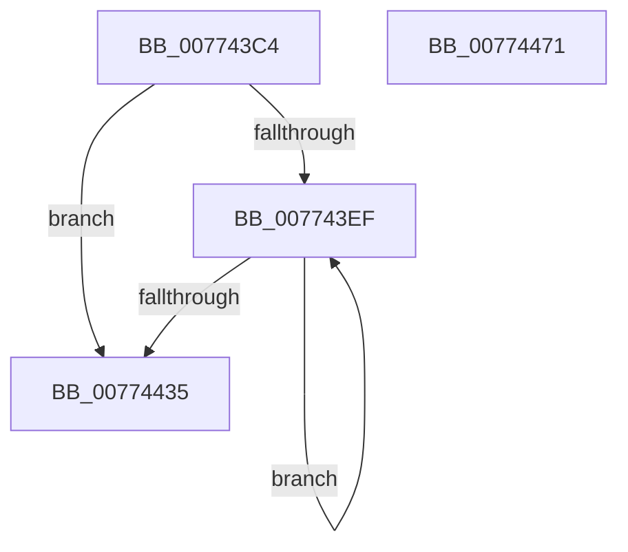

# SshpSessionManagerFlushControlEventBuffer

- RVA: `0x007743C4`–`0x00774472` (길이 `174` bytes)
- VA: `0x00000001407743C4`
- 실행 섹션: `PAGE`
- PDB 이름 있음: `예`; PDB Function 태그: `아니요`
- unwind 정보 RVA: `0x000C3764`
- 디코드: `43`개 명령, `174/174` bytes 표시
- 미해석 바이트: `0` (있으면 어셈블리에 `.byte`로 보존)

> 이 문서는 커널 이미지의 기계어와 PDB 기호를 분석해 생성했습니다. 4번과 5번은 함수 원형과 자료형을 바이너리 사용 방식에서 추정한 C 해석이며 원본 소스 복구 결과는 아닙니다.

## 1. Dependencies

- 직접 호출 지점: **4**; 고유 호출 대상: **4**
- 직접 호출자로 확인된 함수: **1**
- RIP 상대 이미지 참조: **6**

### Outgoing calls
- `0x00774423` → [SSHSupportEtwWrite](../../text/4A/SSHSupportEtwWrite_function_004ADF5C.md) (function, `0x004ADF5C`)
- `0x00774443` → [SshpAlpcCloseTraceSession](SshpAlpcCloseTraceSession_function_00774DE8.md) (function, `0x00774DE8`)
- `0x00774454` → [KeSetEvent](../../text/33/KeSetEvent_function_0033F310.md) (function, `0x0033F310`)
- `0x00774461` → [_security_check_cookie](../../text/6A/_security_check_cookie_function_006AC640.md) (function, `0x006AC640`)

### Direct callers
- [SshpSessionManagerControlSessionCallback](SshpSessionManagerControlSessionCallback_function_00774360.md) at `0x007743A5`

### Static image references
- `0x007743CE` → RVA `0x00E0A740` (`.data`; read)
- `0x007743E2` → RVA `0x00F06C08` (`.data`; read)
- `0x007743EF` → RVA `0x00F06C0C` (`.data`; read)
- `0x00774435` → RVA `0x00F06C08` (`.data`; read/write)
- `0x0077443C` → RVA `0x00F06BA0` (`.data`; write)
- `0x0077444B` → RVA `0x00F06BF0` (`.data`; read)

## 2. Other-region calls and transfers

- 다른 실행 섹션으로 향하는 call: **3**
  - `0x00774423` → [SSHSupportEtwWrite](../../text/4A/SSHSupportEtwWrite_function_004ADF5C.md) (`PAGE` → `.text`)
  - `0x00774454` → [KeSetEvent](../../text/33/KeSetEvent_function_0033F310.md) (`PAGE` → `.text`)
  - `0x00774461` → [_security_check_cookie](../../text/6A/_security_check_cookie_function_006AC640.md) (`PAGE` → `.text`)
- 별도 외부 분기/꼬리 이동을 확인하지 못했습니다.

## 3. Assembly (complete function range)

```asm
007743C4  48 89 5C 24 08                  mov qword ptr [rsp + 8], rbx
007743C9  57                              push rdi
007743CA  48 83 EC 50                     sub rsp, 0x50
007743CE  48 8B 05 6B 63 69 00            mov rax, qword ptr [rip + 0x69636b]
007743D5  48 33 C4                        xor rax, rsp
007743D8  48 89 44 24 40                  mov qword ptr [rsp + 0x40], rax
007743DD  33 FF                           xor edi, edi
007743DF  0F 57 C0                        xorps xmm0, xmm0
007743E2  39 3D 20 28 79 00               cmp dword ptr [rip + 0x792820], edi
007743E8  0F 11 44 24 30                  movups xmmword ptr [rsp + 0x30], xmm0
007743ED  76 46                           jbe 0x140774435
007743EF  48 8D 0D 16 28 79 00            lea rcx, [rip + 0x792816]
007743F6  8B C7                           mov eax, edi
007743F8  48 03 C1                        add rax, rcx
007743FB  41 B9 01 00 00 00               mov r9d, 1
00774401  8B 18                           mov ebx, dword ptr [rax]
00774403  48 8B 50 04                     mov rdx, qword ptr [rax + 4]
00774407  48 83 C0 0C                     add rax, 0xc
0077440B  83 64 24 3C 00                  and dword ptr [rsp + 0x3c], 0
00774410  48 89 44 24 30                  mov qword ptr [rsp + 0x30], rax
00774415  48 8D 44 24 30                  lea rax, [rsp + 0x30]
0077441A  48 89 44 24 20                  mov qword ptr [rsp + 0x20], rax
0077441F  89 5C 24 38                     mov dword ptr [rsp + 0x38], ebx
00774423  E8 34 9B D3 FF                  call 0x1404adf5c
00774428  83 C7 0C                        add edi, 0xc
0077442B  03 FB                           add edi, ebx
0077442D  3B 3D D5 27 79 00               cmp edi, dword ptr [rip + 0x7927d5]
00774433  72 BA                           jb 0x1407743ef
00774435  83 25 CC 27 79 00 00            and dword ptr [rip + 0x7927cc], 0
0077443C  C6 05 5D 27 79 00 00            mov byte ptr [rip + 0x79275d], 0
00774443  E8 A0 09 00 00                  call 0x140774de8
00774448  45 33 C0                        xor r8d, r8d
0077444B  48 8D 0D 9E 27 79 00            lea rcx, [rip + 0x79279e]
00774452  33 D2                           xor edx, edx
00774454  E8 B7 AE BC FF                  call 0x14033f310
00774459  48 8B 4C 24 40                  mov rcx, qword ptr [rsp + 0x40]
0077445E  48 33 CC                        xor rcx, rsp
00774461  E8 DA 81 F3 FF                  call 0x1406ac640
00774466  48 8B 5C 24 60                  mov rbx, qword ptr [rsp + 0x60]
0077446B  48 83 C4 50                     add rsp, 0x50
0077446F  5F                              pop rdi
00774470  C3                              ret
00774471  CC                              int3
```

## 4. C-style interpretation (structured pseudocode)

```c
__int64 __fastcall SshpSessionManagerFlushControlEventBuffer(__int64 a1, __int64 a2, int a3)
{
    __int64 result;
    __int64 v_rdi;
    __int64 v_rsp;
    unsigned __int64 v_stack_m18;
    unsigned int v_stack_m1C;
    unsigned int v_stack_m20;
    unsigned __int64 v_stack_m28;
    unsigned __int64 v_stack_m38;
    unsigned __int64 v_stack_p8;

    v_stack_p8 = v_rbx;
    v_rsp = (v_rsp) - (80);
    result = (*(unsigned __int64 *)(v_rip + 6906731)) ^ (v_rsp);
    v_stack_m18 = result;
    v_rdi = 0;
    v_stack_m28 = v_xmm0;
    if ((*(unsigned int *)(v_rip + 7940128)) <= 0) goto loc_00774435;
loc_007743EF:
    result = (0) + (v_rip + 7940118);
    result = (result) + (12);
    v_stack_m28 = result;
    v_stack_m38 = v_stack_m28;
    v_stack_m20 = (unsigned int)((unsigned int)(*(unsigned int *)(result)));
    result = SSHSupportEtwWrite(v_rip + 7940118, *(unsigned __int64 *)(result + 4), a3, 1);
    v_rdi = (unsigned int)((v_rdi) + (12));
    v_rdi = (unsigned int)((v_rdi) + ((unsigned int)((unsigned int)(*(unsigned int *)(result)))));
    if (((unsigned int)(v_rdi)) < (*(unsigned int *)(v_rip + 7940053))) goto loc_007743EF;
loc_00774435:
    *(unsigned __int8 *)(v_rip + 7939933) = 0;
    result = SshpAlpcCloseTraceSession(v_rip + 7940118, *(unsigned __int64 *)(result + 4), a3, 1);
    a3 = 0;
    a2 = 0;
    result = KeSetEvent(v_rip + 7939998, a2, a3, 1);
    a1 = (v_stack_m18) ^ (v_rsp);
    result = _security_check_cookie(a1, a2, a3, 1);
    v_rsp = (v_rsp) + (80);
    return result;
}
```

## 5. (Beta) C Style

```c
int64_t SshpSessionManagerFlushControlEventBuffer(int64_t Arg1, int64_t Arg2, int32_t Arg3)
{
    int64_t result;
    int64_t local_rdi;
    int64_t local_rsp;
    uint64_t v_stack_m18;
    uint32_t v_stack_m1C;
    uint32_t v_stack_m20;
    uint64_t v_stack_m28;
    uint64_t v_stack_m38;
    uint64_t v_stack_p8;

    v_stack_p8 = local_rbx;
    local_rsp = (local_rsp) - (80);
    result = (*(uint64_t *)(v_rip + 0x69636B)) ^ (local_rsp);
    v_stack_m18 = result;
    local_rdi = 0;
    v_stack_m28 = v_xmm0;
    if ((*(uint32_t *)(v_rip + 0x792820)) <= 0) goto loc_00774435;
loc_007743EF:
    result = (0) + (v_rip + 7940118);
    result = (result) + (12);
    v_stack_m28 = result;
    v_stack_m38 = v_stack_m28;
    v_stack_m20 = (uint32_t)((uint32_t)(*(uint32_t *)(result)));
    result = SSHSupportEtwWrite(v_rip + 7940118, *(uint64_t *)(result + 0x4), Arg3, 1);
    local_rdi = (uint32_t)((local_rdi) + (12));
    local_rdi = (uint32_t)((local_rdi) + ((uint32_t)((uint32_t)(*(uint32_t *)(result)))));
    if (((uint32_t)(local_rdi)) < (*(uint32_t *)(v_rip + 0x7927D5))) goto loc_007743EF;
loc_00774435:
    *(uint8_t *)(v_rip + 0x79275D) = 0;
    result = SshpAlpcCloseTraceSession(v_rip + 7940118, *(uint64_t *)(result + 0x4), Arg3, 1);
    Arg3 = 0;
    Arg2 = 0;
    result = KeSetEvent(v_rip + 7939998, Arg2, Arg3, 1);
    Arg1 = (v_stack_m18) ^ (local_rsp);
    result = _security_check_cookie(Arg1, Arg2, Arg3, 1);
    local_rsp = (local_rsp) + (80);
    return result;
}
```

## 6. Execution-region graph

[열기: 2D/3D 그래프와 함수 탐색 컨트롤 패널](../../../control-panel.html?section=page&rva=0x007743C4&view=graph)

- 2D 그래프는 위에서 아래로 흐르고, 3D 그래프는 빈 공간을 드래그해 회전합니다. Shift+드래그는 이동, 휠은 확대·축소, 함수 노드 선택은 대상 보고서 이동입니다.

### Static fallback


