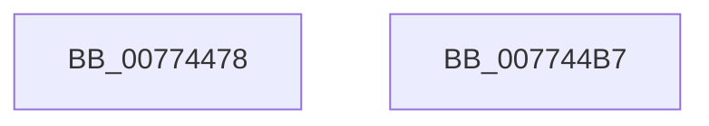

# SshpSessionManagerInterruptTimeToSystemTime

- RVA: `0x00774478`–`0x007744B8` (길이 `64` bytes)
- VA: `0x0000000140774478`
- 실행 섹션: `PAGE`
- PDB 이름 있음: `예`; PDB Function 태그: `아니요`
- unwind 정보 RVA: `0x0005C788`
- 디코드: `18`개 명령, `64/64` bytes 표시
- 미해석 바이트: `0` (있으면 어셈블리에 `.byte`로 보존)

> 이 문서는 커널 이미지의 기계어와 PDB 기호를 분석해 생성했습니다. 4번과 5번은 함수 원형과 자료형을 바이너리 사용 방식에서 추정한 C 해석이며 원본 소스 복구 결과는 아닙니다.

## 1. Dependencies

- 직접 호출 지점: **2**; 고유 호출 대상: **2**
- 직접 호출자로 확인된 함수: **1**
- RIP 상대 이미지 참조: **0**

### Outgoing calls
- `0x00774485` → [SSHSupportQueryInterruptTime](../../text/4B/SSHSupportQueryInterruptTime_function_004BB458.md) (function, `0x004BB458`)
- `0x00774492` → [CmSiQuerySystemTime](../../text/4B/CmSiQuerySystemTime_function_004BD394.md) (function, `0x004BD394`)

### Direct callers
- [SshSessionManagerTracePostSleepNotification](../A8/SshSessionManagerTracePostSleepNotification_function_00A87054.md) at `0x00A870AF`
- [SshSessionManagerTracePostSleepNotification](../A8/SshSessionManagerTracePostSleepNotification_function_00A87054.md) at `0x00A870C1`

### Static image references
- 디코드된 RIP-relative 메모리 참조가 없습니다.

## 2. Other-region calls and transfers

- 다른 실행 섹션으로 향하는 call: **2**
  - `0x00774485` → [SSHSupportQueryInterruptTime](../../text/4B/SSHSupportQueryInterruptTime_function_004BB458.md) (`PAGE` → `.text`)
  - `0x00774492` → [CmSiQuerySystemTime](../../text/4B/CmSiQuerySystemTime_function_004BD394.md) (`PAGE` → `.text`)
- 별도 외부 분기/꼬리 이동을 확인하지 못했습니다.

## 3. Assembly (complete function range)

```asm
00774478  48 83 EC 28                     sub rsp, 0x28
0077447C  48 83 64 24 30 00               and qword ptr [rsp + 0x30], 0
00774482  4C 8B C9                        mov r9, rcx
00774485  E8 CE 6F D4 FF                  call 0x1404bb458
0077448A  48 8D 4C 24 30                  lea rcx, [rsp + 0x30]
0077448F  4C 8B C0                        mov r8, rax
00774492  E8 FD 8E D4 FF                  call 0x1404bd394
00774497  49 8B C1                        mov rax, r9
0077449A  49 2B C0                        sub rax, r8
0077449D  4D 8B C1                        mov r8, r9
007744A0  49 F7 D8                        neg r8
007744A3  4D 85 C9                        test r9, r9
007744A6  4C 0F 49 C0                     cmovns r8, rax
007744AA  4C 03 44 24 30                  add r8, qword ptr [rsp + 0x30]
007744AF  4C 89 02                        mov qword ptr [rdx], r8
007744B2  48 83 C4 28                     add rsp, 0x28
007744B6  C3                              ret
007744B7  CC                              int3
```

## 4. C-style interpretation (structured pseudocode)

```c
__int64 __fastcall SshpSessionManagerInterruptTimeToSystemTime(__int64 a1, __int64 a2)
{
    __int64 result;
    __int64 v_rsp;
    unsigned __int64 v_stack_p8;

    v_rsp = (v_rsp) - (40);
    result = SSHSupportQueryInterruptTime(a1, a2, a3, a1);
    result = CmSiQuerySystemTime(v_stack_p8, a2, result, a1);
    result = (a1) - (result);
    a3 = -(a1);
    if (!sign_flag) { a3 = result; }
    a3 = (a3) + (v_stack_p8);
    *(unsigned __int64 *)(a2) = a3;
    v_rsp = (v_rsp) + (40);
    return result;
}
```

## 5. (Beta) C Style

```c
int64_t SshpSessionManagerInterruptTimeToSystemTime(int64_t Arg1, int64_t Arg2)
{
    int64_t result;
    int64_t local_rsp;
    uint64_t v_stack_p8;

    local_rsp = (local_rsp) - (40);
    result = SSHSupportQueryInterruptTime(Arg1, Arg2, a3, Arg1);
    result = CmSiQuerySystemTime(v_stack_p8, Arg2, result, Arg1);
    result = (Arg1) - (result);
    a3 = -(Arg1);
    if (!sign_flag) { a3 = result; }
    a3 = (a3) + (v_stack_p8);
    *(uint64_t *)(Arg2) = a3;
    local_rsp = (local_rsp) + (40);
    return result;
}
```

## 6. Execution-region graph

[열기: 2D/3D 그래프와 함수 탐색 컨트롤 패널](../../../control-panel.html?section=page&rva=0x00774478&view=graph)

- 2D 그래프는 위에서 아래로 흐르고, 3D 그래프는 빈 공간을 드래그해 회전합니다. Shift+드래그는 이동, 휠은 확대·축소, 함수 노드 선택은 대상 보고서 이동입니다.

### Static fallback


