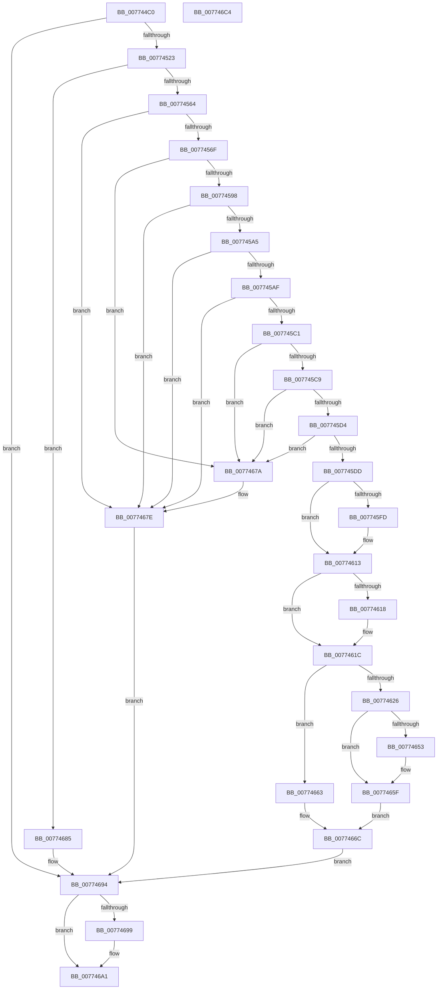

# SshpSessionManagerOpenControlTrace

- RVA: `0x007744C0`–`0x007746C5` (길이 `517` bytes)
- VA: `0x00000001407744C0`
- 실행 섹션: `PAGE`
- PDB 이름 있음: `예`; PDB Function 태그: `아니요`
- unwind 정보 RVA: `0x000CDA4C`
- 디코드: `125`개 명령, `517/517` bytes 표시
- 미해석 바이트: `0` (있으면 어셈블리에 `.byte`로 보존)

> 이 문서는 커널 이미지의 기계어와 PDB 기호를 분석해 생성했습니다. 4번과 5번은 함수 원형과 자료형을 바이너리 사용 방식에서 추정한 C 해석이며 원본 소스 복구 결과는 아닙니다.

## 1. Dependencies

- 직접 호출 지점: **8**; 고유 호출 대상: **8**
- 직접 호출자로 확인된 함수: **1**
- RIP 상대 이미지 참조: **9**

### Outgoing calls
- `0x00774510` → [IoConvertFileHandleToKernelHandle](../A8/IoConvertFileHandleToKernelHandle_function_00A85680.md) (function, `0x00A85680`)
- `0x00774557` → [ZwReadFile](../../text/6A/ZwReadFile_function_006AD190.md) (function, `0x006AD190`)
- `0x007745E9` → [KeAbPreAcquire](../../text/21/KeAbPreAcquire_function_00210230.md) (function, `0x00210230`)
- `0x0077460E` → [ExfAcquirePushLockExclusiveEx](../../text/20/ExfAcquirePushLockExclusiveEx_function_0020FC90.md) (function, `0x0020FC90`)
- `0x0077465A` → [SshpWorkItemQueue](../../text/48/SshpWorkItemQueue_function_00486B3C.md) (function, `0x00486B3C`)
- `0x00774673` → [SSHSupportReleasePushLockExclusive](../../text/49/SSHSupportReleasePushLockExclusive_function_004954EC.md) (function, `0x004954EC`)
- `0x0077469C` → [ZwClose](../../text/6A/ZwClose_function_006AD2B0.md) (function, `0x006AD2B0`)
- `0x007746AA` → [_security_check_cookie](../../text/6A/_security_check_cookie_function_006AC640.md) (function, `0x006AC640`)

### Direct callers
- [SshpAlpcProcessMessage](SshpAlpcProcessMessage_function_007752C8.md) at `0x00775341`

### Static image references
- `0x007744D7` → RVA `0x00E0A740` (`.data`; read)
- `0x007745E0` → RVA `0x00F06B70` (`.data`; read)
- `0x007745EE` → RVA `0x00F06B70` (`.data`; read/write)
- `0x0077461C` → RVA `0x00F06BA8` (`.data`; read)
- `0x00774630` → RVA `0x00F06C08` (`.data`; read)
- `0x0077463B` → RVA `0x00F06BD8` (`.data`; read)
- `0x00774642` → RVA `0x00F06BA8` (`.data`; write)
- `0x00774649` → RVA `0x00F06BE8` (`.data`; write)
- `0x00774653` → RVA `0x00F06BB0` (`.data`; read)

## 2. Other-region calls and transfers

- 다른 실행 섹션으로 향하는 call: **7**
  - `0x00774557` → [ZwReadFile](../../text/6A/ZwReadFile_function_006AD190.md) (`PAGE` → `.text`)
  - `0x007745E9` → [KeAbPreAcquire](../../text/21/KeAbPreAcquire_function_00210230.md) (`PAGE` → `.text`)
  - `0x0077460E` → [ExfAcquirePushLockExclusiveEx](../../text/20/ExfAcquirePushLockExclusiveEx_function_0020FC90.md) (`PAGE` → `.text`)
  - `0x0077465A` → [SshpWorkItemQueue](../../text/48/SshpWorkItemQueue_function_00486B3C.md) (`PAGE` → `.text`)
  - `0x00774673` → [SSHSupportReleasePushLockExclusive](../../text/49/SSHSupportReleasePushLockExclusive_function_004954EC.md) (`PAGE` → `.text`)
  - `0x0077469C` → [ZwClose](../../text/6A/ZwClose_function_006AD2B0.md) (`PAGE` → `.text`)
  - `0x007746AA` → [_security_check_cookie](../../text/6A/_security_check_cookie_function_006AC640.md) (`PAGE` → `.text`)
- 별도 외부 분기/꼬리 이동을 확인하지 못했습니다.

## 3. Assembly (complete function range)

```asm
007744C0  4C 8B DC                        mov r11, rsp
007744C3  49 89 5B 10                     mov qword ptr [r11 + 0x10], rbx
007744C7  49 89 7B 18                     mov qword ptr [r11 + 0x18], rdi
007744CB  55                              push rbp
007744CC  49 8D 6B A1                     lea rbp, [r11 - 0x5f]
007744D0  48 81 EC 90 00 00 00            sub rsp, 0x90
007744D7  48 8B 05 62 62 69 00            mov rax, qword ptr [rip + 0x696262]
007744DE  48 33 C4                        xor rax, rsp
007744E1  48 89 45 4F                     mov qword ptr [rbp + 0x4f], rax
007744E5  48 83 65 1F 00                  and qword ptr [rbp + 0x1f], 0
007744EA  33 C0                           xor eax, eax
007744EC  48 21 45 17                     and qword ptr [rbp + 0x17], rax
007744F0  0F 57 C0                        xorps xmm0, xmm0
007744F3  45 33 C9                        xor r9d, r9d
007744F6  48 89 45 47                     mov qword ptr [rbp + 0x47], rax
007744FA  48 8D 45 17                     lea rax, [rbp + 0x17]
007744FE  B2 01                           mov dl, 1
00774500  0F 11 45 37                     movups xmmword ptr [rbp + 0x37], xmm0
00774504  49 89 43 88                     mov qword ptr [r11 - 0x78], rax
00774508  45 8D 41 03                     lea r8d, [r9 + 3]
0077450C  0F 11 45 27                     movups xmmword ptr [rbp + 0x27], xmm0
00774510  E8 6B 11 31 00                  call 0x140a85680
00774515  48 8B 7D 17                     mov rdi, qword ptr [rbp + 0x17]
00774519  8B D8                           mov ebx, eax
0077451B  85 C0                           test eax, eax
0077451D  0F 88 71 01 00 00               js 0x140774694
00774523  48 83 64 24 40 00               and qword ptr [rsp + 0x40], 0
00774529  48 8D 45 1F                     lea rax, [rbp + 0x1f]
0077452D  48 89 44 24 38                  mov qword ptr [rsp + 0x38], rax
00774532  45 33 C9                        xor r9d, r9d
00774535  48 8D 45 37                     lea rax, [rbp + 0x37]
00774539  C7 44 24 30 18 00 00 00         mov dword ptr [rsp + 0x30], 0x18
00774541  48 89 44 24 28                  mov qword ptr [rsp + 0x28], rax
00774546  45 33 C0                        xor r8d, r8d
00774549  48 8D 45 27                     lea rax, [rbp + 0x27]
0077454D  33 D2                           xor edx, edx
0077454F  48 8B CF                        mov rcx, rdi
00774552  48 89 44 24 20                  mov qword ptr [rsp + 0x20], rax
00774557  E8 34 8C F3 FF                  call 0x1406ad190
0077455C  85 C0                           test eax, eax
0077455E  0F 88 21 01 00 00               js 0x140774685
00774564  48 83 7D 2F 18                  cmp qword ptr [rbp + 0x2f], 0x18
00774569  0F 85 0F 01 00 00               jne 0x14077467e
0077456F  8B 4D 47                        mov ecx, dword ptr [rbp + 0x47]
00774572  44 8B 55 3B                     mov r10d, dword ptr [rbp + 0x3b]
00774576  44 8B 45 4B                     mov r8d, dword ptr [rbp + 0x4b]
0077457A  8B 55 43                        mov edx, dword ptr [rbp + 0x43]
0077457D  44 8B 4D 3F                     mov r9d, dword ptr [rbp + 0x3f]
00774581  42 8D 04 11                     lea eax, [rcx + r10]
00774585  41 03 C0                        add eax, r8d
00774588  03 C2                           add eax, edx
0077458A  03 45 37                        add eax, dword ptr [rbp + 0x37]
0077458D  F7 D0                           not eax
0077458F  44 3B C8                        cmp r9d, eax
00774592  0F 85 E2 00 00 00               jne 0x14077467a
00774598  81 7D 37 5F 53 50 52            cmp dword ptr [rbp + 0x37], 0x5250535f
0077459F  0F 85 D9 00 00 00               jne 0x14077467e
007745A5  41 83 FA 01                     cmp r10d, 1
007745A9  0F 85 CF 00 00 00               jne 0x14077467e
007745AF  41 8D 80 00 00 F0 FF            lea eax, [r8 - 0x100000]
007745B6  3D 00 00 F0 03                  cmp eax, 0x3f00000
007745BB  0F 87 BD 00 00 00               ja 0x14077467e
007745C1  3B D1                           cmp edx, ecx
007745C3  0F 87 B1 00 00 00               ja 0x14077467a
007745C9  2B CA                           sub ecx, edx
007745CB  41 3B C8                        cmp ecx, r8d
007745CE  0F 87 A6 00 00 00               ja 0x14077467a
007745D4  41 3B D0                        cmp edx, r8d
007745D7  0F 83 9D 00 00 00               jae 0x14077467a
007745DD  45 33 C0                        xor r8d, r8d
007745E0  48 8D 0D 89 25 79 00            lea rcx, [rip + 0x792589]
007745E7  33 D2                           xor edx, edx
007745E9  E8 42 BC A9 FF                  call 0x140210230
007745EE  F0 48 0F BA 2D 78 25 79 00 00   lock bts qword ptr [rip + 0x792578], 0
007745F8  48 8B D8                        mov rbx, rax
007745FB  73 16                           jae 0x140774613
007745FD  4C 8D 05 6C 25 79 00            lea r8, [rip + 0x79256c]
00774604  48 8B D0                        mov rdx, rax
00774607  48 8D 0D 62 25 79 00            lea rcx, [rip + 0x792562]
0077460E  E8 7D B6 A9 FF                  call 0x14020fc90
00774613  48 85 DB                        test rbx, rbx
00774616  74 04                           je 0x14077461c
00774618  C6 43 0A 01                     mov byte ptr [rbx + 0xa], 1
0077461C  48 83 3D 84 25 79 00 00         cmp qword ptr [rip + 0x792584], 0
00774624  75 3D                           jne 0x140774663
00774626  0F 10 45 37                     movups xmm0, xmmword ptr [rbp + 0x37]
0077462A  48 8B 45 17                     mov rax, qword ptr [rbp + 0x17]
0077462E  33 FF                           xor edi, edi
00774630  39 3D D2 25 79 00               cmp dword ptr [rip + 0x7925d2], edi
00774636  F2 0F 10 4D 47                  movsd xmm1, qword ptr [rbp + 0x47]
0077463B  0F 11 05 96 25 79 00            movups xmmword ptr [rip + 0x792596], xmm0
00774642  48 89 05 5F 25 79 00            mov qword ptr [rip + 0x79255f], rax
00774649  F2 0F 11 0D 97 25 79 00         movsd qword ptr [rip + 0x792597], xmm1
00774651  74 0C                           je 0x14077465f
00774653  48 8D 0D 56 25 79 00            lea rcx, [rip + 0x792556]
0077465A  E8 DD 24 D1 FF                  call 0x140486b3c
0077465F  33 DB                           xor ebx, ebx
00774661  EB 09                           jmp 0x14077466c
00774663  48 8B 7D 17                     mov rdi, qword ptr [rbp + 0x17]
00774667  BB 21 00 00 C0                  mov ebx, 0xc0000021
0077466C  48 8D 0D FD 24 79 00            lea rcx, [rip + 0x7924fd]
00774673  E8 74 0E D2 FF                  call 0x1404954ec
00774678  EB 1A                           jmp 0x140774694
0077467A  44 89 4D 3F                     mov dword ptr [rbp + 0x3f], r9d
0077467E  BB 0B 09 00 C0                  mov ebx, 0xc000090b
00774683  EB 0F                           jmp 0x140774694
00774685  BB 0B 09 00 C0                  mov ebx, 0xc000090b
0077468A  3D 11 00 00 C0                  cmp eax, 0xc0000011
0077468F  0F 44 C3                        cmove eax, ebx
00774692  8B D8                           mov ebx, eax
00774694  48 85 FF                        test rdi, rdi
00774697  74 08                           je 0x1407746a1
00774699  48 8B CF                        mov rcx, rdi
0077469C  E8 0F 8C F3 FF                  call 0x1406ad2b0
007746A1  8B C3                           mov eax, ebx
007746A3  48 8B 4D 4F                     mov rcx, qword ptr [rbp + 0x4f]
007746A7  48 33 CC                        xor rcx, rsp
007746AA  E8 91 7F F3 FF                  call 0x1406ac640
007746AF  4C 8D 9C 24 90 00 00 00         lea r11, [rsp + 0x90]
007746B7  49 8B 5B 18                     mov rbx, qword ptr [r11 + 0x18]
007746BB  49 8B 7B 20                     mov rdi, qword ptr [r11 + 0x20]
007746BF  49 8B E3                        mov rsp, r11
007746C2  5D                              pop rbp
007746C3  C3                              ret
007746C4  CC                              int3
```

## 4. C-style interpretation (structured pseudocode)

```c
__int64 __fastcall SshpSessionManagerOpenControlTrace(__int64 a1, __int64 a2, __int64 a3, int a4)
{
    __int64 result;
    __int64 v_rbx;
    __int64 v_rdi;
    __int64 v_rsp;
    unsigned __int64 v_stack_m58;
    unsigned __int64 v_stack_m60;
    unsigned int v_stack_m68;
    unsigned __int64 v_stack_m70;
    unsigned __int64 v_stack_m78;
    unsigned __int64 v_stack_m8;

    *(unsigned __int64 *)(v_rsp + 16) = v_rbx;
    *(unsigned __int64 *)(v_rsp + 24) = v_rdi;
    v_rsp = (v_rsp) - (144);
    result = (*(unsigned __int64 *)(v_rip + 6906466)) ^ (v_rsp);
    *(unsigned __int64 *)(v_rsp - 95 + 79) = result;
    result = 0;
    a4 = 0;
    *(unsigned __int64 *)(v_rsp - 95 + 71) = 0;
    *(unsigned __int64 *)(v_rsp - 95 + 55) = v_xmm0;
    *(unsigned __int64 *)(v_rsp - 120) = v_rsp - 95 + 23;
    *(unsigned __int64 *)(v_rsp - 95 + 39) = v_xmm0;
    result = IoConvertFileHandleToKernelHandle(a1, 1, a4 + 3, a4);
    if (sign_flag) goto loc_00774694;
    v_stack_m60 = v_rsp - 95 + 31;
    a4 = 0;
    v_stack_m68 = 24;
    v_stack_m70 = v_rsp - 95 + 55;
    a3 = 0;
    a2 = 0;
    v_stack_m78 = v_rsp - 95 + 39;
    result = ZwReadFile(*(unsigned __int64 *)(v_rsp - 95 + 23), a2, a3, a4);
    if (sign_flag) goto loc_00774685;
    if ((*(unsigned __int64 *)(v_rsp - 95 + 47)) != 24) goto loc_0077467E;
    result = (unsigned int)(((unsigned int)(*(unsigned int *)(v_rsp - 95 + 71)) + (unsigned int)(*(unsigned int *)(v_rsp - 95 + 59)) * 1) + ((unsigned int)((unsigned int)(*(unsigned int *)(v_rsp - 95 + 75)))));
    result = (unsigned int)((result) + ((unsigned int)((unsigned int)(*(unsigned int *)(v_rsp - 95 + 67)))));
    result = (unsigned int)((result) + (*(unsigned int *)(v_rsp - 95 + 55)));
    result = (unsigned int)(~(result));
    if (((unsigned int)((unsigned int)(*(unsigned int *)(v_rsp - 95 + 63)))) != ((unsigned int)(result))) goto loc_0077467A;
    if ((*(unsigned int *)(v_rsp - 95 + 55)) != 0x5250535FULL) goto loc_0077467E;
    if (((unsigned int)((unsigned int)(*(unsigned int *)(v_rsp - 95 + 59)))) != 1) goto loc_0077467E;
    if (((unsigned int)((unsigned int)(*(unsigned int *)(v_rsp - 95 + 75)) - 1048576)) > 0x3F00000ULL) goto loc_0077467E;
    if (((unsigned int)((unsigned int)(*(unsigned int *)(v_rsp - 95 + 67)))) > ((unsigned int)((unsigned int)(*(unsigned int *)(v_rsp - 95 + 71))))) goto loc_0077467A;
    a1 = (unsigned int)(((unsigned int)(*(unsigned int *)(v_rsp - 95 + 71))) - ((unsigned int)((unsigned int)(*(unsigned int *)(v_rsp - 95 + 67)))));
    if (((unsigned int)(a1)) > ((unsigned int)((unsigned int)(*(unsigned int *)(v_rsp - 95 + 75))))) goto loc_0077467A;
    if (((unsigned int)((unsigned int)(*(unsigned int *)(v_rsp - 95 + 67)))) >= ((unsigned int)((unsigned int)(*(unsigned int *)(v_rsp - 95 + 75))))) goto loc_0077467A;
    a3 = 0;
    a2 = 0;
    result = KeAbPreAcquire(v_rip + 7939465, a2, a3, (unsigned int)(*(unsigned int *)(v_rsp - 95 + 63)));
    if (!(condition_is_above_or_equal)) {
        a3 = v_rip + 7939436;
        a2 = result;
        a1 = v_rip + 7939426;
        result = ExfAcquirePushLockExclusiveEx(a1, a2, a3, (unsigned int)(*(unsigned int *)(v_rsp - 95 + 63)));
    }
    if (result != 0) {
        *(unsigned __int8 *)(result + 10) = 1;
    }
    if ((*(unsigned __int64 *)(v_rip + 7939460)) != 0) goto loc_00774663;
    v_rdi = 0;
    *(unsigned __int64 *)(v_rip + 7939478) = v_xmm0;
    *(unsigned __int64 *)(v_rip + 7939423) = *(unsigned __int64 *)(v_rsp - 95 + 23);
    *(unsigned __int64 *)(v_rip + 7939479) = v_xmm1;
    result = *(unsigned __int64 *)(v_rsp - 95 + 23);
    if ((*(unsigned int *)(v_rip + 7939538)) != 0) {
        a1 = v_rip + 7939414;
        result = SshpWorkItemQueue(a1, a2, a3, (unsigned int)(*(unsigned int *)(v_rsp - 95 + 63)));
    }
    v_rbx = 0;
    goto loc_0077466C;
loc_00774663:
loc_0077466C:
    result = SSHSupportReleasePushLockExclusive(v_rip + 7939325, a2, a3, (unsigned int)(*(unsigned int *)(v_rsp - 95 + 63)));
    goto loc_00774694;
loc_0077467A:
    *(unsigned int *)(v_rsp - 95 + 63) = (unsigned int)((unsigned int)(*(unsigned int *)(v_rsp - 95 + 63)));
loc_0077467E:
    goto loc_00774694;
loc_00774685:
    if (((unsigned int)(result)) == 0xC0000011ULL) { result = (unsigned int)((unsigned int)(0xC000090BULL)); }
loc_00774694:
    if (*(unsigned __int64 *)(v_rsp - 95 + 23) != 0) {
        a1 = *(unsigned __int64 *)(v_rsp - 95 + 23);
        result = ZwClose(a1, a2, a3, (unsigned int)(*(unsigned int *)(v_rsp - 95 + 63)));
    }
    a1 = (*(unsigned __int64 *)(v_rsp - 95 + 79)) ^ (v_rsp);
    result = _security_check_cookie(a1, a2, a3, (unsigned int)(*(unsigned int *)(v_rsp - 95 + 63)));
    return result;
}
```

## 5. (Beta) C Style

```c
int64_t SshpSessionManagerOpenControlTrace(int64_t Arg1, int64_t Arg2, int64_t Arg3, int32_t Arg4)
{
    int64_t result;
    int64_t local_rbx;
    int64_t local_rdi;
    int64_t local_rsp;
    uint64_t v_stack_m58;
    uint64_t v_stack_m60;
    uint32_t v_stack_m68;
    uint64_t v_stack_m70;
    uint64_t v_stack_m78;
    uint64_t v_stack_m8;

    *(uint64_t *)(local_rsp + 0x10) = local_rbx;
    *(uint64_t *)(local_rsp + 0x18) = local_rdi;
    local_rsp = (local_rsp) - (144);
    result = (*(uint64_t *)(v_rip + 0x696262)) ^ (local_rsp);
    *(uint64_t *)(local_rsp - 0x5F + 0x4F) = result;
    result = 0;
    Arg4 = 0;
    *(uint64_t *)(local_rsp - 0x5F + 0x47) = 0;
    *(uint64_t *)(local_rsp - 0x5F + 0x37) = v_xmm0;
    *(uint64_t *)(local_rsp - 0x78) = local_rsp - 95 + 23;
    *(uint64_t *)(local_rsp - 0x5F + 0x27) = v_xmm0;
    result = IoConvertFileHandleToKernelHandle(Arg1, 1, Arg4 + 3, Arg4);
    if (sign_flag) goto loc_00774694;
    v_stack_m60 = local_rsp - 95 + 31;
    Arg4 = 0;
    v_stack_m68 = 24;
    v_stack_m70 = local_rsp - 95 + 55;
    Arg3 = 0;
    Arg2 = 0;
    v_stack_m78 = local_rsp - 95 + 39;
    result = ZwReadFile(*(uint64_t *)(local_rsp - 0x5F + 0x17), Arg2, Arg3, Arg4);
    if (sign_flag) goto loc_00774685;
    if ((*(uint64_t *)(local_rsp - 0x5F + 0x2F)) != 24) goto loc_0077467E;
    result = (uint32_t)(((uint32_t)(*(uint32_t *)(local_rsp - 0x5F + 0x47)) + (uint32_t)(*(uint32_t *)(local_rsp - 0x5F + 0x3B)) * 1) + ((uint32_t)((uint32_t)(*(uint32_t *)(local_rsp - 0x5F + 0x4B)))));
    result = (uint32_t)((result) + ((uint32_t)((uint32_t)(*(uint32_t *)(local_rsp - 0x5F + 0x43)))));
    result = (uint32_t)((result) + (*(uint32_t *)(local_rsp - 0x5F + 0x37)));
    result = (uint32_t)(~(result));
    if (((uint32_t)((uint32_t)(*(uint32_t *)(local_rsp - 0x5F + 0x3F)))) != ((uint32_t)(result))) goto loc_0077467A;
    if ((*(uint32_t *)(local_rsp - 0x5F + 0x37)) != 0x5250535FULL) goto loc_0077467E;
    if (((uint32_t)((uint32_t)(*(uint32_t *)(local_rsp - 0x5F + 0x3B)))) != 1) goto loc_0077467E;
    if (((uint32_t)((uint32_t)(*(uint32_t *)(local_rsp - 0x5F + 0x4B)) - 1048576)) > 0x3F00000ULL) goto loc_0077467E;
    if (((uint32_t)((uint32_t)(*(uint32_t *)(local_rsp - 0x5F + 0x43)))) > ((uint32_t)((uint32_t)(*(uint32_t *)(local_rsp - 0x5F + 0x47))))) goto loc_0077467A;
    Arg1 = (uint32_t)(((uint32_t)(*(uint32_t *)(local_rsp - 0x5F + 0x47))) - ((uint32_t)((uint32_t)(*(uint32_t *)(local_rsp - 0x5F + 0x43)))));
    if (((uint32_t)(Arg1)) > ((uint32_t)((uint32_t)(*(uint32_t *)(local_rsp - 0x5F + 0x4B))))) goto loc_0077467A;
    if (((uint32_t)((uint32_t)(*(uint32_t *)(local_rsp - 0x5F + 0x43)))) >= ((uint32_t)((uint32_t)(*(uint32_t *)(local_rsp - 0x5F + 0x4B))))) goto loc_0077467A;
    Arg3 = 0;
    Arg2 = 0;
    result = KeAbPreAcquire(v_rip + 7939465, Arg2, Arg3, (uint32_t)(*(uint32_t *)(local_rsp - 0x5F + 0x3F)));
    if (!(condition_is_above_or_equal)) {
        Arg3 = v_rip + 7939436;
        Arg2 = result;
        Arg1 = v_rip + 7939426;
        result = ExfAcquirePushLockExclusiveEx(Arg1, Arg2, Arg3, (uint32_t)(*(uint32_t *)(local_rsp - 0x5F + 0x3F)));
    }
    if (result != 0) {
        *(uint8_t *)(result + 0xA) = 1;
    }
    if ((*(uint64_t *)(v_rip + 0x792584)) != 0) goto loc_00774663;
    local_rdi = 0;
    *(uint64_t *)(v_rip + 0x792596) = v_xmm0;
    *(uint64_t *)(v_rip + 0x79255F) = *(uint64_t *)(local_rsp - 0x5F + 0x17);
    *(uint64_t *)(v_rip + 0x792597) = v_xmm1;
    result = *(uint64_t *)(local_rsp - 0x5F + 0x17);
    if ((*(uint32_t *)(v_rip + 0x7925D2)) != 0) {
        Arg1 = v_rip + 7939414;
        result = SshpWorkItemQueue(Arg1, Arg2, Arg3, (uint32_t)(*(uint32_t *)(local_rsp - 0x5F + 0x3F)));
    }
    local_rbx = 0;
    goto loc_0077466C;
loc_00774663:
loc_0077466C:
    result = SSHSupportReleasePushLockExclusive(v_rip + 7939325, Arg2, Arg3, (uint32_t)(*(uint32_t *)(local_rsp - 0x5F + 0x3F)));
    goto loc_00774694;
loc_0077467A:
    *(uint32_t *)(local_rsp - 0x5F + 0x3F) = (uint32_t)((uint32_t)(*(uint32_t *)(local_rsp - 0x5F + 0x3F)));
loc_0077467E:
    goto loc_00774694;
loc_00774685:
    if (((uint32_t)(result)) == 0xC0000011ULL) { result = (uint32_t)((uint32_t)(0xC000090BULL)); }
loc_00774694:
    if (*(uint64_t *)(local_rsp - 0x5F + 0x17) != 0) {
        Arg1 = *(uint64_t *)(local_rsp - 0x5F + 0x17);
        result = ZwClose(Arg1, Arg2, Arg3, (uint32_t)(*(uint32_t *)(local_rsp - 0x5F + 0x3F)));
    }
    Arg1 = (*(uint64_t *)(local_rsp - 0x5F + 0x4F)) ^ (local_rsp);
    result = _security_check_cookie(Arg1, Arg2, Arg3, (uint32_t)(*(uint32_t *)(local_rsp - 0x5F + 0x3F)));
    return result;
}
```

## 6. Execution-region graph

[열기: 2D/3D 그래프와 함수 탐색 컨트롤 패널](../../../control-panel.html?section=page&rva=0x007744C0&view=graph)

- 2D 그래프는 위에서 아래로 흐르고, 3D 그래프는 빈 공간을 드래그해 회전합니다. Shift+드래그는 이동, 휠은 확대·축소, 함수 노드 선택은 대상 보고서 이동입니다.

### Static fallback


