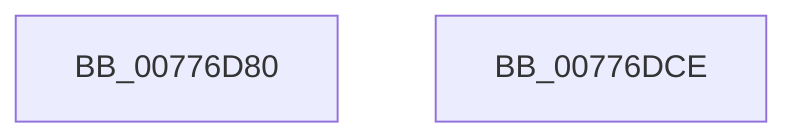

# TtmInit

- RVA: `0x00776D80`–`0x00776DCF` (길이 `79` bytes)
- VA: `0x0000000140776D80`
- 실행 섹션: `PAGE`
- PDB 이름 있음: `예`; PDB Function 태그: `아니요`
- unwind 정보 RVA: `0x0005C788`
- 디코드: `17`개 명령, `79/79` bytes 표시
- 미해석 바이트: `0` (있으면 어셈블리에 `.byte`로 보존)

> 이 문서는 커널 이미지의 기계어와 PDB 기호를 분석해 생성했습니다. 4번과 5번은 함수 원형과 자료형을 바이너리 사용 방식에서 추정한 C 해석이며 원본 소스 복구 결과는 아닙니다.

## 1. Dependencies

- 직접 호출 지점: **5**; 고유 호출 대상: **4**
- 직접 호출자로 확인된 함수: **1**
- RIP 상대 이미지 참조: **5**

### Outgoing calls
- `0x00776D84` → [TtmiInitQueues](TtmiInitQueues_function_0077DB68.md) (function, `0x0077DB68`)
- `0x00776D90` → [ExInitializeResourceLite](../../text/41/ExInitializeResourceLite_function_0041F9A0.md) (function, `0x0041F9A0`)
- `0x00776D9D` → [TtmiInitTerminals](TtmiInitTerminals_function_0077CA40.md) (function, `0x0077CA40`)
- `0x00776DB3` → [TraceLoggingRegisterEx_EtwRegister_EtwSetInformation](../92/TraceLoggingRegisterEx_EtwRegister_EtwSetInformation_function_009208A0.md) (function, `0x009208A0`)
- `0x00776DC4` → [TraceLoggingRegisterEx_EtwRegister_EtwSetInformation](../92/TraceLoggingRegisterEx_EtwRegister_EtwSetInformation_function_009208A0.md) (function, `0x009208A0`)

### Direct callers
- [PoInitSystem](../../init/C7/PoInitSystem_function_00C72358.md) at `0x00C73201`

### Static image references
- `0x00776D89` → RVA `0x00F06940` (`.data`; read)
- `0x00776D95` → RVA `0x00FD9B90` (`PAGEDATA`; read/write)
- `0x00776DA5` → RVA `0x0077C720` (`TtmpTraceLoggingCallback`; read)
- `0x00776DAC` → RVA `0x00FD88C8` (`PAGEDATA`; read)
- `0x00776DBB` → RVA `0x00FD8890` (`PAGEDATA`; read)

## 2. Other-region calls and transfers

- 다른 실행 섹션으로 향하는 call: **1**
  - `0x00776D90` → [ExInitializeResourceLite](../../text/41/ExInitializeResourceLite_function_0041F9A0.md) (`PAGE` → `.text`)
- 별도 외부 분기/꼬리 이동을 확인하지 못했습니다.

## 3. Assembly (complete function range)

```asm
00776D80  48 83 EC 28                     sub rsp, 0x28
00776D84  E8 DF 6D 00 00                  call 0x14077db68
00776D89  48 8D 0D B0 FB 78 00            lea rcx, [rip + 0x78fbb0]
00776D90  E8 0B 8C CA FF                  call 0x14041f9a0
00776D95  48 83 25 F3 2D 86 00 00         and qword ptr [rip + 0x862df3], 0
00776D9D  E8 9E 5C 00 00                  call 0x14077ca40
00776DA2  45 33 C0                        xor r8d, r8d
00776DA5  48 8D 15 74 59 00 00            lea rdx, [rip + 0x5974]
00776DAC  48 8D 0D 15 1B 86 00            lea rcx, [rip + 0x861b15]
00776DB3  E8 E8 9A 1A 00                  call 0x1409208a0
00776DB8  45 33 C0                        xor r8d, r8d
00776DBB  48 8D 0D CE 1A 86 00            lea rcx, [rip + 0x861ace]
00776DC2  33 D2                           xor edx, edx
00776DC4  E8 D7 9A 1A 00                  call 0x1409208a0
00776DC9  48 83 C4 28                     add rsp, 0x28
00776DCD  C3                              ret
00776DCE  CC                              int3
```

## 4. C-style interpretation (structured pseudocode)

```c
__int64 __fastcall TtmInit(__int64 a1, __int64 a2, int a3)
{
    __int64 result;
    __int64 v_rsp;

    v_rsp = (v_rsp) - (40);
    result = TtmiInitQueues(a1, a2, a3, a4);
    result = ExInitializeResourceLite(v_rip + 7928752, a2, a3, a4);
    result = TtmiInitTerminals(v_rip + 7928752, a2, a3, a4);
    a3 = 0;
    result = TraceLoggingRegisterEx_EtwRegister_EtwSetInformation(v_rip + 8788757, v_rip + 22900, a3, a4);
    a3 = 0;
    a2 = 0;
    result = TraceLoggingRegisterEx_EtwRegister_EtwSetInformation(v_rip + 8788686, a2, a3, a4);
    v_rsp = (v_rsp) + (40);
    return result;
}
```

## 5. (Beta) C Style

```c
int64_t TtmInit(int64_t Arg1, int64_t Arg2, int32_t Arg3)
{
    int64_t result;
    int64_t local_rsp;

    local_rsp = (local_rsp) - (40);
    result = TtmiInitQueues(Arg1, Arg2, Arg3, a4);
    result = ExInitializeResourceLite(v_rip + 7928752, Arg2, Arg3, a4);
    result = TtmiInitTerminals(v_rip + 7928752, Arg2, Arg3, a4);
    Arg3 = 0;
    result = TraceLoggingRegisterEx_EtwRegister_EtwSetInformation(v_rip + 8788757, v_rip + 22900, Arg3, a4);
    Arg3 = 0;
    Arg2 = 0;
    result = TraceLoggingRegisterEx_EtwRegister_EtwSetInformation(v_rip + 8788686, Arg2, Arg3, a4);
    local_rsp = (local_rsp) + (40);
    return result;
}
```

## 6. Execution-region graph

[열기: 2D/3D 그래프와 함수 탐색 컨트롤 패널](../../../control-panel.html?section=page&rva=0x00776D80&view=graph)

- 2D 그래프는 위에서 아래로 흐르고, 3D 그래프는 빈 공간을 드래그해 회전합니다. Shift+드래그는 이동, 휠은 확대·축소, 함수 노드 선택은 대상 보고서 이동입니다.

### Static fallback


