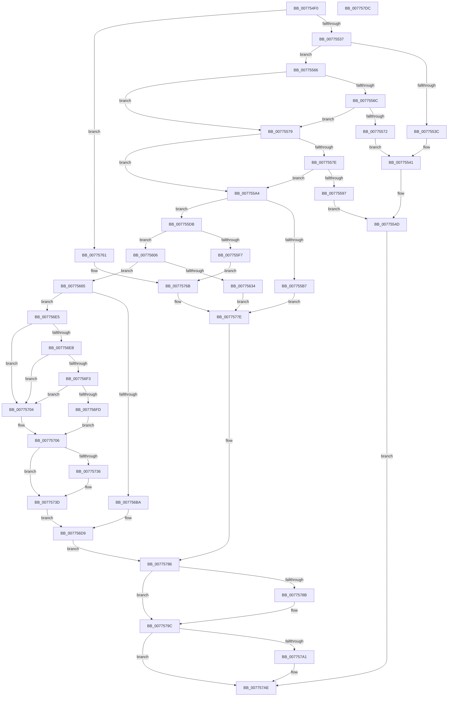

# TtmNotifyDeviceArrival

- RVA: `0x007754F0`–`0x007757DD` (길이 `749` bytes)
- VA: `0x00000001407754F0`
- 실행 섹션: `PAGE`
- PDB 이름 있음: `예`; PDB Function 태그: `아니요`
- unwind 정보 RVA: `0x000CDC38`
- 디코드: `194`개 명령, `749/749` bytes 표시
- 미해석 바이트: `0` (있으면 어셈블리에 `.byte`로 보존)

> 이 문서는 커널 이미지의 기계어와 PDB 기호를 분석해 생성했습니다. 4번과 5번은 함수 원형과 자료형을 바이너리 사용 방식에서 추정한 C 해석이며 원본 소스 복구 결과는 아닙니다.

## 1. Dependencies

- 직접 호출 지점: **15**; 고유 호출 대상: **11**
- 직접 호출자로 확인된 함수: **0**
- RIP 상대 이미지 참조: **2**

### Outgoing calls
- `0x00775554` → [TtmiLogError](../98/TtmiLogError_function_0098B39C.md) (function, `0x0098B39C`)
- `0x0077558C` → [RtlStringCchLengthW](../../text/43/RtlStringCchLengthW_function_00435A70.md) (function, `0x00435A70`)
- `0x007755AC` → [TtmiAcquireCurrentSession](TtmiAcquireCurrentSession_function_00777010.md) (function, `0x00777010`)
- `0x007755C9` → [TtmiLogError](../98/TtmiLogError_function_0098B39C.md) (function, `0x0098B39C`)
- `0x007755EE` → [TtmpFindDeviceByToken](TtmpFindDeviceByToken_function_00776568.md) (function, `0x00776568`)
- `0x00775627` → [ExAllocatePool2](../../poolcode/B8/ExAllocatePool2_function_00B820F0.md) (function, `0x00B820F0`)
- `0x0077564C` → [TtmiLogError](../98/TtmiLogError_function_0098B39C.md) (function, `0x0098B39C`)
- `0x007756AF` → [RtlStringCchCopyW](../../text/26/RtlStringCchCopyW_function_0026E9A4.md) (function, `0x0026E9A4`)
- `0x007756CC` → [TtmiLogError](../98/TtmiLogError_function_0098B39C.md) (function, `0x0098B39C`)
- `0x00775753` → [TtmiScheduleSessionWorker](TtmiScheduleSessionWorker_function_00777184.md) (function, `0x00777184`)
- `0x00775779` → [TtmiLogError](../98/TtmiLogError_function_0098B39C.md) (function, `0x0098B39C`)
- `0x00775792` → [ExReleaseResourceLite](../../text/25/ExReleaseResourceLite_function_0025FA10.md) (function, `0x0025FA10`)
- `0x00775797` → [KeLeaveCriticalRegion](../../text/25/KeLeaveCriticalRegion_function_0025D8B0.md) (function, `0x0025D8B0`)
- `0x007757A9` → [ExFreePoolWithTag](../../poolcode/B8/ExFreePoolWithTag_function_00B82870.md) (function, `0x00B82870`)
- `0x007757BD` → [TtmiLogDeviceArrivalNotified](TtmiLogDeviceArrivalNotified_function_007793BC.md) (function, `0x007793BC`)

### Direct callers
- 이 함수 시작 RVA로 연결되는 직접 call은 확인되지 않았습니다. 간접 호출은 완전히 역산할 수 없습니다.

### Static image references
- `0x0077554D` → RVA `0x00B03FE0` (` ?? ::NNGAKEGL::`string'`; read)
- `0x0077578B` → RVA `0x00F06940` (`.data`; read)

## 2. Other-region calls and transfers

- 다른 실행 섹션으로 향하는 call: **6**
  - `0x0077558C` → [RtlStringCchLengthW](../../text/43/RtlStringCchLengthW_function_00435A70.md) (`PAGE` → `.text`)
  - `0x00775627` → [ExAllocatePool2](../../poolcode/B8/ExAllocatePool2_function_00B820F0.md) (`PAGE` → `POOLCODE`)
  - `0x007756AF` → [RtlStringCchCopyW](../../text/26/RtlStringCchCopyW_function_0026E9A4.md) (`PAGE` → `.text`)
  - `0x00775792` → [ExReleaseResourceLite](../../text/25/ExReleaseResourceLite_function_0025FA10.md) (`PAGE` → `.text`)
  - `0x00775797` → [KeLeaveCriticalRegion](../../text/25/KeLeaveCriticalRegion_function_0025D8B0.md) (`PAGE` → `.text`)
  - `0x007757A9` → [ExFreePoolWithTag](../../poolcode/B8/ExFreePoolWithTag_function_00B82870.md) (`PAGE` → `POOLCODE`)
- 별도 외부 분기/꼬리 이동을 확인하지 못했습니다.

## 3. Assembly (complete function range)

```asm
007754F0  48 8B C4                        mov rax, rsp
007754F3  48 89 58 10                     mov qword ptr [rax + 0x10], rbx
007754F7  44 89 48 20                     mov dword ptr [rax + 0x20], r9d
007754FB  89 48 08                        mov dword ptr [rax + 8], ecx
007754FE  55                              push rbp
007754FF  56                              push rsi
00775500  57                              push rdi
00775501  41 54                           push r12
00775503  41 55                           push r13
00775505  41 56                           push r14
00775507  41 57                           push r15
00775509  48 83 EC 40                     sub rsp, 0x40
0077550D  4C 8B AC 24 A0 00 00 00         mov r13, qword ptr [rsp + 0xa0]
00775515  45 33 D2                        xor r10d, r10d
00775518  41 83 CF FF                     or r15d, 0xffffffff
0077551C  4C 89 50 18                     mov qword ptr [rax + 0x18], r10
00775520  4D 8B F0                        mov r14, r8
00775523  4C 8B E2                        mov r12, rdx
00775526  8B D9                           mov ebx, ecx
00775528  41 8B EA                        mov ebp, r10d
0077552B  41 8B F2                        mov esi, r10d
0077552E  4D 85 C0                        test r8, r8
00775531  0F 84 2A 02 00 00               je 0x140775761
00775537  4D 39 10                        cmp qword ptr [r8], r10
0077553A  75 2A                           jne 0x140775566
0077553C  BA 76 01 00 00                  mov edx, 0x176
00775541  BF 0D 00 00 C0                  mov edi, 0xc000000d
00775546  41 83 C8 FF                     or r8d, 0xffffffff
0077554A  44 8B CF                        mov r9d, edi
0077554D  48 8D 0D 8C EA 38 00            lea rcx, [rip + 0x38ea8c]
00775554  E8 43 5E 21 00                  call 0x14098b39c
00775559  44 8B B4 24 98 00 00 00         mov r14d, dword ptr [rsp + 0x98]
00775561  E9 48 02 00 00                  jmp 0x1407757ae
00775566  4D 39 50 18                     cmp qword ptr [r8 + 0x18], r10
0077556A  74 0D                           je 0x140775579
0077556C  4D 39 50 10                     cmp qword ptr [r8 + 0x10], r10
00775570  74 07                           je 0x140775579
00775572  BA 7D 01 00 00                  mov edx, 0x17d
00775577  EB C8                           jmp 0x140775541
00775579  4D 85 ED                        test r13, r13
0077557C  74 26                           je 0x1407755a4
0077557E  49 8B 4D 08                     mov rcx, qword ptr [r13 + 8]
00775582  4C 8D 44 24 30                  lea r8, [rsp + 0x30]
00775587  BA 04 01 00 00                  mov edx, 0x104
0077558C  E8 DF 04 CC FF                  call 0x140435a70
00775591  8B F8                           mov edi, eax
00775593  85 C0                           test eax, eax
00775595  79 0D                           jns 0x1407755a4
00775597  44 8B C8                        mov r9d, eax
0077559A  44 8B C0                        mov r8d, eax
0077559D  BA 91 01 00 00                  mov edx, 0x191
007755A2  EB A9                           jmp 0x14077554d
007755A4  48 8D 8C 24 90 00 00 00         lea rcx, [rsp + 0x90]
007755AC  E8 5F 1A 00 00                  call 0x140777010
007755B1  8B F8                           mov edi, eax
007755B3  85 C0                           test eax, eax
007755B5  79 24                           jns 0x1407755db
007755B7  44 8B C8                        mov r9d, eax
007755BA  48 8D 0D 1F EA 38 00            lea rcx, [rip + 0x38ea1f]
007755C1  44 8B C0                        mov r8d, eax
007755C4  BA 9C 01 00 00                  mov edx, 0x19c
007755C9  E8 CE 5D 21 00                  call 0x14098b39c
007755CE  48 8B AC 24 90 00 00 00         mov rbp, qword ptr [rsp + 0x90]
007755D6  E9 A3 01 00 00                  jmp 0x14077577e
007755DB  48 8B AC 24 90 00 00 00         mov rbp, qword ptr [rsp + 0x90]
007755E3  45 33 C9                        xor r9d, r9d
007755E6  48 8B CD                        mov rcx, rbp
007755E9  4D 8B C4                        mov r8, r12
007755EC  8B D3                           mov edx, ebx
007755EE  E8 75 0F 00 00                  call 0x140776568
007755F3  84 C0                           test al, al
007755F5  74 0F                           je 0x140775606
007755F7  BF 38 00 00 C0                  mov edi, 0xc0000038
007755FC  BA AE 01 00 00                  mov edx, 0x1ae
00775601  E9 65 01 00 00                  jmp 0x14077576b
00775606  BB 01 00 00 00                  mov ebx, 1
0077560B  44 8B FB                        mov r15d, ebx
0077560E  F0 44 0F C1 7D 70               lock xadd dword ptr [rbp + 0x70], r15d
00775614  BA 68 02 00 00                  mov edx, 0x268
00775619  B9 00 01 00 00                  mov ecx, 0x100
0077561E  41 B8 54 74 6D 44               mov r8d, 0x446d7454
00775624  44 03 FB                        add r15d, ebx
00775627  E8 C4 CA 40 00                  call 0x140b820f0
0077562C  48 8B F0                        mov rsi, rax
0077562F  48 85 C0                        test rax, rax
00775632  75 31                           jne 0x140775665
00775634  BF 9A 00 00 C0                  mov edi, 0xc000009a
00775639  48 8D 0D A0 E9 38 00            lea rcx, [rip + 0x38e9a0]
00775640  44 8B CF                        mov r9d, edi
00775643  41 83 C8 FF                     or r8d, 0xffffffff
00775647  BA C4 01 00 00                  mov edx, 0x1c4
0077564C  E8 4B 5D 21 00                  call 0x14098b39c
00775651  48 8B AC 24 90 00 00 00         mov rbp, qword ptr [rsp + 0x90]
00775659  8B 9C 24 80 00 00 00            mov ebx, dword ptr [rsp + 0x80]
00775660  E9 19 01 00 00                  jmp 0x14077577e
00775665  8B 84 24 80 00 00 00            mov eax, dword ptr [rsp + 0x80]
0077566C  48 8D 4E 4C                     lea rcx, [rsi + 0x4c]
00775670  89 46 10                        mov dword ptr [rsi + 0x10], eax
00775673  BA 04 01 00 00                  mov edx, 0x104
00775678  4C 89 66 18                     mov qword ptr [rsi + 0x18], r12
0077567C  44 89 7E 20                     mov dword ptr [rsi + 0x20], r15d
00775680  49 8B 06                        mov rax, qword ptr [r14]
00775683  48 89 46 28                     mov qword ptr [rsi + 0x28], rax
00775687  49 8B 46 08                     mov rax, qword ptr [r14 + 8]
0077568B  48 89 46 30                     mov qword ptr [rsi + 0x30], rax
0077568F  49 8B 46 10                     mov rax, qword ptr [r14 + 0x10]
00775693  48 89 46 38                     mov qword ptr [rsi + 0x38], rax
00775697  49 8B 46 18                     mov rax, qword ptr [r14 + 0x18]
0077569B  44 8B B4 24 98 00 00 00         mov r14d, dword ptr [rsp + 0x98]
007756A3  48 89 46 40                     mov qword ptr [rsi + 0x40], rax
007756A7  44 89 76 48                     mov dword ptr [rsi + 0x48], r14d
007756AB  4D 8B 45 08                     mov r8, qword ptr [r13 + 8]
007756AF  E8 F0 92 AF FF                  call 0x14026e9a4
007756B4  8B F8                           mov edi, eax
007756B6  85 C0                           test eax, eax
007756B8  79 2B                           jns 0x1407756e5
007756BA  44 8B C8                        mov r9d, eax
007756BD  48 8D 0D 1C E9 38 00            lea rcx, [rip + 0x38e91c]
007756C4  44 8B C0                        mov r8d, eax
007756C7  BA DA 01 00 00                  mov edx, 0x1da
007756CC  E8 CB 5C 21 00                  call 0x14098b39c
007756D1  48 8B AC 24 90 00 00 00         mov rbp, qword ptr [rsp + 0x90]
007756D9  8B 9C 24 80 00 00 00            mov ebx, dword ptr [rsp + 0x80]
007756E0  E9 A1 00 00 00                  jmp 0x140775786
007756E5  83 7E 10 02                     cmp dword ptr [rsi + 0x10], 2
007756E9  75 19                           jne 0x140775704
007756EB  8B 46 48                        mov eax, dword ptr [rsi + 0x48]
007756EE  83 F8 10                        cmp eax, 0x10
007756F1  77 11                           ja 0x140775704
007756F3  B9 16 01 01 00                  mov ecx, 0x10116
007756F8  0F A3 C1                        bt ecx, eax
007756FB  73 07                           jae 0x140775704
007756FD  B9 80 00 00 00                  mov ecx, 0x80
00775702  EB 02                           jmp 0x140775706
00775704  33 C9                           xor ecx, ecx
00775706  8B 86 58 02 00 00               mov eax, dword ptr [rsi + 0x258]
0077570C  83 8E 54 02 00 00 FF            or dword ptr [rsi + 0x254], 0xffffffff
00775713  0F BA F0 07                     btr eax, 7
00775717  48 8B AC 24 90 00 00 00         mov rbp, qword ptr [rsp + 0x90]
0077571F  0B C1                           or eax, ecx
00775721  0B C3                           or eax, ebx
00775723  89 86 58 02 00 00               mov dword ptr [rsi + 0x258], eax
00775729  48 8D 45 60                     lea rax, [rbp + 0x60]
0077572D  48 8B 48 08                     mov rcx, qword ptr [rax + 8]
00775731  48 39 01                        cmp qword ptr [rcx], rax
00775734  74 07                           je 0x14077573d
00775736  B9 03 00 00 00                  mov ecx, 3
0077573B  CD 29                           int 0x29
0077573D  48 89 4E 08                     mov qword ptr [rsi + 8], rcx
00775741  8B D3                           mov edx, ebx
00775743  48 89 06                        mov qword ptr [rsi], rax
00775746  48 89 31                        mov qword ptr [rcx], rsi
00775749  48 8B CD                        mov rcx, rbp
0077574C  48 89 70 08                     mov qword ptr [rax + 8], rsi
00775750  01 5D 74                        add dword ptr [rbp + 0x74], ebx
00775753  E8 2C 1A 00 00                  call 0x140777184
00775758  33 F6                           xor esi, esi
0077575A  33 FF                           xor edi, edi
0077575C  E9 78 FF FF FF                  jmp 0x1407756d9
00775761  BF 0D 00 00 C0                  mov edi, 0xc000000d
00775766  BA 82 01 00 00                  mov edx, 0x182
0077576B  44 8B CF                        mov r9d, edi
0077576E  48 8D 0D 6B E8 38 00            lea rcx, [rip + 0x38e86b]
00775775  41 83 C8 FF                     or r8d, 0xffffffff
00775779  E8 1E 5C 21 00                  call 0x14098b39c
0077577E  44 8B B4 24 98 00 00 00         mov r14d, dword ptr [rsp + 0x98]
00775786  48 85 ED                        test rbp, rbp
00775789  74 11                           je 0x14077579c
0077578B  48 8D 0D AE 11 79 00            lea rcx, [rip + 0x7911ae]
00775792  E8 79 A2 AE FF                  call 0x14025fa10
00775797  E8 14 81 AE FF                  call 0x14025d8b0
0077579C  48 85 F6                        test rsi, rsi
0077579F  74 0D                           je 0x1407757ae
007757A1  BA 54 74 6D 44                  mov edx, 0x446d7454
007757A6  48 8B CE                        mov rcx, rsi
007757A9  E8 C2 D0 40 00                  call 0x140b82870
007757AE  45 8B CE                        mov r9d, r14d
007757B1  89 7C 24 20                     mov dword ptr [rsp + 0x20], edi
007757B5  45 8B C7                        mov r8d, r15d
007757B8  49 8B D4                        mov rdx, r12
007757BB  8B CB                           mov ecx, ebx
007757BD  E8 FA 3B 00 00                  call 0x1407793bc
007757C2  48 8B 9C 24 88 00 00 00         mov rbx, qword ptr [rsp + 0x88]
007757CA  8B C7                           mov eax, edi
007757CC  48 83 C4 40                     add rsp, 0x40
007757D0  41 5F                           pop r15
007757D2  41 5E                           pop r14
007757D4  41 5D                           pop r13
007757D6  41 5C                           pop r12
007757D8  5F                              pop rdi
007757D9  5E                              pop rsi
007757DA  5D                              pop rbp
007757DB  C3                              ret
007757DC  CC                              int3
```

## 4. C-style interpretation (structured pseudocode)

```c
__int64 __fastcall TtmNotifyDeviceArrival(int a1, __int64 a2, __int64 a3, int a4, __int64 a5)
{
    __int64 result;
    __int64 v_r10;
    __int64 v_r15;
    __int64 v_rdi;
    __int64 v_rsi;
    __int64 v_rsp;
    unsigned __int64 v_stack_m48;
    unsigned int v_stack_m58;
    unsigned __int64 v_stack_p10;
    unsigned __int64 v_stack_p18;
    unsigned int v_stack_p20;
    unsigned int v_stack_p8;

    *(unsigned __int64 *)(v_rsp + 16) = v_rbx;
    *(unsigned int *)(v_rsp + 32) = a4;
    *(unsigned int *)(v_rsp + 8) = a1;
    v_rsp = (v_rsp) - (64);
    v_r10 = 0;
    v_r15 = (unsigned int)((v_r15) | (0xFFFFFFFFULL));
    *(unsigned __int64 *)(v_rsp + 24) = 0;
    if (a3 == 0) goto loc_00775761;
    if ((*(unsigned __int64 *)(a3)) != 0) goto loc_00775566;
loc_00775541:
    a3 = (unsigned int)((a3) | (0xFFFFFFFFULL));
loc_0077554D:
    result = TtmiLogError(v_rip + 3730060, 374, a3, (unsigned int)((unsigned int)((unsigned int)(0xC000000DULL))));
    goto loc_007757AE;
loc_00775566:
    if ((*(unsigned __int64 *)(a3 + 24)) == 0) goto loc_00775579;
    if ((*(unsigned __int64 *)(a3 + 16)) == 0) goto loc_00775579;
    goto loc_00775541;
loc_00775579:
    if (a5 == 0) goto loc_007755A4;
    result = RtlStringCchLengthW(*(unsigned __int64 *)(a5 + 8), 260, v_stack_m48, (unsigned int)((unsigned int)((unsigned int)(0xC000000DULL))));
    if (!sign_flag) goto loc_007755A4;
    goto loc_0077554D;
loc_007755A4:
    result = TtmiAcquireCurrentSession(v_stack_p18, 401, (unsigned int)((unsigned int)(result)), (unsigned int)((unsigned int)(result)));
    if (!sign_flag) goto loc_007755DB;
    result = TtmiLogError(v_rip + 3729951, 412, (unsigned int)((unsigned int)(result)), (unsigned int)((unsigned int)(result)));
    goto loc_0077577E;
loc_007755DB:
    a4 = 0;
    result = TtmpFindDeviceByToken(v_stack_p18, (unsigned int)((unsigned int)((unsigned int)(a1))), a2, a4);
    if ((unsigned __int8)(result) == 0) goto loc_00775606;
    goto loc_0077576B;
loc_00775606:
    v_r15 = (unsigned int)((1) + (1));
    result = ExAllocatePool2(256, 616, (unsigned int)(0x446D7454ULL), a4);
    if (result != 0) goto loc_00775665;
    a3 = (unsigned int)(((unsigned int)(0x446D7454ULL)) | (0xFFFFFFFFULL));
    result = TtmiLogError(v_rip + 3729824, 452, a3, (unsigned int)((unsigned int)((unsigned int)(0xC000009AULL))));
    goto loc_0077577E;
loc_00775665:
    *(unsigned int *)(result + 16) = (unsigned int)((unsigned int)(v_stack_p8));
    *(unsigned __int64 *)(result + 24) = a2;
    *(unsigned int *)(result + 32) = (unsigned int)(v_r15);
    *(unsigned __int64 *)(result + 40) = *(unsigned __int64 *)((unsigned int)(v_stack_p20));
    *(unsigned __int64 *)(result + 48) = *(unsigned __int64 *)((unsigned int)(v_stack_p20) + 8);
    *(unsigned __int64 *)(result + 56) = *(unsigned __int64 *)((unsigned int)(v_stack_p20) + 16);
    *(unsigned __int64 *)(result + 64) = *(unsigned __int64 *)((unsigned int)(v_stack_p20) + 24);
    *(unsigned int *)(result + 72) = (unsigned int)((unsigned int)(v_stack_p20));
    result = RtlStringCchCopyW(result + 76, 260, *(unsigned __int64 *)(a5 + 8), (unsigned int)((unsigned int)((unsigned int)(0xC000009AULL))));
    if (!sign_flag) goto loc_007756E5;
    result = TtmiLogError(v_rip + 3729692, 474, (unsigned int)((unsigned int)(result)), (unsigned int)((unsigned int)(result)));
loc_007756D9:
    goto loc_00775786;
loc_007756E5:
    if ((*(unsigned int *)(result + 16)) != 2) goto loc_00775704;
    if (((unsigned int)((unsigned int)(*(unsigned int *)(result + 72)))) > 16) goto loc_00775704;
    if (((unsigned int)((unsigned int)(*(unsigned int *)(result + 72)))) >= 16) goto loc_00775704;
    goto loc_00775706;
loc_00775704:
    a1 = 0;
loc_00775706:
    result = (unsigned int)(((unsigned int)(*(unsigned int *)(result + 600))) | (0));
    result = (unsigned int)((result) | ((unsigned int)((unsigned int)(v_stack_p8))));
    *(unsigned int *)(result + 600) = (unsigned int)(result);
    if ((*(unsigned __int64 *)(*(unsigned __int64 *)(v_stack_p18 + 96 + 8))) != (v_stack_p18 + 96)) {
        a1 = 3;
    }
    *(unsigned __int64 *)(result + 8) = a1;
    *(unsigned __int64 *)(result) = v_stack_p18 + 96;
    *(unsigned __int64 *)(a1) = result;
    *(unsigned __int64 *)(v_stack_p18 + 96 + 8) = result;
    result = TtmiScheduleSessionWorker(v_stack_p18, (unsigned int)((unsigned int)((unsigned int)(v_stack_p8))), (unsigned int)((unsigned int)(result)), (unsigned int)((unsigned int)(result)));
    v_rsi = 0;
    v_rdi = 0;
    goto loc_007756D9;
loc_00775761:
loc_0077576B:
    a3 = (unsigned int)(((unsigned int)((unsigned int)(result))) | (0xFFFFFFFFULL));
    result = TtmiLogError(v_rip + 3729515, 386, a3, (unsigned int)((unsigned int)((unsigned int)(0xC000000DULL))));
loc_0077577E:
loc_00775786:
    if (v_stack_p18 != 0) {
        a1 = v_rip + 7934382;
        result = ExReleaseResourceLite(a1, 386, a3, (unsigned int)((unsigned int)((unsigned int)(0xC000000DULL))));
        result = KeLeaveCriticalRegion(a1, 386, a3, (unsigned int)((unsigned int)((unsigned int)(0xC000000DULL))));
    }
    if (0 != 0) {
        a2 = 0x446D7454ULL;
        a1 = 0;
        result = ExFreePoolWithTag(a1, a2, a3, (unsigned int)((unsigned int)((unsigned int)(0xC000000DULL))));
    }
    v_stack_m58 = (unsigned int)((unsigned int)(0xC000000DULL));
    result = TtmiLogDeviceArrivalNotified((unsigned int)((unsigned int)((unsigned int)(v_stack_p8))), a2, (unsigned int)((unsigned int)(v_r15)), (unsigned int)((unsigned int)((unsigned int)(v_stack_p20))));
    v_rsp = (v_rsp) + (64);
    return (unsigned int)((unsigned int)((unsigned int)(0xC000000DULL)));
}
```

## 5. (Beta) C Style

```c
int64_t TtmNotifyDeviceArrival(int32_t Arg1, int64_t Arg2, void *Arg3, int32_t Arg4, int64_t Arg5)
{
    uint8_t *arg3 = (uint8_t *)Arg3;

    int64_t result;
    int64_t local_r10;
    int64_t local_r15;
    int64_t local_rdi;
    int64_t local_rsi;
    int64_t local_rsp;
    uint64_t v_stack_m48;
    uint32_t v_stack_m58;
    uint64_t v_stack_p10;
    uint64_t v_stack_p18;
    uint32_t v_stack_p20;
    uint32_t v_stack_p8;

    *(uint64_t *)(local_rsp + 0x10) = local_rbx;
    *(uint32_t *)(local_rsp + 0x20) = Arg4;
    *(uint32_t *)(local_rsp + 0x8) = Arg1;
    local_rsp = (local_rsp) - (64);
    local_r10 = 0;
    local_r15 = (uint32_t)((local_r15) | (0xFFFFFFFFULL));
    *(uint64_t *)(local_rsp + 0x18) = 0;
    if (Arg3 == NULL) goto loc_00775761;
    if ((*(uint64_t *)(arg3)) != 0) goto loc_00775566;
loc_00775541:
    Arg3 = (uint32_t)((Arg3) | (0xFFFFFFFFULL));
loc_0077554D:
    result = TtmiLogError(v_rip + 3730060, 374, Arg3, (uint32_t)((uint32_t)((uint32_t)(0xC000000DULL))));
    goto loc_007757AE;
loc_00775566:
    if ((*(uint64_t *)(arg3 + 0x18)) == 0) goto loc_00775579;
    if ((*(uint64_t *)(arg3 + 0x10)) == 0) goto loc_00775579;
    goto loc_00775541;
loc_00775579:
    if (Arg5 == 0) goto loc_007755A4;
    result = RtlStringCchLengthW(*(uint64_t *)(Arg5 + 0x8), 260, v_stack_m48, (uint32_t)((uint32_t)((uint32_t)(0xC000000DULL))));
    if (!sign_flag) goto loc_007755A4;
    goto loc_0077554D;
loc_007755A4:
    result = TtmiAcquireCurrentSession(v_stack_p18, 401, (uint32_t)((uint32_t)(result)), (uint32_t)((uint32_t)(result)));
    if (!sign_flag) goto loc_007755DB;
    result = TtmiLogError(v_rip + 3729951, 412, (uint32_t)((uint32_t)(result)), (uint32_t)((uint32_t)(result)));
    goto loc_0077577E;
loc_007755DB:
    Arg4 = 0;
    result = TtmpFindDeviceByToken(v_stack_p18, (uint32_t)((uint32_t)((uint32_t)(Arg1))), Arg2, Arg4);
    if ((uint8_t)(result) == 0) goto loc_00775606;
    goto loc_0077576B;
loc_00775606:
    local_r15 = (uint32_t)((1) + (1));
    result = ExAllocatePool2(256, 616, (uint32_t)(0x446D7454ULL), Arg4);
    if (result != 0) goto loc_00775665;
    Arg3 = (uint32_t)(((uint32_t)(0x446D7454ULL)) | (0xFFFFFFFFULL));
    result = TtmiLogError(v_rip + 3729824, 452, Arg3, (uint32_t)((uint32_t)((uint32_t)(0xC000009AULL))));
    goto loc_0077577E;
loc_00775665:
    *(uint32_t *)(result + 0x10) = (uint32_t)((uint32_t)(v_stack_p8));
    *(uint64_t *)(result + 0x18) = Arg2;
    *(uint32_t *)(result + 0x20) = (uint32_t)(local_r15);
    *(uint64_t *)(result + 0x28) = *(uint64_t *)((uint32_t)(v_stack_p20));
    *(uint64_t *)(result + 0x30) = *(uint64_t *)((uint32_t)(v_stack_p20) + 0x8);
    *(uint64_t *)(result + 0x38) = *(uint64_t *)((uint32_t)(v_stack_p20) + 0x10);
    *(uint64_t *)(result + 0x40) = *(uint64_t *)((uint32_t)(v_stack_p20) + 0x18);
    *(uint32_t *)(result + 0x48) = (uint32_t)((uint32_t)(v_stack_p20));
    result = RtlStringCchCopyW(result + 76, 260, *(uint64_t *)(Arg5 + 0x8), (uint32_t)((uint32_t)((uint32_t)(0xC000009AULL))));
    if (!sign_flag) goto loc_007756E5;
    result = TtmiLogError(v_rip + 3729692, 474, (uint32_t)((uint32_t)(result)), (uint32_t)((uint32_t)(result)));
loc_007756D9:
    goto loc_00775786;
loc_007756E5:
    if ((*(uint32_t *)(result + 0x10)) != 2) goto loc_00775704;
    if (((uint32_t)((uint32_t)(*(uint32_t *)(result + 0x48)))) > 16) goto loc_00775704;
    if (((uint32_t)((uint32_t)(*(uint32_t *)(result + 0x48)))) >= 16) goto loc_00775704;
    goto loc_00775706;
loc_00775704:
    Arg1 = 0;
loc_00775706:
    result = (uint32_t)(((uint32_t)(*(uint32_t *)(result + 0x258))) | (0));
    result = (uint32_t)((result) | ((uint32_t)((uint32_t)(v_stack_p8))));
    *(uint32_t *)(result + 0x258) = (uint32_t)(result);
    if ((*(uint64_t *)(*(uint64_t *)(v_stack_p18 + 0x60 + 0x8))) != (v_stack_p18 + 96)) {
        Arg1 = 3;
    }
    *(uint64_t *)(result + 0x8) = Arg1;
    *(uint64_t *)(result) = v_stack_p18 + 96;
    *(uint64_t *)(Arg1) = result;
    *(uint64_t *)(v_stack_p18 + 0x60 + 0x8) = result;
    result = TtmiScheduleSessionWorker(v_stack_p18, (uint32_t)((uint32_t)((uint32_t)(v_stack_p8))), (uint32_t)((uint32_t)(result)), (uint32_t)((uint32_t)(result)));
    local_rsi = 0;
    local_rdi = 0;
    goto loc_007756D9;
loc_00775761:
loc_0077576B:
    Arg3 = (uint32_t)(((uint32_t)((uint32_t)(result))) | (0xFFFFFFFFULL));
    result = TtmiLogError(v_rip + 3729515, 386, Arg3, (uint32_t)((uint32_t)((uint32_t)(0xC000000DULL))));
loc_0077577E:
loc_00775786:
    if (v_stack_p18 != 0) {
        Arg1 = v_rip + 7934382;
        result = ExReleaseResourceLite(Arg1, 386, Arg3, (uint32_t)((uint32_t)((uint32_t)(0xC000000DULL))));
        result = KeLeaveCriticalRegion(Arg1, 386, Arg3, (uint32_t)((uint32_t)((uint32_t)(0xC000000DULL))));
    }
    if (0 != 0) {
        Arg2 = 0x446D7454ULL;
        Arg1 = 0;
        result = ExFreePoolWithTag(Arg1, Arg2, Arg3, (uint32_t)((uint32_t)((uint32_t)(0xC000000DULL))));
    }
    v_stack_m58 = (uint32_t)((uint32_t)(0xC000000DULL));
    result = TtmiLogDeviceArrivalNotified((uint32_t)((uint32_t)((uint32_t)(v_stack_p8))), Arg2, (uint32_t)((uint32_t)(local_r15)), (uint32_t)((uint32_t)((uint32_t)(v_stack_p20))));
    local_rsp = (local_rsp) + (64);
    return (uint32_t)((uint32_t)((uint32_t)(0xC000000DULL)));
}
```

### 관측된 메모리 오프셋

구조체 형식이 확인되지 않은 접근은 인자 기준의 오프셋으로만 기록했습니다.

| 기준 인자 | 오프셋 표현 | 폭 (bit) | 접근 |
|---|---:|---:|---|
| `Arg3` | `+ 0x0` | `64` | `R` |
| `Arg3` | `+ 0x8` | `64` | `R` |
| `Arg3` | `+ 0x10` | `64` | `R` |
| `Arg3` | `+ 0x18` | `64` | `R` |

## 6. Execution-region graph

[열기: 2D/3D 그래프와 함수 탐색 컨트롤 패널](../../../control-panel.html?section=page&rva=0x007754F0&view=graph)

- 2D 그래프는 위에서 아래로 흐르고, 3D 그래프는 빈 공간을 드래그해 회전합니다. Shift+드래그는 이동, 휠은 확대·축소, 함수 노드 선택은 대상 보고서 이동입니다.

### Static fallback


