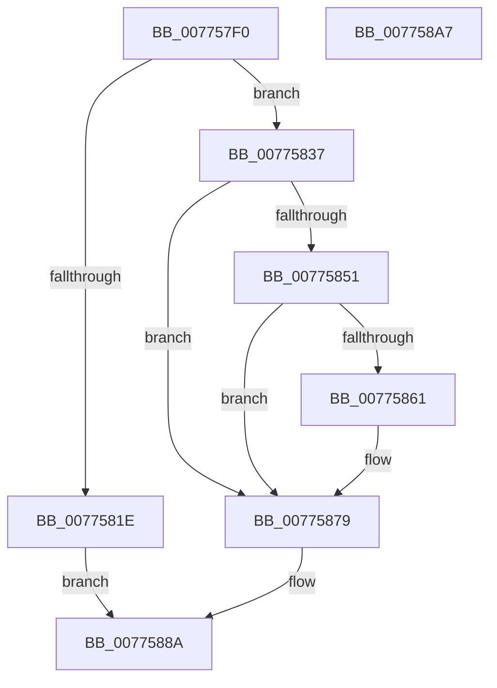

# TtmNotifyDeviceDeparture

- RVA: `0x007757F0`–`0x007758A8` (길이 `184` bytes)
- VA: `0x00000001407757F0`
- 실행 섹션: `PAGE`
- PDB 이름 있음: `예`; PDB Function 태그: `아니요`
- unwind 정보 RVA: `0x000BC3A0`
- 디코드: `50`개 명령, `184/184` bytes 표시
- 미해석 바이트: `0` (있으면 어셈블리에 `.byte`로 보존)

> 이 문서는 커널 이미지의 기계어와 PDB 기호를 분석해 생성했습니다. 4번과 5번은 함수 원형과 자료형을 바이너리 사용 방식에서 추정한 C 해석이며 원본 소스 복구 결과는 아닙니다.

## 1. Dependencies

- 직접 호출 지점: **7**; 고유 호출 대상: **7**
- 직접 호출자로 확인된 함수: **0**
- RIP 상대 이미지 참조: **2**

### Outgoing calls
- `0x00775815` → [TtmiAcquireCurrentSession](TtmiAcquireCurrentSession_function_00777010.md) (function, `0x00777010`)
- `0x00775830` → [TtmiLogError](../98/TtmiLogError_function_0098B39C.md) (function, `0x0098B39C`)
- `0x00775846` → [TtmpFindDeviceByToken](TtmpFindDeviceByToken_function_00776568.md) (function, `0x00776568`)
- `0x00775874` → [TtmiScheduleSessionWorker](TtmiScheduleSessionWorker_function_00777184.md) (function, `0x00777184`)
- `0x00775880` → [ExReleaseResourceLite](../../text/25/ExReleaseResourceLite_function_0025FA10.md) (function, `0x0025FA10`)
- `0x00775885` → [KeLeaveCriticalRegion](../../text/25/KeLeaveCriticalRegion_function_0025D8B0.md) (function, `0x0025D8B0`)
- `0x00775892` → [TtmiLogDeviceDepartureNotified](TtmiLogDeviceDepartureNotified_function_00779808.md) (function, `0x00779808`)

### Direct callers
- 이 함수 시작 RVA로 연결되는 직접 call은 확인되지 않았습니다. 간접 호출은 완전히 역산할 수 없습니다.

### Static image references
- `0x00775821` → RVA `0x00B04050` (` ?? ::NNGAKEGL::`string'`; read)
- `0x00775879` → RVA `0x00F06940` (`.data`; read)

## 2. Other-region calls and transfers

- 다른 실행 섹션으로 향하는 call: **2**
  - `0x00775880` → [ExReleaseResourceLite](../../text/25/ExReleaseResourceLite_function_0025FA10.md) (`PAGE` → `.text`)
  - `0x00775885` → [KeLeaveCriticalRegion](../../text/25/KeLeaveCriticalRegion_function_0025D8B0.md) (`PAGE` → `.text`)
- 별도 외부 분기/꼬리 이동을 확인하지 못했습니다.

## 3. Assembly (complete function range)

```asm
007757F0  48 8B C4                        mov rax, rsp
007757F3  48 89 58 08                     mov qword ptr [rax + 8], rbx
007757F7  48 89 70 10                     mov qword ptr [rax + 0x10], rsi
007757FB  57                              push rdi
007757FC  48 83 EC 20                     sub rsp, 0x20
00775800  48 83 60 18 00                  and qword ptr [rax + 0x18], 0
00775805  8B F1                           mov esi, ecx
00775807  48 83 60 20 00                  and qword ptr [rax + 0x20], 0
0077580C  48 8D 48 18                     lea rcx, [rax + 0x18]
00775810  48 8B FA                        mov rdi, rdx
00775813  32 DB                           xor bl, bl
00775815  E8 F6 17 00 00                  call 0x140777010
0077581A  85 C0                           test eax, eax
0077581C  79 19                           jns 0x140775837
0077581E  44 8B C8                        mov r9d, eax
00775821  48 8D 0D 28 E8 38 00            lea rcx, [rip + 0x38e828]
00775828  44 8B C0                        mov r8d, eax
0077582B  BA 6F 02 00 00                  mov edx, 0x26f
00775830  E8 67 5B 21 00                  call 0x14098b39c
00775835  EB 53                           jmp 0x14077588a
00775837  48 8B 4C 24 40                  mov rcx, qword ptr [rsp + 0x40]
0077583C  4C 8D 4C 24 48                  lea r9, [rsp + 0x48]
00775841  4C 8B C7                        mov r8, rdi
00775844  8B D6                           mov edx, esi
00775846  E8 1D 0D 00 00                  call 0x140776568
0077584B  8A D8                           mov bl, al
0077584D  84 C0                           test al, al
0077584F  74 28                           je 0x140775879
00775851  48 8B 44 24 48                  mov rax, qword ptr [rsp + 0x48]
00775856  8B 90 58 02 00 00               mov edx, dword ptr [rax + 0x258]
0077585C  F6 C2 04                        test dl, 4
0077585F  75 18                           jne 0x140775879
00775861  48 8B 4C 24 40                  mov rcx, qword ptr [rsp + 0x40]
00775866  83 CA 04                        or edx, 4
00775869  89 90 58 02 00 00               mov dword ptr [rax + 0x258], edx
0077586F  BA 01 00 00 00                  mov edx, 1
00775874  E8 0B 19 00 00                  call 0x140777184
00775879  48 8D 0D C0 10 79 00            lea rcx, [rip + 0x7910c0]
00775880  E8 8B A1 AE FF                  call 0x14025fa10
00775885  E8 26 80 AE FF                  call 0x14025d8b0
0077588A  44 8A C3                        mov r8b, bl
0077588D  48 8B D7                        mov rdx, rdi
00775890  8B CE                           mov ecx, esi
00775892  E8 71 3F 00 00                  call 0x140779808
00775897  48 8B 5C 24 30                  mov rbx, qword ptr [rsp + 0x30]
0077589C  48 8B 74 24 38                  mov rsi, qword ptr [rsp + 0x38]
007758A1  48 83 C4 20                     add rsp, 0x20
007758A5  5F                              pop rdi
007758A6  C3                              ret
007758A7  CC                              int3
```

## 4. C-style interpretation (structured pseudocode)

```c
__int64 __fastcall TtmNotifyDeviceDeparture(int a1, __int64 a2)
{
    __int64 result;
    __int64 v_rbx;
    __int64 v_rsp;
    unsigned __int64 v_stack_p10;
    unsigned __int64 v_stack_p18;
    unsigned __int64 v_stack_p20;
    unsigned __int64 v_stack_p8;

    *(unsigned __int64 *)(v_rsp + 8) = v_rbx;
    *(unsigned __int64 *)(v_rsp + 16) = v_rsi;
    v_rsp = (v_rsp) - (32);
    v_rbx = 0;
    result = TtmiAcquireCurrentSession(v_rsp + 24, a2, a3, a4);
    if (!sign_flag) goto loc_00775837;
    result = TtmiLogError(v_rip + 3729448, 623, (unsigned int)((unsigned int)(result)), (unsigned int)((unsigned int)(result)));
    goto loc_0077588A;
loc_00775837:
    result = TtmpFindDeviceByToken(v_stack_p18, (unsigned int)((unsigned int)((unsigned int)(a1))), a2, v_stack_p20);
    if ((unsigned __int8)(result) == 0) goto loc_00775879;
    result = v_stack_p20;
    if ((((unsigned __int8)((unsigned int)(*(unsigned int *)(v_stack_p20 + 600)))) & (4)) == 0) {
        a1 = v_stack_p18;
        a2 = (unsigned int)(((unsigned int)(*(unsigned int *)(v_stack_p20 + 600))) | (4));
        *(unsigned int *)(v_stack_p20 + 600) = (unsigned int)(a2);
        a2 = 1;
        result = TtmiScheduleSessionWorker(a1, a2, a2, v_stack_p20);
    }
    result = ExReleaseResourceLite(v_rip + 7934144, a2, a2, v_stack_p20);
    result = KeLeaveCriticalRegion(v_rip + 7934144, a2, a2, v_stack_p20);
loc_0077588A:
    result = TtmiLogDeviceDepartureNotified((unsigned int)((unsigned int)((unsigned int)(a1))), a2, (unsigned __int8)((unsigned __int8)(result)), v_stack_p20);
    v_rsp = (v_rsp) + (32);
    return result;
}
```

## 5. (Beta) C Style

```c
int64_t TtmNotifyDeviceDeparture(int32_t Arg1, int64_t Arg2)
{
    int64_t result;
    int64_t local_rbx;
    int64_t local_rsp;
    uint64_t v_stack_p10;
    uint64_t v_stack_p18;
    uint64_t v_stack_p20;
    uint64_t v_stack_p8;

    *(uint64_t *)(local_rsp + 0x8) = local_rbx;
    *(uint64_t *)(local_rsp + 0x10) = local_rsi;
    local_rsp = (local_rsp) - (32);
    local_rbx = 0;
    result = TtmiAcquireCurrentSession(local_rsp + 24, Arg2, a3, a4);
    if (!sign_flag) goto loc_00775837;
    result = TtmiLogError(v_rip + 3729448, 623, (uint32_t)((uint32_t)(result)), (uint32_t)((uint32_t)(result)));
    goto loc_0077588A;
loc_00775837:
    result = TtmpFindDeviceByToken(v_stack_p18, (uint32_t)((uint32_t)((uint32_t)(Arg1))), Arg2, v_stack_p20);
    if ((uint8_t)(result) == 0) goto loc_00775879;
    result = v_stack_p20;
    if ((((uint8_t)((uint32_t)(*(uint32_t *)(v_stack_p20 + 0x258)))) & (4)) == 0) {
        Arg1 = v_stack_p18;
        Arg2 = (uint32_t)(((uint32_t)(*(uint32_t *)(v_stack_p20 + 0x258))) | (4));
        *(uint32_t *)(v_stack_p20 + 0x258) = (uint32_t)(Arg2);
        Arg2 = 1;
        result = TtmiScheduleSessionWorker(Arg1, Arg2, Arg2, v_stack_p20);
    }
    result = ExReleaseResourceLite(v_rip + 7934144, Arg2, Arg2, v_stack_p20);
    result = KeLeaveCriticalRegion(v_rip + 7934144, Arg2, Arg2, v_stack_p20);
loc_0077588A:
    result = TtmiLogDeviceDepartureNotified((uint32_t)((uint32_t)((uint32_t)(Arg1))), Arg2, (uint8_t)((uint8_t)(result)), v_stack_p20);
    local_rsp = (local_rsp) + (32);
    return result;
}
```

## 6. Execution-region graph

[열기: 2D/3D 그래프와 함수 탐색 컨트롤 패널](../../../control-panel.html?section=page&rva=0x007757F0&view=graph)

- 2D 그래프는 위에서 아래로 흐르고, 3D 그래프는 빈 공간을 드래그해 회전합니다. Shift+드래그는 이동, 휠은 확대·축소, 함수 노드 선택은 대상 보고서 이동입니다.

### Static fallback


