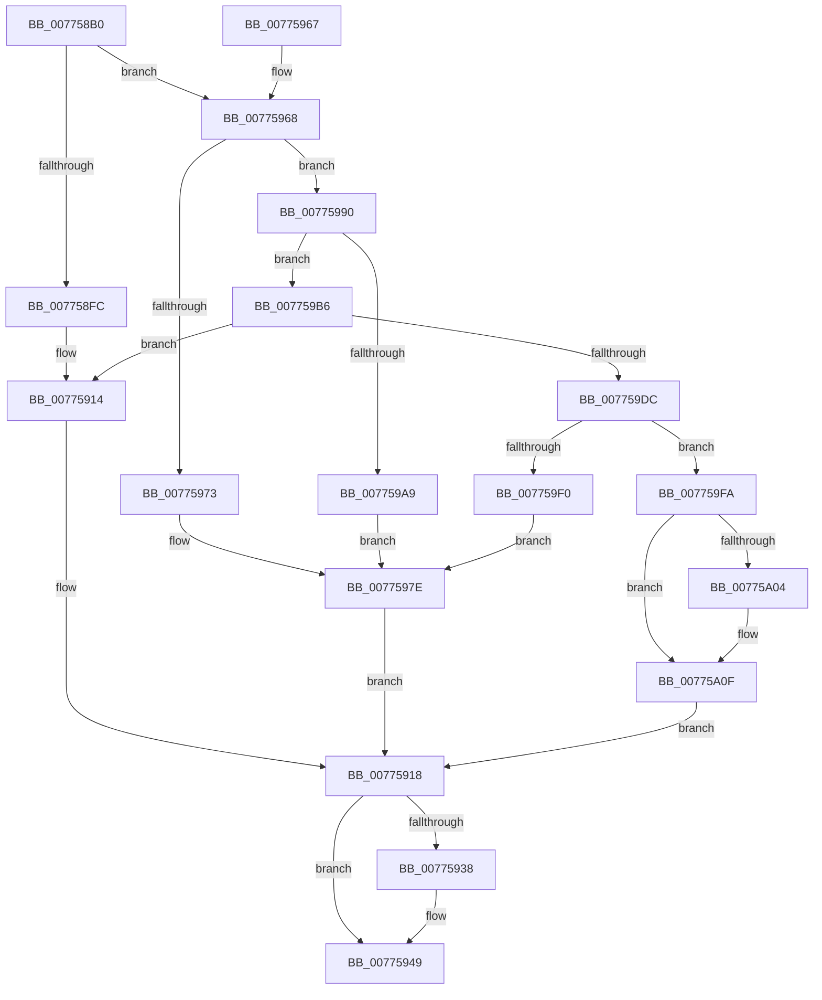

# TtmNotifyDeviceInput

- RVA: `0x007758B0`–`0x00775A34` (길이 `388` bytes)
- VA: `0x00000001407758B0`
- 실행 섹션: `PAGE`
- PDB 이름 있음: `예`; PDB Function 태그: `아니요`
- unwind 정보 RVA: `0x000CDC18`
- 디코드: `103`개 명령, `388/388` bytes 표시
- 미해석 바이트: `0` (있으면 어셈블리에 `.byte`로 보존)

> 이 문서는 커널 이미지의 기계어와 PDB 기호를 분석해 생성했습니다. 4번과 5번은 함수 원형과 자료형을 바이너리 사용 방식에서 추정한 C 해석이며 원본 소스 복구 결과는 아닙니다.

## 1. Dependencies

- 직접 호출 지점: **9**; 고유 호출 대상: **8**
- 직접 호출자로 확인된 함수: **0**
- RIP 상대 이미지 참조: **2**

### Outgoing calls
- `0x007758F3` → [TtmiAcquireCurrentSession](TtmiAcquireCurrentSession_function_00777010.md) (function, `0x00777010`)
- `0x0077590F` → [TtmiLogError](../98/TtmiLogError_function_0098B39C.md) (function, `0x0098B39C`)
- `0x0077592E` → [TtmiLogDeviceInputNotified](TtmiLogDeviceInputNotified_function_00779B94.md) (function, `0x00779B94`)
- `0x0077593F` → [ExReleaseResourceLite](../../text/25/ExReleaseResourceLite_function_0025FA10.md) (function, `0x0025FA10`)
- `0x00775944` → [KeLeaveCriticalRegion](../../text/25/KeLeaveCriticalRegion_function_0025D8B0.md) (function, `0x0025D8B0`)
- `0x00775989` → [TtmiLogError](../98/TtmiLogError_function_0098B39C.md) (function, `0x0098B39C`)
- `0x0077599D` → [TtmpFindDeviceByToken](TtmpFindDeviceByToken_function_00776568.md) (function, `0x00776568`)
- `0x007759E7` → [TtmiGetTerminalById](TtmiGetTerminalById_function_0077CA04.md) (function, `0x0077CA04`)
- `0x00775A27` → [TtmiResetTerminalTimeouts](TtmiResetTerminalTimeouts_function_0077CD90.md) (function, `0x0077CD90`)

### Direct callers
- 이 함수 시작 RVA로 연결되는 직접 call은 확인되지 않았습니다. 간접 호출은 완전히 역산할 수 없습니다.

### Static image references
- `0x00775900` → RVA `0x00B04070` (` ?? ::NNGAKEGL::`string'`; read)
- `0x00775938` → RVA `0x00F06940` (`.data`; read)

## 2. Other-region calls and transfers

- 다른 실행 섹션으로 향하는 call: **2**
  - `0x0077593F` → [ExReleaseResourceLite](../../text/25/ExReleaseResourceLite_function_0025FA10.md) (`PAGE` → `.text`)
  - `0x00775944` → [KeLeaveCriticalRegion](../../text/25/KeLeaveCriticalRegion_function_0025D8B0.md) (`PAGE` → `.text`)
- 별도 외부 분기/꼬리 이동을 확인하지 못했습니다.

## 3. Assembly (complete function range)

```asm
007758B0  48 89 5C 24 08                  mov qword ptr [rsp + 8], rbx
007758B5  48 89 74 24 10                  mov qword ptr [rsp + 0x10], rsi
007758BA  48 89 7C 24 18                  mov qword ptr [rsp + 0x18], rdi
007758BF  55                              push rbp
007758C0  41 54                           push r12
007758C2  41 55                           push r13
007758C4  41 56                           push r14
007758C6  41 57                           push r15
007758C8  48 8B EC                        mov rbp, rsp
007758CB  48 83 EC 40                     sub rsp, 0x40
007758CF  33 DB                           xor ebx, ebx
007758D1  44 8B E9                        mov r13d, ecx
007758D4  48 8D 4D 48                     lea rcx, [rbp + 0x48]
007758D8  48 89 5D F0                     mov qword ptr [rbp - 0x10], rbx
007758DC  48 89 5D 48                     mov qword ptr [rbp + 0x48], rbx
007758E0  40 8A F3                        mov sil, bl
007758E3  48 89 5D F8                     mov qword ptr [rbp - 8], rbx
007758E7  44 8A F3                        mov r14b, bl
007758EA  0F B6 FB                        movzx edi, bl
007758ED  45 8B F8                        mov r15d, r8d
007758F0  4C 8B E2                        mov r12, rdx
007758F3  E8 18 17 00 00                  call 0x140777010
007758F8  85 C0                           test eax, eax
007758FA  79 6C                           jns 0x140775968
007758FC  41 83 C9 FF                     or r9d, 0xffffffff
00775900  48 8D 0D 69 E7 38 00            lea rcx, [rip + 0x38e769]
00775907  44 8B C0                        mov r8d, eax
0077590A  BA F8 02 00 00                  mov edx, 0x2f8
0077590F  E8 88 5A 21 00                  call 0x14098b39c
00775914  48 8B 5D 48                     mov rbx, qword ptr [rbp + 0x48]
00775918  40 88 7C 24 28                  mov byte ptr [rsp + 0x28], dil
0077591D  44 8A CE                        mov r9b, sil
00775920  45 8B C7                        mov r8d, r15d
00775923  44 88 74 24 20                  mov byte ptr [rsp + 0x20], r14b
00775928  49 8B D4                        mov rdx, r12
0077592B  41 8B CD                        mov ecx, r13d
0077592E  E8 61 42 00 00                  call 0x140779b94
00775933  48 85 DB                        test rbx, rbx
00775936  74 11                           je 0x140775949
00775938  48 8D 0D 01 10 79 00            lea rcx, [rip + 0x791001]
0077593F  E8 CC A0 AE FF                  call 0x14025fa10
00775944  E8 67 7F AE FF                  call 0x14025d8b0
00775949  4C 8D 5C 24 40                  lea r11, [rsp + 0x40]
0077594E  49 8B 5B 30                     mov rbx, qword ptr [r11 + 0x30]
00775952  49 8B 73 38                     mov rsi, qword ptr [r11 + 0x38]
00775956  49 8B 7B 40                     mov rdi, qword ptr [r11 + 0x40]
0077595A  49 8B E3                        mov rsp, r11
0077595D  41 5F                           pop r15
0077595F  41 5E                           pop r14
00775961  41 5D                           pop r13
00775963  41 5C                           pop r12
00775965  5D                              pop rbp
00775966  C3                              ret
00775967  CC                              int3
00775968  48 8B 5D 48                     mov rbx, qword ptr [rbp + 0x48]
0077596C  8B 43 04                        mov eax, dword ptr [rbx + 4]
0077596F  A8 04                           test al, 4
00775971  74 1D                           je 0x140775990
00775973  BA 00 03 00 00                  mov edx, 0x300
00775978  41 B8 55 04 00 C0               mov r8d, 0xc0000455
0077597E  41 83 C9 FF                     or r9d, 0xffffffff
00775982  48 8D 0D E7 E6 38 00            lea rcx, [rip + 0x38e6e7]
00775989  E8 0E 5A 21 00                  call 0x14098b39c
0077598E  EB 88                           jmp 0x140775918
00775990  4C 8D 4D F0                     lea r9, [rbp - 0x10]
00775994  4D 8B C4                        mov r8, r12
00775997  41 8B D5                        mov edx, r13d
0077599A  48 8B CB                        mov rcx, rbx
0077599D  E8 C6 0B 00 00                  call 0x140776568
007759A2  40 8A F0                        mov sil, al
007759A5  84 C0                           test al, al
007759A7  75 0D                           jne 0x1407759b6
007759A9  BA 11 03 00 00                  mov edx, 0x311
007759AE  41 B8 25 02 00 C0               mov r8d, 0xc0000225
007759B4  EB C8                           jmp 0x14077597e
007759B6  48 A1 08 00 00 00 80 F7 FF FF   movabs rax, qword ptr [0xfffff78000000008]
007759C0  4C 8B 55 F0                     mov r10, qword ptr [rbp - 0x10]
007759C4  49 89 82 60 02 00 00            mov qword ptr [r10 + 0x260], rax
007759CB  45 8B 82 54 02 00 00            mov r8d, dword ptr [r10 + 0x254]
007759D2  41 83 F8 FF                     cmp r8d, -1
007759D6  0F 84 38 FF FF FF               je 0x140775914
007759DC  48 8B 5D 48                     mov rbx, qword ptr [rbp + 0x48]
007759E0  48 8D 4D F8                     lea rcx, [rbp - 8]
007759E4  48 8B D3                        mov rdx, rbx
007759E7  E8 18 70 00 00                  call 0x14077ca04
007759EC  85 C0                           test eax, eax
007759EE  79 0A                           jns 0x1407759fa
007759F0  44 8B C0                        mov r8d, eax
007759F3  BA 24 03 00 00                  mov edx, 0x324
007759F8  EB 84                           jmp 0x14077597e
007759FA  B9 01 00 00 00                  mov ecx, 1
007759FF  44 84 F9                        test cl, r15b
00775A02  74 0B                           je 0x140775a0f
00775A04  41 F6 82 58 02 00 00 80         test byte ptr [r10 + 0x258], 0x80
00775A0C  0F 45 F9                        cmovne edi, ecx
00775A0F  48 8B 55 F8                     mov rdx, qword ptr [rbp - 8]
00775A13  41 B9 41 49 54 54               mov r9d, 0x54544941
00775A19  41 B8 04 00 00 00               mov r8d, 4
00775A1F  40 88 7C 24 20                  mov byte ptr [rsp + 0x20], dil
00775A24  48 8B CB                        mov rcx, rbx
00775A27  E8 64 73 00 00                  call 0x14077cd90
00775A2C  44 8A F0                        mov r14b, al
00775A2F  E9 E4 FE FF FF                  jmp 0x140775918
```

## 4. C-style interpretation (structured pseudocode)

```c
__int64 __fastcall TtmNotifyDeviceInput(int a1, __int64 a2, int a3, int a4)
{
    __int64 result;
    __int64 v_rbx;
    __int64 v_rdi;
    __int64 v_rsp;
    unsigned __int8 v_stack_m20;
    unsigned __int64 v_stack_m28;
    unsigned __int64 v_stack_m30;
    unsigned __int64 v_stack_m38;
    unsigned __int8 v_stack_m40;
    unsigned __int8 v_stack_m48;
    unsigned __int64 v_stack_p10;
    unsigned __int64 v_stack_p18;
    unsigned __int64 v_stack_p20;
    unsigned __int64 v_stack_p8;

    v_stack_p8 = v_rbx;
    v_stack_p10 = v_rsi;
    v_stack_p18 = v_rdi;
    v_rsp = (v_rsp) - (64);
    v_rbx = 0;
    v_stack_m38 = 0;
    v_stack_p20 = 0;
    v_stack_m30 = 0;
    result = TtmiAcquireCurrentSession(v_stack_p20, a2, a3, a4);
    if (!sign_flag) goto loc_00775968;
    a4 = (unsigned int)((a4) | (0xFFFFFFFFULL));
    result = TtmiLogError(v_rip + 3729257, 760, (unsigned int)((unsigned int)(result)), a4);
loc_00775914:
loc_00775918:
    v_stack_m40 = 0;
    v_stack_m48 = 0;
    result = TtmiLogDeviceInputNotified((unsigned int)((unsigned int)((unsigned int)(a1))), a2, (unsigned int)((unsigned int)((unsigned int)(a3))), 0);
    if (v_stack_p20 != 0) {
        a1 = v_rip + 7933953;
        result = ExReleaseResourceLite(a1, a2, (unsigned int)((unsigned int)((unsigned int)(a3))), 0);
        result = KeLeaveCriticalRegion(a1, a2, (unsigned int)((unsigned int)((unsigned int)(a3))), 0);
    }
    return result;
loc_00775968:
    if ((((unsigned __int8)((unsigned int)(*(unsigned int *)(v_stack_p20 + 4)))) & (4)) == 0) goto loc_00775990;
loc_0077597E:
    a4 = (unsigned int)((0) | (0xFFFFFFFFULL));
    result = TtmiLogError(v_rip + 3729127, 768, (unsigned int)(0xC0000455ULL), a4);
    goto loc_00775918;
loc_00775990:
    result = TtmpFindDeviceByToken(v_stack_p20, (unsigned int)((unsigned int)((unsigned int)(a1))), a2, v_stack_m38);
    if ((unsigned __int8)(result) != 0) goto loc_007759B6;
    goto loc_0077597E;
loc_007759B6:
    *(unsigned __int64 *)(v_stack_m38 + 608) = result;
    if (((unsigned int)((unsigned int)(*(unsigned int *)(v_stack_m38 + 596)))) == -1) goto loc_00775914;
    result = TtmiGetTerminalById(v_stack_m30, v_stack_p20, (unsigned int)(*(unsigned int *)(v_stack_m38 + 596)), v_stack_m38);
    if (!sign_flag) goto loc_007759FA;
    goto loc_0077597E;
loc_007759FA:
    v_rdi = *(unsigned __int64 *)(v_stack_m28 + 64);
    if (((1) & ((unsigned __int8)((unsigned int)(a3)))) != 0) {
        v_rdi = *(unsigned __int64 *)(v_stack_m28 + 64);
        if (((*(unsigned __int8 *)(v_stack_m38 + 600)) & (128)) != 0) { v_rdi = 1; }
    }
    v_stack_m20 = (unsigned __int8)(v_rdi);
    result = TtmiResetTerminalTimeouts(v_stack_p20, v_stack_m30, 4, (unsigned int)(0x54544941ULL));
    goto loc_00775918;
}
```

## 5. (Beta) C Style

```c
int64_t TtmNotifyDeviceInput(int32_t Arg1, int64_t Arg2, int32_t Arg3, int32_t Arg4)
{
    int64_t result;
    int64_t local_rbx;
    int64_t local_rdi;
    int64_t local_rsp;
    uint8_t v_stack_m20;
    uint64_t v_stack_m28;
    uint64_t v_stack_m30;
    uint64_t v_stack_m38;
    uint8_t v_stack_m40;
    uint8_t v_stack_m48;
    uint64_t v_stack_p10;
    uint64_t v_stack_p18;
    uint64_t v_stack_p20;
    uint64_t v_stack_p8;

    v_stack_p8 = local_rbx;
    v_stack_p10 = local_rsi;
    v_stack_p18 = local_rdi;
    local_rsp = (local_rsp) - (64);
    local_rbx = 0;
    v_stack_m38 = 0;
    v_stack_p20 = 0;
    v_stack_m30 = 0;
    result = TtmiAcquireCurrentSession(v_stack_p20, Arg2, Arg3, Arg4);
    if (!sign_flag) goto loc_00775968;
    Arg4 = (uint32_t)((Arg4) | (0xFFFFFFFFULL));
    result = TtmiLogError(v_rip + 3729257, 760, (uint32_t)((uint32_t)(result)), Arg4);
loc_00775914:
loc_00775918:
    v_stack_m40 = 0;
    v_stack_m48 = 0;
    result = TtmiLogDeviceInputNotified((uint32_t)((uint32_t)((uint32_t)(Arg1))), Arg2, (uint32_t)((uint32_t)((uint32_t)(Arg3))), 0);
    if (v_stack_p20 != 0) {
        Arg1 = v_rip + 7933953;
        result = ExReleaseResourceLite(Arg1, Arg2, (uint32_t)((uint32_t)((uint32_t)(Arg3))), 0);
        result = KeLeaveCriticalRegion(Arg1, Arg2, (uint32_t)((uint32_t)((uint32_t)(Arg3))), 0);
    }
    return result;
loc_00775968:
    if ((((uint8_t)((uint32_t)(*(uint32_t *)(v_stack_p20 + 0x4)))) & (4)) == 0) goto loc_00775990;
loc_0077597E:
    Arg4 = (uint32_t)((0) | (0xFFFFFFFFULL));
    result = TtmiLogError(v_rip + 3729127, 768, (uint32_t)(0xC0000455ULL), Arg4);
    goto loc_00775918;
loc_00775990:
    result = TtmpFindDeviceByToken(v_stack_p20, (uint32_t)((uint32_t)((uint32_t)(Arg1))), Arg2, v_stack_m38);
    if ((uint8_t)(result) != 0) goto loc_007759B6;
    goto loc_0077597E;
loc_007759B6:
    *(uint64_t *)(v_stack_m38 + 0x260) = result;
    if (((uint32_t)((uint32_t)(*(uint32_t *)(v_stack_m38 + 0x254)))) == -1) goto loc_00775914;
    result = TtmiGetTerminalById(v_stack_m30, v_stack_p20, (uint32_t)(*(uint32_t *)(v_stack_m38 + 0x254)), v_stack_m38);
    if (!sign_flag) goto loc_007759FA;
    goto loc_0077597E;
loc_007759FA:
    local_rdi = *(uint64_t *)(v_stack_m28 + 0x40);
    if (((1) & ((uint8_t)((uint32_t)(Arg3)))) != 0) {
        local_rdi = *(uint64_t *)(v_stack_m28 + 0x40);
        if (((*(uint8_t *)(v_stack_m38 + 0x258)) & (128)) != 0) { local_rdi = 1; }
    }
    v_stack_m20 = (uint8_t)(local_rdi);
    result = TtmiResetTerminalTimeouts(v_stack_p20, v_stack_m30, 4, (uint32_t)(0x54544941ULL));
    goto loc_00775918;
}
```

## 6. Execution-region graph

[열기: 2D/3D 그래프와 함수 탐색 컨트롤 패널](../../../control-panel.html?section=page&rva=0x007758B0&view=graph)

- 2D 그래프는 위에서 아래로 흐르고, 3D 그래프는 빈 공간을 드래그해 회전합니다. Shift+드래그는 이동, 휠은 확대·축소, 함수 노드 선택은 대상 보고서 이동입니다.

### Static fallback


