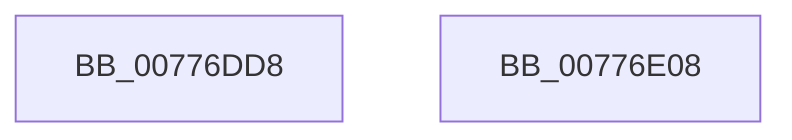

# TtmNotifySessionPowerRequestCreated

- RVA: `0x00776DD8`–`0x00776E09` (길이 `49` bytes)
- VA: `0x0000000140776DD8`
- 실행 섹션: `PAGE`
- PDB 이름 있음: `예`; PDB Function 태그: `아니요`
- unwind 정보 RVA: `0x0006E5F8`
- 디코드: `16`개 명령, `49/49` bytes 표시
- 미해석 바이트: `0` (있으면 어셈블리에 `.byte`로 보존)

> 이 문서는 커널 이미지의 기계어와 PDB 기호를 분석해 생성했습니다. 4번과 5번은 함수 원형과 자료형을 바이너리 사용 방식에서 추정한 C 해석이며 원본 소스 복구 결과는 아닙니다.

## 1. Dependencies

- 직접 호출 지점: **2**; 고유 호출 대상: **2**
- 직접 호출자로 확인된 함수: **1**
- RIP 상대 이미지 참조: **0**

### Outgoing calls
- `0x00776DEC` → [TtmpInsertPowerRequestToSession](TtmpInsertPowerRequestToSession_function_00777A98.md) (function, `0x00777A98`)
- `0x00776DF8` → [TtmiLogSessionPowerRequestCreated](TtmiLogSessionPowerRequestCreated_function_0077B41C.md) (function, `0x0077B41C`)

### Direct callers
- [PopPowerRequestCreateUserModeRequest](../../text/22/PopPowerRequestCreateUserModeRequest_function_0022F91C.md) at `0x0022F9F7`

### Static image references
- 디코드된 RIP-relative 메모리 참조가 없습니다.

## 2. Other-region calls and transfers

- 다른 실행 섹션으로 향하는 call: **0**
- 별도 외부 분기/꼬리 이동을 확인하지 못했습니다.

## 3. Assembly (complete function range)

```asm
00776DD8  48 89 5C 24 08                  mov qword ptr [rsp + 8], rbx
00776DDD  57                              push rdi
00776DDE  48 83 EC 30                     sub rsp, 0x30
00776DE2  48 83 64 24 20 00               and qword ptr [rsp + 0x20], 0
00776DE8  8B DA                           mov ebx, edx
00776DEA  8B F9                           mov edi, ecx
00776DEC  E8 A7 0C 00 00                  call 0x140777a98
00776DF1  44 8A C0                        mov r8b, al
00776DF4  8B D3                           mov edx, ebx
00776DF6  8B CF                           mov ecx, edi
00776DF8  E8 1F 46 00 00                  call 0x14077b41c
00776DFD  48 8B 5C 24 40                  mov rbx, qword ptr [rsp + 0x40]
00776E02  48 83 C4 30                     add rsp, 0x30
00776E06  5F                              pop rdi
00776E07  C3                              ret
00776E08  CC                              int3
```

## 4. C-style interpretation (structured pseudocode)

```c
__int64 __fastcall TtmNotifySessionPowerRequestCreated(int a1, int a2)
{
    __int64 result;
    __int64 v_rsp;
    unsigned __int64 v_stack_m18;
    unsigned __int64 v_stack_p8;

    v_stack_p8 = v_rbx;
    v_rsp = (v_rsp) - (48);
    result = TtmpInsertPowerRequestToSession(a1, a2, a3, a4);
    result = TtmiLogSessionPowerRequestCreated((unsigned int)((unsigned int)((unsigned int)(a1))), (unsigned int)((unsigned int)((unsigned int)(a2))), (unsigned __int8)(result), a4);
    v_rsp = (v_rsp) + (48);
    return result;
}
```

## 5. (Beta) C Style

```c
int64_t TtmNotifySessionPowerRequestCreated(int32_t Arg1, int32_t Arg2)
{
    int64_t result;
    int64_t local_rsp;
    uint64_t v_stack_m18;
    uint64_t v_stack_p8;

    v_stack_p8 = local_rbx;
    local_rsp = (local_rsp) - (48);
    result = TtmpInsertPowerRequestToSession(Arg1, Arg2, a3, a4);
    result = TtmiLogSessionPowerRequestCreated((uint32_t)((uint32_t)((uint32_t)(Arg1))), (uint32_t)((uint32_t)((uint32_t)(Arg2))), (uint8_t)(result), a4);
    local_rsp = (local_rsp) + (48);
    return result;
}
```

## 6. Execution-region graph

[열기: 2D/3D 그래프와 함수 탐색 컨트롤 패널](../../../control-panel.html?section=page&rva=0x00776DD8&view=graph)

- 2D 그래프는 위에서 아래로 흐르고, 3D 그래프는 빈 공간을 드래그해 회전합니다. Shift+드래그는 이동, 휠은 확대·축소, 함수 노드 선택은 대상 보고서 이동입니다.

### Static fallback


