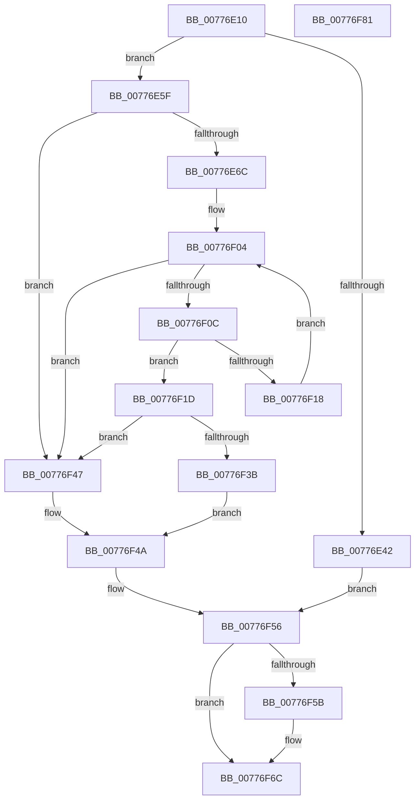

# TtmNotifySessionPowerRequestDeleted

- RVA: `0x00776E10`–`0x00776F82` (길이 `370` bytes)
- VA: `0x0000000140776E10`
- 실행 섹션: `PAGE`
- PDB 이름 있음: `예`; PDB Function 태그: `아니요`
- unwind 정보 RVA: `0x000AEEA8`
- 디코드: `97`개 명령, `370/370` bytes 표시
- 미해석 바이트: `0` (있으면 어셈블리에 `.byte`로 보존)

> 이 문서는 커널 이미지의 기계어와 PDB 기호를 분석해 생성했습니다. 4번과 5번은 함수 원형과 자료형을 바이너리 사용 방식에서 추정한 C 해석이며 원본 소스 복구 결과는 아닙니다.

## 1. Dependencies

- 직접 호출 지점: **6**; 고유 호출 대상: **6**
- 직접 호출자로 확인된 함수: **1**
- RIP 상대 이미지 참조: **2**

### Outgoing calls
- `0x00776E34` → [TtmpAcquireSessionById](../98/TtmpAcquireSessionById_function_0098B4F4.md) (function, `0x0098B4F4`)
- `0x00776E55` → [TtmiLogError](../98/TtmiLogError_function_0098B39C.md) (function, `0x0098B39C`)
- `0x00776F40` → [ExFreePoolWithTag](../../poolcode/B8/ExFreePoolWithTag_function_00B82870.md) (function, `0x00B82870`)
- `0x00776F51` → [TtmiLogSessionPowerRequestDeleted](TtmiLogSessionPowerRequestDeleted_function_0077B4DC.md) (function, `0x0077B4DC`)
- `0x00776F62` → [ExReleaseResourceLite](../../text/25/ExReleaseResourceLite_function_0025FA10.md) (function, `0x0025FA10`)
- `0x00776F67` → [KeLeaveCriticalRegion](../../text/25/KeLeaveCriticalRegion_function_0025D8B0.md) (function, `0x0025D8B0`)

### Direct callers
- [PopPowerRequestDelete](../91/PopPowerRequestDelete_function_00913030.md) at `0x00913162`

### Static image references
- `0x00776E46` → RVA `0x00B04430` (` ?? ::NNGAKEGL::`string'`; read)
- `0x00776F5B` → RVA `0x00F06940` (`.data`; read)

## 2. Other-region calls and transfers

- 다른 실행 섹션으로 향하는 call: **3**
  - `0x00776F40` → [ExFreePoolWithTag](../../poolcode/B8/ExFreePoolWithTag_function_00B82870.md) (`PAGE` → `POOLCODE`)
  - `0x00776F62` → [ExReleaseResourceLite](../../text/25/ExReleaseResourceLite_function_0025FA10.md) (`PAGE` → `.text`)
  - `0x00776F67` → [KeLeaveCriticalRegion](../../text/25/KeLeaveCriticalRegion_function_0025D8B0.md) (`PAGE` → `.text`)
- 별도 외부 분기/꼬리 이동을 확인하지 못했습니다.

## 3. Assembly (complete function range)

```asm
00776E10  48 8B C4                        mov rax, rsp
00776E13  48 89 58 08                     mov qword ptr [rax + 8], rbx
00776E17  48 89 68 10                     mov qword ptr [rax + 0x10], rbp
00776E1B  48 89 70 20                     mov qword ptr [rax + 0x20], rsi
00776E1F  57                              push rdi
00776E20  48 83 EC 20                     sub rsp, 0x20
00776E24  48 83 60 18 00                  and qword ptr [rax + 0x18], 0
00776E29  8B F1                           mov esi, ecx
00776E2B  48 63 EA                        movsxd rbp, edx
00776E2E  8B D1                           mov edx, ecx
00776E30  48 8D 48 18                     lea rcx, [rax + 0x18]
00776E34  E8 BB 46 21 00                  call 0x14098b4f4
00776E39  48 8B 5C 24 40                  mov rbx, qword ptr [rsp + 0x40]
00776E3E  85 C0                           test eax, eax
00776E40  79 1D                           jns 0x140776e5f
00776E42  49 83 C9 FF                     or r9, 0xffffffffffffffff
00776E46  48 8D 0D E3 D5 38 00            lea rcx, [rip + 0x38d5e3]
00776E4D  44 8B C0                        mov r8d, eax
00776E50  BA 29 0E 00 00                  mov edx, 0xe29
00776E55  E8 42 45 21 00                  call 0x14098b39c
00776E5A  E9 F7 00 00 00                  jmp 0x140776f56
00776E5F  83 BB 10 01 00 00 00            cmp dword ptr [rbx + 0x110], 0
00776E66  0F 84 DB 00 00 00               je 0x140776f47
00776E6C  44 8B 8B 14 01 00 00            mov r9d, dword ptr [rbx + 0x114]
00776E73  49 83 CA FF                     or r10, 0xffffffffffffffff
00776E77  41 8B C9                        mov ecx, r9d
00776E7A  4C 8B DD                        mov r11, rbp
00776E7D  83 E1 1F                        and ecx, 0x1f
00776E80  41 C1 E9 05                     shr r9d, 5
00776E84  49 D3 E2                        shl r10, cl
00776E87  40 B7 01                        mov dil, 1
00776E8A  4D 23 DA                        and r11, r10
00776E8D  4C 89 5C 24 40                  mov qword ptr [rsp + 0x40], r11
00776E92  41 0F B6 C3                     movzx eax, r11b
00776E96  48 05 CB 5D B1 00               add rax, 0xb15dcb
00776E9C  48 6B C8 25                     imul rcx, rax, 0x25
00776EA0  0F B6 44 24 41                  movzx eax, byte ptr [rsp + 0x41]
00776EA5  48 03 C8                        add rcx, rax
00776EA8  0F B6 44 24 42                  movzx eax, byte ptr [rsp + 0x42]
00776EAD  48 6B D1 25                     imul rdx, rcx, 0x25
00776EB1  48 03 D0                        add rdx, rax
00776EB4  0F B6 44 24 43                  movzx eax, byte ptr [rsp + 0x43]
00776EB9  48 6B CA 25                     imul rcx, rdx, 0x25
00776EBD  48 03 C8                        add rcx, rax
00776EC0  0F B6 44 24 44                  movzx eax, byte ptr [rsp + 0x44]
00776EC5  48 6B D1 25                     imul rdx, rcx, 0x25
00776EC9  48 03 D0                        add rdx, rax
00776ECC  0F B6 44 24 45                  movzx eax, byte ptr [rsp + 0x45]
00776ED1  48 6B CA 25                     imul rcx, rdx, 0x25
00776ED5  48 03 C8                        add rcx, rax
00776ED8  0F B6 44 24 46                  movzx eax, byte ptr [rsp + 0x46]
00776EDD  48 6B D1 25                     imul rdx, rcx, 0x25
00776EE1  41 8D 49 FF                     lea ecx, [r9 - 1]
00776EE5  48 03 D0                        add rdx, rax
00776EE8  0F B6 44 24 47                  movzx eax, byte ptr [rsp + 0x47]
00776EED  4C 6B C2 25                     imul r8, rdx, 0x25
00776EF1  49 03 C0                        add rax, r8
00776EF4  8B C0                           mov eax, eax
00776EF6  48 23 C8                        and rcx, rax
00776EF9  48 8B 83 18 01 00 00            mov rax, qword ptr [rbx + 0x118]
00776F00  48 8D 14 C8                     lea rdx, [rax + rcx*8]
00776F04  48 8B 0A                        mov rcx, qword ptr [rdx]
00776F07  40 84 CF                        test dil, cl
00776F0A  75 3B                           jne 0x140776f47
00776F0C  48 8B 41 08                     mov rax, qword ptr [rcx + 8]
00776F10  49 23 C2                        and rax, r10
00776F13  49 3B C3                        cmp rax, r11
00776F16  74 05                           je 0x140776f1d
00776F18  48 8B D1                        mov rdx, rcx
00776F1B  EB E7                           jmp 0x140776f04
00776F1D  48 8B 01                        mov rax, qword ptr [rcx]
00776F20  48 89 02                        mov qword ptr [rdx], rax
00776F23  48 B8 02 00 00 00 00 00 00 80   movabs rax, 0x8000000000000002
00776F2D  FF 8B 10 01 00 00               dec dword ptr [rbx + 0x110]
00776F33  48 09 01                        or qword ptr [rcx], rax
00776F36  48 85 C9                        test rcx, rcx
00776F39  74 0C                           je 0x140776f47
00776F3B  BA 54 74 50 52                  mov edx, 0x52507454
00776F40  E8 2B B9 40 00                  call 0x140b82870
00776F45  EB 03                           jmp 0x140776f4a
00776F47  40 32 FF                        xor dil, dil
00776F4A  44 8A C7                        mov r8b, dil
00776F4D  8B D5                           mov edx, ebp
00776F4F  8B CE                           mov ecx, esi
00776F51  E8 86 45 00 00                  call 0x14077b4dc
00776F56  48 85 DB                        test rbx, rbx
00776F59  74 11                           je 0x140776f6c
00776F5B  48 8D 0D DE F9 78 00            lea rcx, [rip + 0x78f9de]
00776F62  E8 A9 8A AE FF                  call 0x14025fa10
00776F67  E8 44 69 AE FF                  call 0x14025d8b0
00776F6C  48 8B 5C 24 30                  mov rbx, qword ptr [rsp + 0x30]
00776F71  48 8B 6C 24 38                  mov rbp, qword ptr [rsp + 0x38]
00776F76  48 8B 74 24 48                  mov rsi, qword ptr [rsp + 0x48]
00776F7B  48 83 C4 20                     add rsp, 0x20
00776F7F  5F                              pop rdi
00776F80  C3                              ret
00776F81  CC                              int3
```

## 4. C-style interpretation (structured pseudocode)

```c
__int64 __fastcall TtmNotifySessionPowerRequestDeleted(int a1, int a2, __int64 a3, __int64 a4)
{
    __int64 result;
    __int64 v_r10;
    __int64 v_r11;
    __int64 v_rdi;
    __int64 v_rsp;
    unsigned __int64 v_stack_p10;
    unsigned __int64 v_stack_p18;
    unsigned __int8 v_stack_p19;
    unsigned __int8 v_stack_p1A;
    unsigned __int8 v_stack_p1B;
    unsigned __int8 v_stack_p1C;
    unsigned __int8 v_stack_p1D;
    unsigned __int8 v_stack_p1E;
    unsigned __int8 v_stack_p1F;
    unsigned __int64 v_stack_p20;
    unsigned __int64 v_stack_p8;

    *(unsigned __int64 *)(v_rsp + 8) = v_rbx;
    *(unsigned __int64 *)(v_rsp + 16) = v_rbp;
    *(unsigned __int64 *)(v_rsp + 32) = v_rsi;
    v_rsp = (v_rsp) - (32);
    result = TtmpAcquireSessionById(v_rsp + 24, (unsigned int)(a1), a3, a4);
    if (!sign_flag) goto loc_00776E5F;
    a4 = (a4) | (-1);
    result = TtmiLogError(v_rip + 3724771, (unsigned int)(0xE29ULL), (unsigned int)((unsigned int)(result)), a4);
    goto loc_00776F56;
loc_00776E5F:
    if ((*(unsigned int *)(v_stack_p18 + 272)) == 0) goto loc_00776F47;
    v_r10 = (v_r10) | (-1);
    a1 = (unsigned int)(((unsigned int)((unsigned int)((unsigned int)(*(unsigned int *)(v_stack_p18 + 276))))) & (31));
    a4 = (unsigned int)(((unsigned int)(*(unsigned int *)(v_stack_p18 + 276))) >> (5));
    v_r10 = (v_r10) << ((unsigned __int8)(a1));
    v_r11 = ((int)(a2)) & (v_r10);
    v_stack_p18 = v_r11;
    result = ((unsigned __int8)(v_r11)) + (0xB15DCBULL);
    a1 = (a1) * (result);
    a1 = (a1) + (v_stack_p19);
    a2 = ((unsigned int)(0xE29ULL)) * (a1);
    a2 = (a2) + (v_stack_p1A);
    a1 = (a1) * (a2);
    a1 = (a1) + (v_stack_p1B);
    a2 = (a2) * (a1);
    a2 = (a2) + (v_stack_p1C);
    a1 = (a1) * (a2);
    a1 = (a1) + (v_stack_p1D);
    a2 = (a2) * (a1);
    a2 = (a2) + (v_stack_p1E);
    a3 = ((unsigned int)((unsigned int)(result))) * (a2);
    result = (v_stack_p1F) + (a3);
    a1 = (a4 - 1) & ((unsigned int)((unsigned int)(result)));
loc_00776F04:
    if (((1) & ((unsigned __int8)(*(unsigned __int64 *)(*(unsigned __int64 *)(v_stack_p18 + 280) + a1 * 8)))) != 0) goto loc_00776F47;
    result = (*(unsigned __int64 *)(*(unsigned __int64 *)(*(unsigned __int64 *)(v_stack_p18 + 280) + a1 * 8) + 8)) & (v_r10);
    if (result == v_r11) goto loc_00776F1D;
    goto loc_00776F04;
loc_00776F1D:
    *(unsigned __int64 *)(*(unsigned __int64 *)(*(unsigned __int64 *)(v_stack_p18 + 280) + a1 * 8)) = *(unsigned __int64 *)(*(unsigned __int64 *)(*(unsigned __int64 *)(v_stack_p18 + 280) + a1 * 8));
    if (*(unsigned __int64 *)(*(unsigned __int64 *)(v_stack_p18 + 280) + a1 * 8) == 0) goto loc_00776F47;
    result = ExFreePoolWithTag(*(unsigned __int64 *)(*(unsigned __int64 *)(v_stack_p18 + 280) + a1 * 8), (unsigned int)(0x52507454ULL), a3, a4);
    goto loc_00776F4A;
loc_00776F47:
    v_rdi = 0;
loc_00776F4A:
    result = TtmiLogSessionPowerRequestDeleted((unsigned int)((unsigned int)((unsigned int)(a1))), (unsigned int)((unsigned int)((int)(a2))), 0, a4);
loc_00776F56:
    if (v_stack_p18 != 0) {
        a1 = v_rip + 7928286;
        result = ExReleaseResourceLite(a1, (unsigned int)((unsigned int)((int)(a2))), 0, a4);
        result = KeLeaveCriticalRegion(a1, (unsigned int)((unsigned int)((int)(a2))), 0, a4);
    }
    v_rsp = (v_rsp) + (32);
    return result;
}
```

## 5. (Beta) C Style

```c
int64_t TtmNotifySessionPowerRequestDeleted(int32_t Arg1, int32_t Arg2, int64_t Arg3, int64_t Arg4)
{
    int64_t result;
    int64_t local_r10;
    int64_t local_r11;
    int64_t local_rdi;
    int64_t local_rsp;
    uint64_t v_stack_p10;
    uint64_t v_stack_p18;
    uint8_t v_stack_p19;
    uint8_t v_stack_p1A;
    uint8_t v_stack_p1B;
    uint8_t v_stack_p1C;
    uint8_t v_stack_p1D;
    uint8_t v_stack_p1E;
    uint8_t v_stack_p1F;
    uint64_t v_stack_p20;
    uint64_t v_stack_p8;

    *(uint64_t *)(local_rsp + 0x8) = local_rbx;
    *(uint64_t *)(local_rsp + 0x10) = local_rbp;
    *(uint64_t *)(local_rsp + 0x20) = local_rsi;
    local_rsp = (local_rsp) - (32);
    result = TtmpAcquireSessionById(local_rsp + 24, (uint32_t)(Arg1), Arg3, Arg4);
    if (!sign_flag) goto loc_00776E5F;
    Arg4 = (Arg4) | (-1);
    result = TtmiLogError(v_rip + 3724771, (uint32_t)(0xE29ULL), (uint32_t)((uint32_t)(result)), Arg4);
    goto loc_00776F56;
loc_00776E5F:
    if ((*(uint32_t *)(v_stack_p18 + 0x110)) == 0) goto loc_00776F47;
    local_r10 = (local_r10) | (-1);
    Arg1 = (uint32_t)(((uint32_t)((uint32_t)((uint32_t)(*(uint32_t *)(v_stack_p18 + 0x114))))) & (31));
    Arg4 = (uint32_t)(((uint32_t)(*(uint32_t *)(v_stack_p18 + 0x114))) >> (5));
    local_r10 = (local_r10) << ((uint8_t)(Arg1));
    local_r11 = ((int32_t)(Arg2)) & (local_r10);
    v_stack_p18 = local_r11;
    result = ((uint8_t)(local_r11)) + (0xB15DCBULL);
    Arg1 = (Arg1) * (result);
    Arg1 = (Arg1) + (v_stack_p19);
    Arg2 = ((uint32_t)(0xE29ULL)) * (Arg1);
    Arg2 = (Arg2) + (v_stack_p1A);
    Arg1 = (Arg1) * (Arg2);
    Arg1 = (Arg1) + (v_stack_p1B);
    Arg2 = (Arg2) * (Arg1);
    Arg2 = (Arg2) + (v_stack_p1C);
    Arg1 = (Arg1) * (Arg2);
    Arg1 = (Arg1) + (v_stack_p1D);
    Arg2 = (Arg2) * (Arg1);
    Arg2 = (Arg2) + (v_stack_p1E);
    Arg3 = ((uint32_t)((uint32_t)(result))) * (Arg2);
    result = (v_stack_p1F) + (Arg3);
    Arg1 = (Arg4 - 1) & ((uint32_t)((uint32_t)(result)));
loc_00776F04:
    if (((1) & ((uint8_t)(*(uint64_t *)(*(uint64_t *)(v_stack_p18 + 0x118) + Arg1 * 8)))) != 0) goto loc_00776F47;
    result = (*(uint64_t *)(*(uint64_t *)(*(uint64_t *)(v_stack_p18 + 0x118) + Arg1 * 8) + 0x8)) & (local_r10);
    if (result == local_r11) goto loc_00776F1D;
    goto loc_00776F04;
loc_00776F1D:
    *(uint64_t *)(*(uint64_t *)(*(uint64_t *)(v_stack_p18 + 0x118) + Arg1 * 8)) = *(uint64_t *)(*(uint64_t *)(*(uint64_t *)(v_stack_p18 + 0x118) + Arg1 * 8));
    if (*(uint64_t *)(*(uint64_t *)(v_stack_p18 + 0x118) + Arg1 * 8) == 0) goto loc_00776F47;
    result = ExFreePoolWithTag(*(uint64_t *)(*(uint64_t *)(v_stack_p18 + 0x118) + Arg1 * 8), (uint32_t)(0x52507454ULL), Arg3, Arg4);
    goto loc_00776F4A;
loc_00776F47:
    local_rdi = 0;
loc_00776F4A:
    result = TtmiLogSessionPowerRequestDeleted((uint32_t)((uint32_t)((uint32_t)(Arg1))), (uint32_t)((uint32_t)((int32_t)(Arg2))), 0, Arg4);
loc_00776F56:
    if (v_stack_p18 != 0) {
        Arg1 = v_rip + 7928286;
        result = ExReleaseResourceLite(Arg1, (uint32_t)((uint32_t)((int32_t)(Arg2))), 0, Arg4);
        result = KeLeaveCriticalRegion(Arg1, (uint32_t)((uint32_t)((int32_t)(Arg2))), 0, Arg4);
    }
    local_rsp = (local_rsp) + (32);
    return result;
}
```

## 6. Execution-region graph

[열기: 2D/3D 그래프와 함수 탐색 컨트롤 패널](../../../control-panel.html?section=page&rva=0x00776E10&view=graph)

- 2D 그래프는 위에서 아래로 흐르고, 3D 그래프는 빈 공간을 드래그해 회전합니다. Shift+드래그는 이동, 휠은 확대·축소, 함수 노드 선택은 대상 보고서 이동입니다.

### Static fallback


