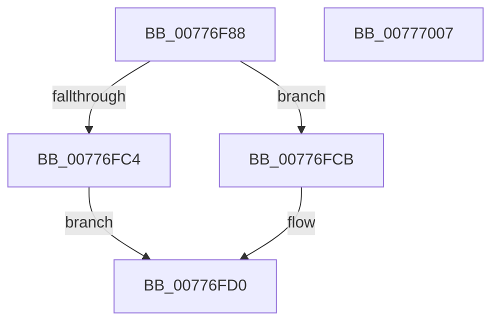

# TtmNotifySessionPowerRequestPresent

- RVA: `0x00776F88`–`0x00777008` (길이 `128` bytes)
- VA: `0x0000000140776F88`
- 실행 섹션: `PAGE`
- PDB 이름 있음: `예`; PDB Function 태그: `아니요`
- unwind 정보 RVA: `0x00093E28`
- 디코드: `37`개 명령, `128/128` bytes 표시
- 미해석 바이트: `0` (있으면 어셈블리에 `.byte`로 보존)

> 이 문서는 커널 이미지의 기계어와 PDB 기호를 분석해 생성했습니다. 4번과 5번은 함수 원형과 자료형을 바이너리 사용 방식에서 추정한 C 해석이며 원본 소스 복구 결과는 아닙니다.

## 1. Dependencies

- 직접 호출 지점: **3**; 고유 호출 대상: **3**
- 직접 호출자로 확인된 함수: **2**
- RIP 상대 이미지 참조: **0**

### Outgoing calls
- `0x00776FC4` → [TtmpInsertPowerRequestToSession](TtmpInsertPowerRequestToSession_function_00777A98.md) (function, `0x00777A98`)
- `0x00776FCB` → [TtmpUpdatePowerRequestAttribute](TtmpUpdatePowerRequestAttribute_function_007783D4.md) (function, `0x007783D4`)
- `0x00776FE9` → [TtmiLogSessionPowerRequestAcknowledged](TtmiLogSessionPowerRequestAcknowledged_function_0077B2CC.md) (function, `0x0077B2CC`)

### Direct callers
- [PopPowerRequestNotifyTtmSessionInitialized](../AD/PopPowerRequestNotifyTtmSessionInitialized_function_00AD1608.md) at `0x00AD1654`
- [PopPowerRequestNotifyUserSessionAttributed](../AD/PopPowerRequestNotifyUserSessionAttributed_function_00ADF48C.md) at `0x00ADF53D`

### Static image references
- 디코드된 RIP-relative 메모리 참조가 없습니다.

## 2. Other-region calls and transfers

- 다른 실행 섹션으로 향하는 call: **0**
- 별도 외부 분기/꼬리 이동을 확인하지 못했습니다.

## 3. Assembly (complete function range)

```asm
00776F88  48 8B C4                        mov rax, rsp
00776F8B  48 89 58 08                     mov qword ptr [rax + 8], rbx
00776F8F  48 89 68 10                     mov qword ptr [rax + 0x10], rbp
00776F93  48 89 70 18                     mov qword ptr [rax + 0x18], rsi
00776F97  57                              push rdi
00776F98  41 56                           push r14
00776F9A  41 57                           push r15
00776F9C  48 83 EC 40                     sub rsp, 0x40
00776FA0  44 8A BC 24 90 00 00 00         mov r15b, byte ptr [rsp + 0x90]
00776FA8  49 8B F9                        mov rdi, r9
00776FAB  48 8B 9C 24 80 00 00 00         mov rbx, qword ptr [rsp + 0x80]
00776FB3  41 8B F0                        mov esi, r8d
00776FB6  48 89 58 C8                     mov qword ptr [rax - 0x38], rbx
00776FBA  8B EA                           mov ebp, edx
00776FBC  44 8B F1                        mov r14d, ecx
00776FBF  45 84 FF                        test r15b, r15b
00776FC2  75 07                           jne 0x140776fcb
00776FC4  E8 CF 0A 00 00                  call 0x140777a98
00776FC9  EB 05                           jmp 0x140776fd0
00776FCB  E8 04 14 00 00                  call 0x1407783d4
00776FD0  88 44 24 38                     mov byte ptr [rsp + 0x38], al
00776FD4  4C 8B CF                        mov r9, rdi
00776FD7  44 88 7C 24 30                  mov byte ptr [rsp + 0x30], r15b
00776FDC  44 8B C6                        mov r8d, esi
00776FDF  8B D5                           mov edx, ebp
00776FE1  48 89 5C 24 20                  mov qword ptr [rsp + 0x20], rbx
00776FE6  41 8B CE                        mov ecx, r14d
00776FE9  E8 DE 42 00 00                  call 0x14077b2cc
00776FEE  48 8B 5C 24 60                  mov rbx, qword ptr [rsp + 0x60]
00776FF3  48 8B 6C 24 68                  mov rbp, qword ptr [rsp + 0x68]
00776FF8  48 8B 74 24 70                  mov rsi, qword ptr [rsp + 0x70]
00776FFD  48 83 C4 40                     add rsp, 0x40
00777001  41 5F                           pop r15
00777003  41 5E                           pop r14
00777005  5F                              pop rdi
00777006  C3                              ret
00777007  CC                              int3
```

## 4. C-style interpretation (structured pseudocode)

```c
__int64 __fastcall TtmNotifySessionPowerRequestPresent(int a1, int a2, int a3, __int64 a4, __int64 a5, __int64 a6, unsigned __int8 a7)
{
    __int64 result;
    __int64 v_rsp;
    unsigned __int8 v_stack_m20;
    unsigned __int8 v_stack_m28;
    unsigned __int64 v_stack_m38;
    unsigned __int64 v_stack_p10;
    unsigned __int64 v_stack_p18;
    unsigned __int64 v_stack_p8;

    *(unsigned __int64 *)(v_rsp + 8) = v_rbx;
    *(unsigned __int64 *)(v_rsp + 16) = v_rbp;
    *(unsigned __int64 *)(v_rsp + 24) = v_rsi;
    v_rsp = (v_rsp) - (64);
    *(unsigned __int64 *)(v_rsp - 56) = a5;
    if (a7 != 0) goto loc_00776FCB;
    result = TtmpInsertPowerRequestToSession(a1, a2, a3, a4);
    goto loc_00776FD0;
loc_00776FCB:
    result = TtmpUpdatePowerRequestAttribute(a1, a2, a3, a4);
loc_00776FD0:
    v_stack_m20 = (unsigned __int8)(result);
    v_stack_m28 = a7;
    v_stack_m38 = a5;
    result = TtmiLogSessionPowerRequestAcknowledged((unsigned int)((unsigned int)((unsigned int)(a1))), (unsigned int)((unsigned int)((unsigned int)(a2))), (unsigned int)((unsigned int)((unsigned int)(a3))), a4);
    v_rsp = (v_rsp) + (64);
    return result;
}
```

## 5. (Beta) C Style

```c
int64_t TtmNotifySessionPowerRequestPresent(int32_t Arg1, int32_t Arg2, int32_t Arg3, int64_t Arg4, int64_t Arg5, uint64_t Arg6, uint8_t Arg7)
{
    int64_t result;
    int64_t local_rsp;
    uint8_t v_stack_m20;
    uint8_t v_stack_m28;
    uint64_t v_stack_m38;
    uint64_t v_stack_p10;
    uint64_t v_stack_p18;
    uint64_t v_stack_p8;

    *(uint64_t *)(local_rsp + 0x8) = local_rbx;
    *(uint64_t *)(local_rsp + 0x10) = local_rbp;
    *(uint64_t *)(local_rsp + 0x18) = local_rsi;
    local_rsp = (local_rsp) - (64);
    *(uint64_t *)(local_rsp - 0x38) = Arg5;
    if (Arg7 != 0) goto loc_00776FCB;
    result = TtmpInsertPowerRequestToSession(Arg1, Arg2, Arg3, Arg4);
    goto loc_00776FD0;
loc_00776FCB:
    result = TtmpUpdatePowerRequestAttribute(Arg1, Arg2, Arg3, Arg4);
loc_00776FD0:
    v_stack_m20 = (uint8_t)(result);
    v_stack_m28 = Arg7;
    v_stack_m38 = Arg5;
    result = TtmiLogSessionPowerRequestAcknowledged((uint32_t)((uint32_t)((uint32_t)(Arg1))), (uint32_t)((uint32_t)((uint32_t)(Arg2))), (uint32_t)((uint32_t)((uint32_t)(Arg3))), Arg4);
    local_rsp = (local_rsp) + (64);
    return result;
}
```

## 6. Execution-region graph

[열기: 2D/3D 그래프와 함수 탐색 컨트롤 패널](../../../control-panel.html?section=page&rva=0x00776F88&view=graph)

- 2D 그래프는 위에서 아래로 흐르고, 3D 그래프는 빈 공간을 드래그해 회전합니다. Shift+드래그는 이동, 휠은 확대·축소, 함수 노드 선택은 대상 보고서 이동입니다.

### Static fallback


