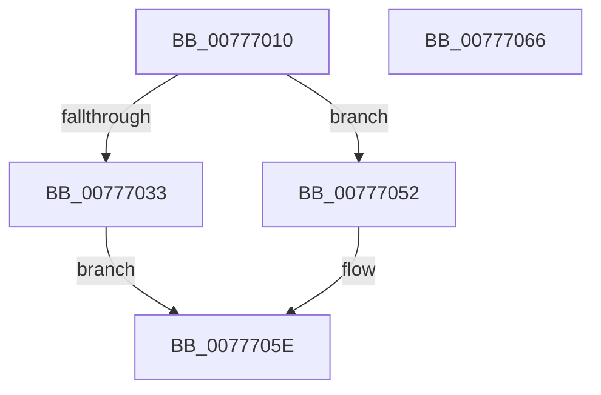

# TtmiAcquireCurrentSession

- RVA: `0x00777010`–`0x00777067` (길이 `87` bytes)
- VA: `0x0000000140777010`
- 실행 섹션: `PAGE`
- PDB 이름 있음: `예`; PDB Function 태그: `아니요`
- unwind 정보 RVA: `0x0005CF00`
- 디코드: `24`개 명령, `87/87` bytes 표시
- 미해석 바이트: `0` (있으면 어셈블리에 `.byte`로 보존)

> 이 문서는 커널 이미지의 기계어와 PDB 기호를 분석해 생성했습니다. 4번과 5번은 함수 원형과 자료형을 바이너리 사용 방식에서 추정한 C 해석이며 원본 소스 복구 결과는 아닙니다.

## 1. Dependencies

- 직접 호출 지점: **3**; 고유 호출 대상: **3**
- 직접 호출자로 확인된 함수: **5**
- RIP 상대 이미지 참조: **1**

### Outgoing calls
- `0x00777029` → [PsGetProcessSessionIdEx](../../text/22/PsGetProcessSessionIdEx_function_0022F8F0.md) (function, `0x0022F8F0`)
- `0x0077704B` → [TtmiLogError](../98/TtmiLogError_function_0098B39C.md) (function, `0x0098B39C`)
- `0x00777057` → [TtmpAcquireSessionById](../98/TtmpAcquireSessionById_function_0098B4F4.md) (function, `0x0098B4F4`)

### Direct callers
- [TtmNotifyDeviceArrival](TtmNotifyDeviceArrival_function_007754F0.md) at `0x007755AC`
- [TtmNotifyDeviceDeparture](TtmNotifyDeviceDeparture_function_007757F0.md) at `0x00775815`
- [TtmNotifyDeviceInput](TtmNotifyDeviceInput_function_007758B0.md) at `0x007758F3`
- [TtmiSessionsRundown](TtmiSessionsRundown_function_007771BC.md) at `0x007771D2`
- [TtmpDispatchOpenTerminal](TtmpDispatchOpenTerminal_function_00778AB8.md) at `0x00778AD7`

### Static image references
- `0x00777038` → RVA `0x00B04200` (` ?? ::NNGAKEGL::`string'`; read)

## 2. Other-region calls and transfers

- 다른 실행 섹션으로 향하는 call: **1**
  - `0x00777029` → [PsGetProcessSessionIdEx](../../text/22/PsGetProcessSessionIdEx_function_0022F8F0.md) (`PAGE` → `.text`)
- 별도 외부 분기/꼬리 이동을 확인하지 못했습니다.

## 3. Assembly (complete function range)

```asm
00777010  40 53                           push rbx
00777012  48 83 EC 20                     sub rsp, 0x20
00777016  48 8B D9                        mov rbx, rcx
00777019  65 48 8B 0C 25 88 01 00 00      mov rcx, qword ptr gs:[0x188]
00777022  48 8B 89 B8 00 00 00            mov rcx, qword ptr [rcx + 0xb8]
00777029  E8 C2 88 AB FF                  call 0x14022f8f0
0077702E  83 F8 FF                        cmp eax, -1
00777031  75 1F                           jne 0x140777052
00777033  BB 55 04 00 C0                  mov ebx, 0xc0000455
00777038  48 8D 0D C1 D1 38 00            lea rcx, [rip + 0x38d1c1]
0077703F  44 8B CB                        mov r9d, ebx
00777042  41 83 C8 FF                     or r8d, 0xffffffff
00777046  BA DE 06 00 00                  mov edx, 0x6de
0077704B  E8 4C 43 21 00                  call 0x14098b39c
00777050  EB 0C                           jmp 0x14077705e
00777052  8B D0                           mov edx, eax
00777054  48 8B CB                        mov rcx, rbx
00777057  E8 98 44 21 00                  call 0x14098b4f4
0077705C  8B D8                           mov ebx, eax
0077705E  8B C3                           mov eax, ebx
00777060  48 83 C4 20                     add rsp, 0x20
00777064  5B                              pop rbx
00777065  C3                              ret
00777066  CC                              int3
```

## 4. C-style interpretation (structured pseudocode)

```c
__int64 __fastcall TtmiAcquireCurrentSession(__int64 a1, __int64 a2, int a3)
{
    __int64 result;
    __int64 v_rsp;

    v_rsp = (v_rsp) - (32);
    result = PsGetProcessSessionIdEx(*(unsigned __int64 *)(*(unsigned __int64 *)(gs_base + (0 + 392)) + 184), a2, a3, a4);
    if (((unsigned int)(result)) != -1) goto loc_00777052;
    a3 = (unsigned int)((a3) | (0xFFFFFFFFULL));
    result = TtmiLogError(v_rip + 3723713, (unsigned int)(0x6DEULL), a3, (unsigned int)((unsigned int)((unsigned int)(0xC0000455ULL))));
    goto loc_0077705E;
loc_00777052:
    result = TtmpAcquireSessionById((unsigned int)(0xC0000455ULL), (unsigned int)((unsigned int)(result)), a3, (unsigned int)((unsigned int)((unsigned int)(0xC0000455ULL))));
loc_0077705E:
    v_rsp = (v_rsp) + (32);
    return (unsigned int)((unsigned int)((unsigned int)((unsigned int)(result))));
}
```

## 5. (Beta) C Style

```c
int64_t TtmiAcquireCurrentSession(int64_t Arg1, int64_t Arg2, int32_t Arg3)
{
    int64_t result;
    int64_t local_rsp;

    local_rsp = (local_rsp) - (32);
    result = PsGetProcessSessionIdEx(*(uint64_t *)(*(uint64_t *)(gs_base + (0 + 0x188)) + 0xB8), Arg2, Arg3, a4);
    if (((uint32_t)(result)) != -1) goto loc_00777052;
    Arg3 = (uint32_t)((Arg3) | (0xFFFFFFFFULL));
    result = TtmiLogError(v_rip + 3723713, (uint32_t)(0x6DEULL), Arg3, (uint32_t)((uint32_t)((uint32_t)(0xC0000455ULL))));
    goto loc_0077705E;
loc_00777052:
    result = TtmpAcquireSessionById((uint32_t)(0xC0000455ULL), (uint32_t)((uint32_t)(result)), Arg3, (uint32_t)((uint32_t)((uint32_t)(0xC0000455ULL))));
loc_0077705E:
    local_rsp = (local_rsp) + (32);
    return (uint32_t)((uint32_t)((uint32_t)((uint32_t)(result))));
}
```

## 6. Execution-region graph

[열기: 2D/3D 그래프와 함수 탐색 컨트롤 패널](../../../control-panel.html?section=page&rva=0x00777010&view=graph)

- 2D 그래프는 위에서 아래로 흐르고, 3D 그래프는 빈 공간을 드래그해 회전합니다. Shift+드래그는 이동, 휠은 확대·축소, 함수 노드 선택은 대상 보고서 이동입니다.

### Static fallback


