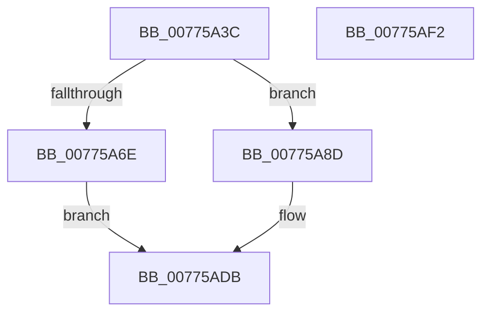

# TtmiAssignDevice

- RVA: `0x00775A3C`–`0x00775AF3` (길이 `183` bytes)
- VA: `0x0000000140775A3C`
- 실행 섹션: `PAGE`
- PDB 이름 있음: `예`; PDB Function 태그: `아니요`
- unwind 정보 RVA: `0x0005C954`
- 디코드: `49`개 명령, `183/183` bytes 표시
- 미해석 바이트: `0` (있으면 어셈블리에 `.byte`로 보존)

> 이 문서는 커널 이미지의 기계어와 PDB 기호를 분석해 생성했습니다. 4번과 5번은 함수 원형과 자료형을 바이너리 사용 방식에서 추정한 C 해석이며 원본 소스 복구 결과는 아닙니다.

## 1. Dependencies

- 직접 호출 지점: **5**; 고유 호출 대상: **5**
- 직접 호출자로 확인된 함수: **1**
- RIP 상대 이미지 참조: **1**

### Outgoing calls
- `0x00775A65` → [TtmpFindDeviceByDeviceId](TtmpFindDeviceByDeviceId_function_00776534.md) (function, `0x00776534`)
- `0x00775A86` → [TtmiLogError](../98/TtmiLogError_function_0098B39C.md) (function, `0x0098B39C`)
- `0x00775AAA` → [TtmpPublishDeviceEvent](TtmpPublishDeviceEvent_function_00776718.md) (function, `0x00776718`)
- `0x00775AB7` → [TtmiLogDeviceToTerminalAssigned](TtmiLogDeviceToTerminalAssigned_function_00779F68.md) (function, `0x00779F68`)
- `0x00775AD6` → [TtmiScheduleSessionWorker](TtmiScheduleSessionWorker_function_00777184.md) (function, `0x00777184`)

### Direct callers
- [TtmpDispatchAssignDevice](TtmpDispatchAssignDevice_function_00778670.md) at `0x007786D1`

### Static image references
- `0x00775A73` → RVA `0x00B04030` (` ?? ::NNGAKEGL::`string'`; read)

## 2. Other-region calls and transfers

- 다른 실행 섹션으로 향하는 call: **0**
- 별도 외부 분기/꼬리 이동을 확인하지 못했습니다.

## 3. Assembly (complete function range)

```asm
00775A3C  48 8B C4                        mov rax, rsp
00775A3F  48 89 58 08                     mov qword ptr [rax + 8], rbx
00775A43  48 89 68 10                     mov qword ptr [rax + 0x10], rbp
00775A47  48 89 70 18                     mov qword ptr [rax + 0x18], rsi
00775A4B  57                              push rdi
00775A4C  48 83 EC 20                     sub rsp, 0x20
00775A50  41 8B E8                        mov ebp, r8d
00775A53  4C 8B D2                        mov r10, rdx
00775A56  33 FF                           xor edi, edi
00775A58  4C 8D 40 20                     lea r8, [rax + 0x20]
00775A5C  8B D5                           mov edx, ebp
00775A5E  48 89 78 20                     mov qword ptr [rax + 0x20], rdi
00775A62  48 8B F1                        mov rsi, rcx
00775A65  E8 CA 0A 00 00                  call 0x140776534
00775A6A  84 C0                           test al, al
00775A6C  75 1F                           jne 0x140775a8d
00775A6E  BF 25 02 00 C0                  mov edi, 0xc0000225
00775A73  48 8D 0D B6 E5 38 00            lea rcx, [rip + 0x38e5b6]
00775A7A  44 8B CF                        mov r9d, edi
00775A7D  41 83 C8 FF                     or r8d, 0xffffffff
00775A81  BA 65 04 00 00                  mov edx, 0x465
00775A86  E8 11 59 21 00                  call 0x14098b39c
00775A8B  EB 4E                           jmp 0x140775adb
00775A8D  48 8B 5C 24 48                  mov rbx, qword ptr [rsp + 0x48]
00775A92  41 B9 04 00 00 00               mov r9d, 4
00775A98  41 8B 42 1C                     mov eax, dword ptr [r10 + 0x1c]
00775A9C  4C 8B C3                        mov r8, rbx
00775A9F  33 D2                           xor edx, edx
00775AA1  48 8B CE                        mov rcx, rsi
00775AA4  89 83 54 02 00 00               mov dword ptr [rbx + 0x254], eax
00775AAA  E8 69 0C 00 00                  call 0x140776718
00775AAF  8B 8B 54 02 00 00               mov ecx, dword ptr [rbx + 0x254]
00775AB5  8B D5                           mov edx, ebp
00775AB7  E8 AC 44 00 00                  call 0x140779f68
00775ABC  8B 8B 58 02 00 00               mov ecx, dword ptr [rbx + 0x258]
00775AC2  BA 01 00 00 00                  mov edx, 1
00775AC7  83 C9 20                        or ecx, 0x20
00775ACA  83 C9 40                        or ecx, 0x40
00775ACD  89 8B 58 02 00 00               mov dword ptr [rbx + 0x258], ecx
00775AD3  48 8B CE                        mov rcx, rsi
00775AD6  E8 A9 16 00 00                  call 0x140777184
00775ADB  48 8B 5C 24 30                  mov rbx, qword ptr [rsp + 0x30]
00775AE0  8B C7                           mov eax, edi
00775AE2  48 8B 6C 24 38                  mov rbp, qword ptr [rsp + 0x38]
00775AE7  48 8B 74 24 40                  mov rsi, qword ptr [rsp + 0x40]
00775AEC  48 83 C4 20                     add rsp, 0x20
00775AF0  5F                              pop rdi
00775AF1  C3                              ret
00775AF2  CC                              int3
```

## 4. C-style interpretation (structured pseudocode)

```c
__int64 __fastcall TtmiAssignDevice(__int64 a1, __int64 a2, int a3)
{
    __int64 result;
    __int64 v_rdi;
    __int64 v_rsp;
    unsigned __int64 v_stack_p10;
    unsigned __int64 v_stack_p18;
    unsigned __int64 v_stack_p20;
    unsigned __int64 v_stack_p8;

    *(unsigned __int64 *)(v_rsp + 8) = v_rbx;
    *(unsigned __int64 *)(v_rsp + 16) = v_rbp;
    *(unsigned __int64 *)(v_rsp + 24) = v_rsi;
    v_rsp = (v_rsp) - (32);
    v_rdi = 0;
    *(unsigned __int64 *)(v_rsp + 32) = 0;
    result = TtmpFindDeviceByDeviceId(a1, (unsigned int)((unsigned int)((unsigned int)(a3))), v_rsp + 32, a4);
    if ((unsigned __int8)(result) != 0) goto loc_00775A8D;
    a3 = (unsigned int)((v_rsp + 32) | (0xFFFFFFFFULL));
    result = TtmiLogError(v_rip + 3728822, (unsigned int)(0x465ULL), a3, (unsigned int)((unsigned int)((unsigned int)(0xC0000225ULL))));
    goto loc_00775ADB;
loc_00775A8D:
    a2 = 0;
    *(unsigned int *)(v_stack_p20 + 596) = (unsigned int)((unsigned int)(*(unsigned int *)(a2 + 28)));
    result = TtmpPublishDeviceEvent(a1, a2, v_stack_p20, 4);
    result = TtmiLogDeviceToTerminalAssigned((unsigned int)(*(unsigned int *)(v_stack_p20 + 596)), (unsigned int)((unsigned int)((unsigned int)(a3))), v_stack_p20, 4);
    a1 = (unsigned int)(((unsigned int)(*(unsigned int *)(v_stack_p20 + 600))) | (32));
    a1 = (unsigned int)((a1) | (64));
    *(unsigned int *)(v_stack_p20 + 600) = (unsigned int)(a1);
    result = TtmiScheduleSessionWorker(a1, 1, v_stack_p20, 4);
loc_00775ADB:
    v_rsp = (v_rsp) + (32);
    return (unsigned int)((unsigned int)((unsigned int)(0xC0000225ULL)));
}
```

## 5. (Beta) C Style

```c
int64_t TtmiAssignDevice(int64_t Arg1, int64_t Arg2, int32_t Arg3)
{
    int64_t result;
    int64_t local_rdi;
    int64_t local_rsp;
    uint64_t v_stack_p10;
    uint64_t v_stack_p18;
    uint64_t v_stack_p20;
    uint64_t v_stack_p8;

    *(uint64_t *)(local_rsp + 0x8) = local_rbx;
    *(uint64_t *)(local_rsp + 0x10) = local_rbp;
    *(uint64_t *)(local_rsp + 0x18) = local_rsi;
    local_rsp = (local_rsp) - (32);
    local_rdi = 0;
    *(uint64_t *)(local_rsp + 0x20) = 0;
    result = TtmpFindDeviceByDeviceId(Arg1, (uint32_t)((uint32_t)((uint32_t)(Arg3))), local_rsp + 32, a4);
    if ((uint8_t)(result) != 0) goto loc_00775A8D;
    Arg3 = (uint32_t)((local_rsp + 32) | (0xFFFFFFFFULL));
    result = TtmiLogError(v_rip + 3728822, (uint32_t)(0x465ULL), Arg3, (uint32_t)((uint32_t)((uint32_t)(0xC0000225ULL))));
    goto loc_00775ADB;
loc_00775A8D:
    Arg2 = 0;
    *(uint32_t *)(v_stack_p20 + 0x254) = (uint32_t)((uint32_t)(*(uint32_t *)(Arg2 + 0x1C)));
    result = TtmpPublishDeviceEvent(Arg1, Arg2, v_stack_p20, 4);
    result = TtmiLogDeviceToTerminalAssigned((uint32_t)(*(uint32_t *)(v_stack_p20 + 0x254)), (uint32_t)((uint32_t)((uint32_t)(Arg3))), v_stack_p20, 4);
    Arg1 = (uint32_t)(((uint32_t)(*(uint32_t *)(v_stack_p20 + 0x258))) | (32));
    Arg1 = (uint32_t)((Arg1) | (64));
    *(uint32_t *)(v_stack_p20 + 0x258) = (uint32_t)(Arg1);
    result = TtmiScheduleSessionWorker(Arg1, 1, v_stack_p20, 4);
loc_00775ADB:
    local_rsp = (local_rsp) + (32);
    return (uint32_t)((uint32_t)((uint32_t)(0xC0000225ULL)));
}
```

## 6. Execution-region graph

[열기: 2D/3D 그래프와 함수 탐색 컨트롤 패널](../../../control-panel.html?section=page&rva=0x00775A3C&view=graph)

- 2D 그래프는 위에서 아래로 흐르고, 3D 그래프는 빈 공간을 드래그해 회전합니다. Shift+드래그는 이동, 휠은 확대·축소, 함수 노드 선택은 대상 보고서 이동입니다.

### Static fallback


