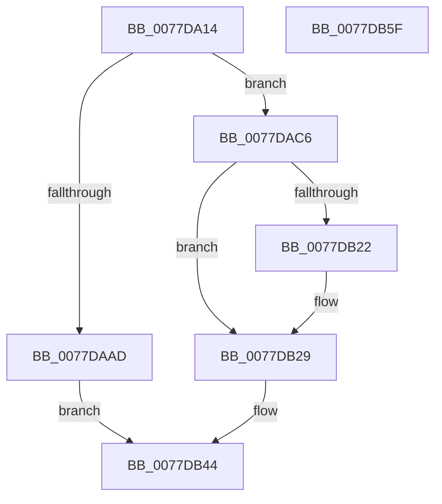

# TtmiCreateEventQueue

- RVA: `0x0077DA14`–`0x0077DB60` (길이 `332` bytes)
- VA: `0x000000014077DA14`
- 실행 섹션: `PAGE`
- PDB 이름 있음: `예`; PDB Function 태그: `아니요`
- unwind 정보 RVA: `0x000CDEA8`
- 디코드: `81`개 명령, `332/332` bytes 표시
- 미해석 바이트: `0` (있으면 어셈블리에 `.byte`로 보존)

> 이 문서는 커널 이미지의 기계어와 PDB 기호를 분석해 생성했습니다. 4번과 5번은 함수 원형과 자료형을 바이너리 사용 방식에서 추정한 C 해석이며 원본 소스 복구 결과는 아닙니다.

## 1. Dependencies

- 직접 호출 지점: **6**; 고유 호출 대상: **6**
- 직접 호출자로 확인된 함수: **1**
- RIP 상대 이미지 참조: **2**

### Outgoing calls
- `0x0077DAA2` → [ObCreateObjectEx](../89/ObCreateObjectEx_function_0089B1E0.md) (function, `0x0089B1E0`)
- `0x0077DABF` → [TtmiLogError](../98/TtmiLogError_function_0098B39C.md) (function, `0x0098B39C`)
- `0x0077DAD5` → [memset](../../text/6C/memset_function_006C6C40.md) (function, `0x006C6C40`)
- `0x0077DAEC` → [ExInitializeResourceLite](../../text/41/ExInitializeResourceLite_function_0041F9A0.md) (function, `0x0041F9A0`)
- `0x0077DAFD` → [KeInitializeEvent](../../text/40/KeInitializeEvent_function_0040DD10.md) (function, `0x0040DD10`)
- `0x0077DB3A` → [TtmiLogQueueCreated](TtmiLogQueueCreated_function_0077A940.md) (function, `0x0077A940`)

### Direct callers
- [TtmpDispatchCreateEventQueue](TtmpDispatchCreateEventQueue_function_00778718.md) at `0x00778785`

### Static image references
- `0x0077DA4A` → RVA `0x00FD9E98` (`PAGEDATA`; read)
- `0x0077DAB0` → RVA `0x00B04720` (` ?? ::NNGAKEGL::`string'`; read)

## 2. Other-region calls and transfers

- 다른 실행 섹션으로 향하는 call: **3**
  - `0x0077DAD5` → [memset](../../text/6C/memset_function_006C6C40.md) (`PAGE` → `.text`)
  - `0x0077DAEC` → [ExInitializeResourceLite](../../text/41/ExInitializeResourceLite_function_0041F9A0.md) (`PAGE` → `.text`)
  - `0x0077DAFD` → [KeInitializeEvent](../../text/40/KeInitializeEvent_function_0040DD10.md) (`PAGE` → `.text`)
- 별도 외부 분기/꼬리 이동을 확인하지 못했습니다.

## 3. Assembly (complete function range)

```asm
0077DA14  4C 8B DC                        mov r11, rsp
0077DA17  49 89 5B 08                     mov qword ptr [r11 + 8], rbx
0077DA1B  49 89 73 18                     mov qword ptr [r11 + 0x18], rsi
0077DA1F  49 89 7B 20                     mov qword ptr [r11 + 0x20], rdi
0077DA23  55                              push rbp
0077DA24  48 8B EC                        mov rbp, rsp
0077DA27  48 81 EC 80 00 00 00            sub rsp, 0x80
0077DA2E  49 83 63 C0 00                  and qword ptr [r11 - 0x40], 0
0077DA33  4C 8D 45 D0                     lea r8, [rbp - 0x30]
0077DA37  65 48 8B 04 25 88 01 00 00      mov rax, qword ptr gs:[0x188]
0077DA40  48 8B FA                        mov rdi, rdx
0077DA43  48 83 22 00                     and qword ptr [rdx], 0
0077DA47  48 8B F1                        mov rsi, rcx
0077DA4A  48 8B 15 47 C4 85 00            mov rdx, qword ptr [rip + 0x85c447]
0077DA51  0F 57 C0                        xorps xmm0, xmm0
0077DA54  48 83 65 18 00                  and qword ptr [rbp + 0x18], 0
0077DA59  33 C9                           xor ecx, ecx
0077DA5B  44 8A 88 32 02 00 00            mov r9b, byte ptr [rax + 0x232]
0077DA62  48 8D 45 18                     lea rax, [rbp + 0x18]
0077DA66  83 65 EC 00                     and dword ptr [rbp - 0x14], 0
0077DA6A  48 83 65 D8 00                  and qword ptr [rbp - 0x28], 0
0077DA6F  48 83 65 E0 00                  and qword ptr [rbp - 0x20], 0
0077DA74  49 89 43 B8                     mov qword ptr [r11 - 0x48], rax
0077DA78  83 64 24 38 00                  and dword ptr [rsp + 0x38], 0
0077DA7D  83 64 24 30 00                  and dword ptr [rsp + 0x30], 0
0077DA82  48 C7 45 D0 30 00 00 00         mov qword ptr [rbp - 0x30], 0x30
0077DA8A  83 65 D4 00                     and dword ptr [rbp - 0x2c], 0
0077DA8E  C7 44 24 28 B0 00 00 00         mov dword ptr [rsp + 0x28], 0xb0
0077DA96  C7 45 E8 20 00 00 00            mov dword ptr [rbp - 0x18], 0x20
0077DA9D  F3 0F 7F 45 F0                  movdqu xmmword ptr [rbp - 0x10], xmm0
0077DAA2  E8 39 D7 11 00                  call 0x14089b1e0
0077DAA7  8B D8                           mov ebx, eax
0077DAA9  85 C0                           test eax, eax
0077DAAB  79 19                           jns 0x14077dac6
0077DAAD  44 8B C8                        mov r9d, eax
0077DAB0  48 8D 0D 69 6C 38 00            lea rcx, [rip + 0x386c69]
0077DAB7  44 8B C0                        mov r8d, eax
0077DABA  BA 36 02 00 00                  mov edx, 0x236
0077DABF  E8 D8 D8 20 00                  call 0x14098b39c
0077DAC4  EB 7E                           jmp 0x14077db44
0077DAC6  48 8B 5D 18                     mov rbx, qword ptr [rbp + 0x18]
0077DACA  33 D2                           xor edx, edx
0077DACC  48 8B CB                        mov rcx, rbx
0077DACF  41 B8 B0 00 00 00               mov r8d, 0xb0
0077DAD5  E8 66 91 F4 FF                  call 0x1406c6c40
0077DADA  48 8D 83 98 00 00 00            lea rax, [rbx + 0x98]
0077DAE1  48 8D 4B 18                     lea rcx, [rbx + 0x18]
0077DAE5  48 89 40 08                     mov qword ptr [rax + 8], rax
0077DAE9  48 89 00                        mov qword ptr [rax], rax
0077DAEC  E8 AF 1E CA FF                  call 0x14041f9a0
0077DAF1  48 8D 8B 80 00 00 00            lea rcx, [rbx + 0x80]
0077DAF8  45 33 C0                        xor r8d, r8d
0077DAFB  33 D2                           xor edx, edx
0077DAFD  E8 0E 02 C9 FF                  call 0x14040dd10
0077DB02  C6 83 A8 00 00 00 01            mov byte ptr [rbx + 0xa8], 1
0077DB09  F0 FF 46 08                     lock inc dword ptr [rsi + 8]
0077DB0D  48 8B 5D 18                     mov rbx, qword ptr [rbp + 0x18]
0077DB11  48 8D 46 50                     lea rax, [rsi + 0x50]
0077DB15  48 89 73 10                     mov qword ptr [rbx + 0x10], rsi
0077DB19  48 8B 48 08                     mov rcx, qword ptr [rax + 8]
0077DB1D  48 39 01                        cmp qword ptr [rcx], rax
0077DB20  74 07                           je 0x14077db29
0077DB22  B9 03 00 00 00                  mov ecx, 3
0077DB27  CD 29                           int 0x29
0077DB29  48 89 4B 08                     mov qword ptr [rbx + 8], rcx
0077DB2D  48 89 03                        mov qword ptr [rbx], rax
0077DB30  48 89 19                        mov qword ptr [rcx], rbx
0077DB33  48 8B CB                        mov rcx, rbx
0077DB36  48 89 58 08                     mov qword ptr [rax + 8], rbx
0077DB3A  E8 01 CE FF FF                  call 0x14077a940
0077DB3F  48 89 1F                        mov qword ptr [rdi], rbx
0077DB42  33 DB                           xor ebx, ebx
0077DB44  4C 8D 9C 24 80 00 00 00         lea r11, [rsp + 0x80]
0077DB4C  8B C3                           mov eax, ebx
0077DB4E  49 8B 5B 10                     mov rbx, qword ptr [r11 + 0x10]
0077DB52  49 8B 73 20                     mov rsi, qword ptr [r11 + 0x20]
0077DB56  49 8B 7B 28                     mov rdi, qword ptr [r11 + 0x28]
0077DB5A  49 8B E3                        mov rsp, r11
0077DB5D  5D                              pop rbp
0077DB5E  C3                              ret
0077DB5F  CC                              int3
```

## 4. C-style interpretation (structured pseudocode)

```c
__int64 __fastcall TtmiCreateEventQueue(__int64 a1, __int64 a2)
{
    __int64 result;
    __int64 v_rbx;
    __int64 v_rsp;
    unsigned __int64 v_stack_m18;
    unsigned int v_stack_m1C;
    unsigned int v_stack_m20;
    unsigned __int64 v_stack_m28;
    unsigned __int64 v_stack_m30;
    unsigned int v_stack_m34;
    unsigned __int64 v_stack_m38;
    unsigned int v_stack_m50;
    unsigned int v_stack_m58;
    unsigned int v_stack_m60;
    unsigned __int64 v_stack_m8;
    unsigned __int64 v_stack_p10;

    *(unsigned __int64 *)(v_rsp + 8) = v_rbx;
    *(unsigned __int64 *)(v_rsp + 24) = v_rsi;
    *(unsigned __int64 *)(v_rsp + 32) = v_rdi;
    v_rsp = (v_rsp) - (128);
    a1 = 0;
    *(unsigned __int64 *)(v_rsp - 72) = v_stack_p10;
    v_stack_m38 = 48;
    v_stack_m60 = 176;
    v_stack_m20 = 32;
    v_stack_m18 = v_xmm0;
    result = ObCreateObjectEx(a1, *(unsigned __int64 *)(v_rip + 8766535), v_stack_m38, *(unsigned __int8 *)(*(unsigned __int64 *)(gs_base + (0 + 392)) + 562));
    if (!sign_flag) goto loc_0077DAC6;
    result = TtmiLogError(v_rip + 3697769, 566, (unsigned int)((unsigned int)(result)), (unsigned int)((unsigned int)(result)));
    goto loc_0077DB44;
loc_0077DAC6:
    a2 = 0;
    result = memset(v_stack_p10, a2, 176, (unsigned int)((unsigned int)(result)));
    *(unsigned __int64 *)(v_stack_p10 + 152 + 8) = v_stack_p10 + 152;
    *(unsigned __int64 *)(v_stack_p10 + 152) = v_stack_p10 + 152;
    result = ExInitializeResourceLite(v_stack_p10 + 24, a2, 176, (unsigned int)((unsigned int)(result)));
    a3 = 0;
    a2 = 0;
    result = KeInitializeEvent(v_stack_p10 + 128, a2, a3, (unsigned int)((unsigned int)(result)));
    *(unsigned __int8 *)(v_stack_p10 + 168) = 1;
    *(unsigned __int64 *)(v_stack_p10 + 16) = 0;
    if ((*(unsigned __int64 *)(*(unsigned __int64 *)(a1 + 80 + 8))) != (a1 + 80)) {
        a1 = 3;
    }
    *(unsigned __int64 *)(v_stack_p10 + 8) = a1;
    *(unsigned __int64 *)(v_stack_p10) = a1 + 80;
    *(unsigned __int64 *)(a1) = v_stack_p10;
    *(unsigned __int64 *)(a1 + 80 + 8) = v_stack_p10;
    result = TtmiLogQueueCreated(v_stack_p10, a2, a3, (unsigned int)((unsigned int)(result)));
    *(unsigned __int64 *)(a2) = v_stack_p10;
    v_rbx = 0;
loc_0077DB44:
    return 0;
}
```

## 5. (Beta) C Style

```c
int64_t TtmiCreateEventQueue(void *Arg1, void *Arg2)
{
    uint8_t *arg1 = (uint8_t *)Arg1;
    uint8_t *arg2 = (uint8_t *)Arg2;

    int64_t result;
    int64_t local_rbx;
    int64_t local_rsp;
    uint64_t v_stack_m18;
    uint32_t v_stack_m1C;
    uint32_t v_stack_m20;
    uint64_t v_stack_m28;
    uint64_t v_stack_m30;
    uint32_t v_stack_m34;
    uint64_t v_stack_m38;
    uint32_t v_stack_m50;
    uint32_t v_stack_m58;
    uint32_t v_stack_m60;
    uint64_t v_stack_m8;
    uint64_t v_stack_p10;

    *(uint64_t *)(local_rsp + 0x8) = local_rbx;
    *(uint64_t *)(local_rsp + 0x18) = local_rsi;
    *(uint64_t *)(local_rsp + 0x20) = local_rdi;
    local_rsp = (local_rsp) - (128);
    Arg1 = 0;
    *(uint64_t *)(local_rsp - 0x48) = v_stack_p10;
    v_stack_m38 = 48;
    v_stack_m60 = 176;
    v_stack_m20 = 32;
    v_stack_m18 = v_xmm0;
    result = ObCreateObjectEx(Arg1, *(uint64_t *)(v_rip + 0x85C447), v_stack_m38, *(uint8_t *)(*(uint64_t *)(gs_base + (0 + 0x188)) + 0x232));
    if (!sign_flag) goto loc_0077DAC6;
    result = TtmiLogError(v_rip + 3697769, 566, (uint32_t)((uint32_t)(result)), (uint32_t)((uint32_t)(result)));
    goto loc_0077DB44;
loc_0077DAC6:
    Arg2 = 0;
    result = memset(v_stack_p10, Arg2, 176, (uint32_t)((uint32_t)(result)));
    *(uint64_t *)(v_stack_p10 + 0x98 + 0x8) = v_stack_p10 + 152;
    *(uint64_t *)(v_stack_p10 + 0x98) = v_stack_p10 + 152;
    result = ExInitializeResourceLite(v_stack_p10 + 24, Arg2, 176, (uint32_t)((uint32_t)(result)));
    a3 = 0;
    Arg2 = 0;
    result = KeInitializeEvent(v_stack_p10 + 128, Arg2, a3, (uint32_t)((uint32_t)(result)));
    *(uint8_t *)(v_stack_p10 + 0xA8) = 1;
    *(uint64_t *)(v_stack_p10 + 0x10) = 0;
    if ((*(uint64_t *)(*(uint64_t *)(arg1 + 0x50 + 0x8))) != (Arg1 + 80)) {
        Arg1 = 3;
    }
    *(void **)(v_stack_p10 + 0x8) = Arg1;
    *(void **)(v_stack_p10) = Arg1 + 80;
    *(uint64_t *)(arg1) = v_stack_p10;
    *(uint64_t *)(arg1 + 0x50 + 0x8) = v_stack_p10;
    result = TtmiLogQueueCreated(v_stack_p10, Arg2, a3, (uint32_t)((uint32_t)(result)));
    *(uint64_t *)(arg2) = v_stack_p10;
    local_rbx = 0;
loc_0077DB44:
    return 0;
}
```

### 관측된 메모리 오프셋

구조체 형식이 확인되지 않은 접근은 인자 기준의 오프셋으로만 기록했습니다.

| 기준 인자 | 오프셋 표현 | 폭 (bit) | 접근 |
|---|---:|---:|---|
| `Arg1` | `+ 0x8` | `32` | `R/W` |
| `Arg1` | `+ 0x8` | `64` | `R` |
| `Arg1` | `+ 0x8` | `64` | `W` |
| `Arg1` | `+ 0x50` | `64` | `R` |
| `Arg2` | `+ 0x0` | `64` | `R/W` |
| `Arg2` | `+ 0x0` | `64` | `W` |

## 6. Execution-region graph

[열기: 2D/3D 그래프와 함수 탐색 컨트롤 패널](../../../control-panel.html?section=page&rva=0x0077DA14&view=graph)

- 2D 그래프는 위에서 아래로 흐르고, 3D 그래프는 빈 공간을 드래그해 회전합니다. Shift+드래그는 이동, 휠은 확대·축소, 함수 노드 선택은 대상 보고서 이동입니다.

### Static fallback


