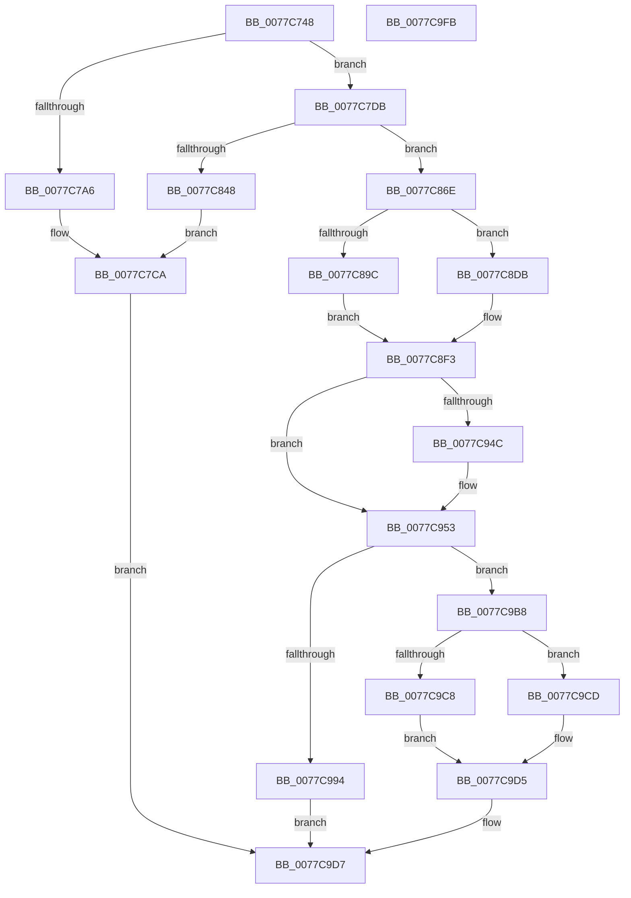

# TtmiCreateTerminal

- RVA: `0x0077C748`–`0x0077C9FC` (길이 `692` bytes)
- VA: `0x000000014077C748`
- 실행 섹션: `PAGE`
- PDB 이름 있음: `예`; PDB Function 태그: `아니요`
- unwind 정보 RVA: `0x000CDE54`
- 디코드: `167`개 명령, `692/692` bytes 표시
- 미해석 바이트: `0` (있으면 어셈블리에 `.byte`로 보존)

> 이 문서는 커널 이미지의 기계어와 PDB 기호를 분석해 생성했습니다. 4번과 5번은 함수 원형과 자료형을 바이너리 사용 방식에서 추정한 C 해석이며 원본 소스 복구 결과는 아닙니다.

## 1. Dependencies

- 직접 호출 지점: **14**; 고유 호출 대상: **12**
- 직접 호출자로 확인된 함수: **2**
- RIP 상대 이미지 참조: **5**

### Outgoing calls
- `0x0077C796` → [RtlFindClearBitsAndSet](../../text/3E/RtlFindClearBitsAndSet_function_003E0CD0.md) (function, `0x003E0CD0`)
- `0x0077C7BA` → [TtmiLogError](../98/TtmiLogError_function_0098B39C.md) (function, `0x0098B39C`)
- `0x0077C7D1` → [TtmiLogError](../98/TtmiLogError_function_0098B39C.md) (function, `0x0098B39C`)
- `0x0077C83D` → [ObCreateObjectEx](../89/ObCreateObjectEx_function_0089B1E0.md) (function, `0x0089B1E0`)
- `0x0077C879` → [ObfReferenceObject](../../text/20/ObfReferenceObject_function_0020FA20.md) (function, `0x0020FA20`)
- `0x0077C889` → [memset](../../text/6C/memset_function_006C6C40.md) (function, `0x006C6C40`)
- `0x0077C8D4` → [TtmiUpdateActiveTerminalCount](TtmiUpdateActiveTerminalCount_function_007774C4.md) (function, `0x007774C4`)
- `0x0077C8F7` → [KeInitializeTimer](../../text/45/KeInitializeTimer_function_0045B590.md) (function, `0x0045B590`)
- `0x0077C90D` → [KeInitializeDpc](../../text/45/KeInitializeDpc_function_0045BBD0.md) (function, `0x0045BBD0`)
- `0x0077C966` → [TtmiLogTerminalCreated](TtmiLogTerminalCreated_function_0077BACC.md) (function, `0x0077BACC`)
- `0x0077C989` → [ObInsertObjectEx](../8B/ObInsertObjectEx_function_008B97A0.md) (function, `0x008B97A0`)
- `0x0077C9A6` → [TtmiLogError](../98/TtmiLogError_function_0098B39C.md) (function, `0x0098B39C`)
- `0x0077C9B1` → [TtmpSetTerminalPendingCleanup](TtmpSetTerminalPendingCleanup_function_0077D5C4.md) (function, `0x0077D5C4`)
- `0x0077C9D0` → [ObfDereferenceObject](../../text/2F/ObfDereferenceObject_function_002F9350.md) (function, `0x002F9350`)

### Direct callers
- [TtmpDispatchCreateTerminal](TtmpDispatchCreateTerminal_function_00778858.md) at `0x007788E3`
- [TtmInitCurrentSession](../98/TtmInitCurrentSession_function_0098AA18.md) at `0x0098AB75`

### Static image references
- `0x0077C7AB` → RVA `0x00B04130` (` ?? ::NNGAKEGL::`string'`; read)
- `0x0077C7CA` → RVA `0x00B046B0` (` ?? ::NNGAKEGL::`string'`; read)
- `0x0077C7DB` → RVA `0x00FD9D08` (`PAGEDATA`; read)
- `0x0077C906` → RVA `0x005E2100` (`TtmpScheduledEvaluationDpc`; read)
- `0x0077C91A` → RVA `0x0077D560` (`TtmpScheduledEvaluationWorker`; read)

## 2. Other-region calls and transfers

- 다른 실행 섹션으로 향하는 call: **6**
  - `0x0077C796` → [RtlFindClearBitsAndSet](../../text/3E/RtlFindClearBitsAndSet_function_003E0CD0.md) (`PAGE` → `.text`)
  - `0x0077C879` → [ObfReferenceObject](../../text/20/ObfReferenceObject_function_0020FA20.md) (`PAGE` → `.text`)
  - `0x0077C889` → [memset](../../text/6C/memset_function_006C6C40.md) (`PAGE` → `.text`)
  - `0x0077C8F7` → [KeInitializeTimer](../../text/45/KeInitializeTimer_function_0045B590.md) (`PAGE` → `.text`)
  - `0x0077C90D` → [KeInitializeDpc](../../text/45/KeInitializeDpc_function_0045BBD0.md) (`PAGE` → `.text`)
  - `0x0077C9D0` → [ObfDereferenceObject](../../text/2F/ObfDereferenceObject_function_002F9350.md) (`PAGE` → `.text`)
- 별도 외부 분기/꼬리 이동을 확인하지 못했습니다.

## 3. Assembly (complete function range)

```asm
0077C748  48 8B C4                        mov rax, rsp
0077C74B  48 89 58 08                     mov qword ptr [rax + 8], rbx
0077C74F  48 89 68 10                     mov qword ptr [rax + 0x10], rbp
0077C753  48 89 70 18                     mov qword ptr [rax + 0x18], rsi
0077C757  48 89 78 20                     mov qword ptr [rax + 0x20], rdi
0077C75B  41 54                           push r12
0077C75D  41 56                           push r14
0077C75F  41 57                           push r15
0077C761  48 81 EC 80 00 00 00            sub rsp, 0x80
0077C768  4C 8B B4 24 C0 00 00 00         mov r14, qword ptr [rsp + 0xc0]
0077C770  41 8A D8                        mov bl, r8b
0077C773  49 83 21 00                     and qword ptr [r9], 0
0077C777  45 33 C0                        xor r8d, r8d
0077C77A  48 83 60 28 00                  and qword ptr [rax + 0x28], 0
0077C77F  44 8B E2                        mov r12d, edx
0077C782  48 8B E9                        mov rbp, rcx
0077C785  4D 8B F9                        mov r15, r9
0077C788  41 83 0E FF                     or dword ptr [r14], 0xffffffff
0077C78C  48 83 C1 38                     add rcx, 0x38
0077C790  41 8D 70 01                     lea esi, [r8 + 1]
0077C794  8B D6                           mov edx, esi
0077C796  E8 35 45 C6 FF                  call 0x1403e0cd0
0077C79B  41 83 C8 FF                     or r8d, 0xffffffff
0077C79F  8B F8                           mov edi, eax
0077C7A1  41 3B C0                        cmp eax, r8d
0077C7A4  75 35                           jne 0x14077c7db
0077C7A6  BB 44 00 00 C0                  mov ebx, 0xc0000044
0077C7AB  48 8D 0D 7E 79 38 00            lea rcx, [rip + 0x38797e]
0077C7B2  44 8B CB                        mov r9d, ebx
0077C7B5  BA 3F 06 00 00                  mov edx, 0x63f
0077C7BA  E8 DD EB 20 00                  call 0x14098b39c
0077C7BF  44 8B CB                        mov r9d, ebx
0077C7C2  44 8B C3                        mov r8d, ebx
0077C7C5  BA D0 02 00 00                  mov edx, 0x2d0
0077C7CA  48 8D 0D DF 7E 38 00            lea rcx, [rip + 0x387edf]
0077C7D1  E8 C6 EB 20 00                  call 0x14098b39c
0077C7D6  E9 FC 01 00 00                  jmp 0x14077c9d7
0077C7DB  48 8B 15 26 D5 85 00            mov rdx, qword ptr [rip + 0x85d526]
0077C7E2  4C 8D 44 24 50                  lea r8, [rsp + 0x50]
0077C7E7  0F 57 C0                        xorps xmm0, xmm0
0077C7EA  8A C3                           mov al, bl
0077C7EC  F6 D8                           neg al
0077C7EE  44 8A CB                        mov r9b, bl
0077C7F1  48 8D 84 24 C0 00 00 00         lea rax, [rsp + 0xc0]
0077C7F9  1B C9                           sbb ecx, ecx
0077C7FB  48 83 64 24 48 00               and qword ptr [rsp + 0x48], 0
0077C801  48 89 44 24 40                  mov qword ptr [rsp + 0x40], rax
0077C806  F7 D1                           not ecx
0077C808  83 64 24 38 00                  and dword ptr [rsp + 0x38], 0
0077C80D  81 E1 00 02 00 00               and ecx, 0x200
0077C813  83 64 24 30 00                  and dword ptr [rsp + 0x30], 0
0077C818  0F 11 44 24 60                  movups xmmword ptr [rsp + 0x60], xmm0
0077C81D  89 4C 24 68                     mov dword ptr [rsp + 0x68], ecx
0077C821  33 C9                           xor ecx, ecx
0077C823  0F 11 44 24 50                  movups xmmword ptr [rsp + 0x50], xmm0
0077C828  C7 44 24 50 30 00 00 00         mov dword ptr [rsp + 0x50], 0x30
0077C830  0F 11 44 24 70                  movups xmmword ptr [rsp + 0x70], xmm0
0077C835  C7 44 24 28 20 01 00 00         mov dword ptr [rsp + 0x28], 0x120
0077C83D  E8 9E E9 11 00                  call 0x14089b1e0
0077C842  8B D8                           mov ebx, eax
0077C844  85 C0                           test eax, eax
0077C846  79 26                           jns 0x14077c86e
0077C848  48 8B D7                        mov rdx, rdi
0077C84B  44 8B C8                        mov r9d, eax
0077C84E  48 C1 EA 03                     shr rdx, 3
0077C852  83 E7 07                        and edi, 7
0077C855  48 03 55 40                     add rdx, qword ptr [rbp + 0x40]
0077C859  44 8B C0                        mov r8d, eax
0077C85C  0F BE 0A                        movsx ecx, byte ptr [rdx]
0077C85F  0F B3 F9                        btr ecx, edi
0077C862  88 0A                           mov byte ptr [rdx], cl
0077C864  BA F1 02 00 00                  mov edx, 0x2f1
0077C869  E9 5C FF FF FF                  jmp 0x14077c7ca
0077C86E  48 8B 9C 24 C0 00 00 00         mov rbx, qword ptr [rsp + 0xc0]
0077C876  48 8B CB                        mov rcx, rbx
0077C879  E8 A2 31 A9 FF                  call 0x14020fa20
0077C87E  33 D2                           xor edx, edx
0077C880  41 B8 20 01 00 00               mov r8d, 0x120
0077C886  48 8B CB                        mov rcx, rbx
0077C889  E8 B2 A3 F4 FF                  call 0x1406c6c40
0077C88E  C7 43 18 54 74 6D 54            mov dword ptr [rbx + 0x18], 0x546d7454
0077C895  89 7B 1C                        mov dword ptr [rbx + 0x1c], edi
0077C898  85 FF                           test edi, edi
0077C89A  75 3F                           jne 0x14077c8db
0077C89C  C7 43 28 03 00 00 00            mov dword ptr [rbx + 0x28], 3
0077C8A3  44 8D 47 1A                     lea r8d, [rdi + 0x1a]
0077C8A7  C7 83 14 01 00 00 03 00 00 00   mov dword ptr [rbx + 0x114], 3
0077C8B1  40 8A D6                        mov dl, sil
0077C8B4  21 7B 30                        and dword ptr [rbx + 0x30], edi
0077C8B7  48 8B CD                        mov rcx, rbp
0077C8BA  83 4B 24 10                     or dword ptr [rbx + 0x24], 0x10
0077C8BE  48 A1 08 00 00 00 80 F7 FF FF   movabs rax, qword ptr [0xfffff78000000008]
0077C8C8  48 8B 9C 24 C0 00 00 00         mov rbx, qword ptr [rsp + 0xc0]
0077C8D0  48 89 43 50                     mov qword ptr [rbx + 0x50], rax
0077C8D4  E8 EB AB FF FF                  call 0x1407774c4
0077C8D9  EB 18                           jmp 0x14077c8f3
0077C8DB  89 73 28                        mov dword ptr [rbx + 0x28], esi
0077C8DE  89 B3 14 01 00 00               mov dword ptr [rbx + 0x114], esi
0077C8E4  C7 43 30 02 00 00 00            mov dword ptr [rbx + 0x30], 2
0077C8EB  48 C7 43 48 00 A3 E1 11         mov qword ptr [rbx + 0x48], 0x11e1a300
0077C8F3  48 8D 4B 58                     lea rcx, [rbx + 0x58]
0077C8F7  E8 94 EC CD FF                  call 0x14045b590
0077C8FC  48 8D 8B 98 00 00 00            lea rcx, [rbx + 0x98]
0077C903  4C 8B C3                        mov r8, rbx
0077C906  48 8D 15 F3 57 E6 FF            lea rdx, [rip - 0x19a80d]
0077C90D  E8 BE F2 CD FF                  call 0x14045bbd0
0077C912  48 83 A3 D8 00 00 00 00         and qword ptr [rbx + 0xd8], 0
0077C91A  48 8D 05 3F 0C 00 00            lea rax, [rip + 0xc3f]
0077C921  48 89 83 E8 00 00 00            mov qword ptr [rbx + 0xe8], rax
0077C928  48 89 9B F0 00 00 00            mov qword ptr [rbx + 0xf0], rbx
0077C92F  F0 01 75 08                     lock add dword ptr [rbp + 8], esi
0077C933  48 8B B4 24 C0 00 00 00         mov rsi, qword ptr [rsp + 0xc0]
0077C93B  48 8D 45 28                     lea rax, [rbp + 0x28]
0077C93F  48 89 6E 10                     mov qword ptr [rsi + 0x10], rbp
0077C943  48 8B 50 08                     mov rdx, qword ptr [rax + 8]
0077C947  48 39 02                        cmp qword ptr [rdx], rax
0077C94A  74 07                           je 0x14077c953
0077C94C  B9 03 00 00 00                  mov ecx, 3
0077C951  CD 29                           int 0x29
0077C953  48 89 56 08                     mov qword ptr [rsi + 8], rdx
0077C957  48 8B CE                        mov rcx, rsi
0077C95A  48 89 06                        mov qword ptr [rsi], rax
0077C95D  48 89 32                        mov qword ptr [rdx], rsi
0077C960  8B D7                           mov edx, edi
0077C962  48 89 70 08                     mov qword ptr [rax + 8], rsi
0077C966  E8 61 F1 FF FF                  call 0x14077bacc
0077C96B  4C 89 7C 24 30                  mov qword ptr [rsp + 0x30], r15
0077C970  41 B9 01 00 00 00               mov r9d, 1
0077C976  48 83 64 24 28 00               and qword ptr [rsp + 0x28], 0
0077C97C  45 8B C4                        mov r8d, r12d
0077C97F  83 64 24 20 00                  and dword ptr [rsp + 0x20], 0
0077C984  33 D2                           xor edx, edx
0077C986  48 8B CE                        mov rcx, rsi
0077C989  E8 12 CE 13 00                  call 0x1408b97a0
0077C98E  8B D8                           mov ebx, eax
0077C990  85 C0                           test eax, eax
0077C992  79 24                           jns 0x14077c9b8
0077C994  44 8B C8                        mov r9d, eax
0077C997  48 8D 0D 12 7D 38 00            lea rcx, [rip + 0x387d12]
0077C99E  44 8B C0                        mov r8d, eax
0077C9A1  BA 4B 03 00 00                  mov edx, 0x34b
0077C9A6  E8 F1 E9 20 00                  call 0x14098b39c
0077C9AB  48 8B D6                        mov rdx, rsi
0077C9AE  48 8B CD                        mov rcx, rbp
0077C9B1  E8 0E 0C 00 00                  call 0x14077d5c4
0077C9B6  EB 1F                           jmp 0x14077c9d7
0077C9B8  48 8B 84 24 C8 00 00 00         mov rax, qword ptr [rsp + 0xc8]
0077C9C0  41 89 3E                        mov dword ptr [r14], edi
0077C9C3  48 85 C0                        test rax, rax
0077C9C6  74 05                           je 0x14077c9cd
0077C9C8  48 89 30                        mov qword ptr [rax], rsi
0077C9CB  EB 08                           jmp 0x14077c9d5
0077C9CD  48 8B CE                        mov rcx, rsi
0077C9D0  E8 7B C9 B7 FF                  call 0x1402f9350
0077C9D5  33 DB                           xor ebx, ebx
0077C9D7  4C 8D 9C 24 80 00 00 00         lea r11, [rsp + 0x80]
0077C9DF  8B C3                           mov eax, ebx
0077C9E1  49 8B 5B 20                     mov rbx, qword ptr [r11 + 0x20]
0077C9E5  49 8B 6B 28                     mov rbp, qword ptr [r11 + 0x28]
0077C9E9  49 8B 73 30                     mov rsi, qword ptr [r11 + 0x30]
0077C9ED  49 8B 7B 38                     mov rdi, qword ptr [r11 + 0x38]
0077C9F1  49 8B E3                        mov rsp, r11
0077C9F4  41 5F                           pop r15
0077C9F6  41 5E                           pop r14
0077C9F8  41 5C                           pop r12
0077C9FA  C3                              ret
0077C9FB  CC                              int3
```

## 4. C-style interpretation (structured pseudocode)

```c
__int64 __fastcall TtmiCreateTerminal(__int64 a1, int a2, int a3, __int64 a4, __int64 a5, __int64 a6)
{
    __int64 result;
    __int64 v_rbx;
    __int64 v_rdi;
    __int64 v_rsp;
    unsigned __int64 v_stack_m18;
    unsigned __int64 v_stack_m28;
    unsigned int v_stack_m30;
    unsigned __int64 v_stack_m38;
    unsigned __int64 v_stack_m48;
    unsigned __int64 v_stack_m50;
    unsigned __int64 v_stack_m58;
    unsigned int v_stack_m60;
    unsigned int v_stack_m68;
    unsigned int v_stack_m70;
    unsigned int v_stack_m78;

    *(unsigned __int64 *)(v_rsp + 8) = v_rbx;
    *(unsigned __int64 *)(v_rsp + 16) = v_rbp;
    *(unsigned __int64 *)(v_rsp + 24) = v_rsi;
    *(unsigned __int64 *)(v_rsp + 32) = v_rdi;
    v_rsp = (v_rsp) - (128);
    a3 = 0;
    a1 = (a1) + (56);
    result = RtlFindClearBitsAndSet(a1, (unsigned int)((unsigned int)(a3 + 1)), a3, a4);
    a3 = (unsigned int)((a3) | (0xFFFFFFFFULL));
    if (((unsigned int)(result)) != a3) goto loc_0077C7DB;
    result = TtmiLogError(v_rip + 3701118, (unsigned int)(0x63FULL), a3, (unsigned int)((unsigned int)((unsigned int)(0xC0000044ULL))));
loc_0077C7CA:
    result = TtmiLogError(v_rip + 3702495, 720, (unsigned int)((unsigned int)((unsigned int)(0xC0000044ULL))), (unsigned int)((unsigned int)((unsigned int)(0xC0000044ULL))));
    goto loc_0077C9D7;
loc_0077C7DB:
    result = (unsigned __int8)(-((unsigned __int8)((unsigned int)(0xC0000044ULL))));
    v_stack_m58 = a5;
    a1 = (unsigned int)(~(v_rip + 3702495));
    a1 = (unsigned int)((a1) & (512));
    v_stack_m38 = v_xmm0;
    v_stack_m30 = (unsigned int)(a1);
    a1 = 0;
    v_stack_m48 = v_xmm0;
    v_stack_m48 = 48;
    v_stack_m28 = v_xmm0;
    v_stack_m70 = 288;
    result = ObCreateObjectEx(a1, *(unsigned __int64 *)(v_rip + 8770854), v_stack_m48, (unsigned __int8)((unsigned int)(0xC0000044ULL)));
    if (!sign_flag) goto loc_0077C86E;
    a2 = ((unsigned int)((unsigned int)(result))) >> (3);
    v_rdi = (unsigned int)(((unsigned int)((unsigned int)(result))) & (7));
    a2 = (a2) + (*(unsigned __int64 *)(a1 + 64));
    *(unsigned __int8 *)(a2) = (unsigned __int8)((__int8)(*(unsigned __int8 *)(a2)));
    goto loc_0077C7CA;
loc_0077C86E:
    result = ObfReferenceObject(a5, 753, (unsigned int)((unsigned int)(result)), (unsigned int)((unsigned int)(result)));
    a2 = 0;
    result = memset(a5, a2, 288, (unsigned int)((unsigned int)(result)));
    *(unsigned int *)(a5 + 24) = 0x546D7454ULL;
    *(unsigned int *)(a5 + 28) = (unsigned int)(v_rdi);
    if ((unsigned int)(v_rdi) != 0) goto loc_0077C8DB;
    *(unsigned int *)(a5 + 40) = 3;
    *(unsigned int *)(a5 + 276) = 3;
    *(unsigned __int64 *)(a5 + 80) = result;
    result = TtmiUpdateActiveTerminalCount(0, (unsigned __int8)(a3 + 1), v_rdi + 26, (unsigned int)((unsigned int)(result)));
    goto loc_0077C8F3;
loc_0077C8DB:
    *(unsigned int *)(a5 + 40) = (unsigned int)(a3 + 1);
    *(unsigned int *)(a5 + 276) = (unsigned int)(a3 + 1);
    *(unsigned int *)(a5 + 48) = 2;
    *(unsigned __int64 *)(a5 + 72) = 0x11E1A300ULL;
loc_0077C8F3:
    result = KeInitializeTimer(a5 + 88, (unsigned __int8)(a3 + 1), v_rdi + 26, (unsigned int)((unsigned int)(result)));
    result = KeInitializeDpc(a5 + 152, v_rip - 1681421, a5, (unsigned int)((unsigned int)(result)));
    *(unsigned __int64 *)(a5 + 232) = v_rip + 3135;
    *(unsigned __int64 *)(a5 + 240) = a5;
    *(unsigned __int64 *)(a5 + 16) = 0;
    if ((*(unsigned __int64 *)(*(unsigned __int64 *)(a1 + 40 + 8))) != (a1 + 40)) {
        a1 = 3;
    }
    *(unsigned __int64 *)(a5 + 8) = *(unsigned __int64 *)(a1 + 40 + 8);
    *(unsigned __int64 *)(a5) = a1 + 40;
    *(unsigned __int64 *)(*(unsigned __int64 *)(a1 + 40 + 8)) = a5;
    *(unsigned __int64 *)(a1 + 40 + 8) = a5;
    result = TtmiLogTerminalCreated(a5, (unsigned int)((unsigned int)(v_rdi)), a5, (unsigned int)((unsigned int)(result)));
    v_stack_m68 = a4;
    a2 = 0;
    result = ObInsertObjectEx(a5, a2, (unsigned int)((unsigned int)((unsigned int)(a2))), 1);
    if (!sign_flag) goto loc_0077C9B8;
    result = TtmiLogError(v_rip + 3702034, 843, (unsigned int)((unsigned int)(result)), (unsigned int)((unsigned int)(result)));
    result = TtmpSetTerminalPendingCleanup(a1, a5, (unsigned int)((unsigned int)(result)), (unsigned int)((unsigned int)(result)));
    goto loc_0077C9D7;
loc_0077C9B8:
    *(unsigned int *)(a5) = (unsigned int)(v_rdi);
    if (a6 == 0) goto loc_0077C9CD;
    *(unsigned __int64 *)(a6) = a5;
    goto loc_0077C9D5;
loc_0077C9CD:
    result = ObfDereferenceObject(a5, a5, (unsigned int)((unsigned int)(result)), (unsigned int)((unsigned int)(result)));
loc_0077C9D5:
    v_rbx = 0;
loc_0077C9D7:
    return 0;
}
```

## 5. (Beta) C Style

```c
int64_t TtmiCreateTerminal(void *Arg1, int32_t Arg2, int32_t Arg3, void *Arg4, void *Arg5, int64_t Arg6)
{
    uint8_t *arg1 = (uint8_t *)Arg1;
    uint8_t *arg4 = (uint8_t *)Arg4;
    uint8_t *arg5 = (uint8_t *)Arg5;

    int64_t result;
    int64_t local_rbx;
    int64_t local_rdi;
    int64_t local_rsp;
    uint64_t v_stack_m18;
    uint64_t v_stack_m28;
    uint32_t v_stack_m30;
    uint64_t v_stack_m38;
    uint64_t v_stack_m48;
    uint64_t v_stack_m50;
    uint64_t v_stack_m58;
    uint32_t v_stack_m60;
    uint32_t v_stack_m68;
    uint32_t v_stack_m70;
    uint32_t v_stack_m78;

    *(uint64_t *)(local_rsp + 0x8) = local_rbx;
    *(uint64_t *)(local_rsp + 0x10) = local_rbp;
    *(uint64_t *)(local_rsp + 0x18) = local_rsi;
    *(uint64_t *)(local_rsp + 0x20) = local_rdi;
    local_rsp = (local_rsp) - (128);
    Arg3 = 0;
    Arg1 = (Arg1) + (56);
    result = RtlFindClearBitsAndSet(Arg1, (uint32_t)((uint32_t)(Arg3 + 1)), Arg3, Arg4);
    Arg3 = (uint32_t)((Arg3) | (0xFFFFFFFFULL));
    if (((uint32_t)(result)) != Arg3) goto loc_0077C7DB;
    result = TtmiLogError(v_rip + 3701118, (uint32_t)(0x63FULL), Arg3, (uint32_t)((uint32_t)((uint32_t)(0xC0000044ULL))));
loc_0077C7CA:
    result = TtmiLogError(v_rip + 3702495, 720, (uint32_t)((uint32_t)((uint32_t)(0xC0000044ULL))), (uint32_t)((uint32_t)((uint32_t)(0xC0000044ULL))));
    goto loc_0077C9D7;
loc_0077C7DB:
    result = (uint8_t)(-((uint8_t)((uint32_t)(0xC0000044ULL))));
    v_stack_m58 = Arg5;
    Arg1 = (uint32_t)(~(v_rip + 3702495));
    Arg1 = (uint32_t)((Arg1) & (512));
    v_stack_m38 = v_xmm0;
    v_stack_m30 = (uint32_t)(Arg1);
    Arg1 = 0;
    v_stack_m48 = v_xmm0;
    v_stack_m48 = 48;
    v_stack_m28 = v_xmm0;
    v_stack_m70 = 288;
    result = ObCreateObjectEx(Arg1, *(uint64_t *)(v_rip + 0x85D526), v_stack_m48, (uint8_t)((uint32_t)(0xC0000044ULL)));
    if (!sign_flag) goto loc_0077C86E;
    Arg2 = ((uint32_t)((uint32_t)(result))) >> (3);
    local_rdi = (uint32_t)(((uint32_t)((uint32_t)(result))) & (7));
    Arg2 = (Arg2) + (*(uint64_t *)(arg1 + 0x40));
    *(uint8_t *)(Arg2) = (uint8_t)((int8_t)(*(uint8_t *)(Arg2)));
    goto loc_0077C7CA;
loc_0077C86E:
    result = ObfReferenceObject(Arg5, 753, (uint32_t)((uint32_t)(result)), (uint32_t)((uint32_t)(result)));
    Arg2 = 0;
    result = memset(Arg5, Arg2, 288, (uint32_t)((uint32_t)(result)));
    *(uint32_t *)(arg5 + 0x18) = 0x546D7454ULL;
    *(uint32_t *)(arg5 + 0x1C) = (uint32_t)(local_rdi);
    if ((uint32_t)(local_rdi) != 0) goto loc_0077C8DB;
    *(uint32_t *)(arg5 + 0x28) = 3;
    *(uint32_t *)(arg5 + 0x114) = 3;
    *(uint64_t *)(arg5 + 0x50) = result;
    result = TtmiUpdateActiveTerminalCount(0, (uint8_t)(Arg3 + 1), local_rdi + 26, (uint32_t)((uint32_t)(result)));
    goto loc_0077C8F3;
loc_0077C8DB:
    *(uint32_t *)(arg5 + 0x28) = (uint32_t)(Arg3 + 1);
    *(uint32_t *)(arg5 + 0x114) = (uint32_t)(Arg3 + 1);
    *(uint32_t *)(arg5 + 0x30) = 2;
    *(uint64_t *)(arg5 + 0x48) = 0x11E1A300ULL;
loc_0077C8F3:
    result = KeInitializeTimer(Arg5 + 88, (uint8_t)(Arg3 + 1), local_rdi + 26, (uint32_t)((uint32_t)(result)));
    result = KeInitializeDpc(Arg5 + 152, v_rip - 1681421, Arg5, (uint32_t)((uint32_t)(result)));
    *(uint64_t *)(arg5 + 0xE8) = v_rip + 3135;
    *(void **)(arg5 + 0xF0) = Arg5;
    *(uint64_t *)(arg5 + 0x10) = 0;
    if ((*(uint64_t *)(*(uint64_t *)(arg1 + 0x28 + 0x8))) != (Arg1 + 40)) {
        Arg1 = 3;
    }
    *(uint64_t *)(arg5 + 0x8) = *(uint64_t *)(arg1 + 0x28 + 0x8);
    *(void **)(arg5) = Arg1 + 40;
    *(void **)(*(uint64_t *)(arg1 + 0x28 + 0x8)) = Arg5;
    *(void **)(arg1 + 0x28 + 0x8) = Arg5;
    result = TtmiLogTerminalCreated(Arg5, (uint32_t)((uint32_t)(local_rdi)), Arg5, (uint32_t)((uint32_t)(result)));
    v_stack_m68 = Arg4;
    Arg2 = 0;
    result = ObInsertObjectEx(Arg5, Arg2, (uint32_t)((uint32_t)((uint32_t)(Arg2))), 1);
    if (!sign_flag) goto loc_0077C9B8;
    result = TtmiLogError(v_rip + 3702034, 843, (uint32_t)((uint32_t)(result)), (uint32_t)((uint32_t)(result)));
    result = TtmpSetTerminalPendingCleanup(Arg1, Arg5, (uint32_t)((uint32_t)(result)), (uint32_t)((uint32_t)(result)));
    goto loc_0077C9D7;
loc_0077C9B8:
    *(uint32_t *)(arg5) = (uint32_t)(local_rdi);
    if (Arg6 == 0) goto loc_0077C9CD;
    *(void **)(Arg6) = Arg5;
    goto loc_0077C9D5;
loc_0077C9CD:
    result = ObfDereferenceObject(Arg5, Arg5, (uint32_t)((uint32_t)(result)), (uint32_t)((uint32_t)(result)));
loc_0077C9D5:
    local_rbx = 0;
loc_0077C9D7:
    return 0;
}
```

### 관측된 메모리 오프셋

구조체 형식이 확인되지 않은 접근은 인자 기준의 오프셋으로만 기록했습니다.

| 기준 인자 | 오프셋 표현 | 폭 (bit) | 접근 |
|---|---:|---:|---|
| `Arg1` | `+ 0x8` | `32` | `R/W` |
| `Arg1` | `+ 0x8` | `64` | `R` |
| `Arg1` | `+ 0x8` | `64` | `W` |
| `Arg1` | `+ 0x28` | `64` | `R` |
| `Arg1` | `+ 0x40` | `64` | `R` |
| `Arg4` | `+ 0x0` | `64` | `R/W` |
| `Arg5` | `+ 0x0` | `32` | `R/W` |
| `Arg5` | `+ 0x0` | `32` | `W` |
| `Arg5` | `+ 0x0` | `64` | `W` |
| `Arg5` | `+ 0x8` | `64` | `W` |
| `Arg5` | `+ 0x10` | `64` | `W` |
| `Arg5` | `+ 0x18` | `32` | `W` |
| `Arg5` | `+ 0x1C` | `32` | `W` |
| `Arg5` | `+ 0x24` | `32` | `R/W` |
| `Arg5` | `+ 0x28` | `32` | `W` |
| `Arg5` | `+ 0x30` | `32` | `R/W` |
| `Arg5` | `+ 0x30` | `32` | `W` |
| `Arg5` | `+ 0x48` | `64` | `W` |
| `Arg5` | `+ 0x50` | `64` | `W` |
| `Arg5` | `+ 0x58` | `64` | `R` |
| `Arg5` | `+ 0x98` | `64` | `R` |
| `Arg5` | `+ 0xD8` | `64` | `R/W` |
| `Arg5` | `+ 0xE8` | `64` | `W` |
| `Arg5` | `+ 0xF0` | `64` | `W` |
| `Arg5` | `+ 0x114` | `32` | `W` |

## 6. Execution-region graph

[열기: 2D/3D 그래프와 함수 탐색 컨트롤 패널](../../../control-panel.html?section=page&rva=0x0077C748&view=graph)

- 2D 그래프는 위에서 아래로 흐르고, 3D 그래프는 빈 공간을 드래그해 회전합니다. Shift+드래그는 이동, 휠은 확대·축소, 함수 노드 선택은 대상 보고서 이동입니다.

### Static fallback


